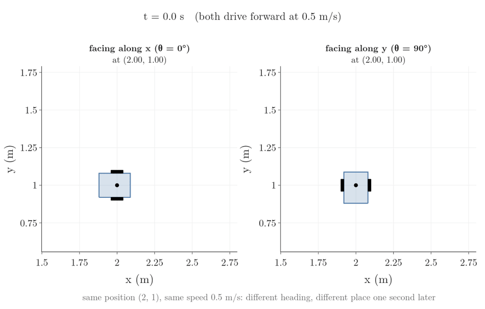

<!-- where-this-fits: generated by course_map/build_map.py; edit concepts.yaml, not this block -->
> **Where this fits:**
>
> - **Builds on:** [Derivatives of one variable](../../../../MA/06-calculus/MA-061-derivatives-of-one-variable/MA-061-derivatives-of-one-variable.md#4-the-derivative-shrinking-the-step-to-zero).
> - **Leads to:** [State, controls and measurements](../../../../RO/localization/02-bayes-filters/RO-007-why-a-robot-is-never-sure/RO-007-why-a-robot-is-never-sure.md#4-the-state-what-the-robot-keeps-track-of); [Uncertainty in robotics](../../../../RO/localization/02-bayes-filters/RO-007-why-a-robot-is-never-sure/RO-007-why-a-robot-is-never-sure.md#2-why-a-robot-is-never-sure); [Probabilistic motion models](../../../../RO/localization/02-bayes-filters/RO-008-probabilistic-motion-models/RO-008-probabilistic-motion-models.md#22-the-motion-model-and-its-density); [Maps and landmarks](../../../../RO/localization/02-bayes-filters/RO-009-maps-and-landmarks/RO-009-maps-and-landmarks.md#21-what-a-map-is-for); [Configuration space](../../../../RO/navigation/04-graph-search-and-configuration-space/RO-036-configuration-space/RO-036-configuration-space.md#22-the-configuration-space-of-the-floor-robot); [Dubins and Reeds-Shepp paths](../../../../RO/navigation/06-grid-sampling-and-car-like-planning/RO-054-planning-with-motion-limits/RO-054-planning-with-motion-limits.md#7-the-shortest-drivable-paths-dubins-and-reeds-shepp-curves); [Kinodynamic planning and phase space](../../../../RO/navigation/06-grid-sampling-and-car-like-planning/RO-054-planning-with-motion-limits/RO-054-planning-with-motion-limits.md#23-kinodynamic-planning); [Motion primitives and lattice search](../../../../RO/navigation/06-grid-sampling-and-car-like-planning/RO-054-planning-with-motion-limits/RO-054-planning-with-motion-limits.md#5-a-few-motions-to-build-with-motion-primitives-and-a-system-simulator); [Reachable sets](../../../../RO/navigation/06-grid-sampling-and-car-like-planning/RO-054-planning-with-motion-limits/RO-054-planning-with-motion-limits.md#4-where-the-robot-can-get-to-reachable-sets); [Driving to a point](../../../../RO/control/08-path-tracking/RO-069-driving-to-a-point-a-line-and-a-pose/RO-069-driving-to-a-point-a-line-and-a-pose.md#21-aim-at-the-dock-and-slow-down-near-it); [Kinematic bicycle model](../../../../RO/control/08-path-tracking/RO-070-path-following-and-tracking-errors/RO-070-path-following-and-tracking-errors.md#22-the-bicycle-models-equations); [Feedback linearisation (offset point)](../../../../RO/control/08-path-tracking/RO-073-tracking-a-timed-trajectory/RO-073-tracking-a-timed-trajectory.md#32-a-point-ahead-of-the-axle-can-move-any-way).
<!-- /where-this-fits -->

## 1. Overview

> **Key point:** A robot can only set its wheel speeds, but every task is stated in places: "go to the door". A model of the robot's motion connects the two, so that we can predict where wheel commands take the robot and choose the commands that reach a goal.


The only thing a wheeled robot can do so far is spin its motors, say the right wheel at 12 rad/s and the left at 8 rad/s, and nothing yet tells us where that takes it. Everything we want from it is about places: drive to the door, stay in the lane, park in the corner. So we need a model that answers two questions, one in each direction:

1. **Prediction:** if the wheels spin at 12 and 8 rad/s, where does the robot of Figure 1 go?
2. **Control:** to bear left towards the door at 0.3 m/s, turning at 0.5 rad/s, at what speeds should the wheels spin?

Figure 1 shows the robot from above: it stands 2 m along the x-axis and 1 m along the y-axis of a floor grid, and faces 30° to the left of the x-axis. Like most indoor robots, it has two driven wheels.

Both questions need a precise way to say where the robot is, and a rule linking wheel speeds to changes in that position. In this Note we build both for that robot:

- three numbers that say where the robot is, together called its pose, and why position alone is not enough ([Section 2](#2-pose-where-the-robot-is));
- why a rolling wheel's spin tells us its speed over the floor ([Section 3](#3-the-differential-drive-robot));
- the link from the two wheel speeds to how fast the robot drives forward and turns, derived from one fact about turning bodies, and the link back ([Section 4](#4-from-wheel-speeds-to-robot-speeds-and-back));
- how those speeds move the robot over the floor, and how to predict its path step by step ([Section 5](#5-from-robot-speeds-to-motion-on-the-floor));
- why the robot cannot slide sideways, and why it can still reach every **pose** (G-2280) ([Section 6](#6-the-robot-cannot-slide-sideways)).

Cars and trailers follow the same model with stricter limits; the car-like robots Note later in this chapter covers them.

## 2. Pose: where the robot is

> **Key point:** Both opening questions first need a way to say where the robot is, and position alone does not tell us where it will go next: we also need the direction it faces. Position $(x, y)$ plus **heading** (G-2284) $\theta$, measured in an agreed frame, is the **pose** (G-2280).

### 2.1 Why we need a frame

"The robot is at (2, 1)" means nothing until we say measured from where, and along which directions. Figure 2 shows the problem: measured from the corner of the room, A, a robot is at (2, 1); measured from the corner of a rug, B, the same robot is at (1, 0.5).


So we first agree on a reference: a corner of the room as the origin, with an x-axis along one wall and a y-axis along the other. Such a choice of origin and axes is a **coordinate frame** (G-2281). The frame fixed to the room is the **world frame** (G-2282); every position in this Note is measured in it.

### 2.2 Why position is not enough: the heading

Take two robots at the same spot, (2, 1), both driving forward at 0.5 m/s for one second. One faces along the x-axis, the other along the y-axis:

| Robot faces | Where it is after 1 s |
|---|---|
| along x | (2.5, 1) |
| along y | (2, 1.5) |

Figure 3 plays the two runs side by side. Watch the two robots leave the same spot at the same speed: after one second they stand in different places, because they face different ways.



To predict motion we must also record the direction the robot faces, its **heading** (G-2284): the angle $\theta$ from the world x-axis to the robot's forward direction.

Angles are measured counter-clockwise, so a robot facing along y has $\theta = 90^\circ$.

Together, position and heading are the robot's **pose** (G-2280). For the robot in Figure 1:

- $x$ is its position along the world x-axis, 2 m;
- $y$ is its position along the world y-axis, 1 m;
- $\theta$ is its heading, 30°.

### 2.3 Why angles are measured in radians

> **Key point:** In radians, the arc travelled by a point turning about a centre is simply radius times angle, with no conversion factor; every formula in this Note relies on that.

The heading is an angle, and when the robot turns, its wheels travel along arcs. So we will often need this: a point at distance $d$ from a centre turns by some angle; how far does it travel along its arc? A full turn travels the whole circumference, $2\pi d$, and a part of a turn travels the same part of the circumference.

Try it in degrees, with $d = 0.5$ m and a turn of 30°. Thirty degrees is one twelfth of a full turn:

$$\text{arc} = \frac{30}{360} \times 2\pi \times 0.5$$

$$= 0.262 \text{ m}$$

Multiplying the radius by the angle in degrees gives nonsense:

$$0.5 \times 30 = 15 \text{ m}$$

Degrees need the extra factor $2\pi / 360$ every time. So we measure angles in a unit that already contains it: the **radian** (G-2285), where a full turn is $2\pi$ radians. Then 30° is:

$$30 \times \frac{2\pi}{360} = 0.524 \text{ rad}$$

and the arc is radius times angle, with nothing else. With our numbers:

- $d$ is the point's distance from the centre, 0.5 m;
- $\Delta\theta$ is the angle it turns, 0.524 rad (30°);
- arc is the distance it travels along its circle, in m.

$$\text{arc} = d \times \Delta\theta$$

$$0.5 \times 0.524 = 0.262 \text{ m}$$

Figure 4 shows where the radian comes from. Bend a piece of string as long as the radius onto the circle: the angle it covers is one radian, about 57.3°. Keep laying radius-long pieces round the rim, and a full turn takes 6.283 of them, which is why a full turn is $2\pi$ radians.


This arc rule is the reason all of these work in radians:

- the wheel formula ([Section 3](#3-the-differential-drive-robot));
- the turning formulas ([Section 4](#4-from-wheel-speeds-to-robot-speeds-and-back));
- the cosine and sine functions of Python's `numpy`.

## 3. The differential-drive robot

> **Key point:** The prediction question starts at the wheels: two motorised wheels on one axle are enough to drive anywhere and even to spin on the spot. If a wheel **rolls without slipping** (G-2290), its speed over the floor is its radius times its spin rate, so 12 rad/s gives 0.6 m/s.

### 3.1 Why two wheels and a caster

A **differential-drive** (G-2288) robot has two driven wheels on a common axle, each turned by its own motor. The differential drive is the most common way to drive an indoor robot (LaValle §13.1.2.2), because two motors are enough for everything: driving, turning and spinning on the spot ([Section 4.4](#44-four-ways-to-drive)). Two wheels on one axle would tip over, so a third, free-swivelling **caster wheel** (G-2289), like the wheel under an office chair, holds the robot up without steering it (LaValle §13.1.2.2).

There is no steering wheel. The robot turns only through the **difference** between its two wheel speeds, and that is where the name "differential" comes from.


The robot's position $(x, y)$ is the midpoint of the axle, the black dot in Figure 5. The figure also shows the only two measurements the model needs, with the values we use throughout. Both can be measured with a ruler:

- $r$ is the wheel radius, 0.05 m;
- $L$ is the wheel separation, the distance between the two wheels, 0.2 m.

### 3.2 Why wheel spin gives ground speed: rolling without slipping

> **Key point:** A wheel that does not skid lays its rim down on the floor as it turns, so it moves forward by exactly the length of rim it turns.

A motor tells us how fast the wheel spins, in **radians** (G-2285) per second. What we need is how fast the robot moves over the floor, in metres per second. The link is the wheel's grip.

A wheel **rolls without slipping** (G-2290) when the point touching the floor does not skid. Each bit of rim that comes down touches the floor once and stays put while touching. So the wheel moves forward by exactly the length of rim it has turned (Figure 6). One full turn lays down the whole circumference, with the wheel radius $r$, 0.05 m:

$$\text{circumference} = 2\pi \times r$$

$$= 6.283 \times 0.05$$

$$= 0.314 \text{ m}$$


A part of a turn lays down the same part of the rim, which is the arc rule of [Section 2.3](#23-why-angles-are-measured-in-radians): radius times angle. So a wheel moves over the floor at its radius times its spin rate. For one wheel:

- $u$ is its spin rate, in rad/s;
- $r$ is its radius, 0.05 m;
- $v_{\text{wheel}}$ is its speed over the floor, in m/s.

$$v_{\text{wheel}} = r\ u$$

For our two wheels:

- $u_R$ is the right wheel's spin rate, 12 rad/s;
- $u_L$ is the left wheel's spin rate, 8 rad/s;
- $v_R$ is the right wheel's speed over the floor, in m/s;
- $v_L$ is the left wheel's speed over the floor, in m/s.

$$v_R = 0.05 \times 12 = 0.6 \text{ m/s}$$

$$v_L = 0.05 \times 8 = 0.4 \text{ m/s}$$

> **Extra:** Real wheels slip a little, more on smooth floors and in fast turns. The formula then overestimates the distance moved, and a robot that tracks its position by counting wheel turns slowly drifts away from the truth. Later Notes on motion models and wheel odometry deal with that error.

The two wheel speeds, 0.6 and 0.4 m/s, do not yet say how the whole robot moves; [Section 4](#4-from-wheel-speeds-to-robot-speeds-and-back) turns them into the robot's own motion.

## 4. From wheel speeds to robot speeds and back

> **Key point:** The prediction question continues: the right and left wheel speeds, 0.6 and 0.4 m/s, give how fast the robot drives forward, their average (0.5 m/s), and how fast it turns, their difference divided by the wheel separation (1 rad/s). Both follow from one fact, that a turning rigid body circles a single point, and run backwards the same formulas answer the control question.

### 4.1 Why we describe motion by linear and angular velocity

Wheel speeds are what the motors take, but they are an awkward way to think. Asked how to drive to the door, nobody says "right wheel 0.35 m/s, left wheel 0.25 m/s"; we say "not too fast, and bear left". So we describe the motion of the whole robot with two numbers that match that way of thinking (Figure 7):

- how fast the midpoint between the wheels moves along the **heading** (G-2284), the direction the robot faces, in metres per second: its **linear velocity** (G-2291) $v$;
- how fast the heading $\theta$ changes, in **radians** (G-2285) per second, positive to the left: its **angular velocity** (G-2292) $\omega$ (omega).


A controller decides $v$ and $\omega$; this section finds the formulas that convert them to wheel speeds and back.

### 4.2 Why the robot turns about a point on its axle line

> **Key point:** Each wheel can only move straight ahead, square to the axle. The only centre the whole body can turn about that allows this lies on the axle line.

When a rigid body turns, every point of it moves on a circle around one centre, and its velocity at each moment points square to the line from that centre. Our two wheels must move straight ahead, because they cannot slide sideways ([Section 6](#6-the-robot-cannot-slide-sideways)). Straight ahead is square to the axle. So the line from the centre to each wheel must be the axle line itself: the centre lies somewhere on the line through the axle.

That centre, the point the whole robot turns about at this moment, is the **instantaneous centre of curvature** (ICC) (G-2529); "instantaneous" because it moves whenever the wheel speeds change. Its distance from the robot's midpoint is the **turning radius** (G-2293) $R$.

Figure 8 plays one second of our robot's turn, with wheel speeds 0.6 and 0.4 m/s. Watch the axle line swing about the ICC: the right wheel, the midpoint and the left wheel all turn by the same angle, and the one farther out covers the longer arc.


The whole body turns by the same angle in each second, the **angular velocity** (G-2292) $\omega$, in rad/s. By the arc rule of [Section 2.3](#23-why-angles-are-measured-in-radians), a point at distance $d$ from the centre then travels $\omega$ times $d$ metres per second. Points farther out move faster (Figure 8):

$$\text{speed} = \omega \times \text{distance}$$

For a left turn, the right wheel sits half the wheel separation, 0.1 m, farther out than the midpoint, and the left wheel 0.1 m closer in. For our robot:

- $\omega$ is the angular velocity, the angle the whole body turns per second, in rad/s;
- $R$ is the turning radius, the midpoint's distance from the ICC, in m;
- $L$ is the wheel separation, 0.2 m;
- $v_R$ is the right wheel's speed over the floor, 0.6 m/s;
- $v_L$ is the left wheel's speed over the floor, 0.4 m/s;
- $v$ is the midpoint's speed, the **linear velocity** (G-2291), in m/s.

Each wheel's line with our numbers first, then in symbols:

$$0.6 = \omega \thinspace(R + 0.1)$$

$$v_R = \omega \thinspace(R + L/2)$$

$$0.4 = \omega \thinspace(R - 0.1)$$

$$v_L = \omega \thinspace(R - L/2)$$

$$v = \omega \thinspace R$$

### 4.3 Wheel speeds to linear and angular velocity

> **Key point:** Subtracting the two wheel equations isolates the angular velocity $\omega$; adding them isolates the linear velocity $v$.

The symbols are the ones listed in [Section 4.2](#42-why-the-robot-turns-about-a-point-on-its-axle-line): the wheel speeds $v_R$ and $v_L$, the wheel separation $L$, the **turning radius** (G-2293) $R$, the **linear velocity** (G-2291) $v$ and the **angular velocity** (G-2292) $\omega$.

Subtract the left-wheel line of Section 4.2 from the right-wheel line, then add the two; our numbers first, each followed by the same step in symbols:

$$0.6 - 0.4 = \omega\thinspace(R + 0.1) - \omega\thinspace(R - 0.1)$$

$$v_R - v_L = \omega\thinspace(R + L/2) - \omega\thinspace(R - L/2)$$

$$0.2 = 0.2\thinspace\omega$$

$$v_R - v_L = \omega\thinspace L$$

$$\omega = 0.2 / 0.2 = 1 \text{ rad/s}$$

$$\omega = \frac{v_R - v_L}{L}$$

$$0.6 + 0.4 = \omega\thinspace(R + 0.1) + \omega\thinspace(R - 0.1)$$

$$v_R + v_L = \omega\thinspace(R + L/2) + \omega\thinspace(R - L/2)$$

$$1.0 = 2\thinspace\omega\thinspace R$$

$$v_R + v_L = 2\thinspace\omega\thinspace R$$

$$1.0 = 2\thinspace v$$

$$v_R + v_L = 2\thinspace v$$

$$v = 1.0 / 2 = 0.5 \text{ m/s}$$

$$v = \frac{v_R + v_L}{2}$$

$$R = 0.5 / 1 = 0.5 \text{ m}$$

$$R = v / \omega$$

The midpoint moves at the average speed of the wheels because it sits halfway between them. The formula for $\omega$ says why a wide robot turns more lazily: the same speed difference has to swing a longer axle. With a speed difference of 0.2 m/s:

| Wheel separation $L$ | Angular velocity $\omega$ |
|---|---|
| 0.2 m | 1 rad/s |
| 0.4 m | 0.5 rad/s |

Going from the wheel speeds to the robot's motion is the **forward kinematics** (G-2294) of the robot. The forward kinematics answers half of the prediction question of [Section 1](#1-overview); [Section 5](#5-from-robot-speeds-to-motion-on-the-floor) finishes it.

### 4.4 Four ways to drive

> **Key point:** Equal wheel speeds drive straight, opposite speeds spin on the spot, one stopped wheel pivots about that wheel, and anything else drives on a circle.

The two formulas predict four kinds of motion. Figure 9 plays each one for two seconds; the green dot is the ICC.


| Wheel speeds $v_R$, $v_L$ (m/s) | Linear velocity $v$ (m/s) | Angular velocity $\omega$ (rad/s) | Turning radius $R$ (m) | Motion |
|---|---|---|---|---|
| 0.5, 0.5 | 0.5 | 0 | none | straight line |
| 0.2, −0.2 | 0 | 2 | 0 | spin on the spot |
| 0.4, 0 | 0.2 | 2 | 0.1 | pivot about the left wheel |
| 0.6, 0.4 | 0.5 | 1 | 0.5 | circle to the left |

Why each happens:

- **Straight line.** Equal speeds have no difference, so $\omega = 0$: nothing turns the **heading** (G-2284). The ICC is infinitely far away.
- **Spin on the spot.** Opposite speeds add up to zero, so $v = 0$: the midpoint stays put while the heading turns.
- **Pivot.** A stopped wheel does not move, so it must be the ICC itself; the table confirms a **turning radius** (G-2293) of 0.1 m, exactly half the wheel separation.

The spin on the spot is what makes the **differential drive** (G-2288) so easy to steer: it can face any direction first and then drive straight (LaValle §13.1.2.2). A car cannot, as the car-like robots Note later in this chapter shows.

### 4.5 Back again: the wheel speeds for a wanted motion

> **Key point:** To drive with **linear velocity** (G-2291) $v$ and **angular velocity** (G-2292) $\omega$, run the right wheel faster than $v$ and the left wheel slower, each by $\omega$ times half the wheel separation $L$.

The control question of [Section 1](#1-overview) goes the other way: the controller has chosen $v$ and $\omega$ and must send wheel commands. Going from $v$ and $\omega$ to the wheel speeds is the **inverse kinematics** (G-2295) of the robot. Solve the two formulas of [Section 4.3](#43-wheel-speeds-to-linear-and-angular-velocity) for the wheel speeds. For the control question:

- $v$ is the wanted linear velocity, 0.3 m/s;
- $\omega$ is the wanted angular velocity, 0.5 rad/s;
- $L$ is the wheel separation, 0.2 m;
- $v_R$ is the right wheel's speed over the floor, in m/s;
- $v_L$ is the left wheel's speed over the floor, in m/s.

$$v_R = v + \omega L/2$$

$$v_L = v - \omega L/2$$

Each wheel runs at the midpoint's speed, plus or minus the extra speed it needs for being half an axle farther out or closer in. Then divide by the wheel radius to get the spin rates for the motors.

**Worked example.** We want 0.3 m/s while bearing left at 0.5 rad/s. The extra speed for half an axle:

$$\omega L/2 = 0.5 \times 0.1 = 0.05 \text{ m/s}$$

The wheel speeds:

$$v_R = 0.3 + 0.05 = 0.35 \text{ m/s}$$

$$v_L = 0.3 - 0.05 = 0.25 \text{ m/s}$$

The spin rates $u_R$ and $u_L$ of the right and left wheels, with the wheel radius 0.05 m:

$$u_R = 0.35 / 0.05 = 7 \text{ rad/s}$$

$$u_L = 0.25 / 0.05 = 5 \text{ rad/s}$$

Figure 10 shows why the two wheels differ. The wanted motion is a circle of radius 0.6 m (the **turning radius** (G-2293), $v$ divided by $\omega$); the right wheel runs on the outside of it and must cover more ground in the same time than the left wheel on the inside.


As a check, feeding 7 and 5 rad/s back into the **forward kinematics** (G-2294) of [Section 4.3](#43-wheel-speeds-to-linear-and-angular-velocity) must return 0.3 m/s and 0.5 rad/s, and it does (the Python box below).

> **Python:** both directions in four lines.
> ```python
> r, L = 0.05, 0.2               # wheel radius, wheel separation (m)
> def forward(uR, uL):           # spin rates (rad/s) -> v (m/s), omega (rad/s)
>     return r * (uR + uL) / 2, r * (uR - uL) / L
> def inverse(v, omega):         # v, omega -> spin rates (rad/s)
>     return (v + omega * L / 2) / r, (v - omega * L / 2) / r
> inverse(0.3, 0.5)              # about (7.0, 5.0)
> forward(7, 5)                  # about (0.3, 0.5): back where we started
> ```

The formulas now link wheel speeds and $v$, $\omega$ in both directions, and the control question has its answer: spin the right wheel at 7 rad/s and the left at 5 rad/s. Still open: where 0.5 m/s and 1 rad/s take the robot over the floor.

## 5. From robot speeds to motion on the floor

> **Key point:** This section finishes the prediction question, where 0.5 m/s and 1 rad/s take the robot over the floor: the robot moves the way it faces, its **heading** (G-2284) $\theta$, so its forward speed $v$ splits into an x part and a y part. Because the heading keeps changing, we predict the path in many small steps.

### 5.1 Why the speed splits into cosine and sine parts

The robot knows its **linear velocity** (G-2291), but the map needs to know how fast $x$ and $y$ change. The robot moves in the direction it faces, so the share of its speed that goes into $x$ and into $y$ depends on the **heading** (G-2284). The two extremes are easy:

- facing along x ($\theta = 0^\circ$): all of the speed goes into $x$, none into $y$;
- facing along y ($\theta = 90^\circ$): all of it goes into $y$, none into $x$.

In between, the speed is shared. Draw the velocity as an arrow of length $v$ at angle $\theta$ (Figure 11). The arrow is the long side of a right-angled triangle whose two short sides are the x speed and the y speed.


The cosine and sine of an angle are defined as exactly these shares of the long side:

- $\cos\theta$ is the side along x divided by the long side;
- $\sin\theta$ is the side along y divided by the long side.

So the x speed is $v$ times $\cos\theta$, and the y speed is $v$ times $\sin\theta$. The extremes check out:

| Heading $\theta$ | $\cos\theta$ | $\sin\theta$ | Speed goes |
|---|---|---|---|
| 0° | 1 | 0 | all along x |
| 90° | 0 | 1 | all along y |

**Worked example.** For the robot of Figure 1:

- $v$ is its linear velocity, 0.5 m/s;
- $\theta$ is its heading, 30°;
- $\cos 30^\circ$ is 0.866, the share of the speed along x;
- $\sin 30^\circ$ is 0.5, the share along y.

$$\text{x speed} = v \cos\theta$$

$$= 0.5 \times 0.866 = 0.433 \text{ m/s}$$

$$\text{y speed} = v \sin\theta$$

$$= 0.5 \times 0.5 = 0.25 \text{ m/s}$$

### 5.2 The kinematic model

> **Key point:** Three equations give how fast each number of the **pose** (G-2280) changes, from the two inputs: the linear velocity $v$ and the angular velocity $\omega$.

We need a short way to write "how fast this changes". A dot over a symbol means its rate of change per second, the [**derivative**](../../../../MA/06-calculus/MA-061-derivatives-of-one-variable/MA-061-derivatives-of-one-variable.md#41-from-secant-to-tangent) (G-595) with respect to time (G-2296). For example, $\dot{x} = 0.433$ m/s means $x$ grows by 0.433 m each second.

The x speed and y speed of [Section 5.1](#51-why-the-speed-splits-into-cosine-and-sine-parts) are $\dot{x}$ and $\dot{y}$. The **heading** (G-2284) changes at the angular velocity, by the definition of $\omega$ in [Section 4.1](#41-why-we-describe-motion-by-linear-and-angular-velocity). Together, for the robot of Figure 1 at the start:

- $\dot{x}$ is how fast its x position changes, 0.433 m/s;
- $\dot{y}$ is how fast its y position changes, 0.25 m/s;
- $\dot{\theta}$ is how fast its heading changes, in rad/s;
- $v$ is its linear velocity, 0.5 m/s;
- $\theta$ is its heading, 30°;
- $\omega$ is its angular velocity, 1 rad/s.

$$\dot{x} = v \cos\theta$$

$$\dot{y} = v \sin\theta$$

$$\dot{\theta} = \omega$$

These three equations are the **kinematic model** (G-2297) of the **differential-drive** (G-2288) robot (LaValle §13.1.2.2; MR §13.3.1). "Kinematic" means it uses speeds only, not masses or forces. Leaving out masses and forces is safe while the robot moves slowly, because then the wheels follow their commands closely; at high speed, skidding and inertia matter and a dynamic model is needed (LaValle §13.1.2.1). The two numbers we choose, the pair $u = (v, \omega)$, here (0.5 m/s, 1 rad/s), are the **control inputs** (G-2298). The wheel spin rates $u_R$ and $u_L$ of [Section 3.2](#32-why-wheel-spin-gives-ground-speed-rolling-without-slipping) share the letter because they are the same kind of thing one level down: the commands the motors receive.

A sanity check at $\theta = 0$, where $\cos\theta = 1$ and $\sin\theta = 0$:

$$\dot{x} = v \times 1 = v$$

$$\dot{y} = v \times 0 = 0$$

The robot drives straight along x, as it should.

### 5.3 Why we predict the path step by step

> **Key point:** The direction of motion changes as the **heading** (G-2284) turns, so we cannot just multiply speed by time. Over a short step the heading hardly changes, so we treat it as fixed, move, and repeat.

Speed times time gives distance only if the direction stays the same. Here the heading turns at 1 rad/s, so the direction of motion changes all the time. But over a short time step $\Delta t$ the heading changes only a little, so we can treat the rates as fixed during the step and add them up. One such step is an **Euler step** (G-2299). Here $x$, $y$ and $\theta$ are the pose at the start of the step, and $\dot{x}$, $\dot{y}$ and $\dot{\theta}$ their rates from [Section 5.2](#52-the-kinematic-model). The new symbols:

- $\Delta t$ is the length of one step, 0.1 s in the worked example below;
- $x_{\text{new}}$ is $x$ after the step, in m;
- $y_{\text{new}}$ is $y$ after the step, in m;
- $\theta_{\text{new}}$ is $\theta$ after the step, in rad.

$$x_{\text{new}} = x + \dot{x}\thinspace\Delta t$$

$$y_{\text{new}} = y + \dot{y}\thinspace\Delta t$$

$$\theta_{\text{new}} = \theta + \dot{\theta}\thinspace\Delta t$$

**Worked example.** Start at the **pose** (G-2280) of Figure 1, with its heading of 30° written in radians as 0.5236, keep $v = 0.5$ m/s and $\omega = 1$ rad/s, and take steps of $\Delta t = 0.1$ s. The first step:

$$x_{\text{new}} = 2 + 0.433 \times 0.1 = 2.0433$$

$$y_{\text{new}} = 1 + 0.25 \times 0.1 = 1.0250$$

$$\theta_{\text{new}} = 0.5236 + 1 \times 0.1 = 0.6236$$

The heading has changed, so the next step uses new rates:

| Step | $x$ (m) | $y$ (m) | $\theta$ (rad) | $\dot{x}$ (m/s) | $\dot{y}$ (m/s) |
|---|---|---|---|---|---|
| 0 | 2.0000 | 1.0000 | 0.5236 | 0.4330 | 0.2500 |
| 1 | 2.0433 | 1.0250 | 0.6236 | 0.4059 | 0.2920 |
| 2 | 2.0839 | 1.0542 | 0.7236 | 0.3747 | 0.3310 |

Figure 12 keeps going. The path bends left, and after about 6.3 s (63 steps) it closes a circle of radius 0.5 m, the **turning radius** (G-2293) of [Section 4.3](#43-wheel-speeds-to-linear-and-angular-velocity). So the prediction question of [Section 1](#1-overview) has its answer: right and left wheels at 12 and 8 rad/s drive the robot of Figure 1 round a circle of radius 0.5 m to the left.


The prediction is not perfect. Each step moves along a straight line in the direction the robot faced at the start of the step, while the true robot curves. So the predicted path drifts from the true circle (the dashed line in Figure 12). The smaller the step, the less the heading changes within it, and the smaller the drift. The largest gap between the predicted and the true position during one lap:

| Step $\Delta t$ | Largest gap |
|---|---|
| 1 s | 51 cm |
| 0.5 s | 25 cm |
| 0.1 s | 5 cm |
| 0.01 s | 0.5 cm |

The gap shrinks in step with $\Delta t$: a step ten times smaller gives a gap ten times smaller. The notebook `RO-001-pose-and-differential-drive.ipynb` reproduces this table and lets us try other wheel speeds. Every step of Figure 12 moves along the heading, never sideways; [Section 6](#6-the-robot-cannot-slide-sideways) asks whether that limits where the robot can go.

## 6. The robot cannot slide sideways

> **Key point:** One last check on the control question: can wheel commands reach every place, even one straight to the side? Rolling wheels forbid sideways motion, which limits which way the robot can move at each moment but not which **poses** (G-2280) it can reach; some moves just need manoeuvres.

Why does this deserve a section? Many route planners assume a robot can move in any direction from where it stands. A route that needs a step sideways cannot be followed by our robot or by a car, so those planners cannot be used as they are (MR §13.3.3). So we need to know exactly what the rule forbids, and what it does not.

### 6.1 The rule: no sideways motion

A wheel rolls along its own direction but grips against sliding sideways (LaValle §13.1.2.1). So the robot's midpoint can move forward or backward, never along its own left–right axis. In words: **the robot's velocity has no part pointing to its left**.

The **kinematic model** (G-2297) of [Section 5.2](#52-the-kinematic-model) already obeys this rule. Its x speed and y speed are the linear velocity split along the **heading** (G-2284) ([Section 5.1](#51-why-the-speed-splits-into-cosine-and-sine-parts)), so the velocity always points the way the robot faces. Its two inputs are "drive forward" ($v$) and "turn" ($\omega$); "slide sideways" is not among them. So the robot has two inputs for the three numbers of its **pose** (G-2280): at each moment it can move forward or back and turn, but one direction of motion, sideways, is missing.

### 6.2 Can the robot still get everywhere?

> **Key point:** Not sliding sideways limits which way the robot can move *right now*, not where it can *end up*. A limit like that is called nonholonomic.

The robot cannot move to its left. Can it still get to a spot 0.5 m to its left? Yes, with three legal moves (Figure 13, which starts the robot at the origin, facing along x):

1. Spin 90° to the left on the spot.
2. Drive 0.5 m forward.
3. Spin 90° back to the right.


The robot ends 0.5 m to the left, facing the same way. The same trick reaches any **pose** (G-2280): turn to face the spot, drive straight to it, then turn to the wanted heading. A car does the same when it parallel parks into a space it cannot drive into sideways (LaValle §13.1.2.1).

Compare a toy train on a circular track of radius 5 m (Figure 14). Its limit is on where it can be: whatever it does, it stays on the circle of radius 5 m. Measured from the centre of the track:

- $x$ is the train's position along the x-axis, in m;
- $y$ is its position along the y-axis, in m.

Every point the train can be at satisfies:

$$x^2 + y^2 = 25$$


In Figure 14, the train on the left can only be on its circle. The robot on the right cannot move along the red dashed arrow, sideways, but it can drive and turn (green arrows), and so it reaches any of the orange example places.

These two kinds of limit have names (MR §2.4):

- a **holonomic constraint** (G-2301) limits where a system can be, like the train's track;
- a **nonholonomic constraint** (G-2302) limits only which way it can move at each moment, and every place stays reachable, like the robot's wheels.

| | Holonomic | Nonholonomic |
|---|---|---|
| Limits | where it can be | which way it can move right now |
| Example | train on a track | wheel that cannot slide sideways |
| Reachable poses | only those on the track | all of them |

So wheel commands reach every pose, which completes the control question of [Section 1](#1-overview).

## 7. Summary

| Robot | Pose | Inputs | So it can |
|---|---|---|---|
| Differential drive | position $(x, y)$ and heading $\theta$ | linear velocity $v$ and angular velocity $\omega$, from two wheel speeds | spin on the spot, then drive straight |

- Both opening questions have answers: right and left wheels at 12 and 8 rad/s give 0.5 m/s and 1 rad/s, so the robot of Figure 1 drives a circle of radius 0.5 m to the left; to drive at 0.3 m/s while turning left at 0.5 rad/s, the right wheel spins at 7 rad/s and the left at 5 rad/s. Both come from the same two formulas, so the model works in both directions.
- The **pose** (G-2280) $(x, y, \theta)$, position and heading, says where a floor robot is, because position alone does not say which way it will drive off.
- Angles are in **radians** (G-2285), so the arc of a point turning about a centre is radius times angle, with no conversion factor.
- A wheel that **rolls without slipping** (G-2290) moves at its radius $r$ times its spin rate, because it lays its rim down on the floor.
- The **linear velocity** (G-2291) is the average of the wheel speeds and the angular velocity is their difference over the wheel separation $L$, because the rigid robot turns about one point on its axle line, the ICC, and each point's speed is **angular velocity** (G-2292) times distance.
- Controllers think in linear and angular velocity, $v$ and $\omega$, and the inverse formulas turn those into wheel commands, so the controller never has to reason in wheel speeds.
- The **kinematic model** (G-2297) gives the rates of the pose's three numbers $x$, $y$ and $\theta$; the **heading** (G-2284) keeps turning, so we predict the path in small Euler steps, and smaller steps drift less.
- The wheels forbid sideways motion, a **nonholonomic constraint** (G-2302): it removes one direction of motion at each moment but no reachable pose, so the robot gets anywhere with manoeuvres such as spin–drive–spin or parallel parking.

The robot can now predict where wheel commands take it and choose the commands for a wanted motion. Still missing: the prediction assumes wheels that never slip, and real wheels slip, so the robot is [never sure where it is](../../../localization/02-bayes-filters/RO-007-why-a-robot-is-never-sure/RO-007-why-a-robot-is-never-sure.md#1-overview).

## 8. Sources

**Built from**

- Duckietown, "11 - Modeling of a differential drive robot", YouTube, https://www.youtube.com/watch?v=XG4cODYVbJk
- Northwestern Robotics, "Modern Robotics, Chapter 13.3.1: Modeling of Nonholonomic Wheeled Mobile Robots", YouTube, https://www.youtube.com/watch?v=fPHVhlRFFCk
- Georgia Institute of Technology, "Control of Mobile Robots, 2.2 Differential Drive Robots", YouTube (re-upload of the Coursera course), https://www.youtube.com/watch?v=aE7RQNhwnPQ
- Carlotta A. Berry, PhD, "Advanced Mobile Robotics: Lecture 1-2b - Forward Kinematics w\ Instantaneous Center of Curvature", YouTube, https://www.youtube.com/watch?v=zx5n6wrl38U
- NPTEL - Indian Institute of Science, Bengaluru, "lec38 Wheeled Mobile Robots (WMR) on Flat Terrain", YouTube, https://www.youtube.com/watch?v=EqcY9Q0qbDs
- LaValle, S. M. (2006). *Planning Algorithms*. Cambridge University Press. §13.1.2.1 "A simple car", §13.1.2.2 "A differential drive". Free online: https://lavalle.pl/planning/node657.html (LaValle)
- Lynch, K. M. and Park, F. C. (2017). *Modern Robotics: Mechanics, Planning, and Control*. Cambridge University Press. §2.4 holonomic and nonholonomic constraints, §13.3.1 the canonical nonholonomic model, §13.3.3 Dubins and Reeds-Shepp paths. Free preprint: http://modernrobotics.org (MR)

**Other references**

- Northwestern Robotics, "Modern Robotics, Chapter 13.3.3: Motion Planning for Nonholonomic Mobile Robots", YouTube, https://www.youtube.com/watch?v=jOesC0wKpTQ

## 9. Key terms

Terms taught in this Note come first; linked terms are recaps, taught in the Note the link opens.

| Term | Meaning |
|---|---|
| Pose (G-2280) | Where a robot is and which way it faces: on a floor, its position $(x, y)$ and heading $\theta$, such as (2 m, 1 m, 30°); needed because a robot at one spot drives off differently depending on its heading. |
| Heading $\theta$ (G-2284) | The angle from the world x-axis to the direction a robot faces, measured counter-clockwise; it decides which way the robot moves when it drives forward. |
| Coordinate frame (G-2281) | A chosen origin and set of axes used to give positions as numbers; every position or pose is stated relative to some frame. |
| World frame (G-2282) | The coordinate frame fixed to the surroundings (for example a corner of the room), in which the robot's pose is given. |
| Radian (G-2285) | The unit of angle at which the arc of a circle is as long as its radius; a full turn is $2\pi$ rad, and with radians an arc is simply radius times angle. |
| Rolling without slipping (G-2290) | A wheel moving so that its contact point does not skid: it moves forward by its radius times the angle it turns and never slides sideways, which is what lets wheel turns predict motion. |
| Differential drive (G-2288) | A robot with two independently driven wheels on one axle (plus a caster); it steers by running the wheels at different speeds and can spin on the spot. |
| Caster wheel (G-2289) | A free-swivelling, undriven wheel, like the one under an office chair; it supports a robot without steering it. |
| Linear velocity $v$ (G-2291) | How fast a robot's reference point (for a differential drive, the middle of the axle) moves along its heading, in m/s; for a differential drive, the average of the two wheel speeds, so it sets how fast the robot advances. |
| Angular velocity $\omega$ (G-2292) | How fast a robot's heading changes, in rad/s, positive to the left; for a differential drive, the difference of the wheel speeds divided by the wheel separation. |
| Instantaneous centre of curvature (ICC) (G-2529) | The point a turning robot's whole body circles at a given moment; for a differential drive it lies on the axle line at distance $R = v/\omega$ from the midpoint, so it fixes how fast each wheel must move. |
| Turning radius $R$ (G-2293) | The distance from the point a robot is turning about (the instantaneous centre of curvature, ICC) to the robot's reference point; $R = v / \omega$, so it says how tight a turn is. |
| Forward kinematics (wheeled robot) (G-2294) | Working out the robot's linear and angular velocity from its wheel speeds, used to predict where the robot goes. |
| Inverse kinematics (wheeled robot) (G-2295) | Working out the wheel speeds that give a wanted linear and angular velocity, used by a controller to command the motors. |
| Dot notation $\dot{x}$ (G-2296) | A dot over a quantity means its rate of change per second (its derivative with respect to time), such as $\dot{x} = 0.433$ m/s; models of motion are written with it. |
| Kinematic model (G-2297) | Equations that give how a robot's configuration changes from its speed inputs alone, ignoring masses and forces, such as $\dot{x} = v\cos\theta$, $\dot{y} = v\sin\theta$, $\dot{\theta} = \omega$; used to predict motion at low speed. |
| Control input $u$ (G-2298) | The numbers we choose to drive a robot, such as $u = (v, \omega)$; the model turns them into motion. |
| Euler step (G-2299) | One step of predicting motion: hold the rates fixed for a short time $\Delta t$ and add rate times $\Delta t$ to each quantity; repeated, it traces a path, more accurately the smaller $\Delta t$ is. |
| Holonomic constraint (G-2301) | An equation on a robot's pose, such as a train on a circular track $x^2 + y^2 = 25$, or a velocity rule that follows from one; it removes whole poses the system can never be in. |
| Nonholonomic constraint (G-2302) | A rule on velocities that does not follow from any equation on the pose, such as a wheel that cannot slide sideways; it limits which way a robot can move at each moment but not which poses it can reach. |
| [Derivative](../../../../MA/06-calculus/MA-061-derivatives-of-one-variable/MA-061-derivatives-of-one-variable.md#41-from-secant-to-tangent) (G-595) | The slope of a function at a point: how fast the output changes as the input changes there. It is zero at the lowest point of a smooth curve, which is how training finds a minimum. |
