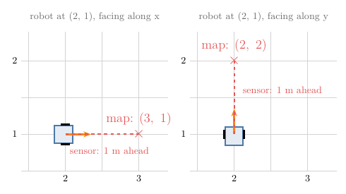
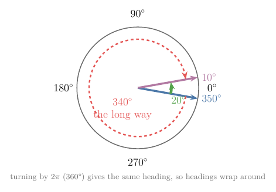

# Draft for the coordinate frames Note (moved from RO-001, 2026-10-10)

RO-001 keeps only what it needs; this text, the body frame and heading wrap-around, was cut from it and belongs in this Note. Figure and section numbers are RO-001's and must be renumbered when this Note is built. Figures: images/sensor_to_map, images/heading_wrap.

## Glossary rows to restore (IDs kept)

| G-2283 | Body frame | A coordinate frame attached to the robot, with its x-axis pointing forward and its y-axis to the left; it moves and turns with the robot, so things can be described from the robot's point of view. | [Note RO-001](RO/control/01-robot-models/RO-001-pose-and-differential-drive/RO-001-pose-and-differential-drive.md#23-why-the-robot-also-has-its-own-frame) | Pose |

### 2.4 Why the robot also has its own frame

A robot's sensors see the world from the robot's point of view: a distance sensor reports "an obstacle 1 m straight ahead", not a position on the room's map. To mark that obstacle on the map, we need to know where the robot is and which way it faces:

| Robot pose | "1 m straight ahead" is at |
|---|---|
| (2, 1), facing along x | (3, 1) |
| (2, 1), facing along y | (2, 2) |

Figure 5 draws both cases: the reading is the same, the map point is not.

So the robot carries a frame of its own, the **body frame** (G-2283): origin at the middle point between its two wheels, x-axis pointing forward, y-axis pointing to its left (Figure 1). It moves and turns with the robot. The pose says exactly where the body frame sits inside the world frame, and that is what lets us move any measurement between the two. A later Note in this chapter, on coordinate frames, does those conversions in general.

### Heading wrap-around (from RO-001 §2.5; RO-012 already teaches angle wrapping, so link there rather than re-teach)

- $\theta$ wraps around, because turning by a full $2\pi$ brings the robot back to the same heading. So the headings 350° and 10° are only 20° apart, not 340°. A program that subtracts headings without allowing for the wrap-around turns the robot the long way round (Figure 7). In the box of Figure 6, this means the top face and the bottom face are the same headings.

