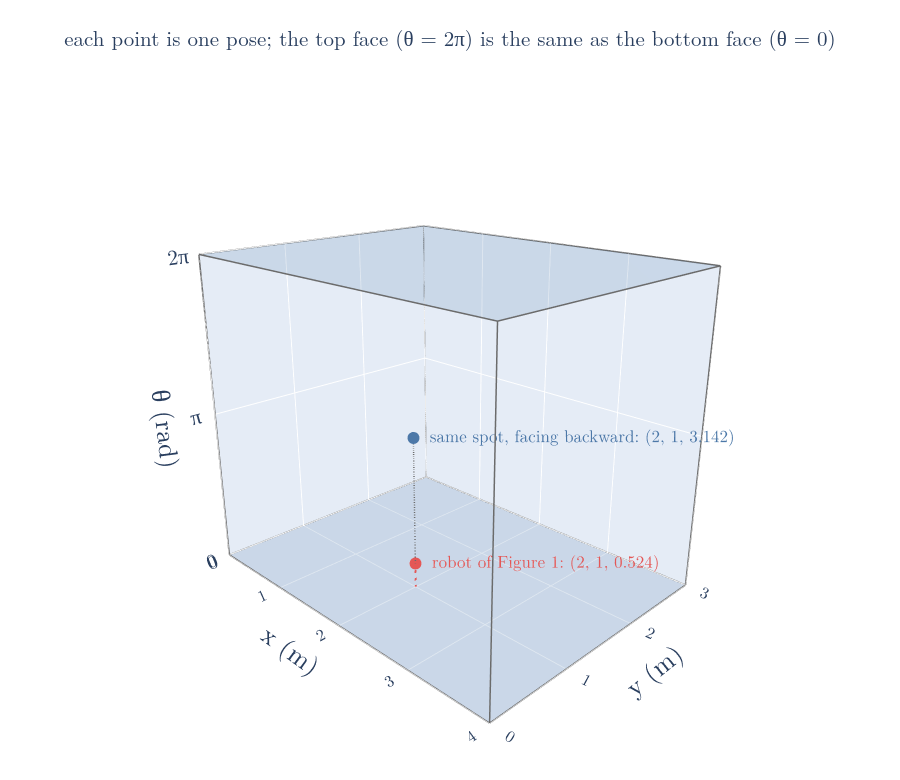

# Draft for the kinematic chains Note (moved from RO-001, 2026-10-10)

RO-001 keeps only what it needs; this text, configuration, degrees of freedom and configuration space, was cut from it and belongs in this Note. Figure and section numbers are RO-001's and must be renumbered when this Note is built. Figures: images/cspace (cspace.py imports robotdraw.py from RO-001 images/).

**2026-10-11:** configuration (G-2286), degrees of freedom (G-2310) and configuration space (G-2287) are now taught and owned by [RO-036](../../../navigation/04-graph-search-and-configuration-space/RO-036-configuration-space/RO-036-configuration-space.md#2-configuration-and-configuration-space); this Note recaps them in one line and links there. The rows below are kept for history only.

## Glossary rows to restore (IDs kept)

| G-2286 | Configuration | The list of numbers that pins down where every part of a robot is, such as $q = (x, y, \theta)$ for a floor robot; planning and models work with it as one vector. | [Note RO-001](RO/control/01-robot-models/RO-001-pose-and-differential-drive/RO-001-pose-and-differential-drive.md#82-configuration-space) | Pose |
| G-2310 | Degrees of freedom | The number of values in a robot's configuration, such as 3 for a floor robot $(x, y, \theta)$: how many independent ways it can be placed. | [Note RO-001](RO/control/01-robot-models/RO-001-pose-and-differential-drive/RO-001-pose-and-differential-drive.md#22-why-position-is-not-enough-the-heading) | Pose |
| G-2287 | Configuration space (C-space) | The set of all possible configurations of a robot; for a floor robot, any $(x, y)$ with a heading on a circle. | [Note RO-001](RO/control/01-robot-models/RO-001-pose-and-differential-drive/RO-001-pose-and-differential-drive.md#82-configuration-space) | Pose |

### 2.5 Configuration and configuration space

> **Key point:** The configuration is the full list of numbers that places the robot; all its possible values form a space, and later planning Notes search that space for paths.

A **configuration** (G-2286) is a list of numbers that pins down where every point of a robot is (MR Definition 2.1). Our robot is rigid, so its pose is enough: knowing where the middle of the axle is and which way the robot faces fixes every other point of the body. We write it as one vector $q$ (a list of numbers):

$$q = (x,\ y,\ \theta)$$

$$q = (2,\ 1,\ 0.524)$$

The smallest number of values that does this is the robot's **degrees of freedom** (G-2310): 3 for a robot on a floor. Two values would not be enough, as the table in Section 2.2 shows.

All possible configurations together form the **configuration space** (G-2287), or C-space (MR Definition 2.1). It gets a name because later Notes plan routes by searching it: every point of the C-space is one placement of the whole robot, and a route is a path through it. Figure 6 draws the C-space of our robot as a box: the floor across, the heading upward. The robot of Figure 1 is one point in it. Turning the same robot around on the spot moves it to a different point straight above, because the pose has changed even though the position has not.

Two things about its shape matter:

- $x$ and $y$ can be any real numbers (any spot on an endless floor);
- $\theta$ wraps around, because turning by a full $2\pi$ brings the robot back to the same heading. So the headings 350° and 10° are only 20° apart, not 340°. A program that subtracts headings without allowing for the wrap-around turns the robot the long way round (Figure 7). In the box of Figure 6, this means the top face and the bottom face are the same headings.

