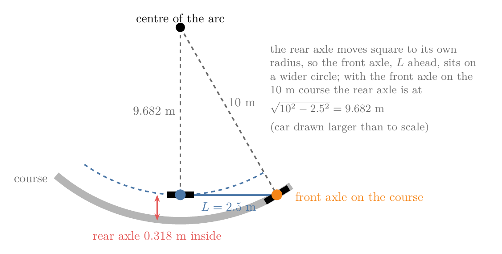

<!-- where-this-fits: generated by course_map/build_map.py; edit concepts.yaml, not this block -->
> **Where this fits:**
>
> - **Builds on:** [Feedforward plus feedback](../../../../RO/control/07-classical-feedback-control/RO-066-feedforward-cascades-and-windup/RO-066-feedforward-cascades-and-windup.md#22-feedforward-from-the-robots-model); [Kinematic bicycle model](../../../../RO/control/08-path-tracking/RO-070-path-following-and-tracking-errors/RO-070-path-following-and-tracking-errors.md#22-the-bicycle-models-equations); [Lateral and heading error](../../../../RO/control/08-path-tracking/RO-070-path-following-and-tracking-errors/RO-070-path-following-and-tracking-errors.md#42-lateral-error); [Pure pursuit](../../../../RO/control/08-path-tracking/RO-071-pure-pursuit/RO-071-pure-pursuit.md#41-find-the-point-steer-drive-repeat); [Stanley controller](../../../../RO/control/08-path-tracking/RO-072-stanley-and-rear-wheel-feedback/RO-072-stanley-and-rear-wheel-feedback.md#22-the-heading-term-and-the-cross-track-term).
<!-- /where-this-fits -->

## 1. Overview

> **Key point:** A curve needs a steering angle of its own, the arctangent of the wheelbase times the path's curvature (14.04° on our 10 m arc), and sent before any error appears it removes the 0.38 m that steering from the errors alone keeps outside the arc. Measured with one ruler, the RMS and peak lateral error and the steering travel at the rear axle, the chapter's four trackers rank differently at 2 m/s and at 5 m/s with a lagging steering motor, so the choice depends on the speed, the path and the steering.

The room robot of RO-073 [keeps to a timetable](../RO-073-tracking-a-timed-trajectory/RO-073-tracking-a-timed-trajectory.md#5-kanayamas-tracker) by sending the plan's own speeds as feedforward and correcting the rest with feedback. The chapter's car can follow its course in four ways. RO-070's [line rule](../RO-070-path-following-and-tracking-errors/RO-070-path-following-and-tracking-errors.md#51-why-a-tracker-needs-both-errors) turns the car from its [**lateral error**](../RO-070-path-following-and-tracking-errors/RO-070-path-following-and-tracking-errors.md#42-lateral-error) (G-3135), how far it is to the side of the path, and its [**heading error**](../RO-070-path-following-and-tracking-errors/RO-070-path-following-and-tracking-errors.md#43-heading-error) (G-3136), its heading minus the path's. [**Pure pursuit**](../RO-071-pure-pursuit/RO-071-pure-pursuit.md#41-find-the-point-steer-drive-repeat) (G-3150) steers along an arc to a point 4 m ahead. The [**Stanley controller**](../RO-072-stanley-and-rear-wheel-feedback/RO-072-stanley-and-rear-wheel-feedback.md#22-the-heading-term-and-the-cross-track-term) (G-3160) steers the front wheels from the front axle's errors, and [**rear-wheel feedback**](../RO-072-stanley-and-rear-wheel-feedback/RO-072-stanley-and-rear-wheel-feedback.md#52-three-parts-of-a-turn-rate) (G-3162) adds the path's own turn to feedback on both errors. Two things still break on the chapter's course (10 m straight, a 90° left arc of radius 10 m, 10 m straight) with the car starting 1.0 m to the left at 2 m/s:

- **Steering from the errors alone sits outside the arc.** The line rule gets onto the line within 7.7 m, then slides out on the arc and ends it 0.384 m outside (Figure 1, red; notebook). Driving faster makes it worse: 0.994 m outside at 5 m/s.
- **The four trackers have never been measured with one ruler.** Pure pursuit runs 0.12 m inside at the arc's entry, Stanley's front axle is on the line while its rear axle runs 0.32 m inside, and rear-wheel feedback is 0.000 m off in the arc's middle; each was measured at its own point, from its own start. So we cannot yet say which one the car should use at 2 m/s, at 5 m/s, or on a tighter curve.

Every run in this Note is our own Python model of the trackers on this car (the notebook `RO-074-feedforward-metrics-and-choosing-a-tracker.ipynb`, with RO-071's simulator), not the code of a real car; Section 6 reads the real code.

This Note adds the missing steering and the ruler:

- the steering a curve needs, worked out from the car's geometry, and what sending it before any error does ([Section 2](#2-feedforward-steering-the-turn-the-curve-needs));
- three numbers for a whole run, measured at the same point of every car ([Section 3](#3-tracker-metrics-one-ruler-for-every-tracker));
- the four trackers raced on the course at 2 m/s, at 5 m/s with a lagging steering motor and on a tighter arc, and what each costs to tune ([Section 4](#4-comparing-the-trackers));
- how to choose among them ([Section 5](#5-choosing-a-tracker));
- where the feedforward steering runs in Apollo and Autoware ([Section 6](#6-where-feedforward-steering-runs-apollo-and-autoware)).

## 2. Feedforward steering: the turn the curve needs

> **Key point:** A steering rule that acts only on errors must keep an error to steer round a curve: 0.38 m outside our 10 m arc for the line rule. The curve's own steering, the arctangent of the wheelbase times the path's curvature, 14.04° here, can be sent before any error appears; added to the feedback, it leaves the car 0.001 m off at the arc's middle.

### 2.1 Steering from the errors alone sits outside the arc

The first problem of the Overview is the line rule's 0.384 m outside the arc. The line rule sets the car's turn rate from its two errors:

- $\omega$ is the turn rate the rule asks for, in rad/s;
- $e$ is the lateral error at the rear axle, in m, positive to the left;
- $\theta_e$ is the heading error, the car's heading minus the path's, in rad;
- $K_D$ is the lateral gain, 0.5 rad/s per m;
- $K_H$ is the heading gain, 2 per s.

$$\omega = -K_D\thinspace e - K_H\thinspace\theta_e$$

The [**kinematic bicycle model**](../RO-070-path-following-and-tracking-errors/RO-070-path-following-and-tracking-errors.md#22-the-bicycle-models-equations) (G-3128) turns the turn rate into a [**steering angle**](../RO-070-path-following-and-tracking-errors/RO-070-path-following-and-tracking-errors.md#21-steering-angle-and-wheelbase) (G-3126), the angle of the front wheels from the car's heading. With $v$ the speed, 2 m/s, and $L$ the [**wheelbase**](../RO-070-path-following-and-tracking-errors/RO-070-path-following-and-tracking-errors.md#21-steering-angle-and-wheelbase) (G-3127), the distance between the axles, 2.5 m:

$$\tan\delta = L\thinspace\omega / v$$

On a straight path both errors can be zero and the rule asks for no turn. On the arc the car must turn, and the rule can only turn it through an error. To drive round the arc at 2 m/s the car must turn at its speed times the [**path curvature**](../RO-070-path-following-and-tracking-errors/RO-070-path-following-and-tracking-errors.md#23-path-curvature) (G-3129) $\kappa$, 1 divided by the radius, 0.1 per m. Once settled the heading error is about zero, so the turn must come from the lateral error alone, as [RO-070 found on the arc](../RO-070-path-following-and-tracking-errors/RO-070-path-following-and-tracking-errors.md#53-measuring-a-run-peak-error-steady-error-and-settling-distance):

$$-0.5\thinspace e = 2 \times 0.1$$

$$-K_D\thinspace e = v\thinspace\kappa$$

$$e = -0.2 / 0.5 = -0.4 \text{ m}$$

$$e = -v\thinspace\kappa / K_D$$

The car settles about 0.4 m outside the arc, where its error is just large enough to supply the turn. The run reaches 0.384 m, a little less, because outside the arc the course turns under the car a little more slowly than 0.2 rad/s (see [measuring a run](../RO-070-path-following-and-tracking-errors/RO-070-path-following-and-tracking-errors.md#53-measuring-a-run-peak-error-steady-error-and-settling-distance)).

RO-070's run gives 0.388 m because it moves the car in straight 0.01 s steps, which drift slightly outward on a curve; this Note's notebook moves the car along exact arcs, and gives 0.388 m too when it takes straight steps.

The 0.4 m is the [**steady-state error**](../../07-classical-feedback-control/RO-061-step-response-and-second-order-systems/RO-061-step-response-and-second-order-systems.md#21-reading-the-four-numbers) (G-2985) of a proportional rule under a steady load, the same kind of lag as [RO-066's speed loop](../../07-classical-feedback-control/RO-066-feedforward-cascades-and-windup/RO-066-feedforward-cascades-and-windup.md#21-why-feedback-alone-trails-the-plan), which had to fall behind before it pushed. The last line also says why speed makes it worse: at 5 m/s the arc needs 0.5 rad/s, and the same gain needs about 1.0 m of error to give it; the run swings out as far as 0.994 m. With feedback only, "the states will not all converge to zero while the vehicle is following a constant curvature path" (Snider §4.3). The missing piece is the turn the curve itself needs.

### 2.2 The steering the curve needs

How much steering does the 10 m arc need, with the car exactly on it? Figure 2 draws the car on the arc. The car turns about a point on its rear axle's line, the centre of the arc; the rear axle is 10 m from it. The front wheel must roll square to the line from that centre, so the angle between the car's axis and the front wheel equals the angle at the centre between the two lines.

The symbols:

- $R$ is the arc's radius at the rear axle, 10 m;
- $\kappa$ is the path curvature, 1 divided by $R$, 0.1 per m;
- $L$ is the wheelbase, 2.5 m;
- $\delta_{\text{ff}}$ is the steering the curve needs, in degrees.

In the right triangle of Figure 2, the bicycle model's [turning-circle triangle](../RO-070-path-following-and-tracking-errors/RO-070-path-following-and-tracking-errors.md#21-steering-angle-and-wheelbase), the side opposite the angle at the centre is the wheelbase and the side next to it is the radius:

$$\tan\delta_{\text{ff}} = 2.5 / 10 = 0.25$$

$$\tan\delta_{\text{ff}} = L / R = L\thinspace\kappa$$

$$\delta_{\text{ff}} = \tan^{-1}(0.25) = 14.04^\circ$$

$$\delta_{\text{ff}} = \tan^{-1}(L\thinspace\kappa)$$

This steering, worked out from the path's curvature and sent before any error appears, is **feedforward steering** (G-3186) (Boyali et al. 2018, eq. 33; Snider §4.3), the [**feedforward**](../../07-classical-feedback-control/RO-066-feedforward-cascades-and-windup/RO-066-feedforward-cascades-and-windup.md#22-feedforward-from-the-robots-model) (G-3070) of RO-066 applied to steering. The same number comes from the turn rate: the arc needs 0.2 rad/s at 2 m/s, and the bicycle model turns that into a steering angle:

$$\tan\delta = 2.5 \times 0.2 / 2 = 0.25$$

$$\tan\delta = L\thinspace v\thinspace\kappa / v = L\thinspace\kappa$$

The speed cancels: the steering a curve needs depends only on the car and the curve, not on how fast the car drives, as long as the tyres do not slip sideways (the [kinematic model is enough here](../RO-070-path-following-and-tracking-errors/RO-070-path-following-and-tracking-errors.md#24-why-the-kinematic-model-is-enough-here)). Section 2.3 adds this steering to the line rule.

### 2.3 Feedforward plus feedback

Now give the line rule the curve's turn as well. With $\kappa$ the curvature at the path point nearest the rear axle, 0 on the straights and 0.1 per m on the arc, and the other symbols as listed in [Section 2.1](#21-steering-from-the-errors-alone-sits-outside-the-arc) (speed $v$ 2 m/s, gains $K_D$ 0.5 rad/s per m and $K_H$ 2 per s):

$$\omega = v\thinspace\kappa - K_D\thinspace e - K_H\thinspace\theta_e$$

On the arc with no error, the rule asks for 0.2 rad/s, which is the steering of Section 2.2, 14.04°. Figure 1 (purple) runs it from the same start: the error at the arc's middle falls from −0.354 m to +0.001 m, and the run's RMS lateral error from 0.351 m to 0.265 m (notebook). The feedback is unchanged; it now corrects only the start and what the curvature term does not foresee. The two parts share the work as in [Kanayama's tracker](../RO-073-tracking-a-timed-trajectory/RO-073-tracking-a-timed-trajectory.md#53-why-both-parts-are-needed): feedforward drives the plan, feedback removes the error the plan leaves.

Feedforward has limits of its own. Feedforward steering needs the path's curvature at every point, so the path must be smooth enough to have one (Boyali et al. 2018 compute it from the path or from the steering a driver used; Paden Table II). And it reacts only to the curvature where the car is, with no look ahead, so where the curvature jumps, at the arc's ends, the steering jumps only once the car is there and the car overshoots a little (Snider §4.3.1: "the feed forward term can only be reactive"). The other trackers of the chapter carry a curvature term of their own.

### 2.4 The curvature term inside the trackers

The chapter's trackers already carry the curve's steering, each in its own way (notebook, middle of the arc at 2 m/s, starting on the line):

- **Rear-wheel feedback** sends the path's turn as its curvature part: 0.2 rad/s on the arc, while its two feedback parts are below 0.0003 rad/s; the steering is 14.02° (see [rear-wheel feedback's three parts](../RO-072-stanley-and-rear-wheel-feedback/RO-072-stanley-and-rear-wheel-feedback.md#52-three-parts-of-a-turn-rate)). The line rule is rear-wheel feedback at 2 m/s without that part and with half its lateral gain (see [rear-wheel feedback's three parts](../RO-072-stanley-and-rear-wheel-feedback/RO-072-stanley-and-rear-wheel-feedback.md#52-three-parts-of-a-turn-rate)).
- **Stanley** gets the curve from its heading term: the course turns under the front axle, so the heading error there supplies 13.77° of steering at the arc's middle while the cross-track term supplies 0.04°, and 14.5° once settled (see [Stanley on the arc](../RO-072-stanley-and-rear-wheel-feedback/RO-072-stanley-and-rear-wheel-feedback.md#33-on-the-arc-the-front-axle-stays-on-it-the-rear-axle-cuts-inside)).
- **Pure pursuit** gets it from its look-ahead point: on the arc the point lies on the arc, and the arc through it has the arc's curvature (see [the look-ahead on the chapter's car](../RO-071-pure-pursuit/RO-071-pure-pursuit.md#51-short-or-long-on-the-chapters-car)); the steering is 14.68°.

The difference is where each holds the car: rear-wheel feedback and the line rule with feedforward hold the rear axle on the arc, Stanley holds the front axle, and pure pursuit cuts a little inside. Comparing them needs one ruler, measured at one point.

## 3. Tracker metrics: one ruler for every tracker

> **Key point:** One run is summed up by three numbers measured at the rear axle of every car: the RMS lateral error, the typical size of the error over the whole run; the peak lateral error, the worst moment; and the steering travel, how far the steering wheel is turned back and forth in total. Stanley's front axle on the line puts its rear axle 0.318 m inside the arc, so the point of the car must be the same for all.

### 3.1 Three numbers for a run

The Overview's second problem is that the four trackers were each measured their own way. RO-070 [summed up a run](../RO-070-path-following-and-tracking-errors/RO-070-path-following-and-tracking-errors.md#53-measuring-a-run-peak-error-steady-error-and-settling-distance) by its largest error, its steady error on the arc and the distance it took to settle. Those three numbers suit one car on one course; to rank trackers, a review of lateral controllers measures the error over a whole run (it adds up the error's size; we take the RMS, which counts large errors more), the worst error, and how much the steering moves (Artuñedo et al. 2024, §5.1.3 and §6). Figure 3 reads the three numbers this Note uses off one finished run, pure pursuit at 2 m/s starting on the line.

- **RMS lateral error** (G-3187): the square root of the average squared lateral error over the run, the [root mean squared error](../../../../ML/06-regression/ML-051-regression-metrics/ML-051-regression-metrics.md#4-root-mean-squared-error-rmse) (G-1705) applied to the lateral error. The RMS says how far off the car typically is, in metres, and squaring makes large errors count more than small ones. For pure pursuit it is 0.086 m.
- **Peak lateral error** (G-3188): the largest size of the lateral error during the run, the review's "maximum lateral error" (Artuñedo et al. 2024, §6.1). The peak says how close the car came to leaving its lane: 0.167 m for pure pursuit, just after the arc.
- **Steering effort** (G-3189): how much the steering works. We measure it as the steering travel, every change of the steering command added up, in degrees. Holding 14° round a bend costs only the turn in and out, while weaving adds every swing, so the travel grows with the swinging that the review measures as oscillation of the control action. Pure pursuit's travel is 30°: up to 14.7° and back.

The RMS value, with the symbols:

- $e_i$ is the lateral error at step $i$, one value every 0.01 s;
- $n$ is the number of steps in the run, 1783 for this run;
- $e_{\text{RMS}}$ is the RMS lateral error, in m.

$$e_{\text{RMS}} = \sqrt{\frac{1}{n}\sum_{i=1}^{n} e_i^2}$$

A check at easy values: an error that stays at 0.1 m all run has an RMS of 0.1 m. An error of 0.1 m for half the run and 0 for the other half has an average size of 0.05 m, and an RMS of:

$$\sqrt{(0.1^2 + 0^2) / 2} = \sqrt{0.005}$$

$$= 0.071 \text{ m}$$

The RMS is more than the average size because squaring weights the bad half.

Each number answers a different question, so we quote all three: a car that holds 0.01 m but swings its steering through 200° is accurate but uncomfortable; one with a small RMS can still touch the kerb once. All three also depend on the point of the car they are measured at.

### 3.2 The same point of every car

Stanley measures its errors at the front axle, the other trackers at the rear axle. On a curve the two axles do not run on the same circle (Figure 4): with the front axle on the 10 m arc, the rear axle, which moves square to its own radius, is on a smaller circle.

The rear axle's radius and the wheelbase are the two short sides of a right triangle whose long side is the front axle's radius, as worked out for [Stanley on the arc](../RO-072-stanley-and-rear-wheel-feedback/RO-072-stanley-and-rear-wheel-feedback.md#33-on-the-arc-the-front-axle-stays-on-it-the-rear-axle-cuts-inside): with the front axle on the 10 m arc, the rear axle is 9.682 m from the centre. So a Stanley car whose front axle is exactly on the arc has its rear axle 0.318 m inside it, by geometry alone. Measured at its own front axle, Stanley's run on the course at 2 m/s has an RMS of 0.003 m and a peak of 0.005 m; at the rear axle, 0.189 m and 0.316 m (notebook). Neither is wrong; they describe different points. We measure every tracker at the rear axle, the car's position in the bicycle model and the point the other three hold on the path, so the numbers compare the same thing.

## 4. Comparing the trackers

> **Key point:** On the chapter's car at 2 m/s the two trackers with a curvature term stay within 0.007 m of the course, pure pursuit cuts the corners by up to 0.167 m and Stanley's rear axle runs 0.316 m inside. At 5 m/s with steering that lags 0.4 s, the order changes: pure pursuit has the smallest RMS, 0.080 m, while rear-wheel feedback weaves, with 203° of steering travel.

### 4.1 The chapter's car at 2 m/s

Now the ruler of Section 3 is applied to all four trackers on the course, with the gains of the earlier Notes: pure pursuit with a 4 m look-ahead, Stanley with gain 1 per s and softening speed 1 m/s, rear-wheel feedback with heading gain 1.0 per m and lateral gain 0.5 per m², and the line rule with the curve's turn. Every car starts on the line, so that every error comes from the curve and the speed, not from the 1.0 m start; how fast each gets onto the line from the start is the subject of RO-071 and RO-072, and the notebook repeats it. Figure 5 races them; watch the lateral errors in the middle panel and the steering below.

| Tracker | RMS lateral error | Peak lateral error | Steering travel |
|---|---|---|---|
| Pure pursuit | 0.086 m | 0.167 m | 30° |
| Stanley | 0.189 m | 0.316 m | 29° |
| Rear-wheel feedback | 0.002 m | 0.007 m | 34° |
| Line rule plus the curve's turn | 0.003 m | 0.007 m | 33° |

What the race shows, and why:

- **The two trackers with a curvature term hold the line**, 0.007 m at worst, because the curve's steering arrives as the arc begins (the steps in their steering at 10 m and 25.7 m in Figure 5).
- **Pure pursuit cuts the corners**: its steering starts rising about 4 m before the arc, as the look-ahead point reaches it, so the car turns early and runs up to 0.164 m inside at the entry and 0.167 m wide at the exit (see [the look-ahead on the chapter's car](../RO-071-pure-pursuit/RO-071-pure-pursuit.md#51-short-or-long-on-the-chapters-car)).
- **Stanley's rear axle runs inside the arc** by nearly the 0.318 m of Section 3.2, while its front axle stays within 0.005 m of the line.

The steering travel is close for all four, 29° to 34°, because each turns the wheels once into the arc and once out. Without the curvature term, the line rule alone has an RMS of 0.234 m and a peak of 0.384 m (notebook). All this is on a car whose wheels steer the moment they are told; speed tests that.

### 4.2 Speed: 5 m/s and a steering motor that lags

On the chapter's car the speed changes almost nothing: at 5 m/s every tracker's RMS and peak are within 0.006 m of its numbers at 2 m/s (notebook). Without tyre slip or steering delay, pure pursuit, Stanley and rear-wheel feedback turn each metre of the course into the same path at any speed (see [the look-ahead on the chapter's car](../RO-071-pure-pursuit/RO-071-pure-pursuit.md#51-short-or-long-on-the-chapters-car) and [why rear-wheel feedback converges](../RO-072-stanley-and-rear-wheel-feedback/RO-072-stanley-and-rear-wheel-feedback.md#53-why-it-converges-a-spring-and-a-damper-over-distance)). The line rule alone is the exception: its steady error, the speed times the curvature over the gain, grows from 0.4 m to 1.0 m.

A real steering motor takes time. RO-071 gave the car [a steering motor that lags](../RO-071-pure-pursuit/RO-071-pure-pursuit.md#52-a-real-steering-motor-the-short-look-ahead-weaves): its wheels follow the command with a lag of 0.4 s, the model of Stanford's car (Hoffmann et al. 2007). In 0.4 s the car drives 0.8 m at 2 m/s but 2 m at 5 m/s, so at speed the wheels answer the trackers late. Figure 6 races the four trackers again at 5 m/s with that lag.

| Tracker, 5 m/s, steering lag 0.4 s | RMS lateral error | Peak lateral error | Steering travel |
|---|---|---|---|
| Pure pursuit | 0.080 m | 0.180 m | 50° |
| Stanley | 0.170 m | 0.312 m | 55° |
| Rear-wheel feedback | 0.235 m | 0.595 m | 203° |
| Line rule plus the curve's turn | 0.203 m | 0.414 m | 75° |

The order has changed. The two trackers that were best at 2 m/s act hardest on the errors at the rear axle, and with the wheels answering late they overshoot and swing back: rear-wheel feedback turns its steering through 203°, almost seven times the 29° it needs at 5 m/s without the lag. Pure pursuit, which looks 4 m ahead, now has the smallest RMS. The lag hurts less at 2 m/s, where the same trackers have RMS errors of 0.042, 0.177, 0.028 and 0.033 m, but rear-wheel feedback's steering travel already nearly triples, from 34° to 96° (notebook). Snider saw the same on a simulated car with tyres: the simple trackers' errors in curves grow with speed, and a tracker tuned with high gains for one course may meet "instability on other paths" (Snider §6). The curve's tightness is the third test.

### 4.3 Curvature: a tighter arc

To see what the curvature does, we tighten the course's arc to a radius of 6 m and keep the straights; the course is otherwise the same, so the change in the numbers is the curve's. The steering the arc needs grows to:

$$\tan^{-1}(2.5 / 6) = 22.62^\circ$$

which is most of the car's 26.57° (notebook). At 2 m/s on the chapter's car:

| Tracker, 6 m arc, 2 m/s | RMS lateral error | Peak lateral error | Steering travel |
|---|---|---|---|
| Pure pursuit | 0.144 m | 0.280 m | 48° |
| Stanley | 0.227 m | 0.513 m | 48° |
| Rear-wheel feedback | 0.003 m | 0.011 m | 53° |
| Line rule plus the curve's turn | 0.004 m | 0.012 m | 53° |

Pure pursuit cuts the tighter corner more (peak 0.280 m against 0.167 m), and Stanley's rear axle runs further inside, because the gap of [Section 3.2](#32-the-same-point-of-every-car) grows as the circle shrinks. With the front axle on the 6 m arc, the same right triangle gives the rear axle's radius $R_r$ and the gap:

$$R_r = \sqrt{6^2 - 2.5^2} = 5.454 \text{ m}$$

$$6 - 5.454 = 0.546 \text{ m}$$

The trackers with a curvature term stay within 0.012 m. A gotcha: the feedforward alone takes 22.6° of the 26.6° the car has, so only 4° are left for the feedback to correct an error on this arc; on a curve tighter than the car's 5 m circle no tracker can hold the line. What remains is how much work each tracker's settings take.

### 4.4 Tuning effort

Each tracker has its own settings, and they depend on the speed and the steering differently:

- **Pure pursuit** has one setting, the [**look-ahead distance**](../RO-071-pure-pursuit/RO-071-pure-pursuit.md#5-choosing-the-look-ahead-distance) (G-3151). Pure pursuit needs no curvature, but the right look-ahead depends on the speed when the steering lags, so real stacks set it from the speed (see [a look-ahead that grows with speed](../RO-071-pure-pursuit/RO-071-pure-pursuit.md#6-a-look-ahead-that-grows-with-speed)) and add limits to it.
- **Stanley** has a gain and a softening speed. Its front-axle error shrinks at a similar rate at any speed (see [Stanley at 2 and 5 m/s](../RO-072-stanley-and-rear-wheel-feedback/RO-072-stanley-and-rear-wheel-feedback.md#32-at-2-and-5-ms)), and a steering lag puts an upper limit on the gain (see [Stanley's gain](../RO-072-stanley-and-rear-wheel-feedback/RO-072-stanley-and-rear-wheel-feedback.md#41-the-gain)).
- **Rear-wheel feedback** has two gains, scaled by the speed so that it behaves the same per metre at any speed (see [why rear-wheel feedback converges](../RO-072-stanley-and-rear-wheel-feedback/RO-072-stanley-and-rear-wheel-feedback.md#53-why-it-converges-a-spring-and-a-damper-over-distance)), but it needs the path's curvature, from a path smooth enough to have one (Paden Table II). With the steering lag at 5 m/s its gains must come down: halving the heading gain and quartering the lateral gain cuts its RMS from 0.235 to 0.171 m and its steering travel from 203° to 90° (notebook).
- **The line rule plus the curve's turn** has two gains in units of time, so its behaviour changes with speed, as the next lines show.

On a straight, for small errors, the line rule's lateral error $e$ obeys a [**second-order system**](../../07-classical-feedback-control/RO-061-step-response-and-second-order-systems/RO-061-step-response-and-second-order-systems.md#51-natural-frequency-and-damping-ratio) (G-2990) equation ([the model in path coordinates](../RO-070-path-following-and-tracking-errors/RO-070-path-following-and-tracking-errors.md#44-how-the-errors-change-the-model-in-path-coordinates): the lateral error changes at the speed times the heading error, and the heading error at the turn rate minus the path's). A dot is the rate per second and two dots the rate of that rate; $K_H$ is the heading gain, 2 per s, $K_D$ the lateral gain, 0.5 rad/s per m, and $v$ the speed:

$$\ddot e + K_H\thinspace\dot e + v\thinspace K_D\thinspace e = 0$$

The [**damping ratio**](../../07-classical-feedback-control/RO-061-step-response-and-second-order-systems/RO-061-step-response-and-second-order-systems.md#51-natural-frequency-and-damping-ratio) (G-2992), the damping compared with the damping that just stops a swing, is then the heading gain over twice the square root of the speed times the lateral gain. At 2 m/s:

$$\zeta = 2 / (2\sqrt{2 \times 0.5})$$

$$= 1$$

At 5 m/s:

$$\zeta = 2 / (2\sqrt{5 \times 0.5})$$

$$= 0.632$$

$$\zeta = K_H / (2\sqrt{v\thinspace K_D})$$

The same gains that are critically damped at 2 m/s swing past at 5 m/s. Rear-wheel feedback avoids this by multiplying its gains by the speed, the reason Paden's survey writes its gains that way (Paden §V.A.2).

So the tuning effort is not the number of settings but how often they must change. Pure pursuit needs a new look-ahead when the speed changes and the steering lags, the line rule new gains whenever the speed changes; rear-wheel feedback and Stanley keep theirs until the steering lags.

## 5. Choosing a tracker

> **Key point:** No tracker wins everywhere (Snider §6). Pick by the speed, the path and the steering, then measure the three numbers on your own car and course before trusting the choice.

The race of Section 4 and Snider's comparison on a simulated car with tyres point the same way:

1. **A slow robot on a rough or jagged path, with few settings to tune: pure pursuit.** Pure pursuit needs no curvature, copes with "large errors and discontinuous paths" (Snider §6), and at 5 m/s with a lagging motor had the smallest RMS here. Pure pursuit cuts corners and swings wide after them: up to 0.167 m off on our arc and 0.280 m on the tighter one. Nav2 runs [regulated pure pursuit on indoor robots](../RO-071-pure-pursuit/RO-071-pure-pursuit.md#8-where-pure-pursuit-runs-nav2-and-autoware).
2. **A car on smooth lanes with known curvature: feedforward from the curvature plus feedback.** Rear-wheel feedback and the line rule with the curve's turn held 0.007 m on the 10 m arc and 0.012 m on the 6 m arc at 2 m/s; Snider calls the LQR tracker with a feedforward term "a great choice for highway driving and many urban driving scenarios" (Snider §6). Their gains need retuning for speed and steering delay.
3. **When the front of the car must be on the line, or the path has no curvature: Stanley.** Stanley holds the front axle within 0.005 m at 2 m/s and 0.017 m at 5 m/s with the same gain, "outperforms Pure Pursuit in most scenarios" (Snider §6), and drove Stanford's car in the 2005 DARPA Grand Challenge (Thrun et al. 2006). Its rear axle runs inside curves.
4. **Driving backwards, as when parking: rear-wheel feedback**, which works for either sign of the speed (see [rear-wheel feedback driving backwards](../RO-072-stanley-and-rear-wheel-feedback/RO-072-stanley-and-rear-wheel-feedback.md#51-why-the-rear-axle-driving-backwards)); lower its gains if the steering lags.

Whatever the choice, measure it on the car's own course at its own speeds with the three numbers of Section 3, at one point of the car.

## 6. Where feedforward steering runs: Apollo and Autoware

Both open stacks for self-driving cars steer with feedforward from the path's curvature plus feedback (Figure 7):

- **Apollo**'s lateral controller (`lat_controller.cc` in the folder `lat_based_lqr_controller` of `modules/control/controllers`, `ApolloAuto/apollo` repository) adds three parts: feedback, a linear-quadratic regulator's gains times the lateral error, the heading error and their rates; feedforward, from `ComputeFeedForward`; and a lead-lag term on the lateral error (the steering angle is the sum of `steer_angle_feedback`, `steer_angle_feedforward` and `steer_angle_feedback_augment`). Its feedforward starts with `wheelbase_ * ref_curvature`, the wheelbase times the curvature, which is our 0.25 rad (14.3°) on the 10 m arc before the arctangent: close to 14.04° for gentle curves. Apollo adds two terms that our kinematic car, measured at the rear axle, does not need: a speed term for tyre slip at speed, from the car's mass and tyre stiffness, and a term that offsets the heading part of its feedback on a curve (Snider §4.3 derives all three).
- **Autoware**'s model predictive controller (`control/autoware_mpc_lateral_controller` in `autoware_universe`) starts from a reference steering along the path, `u_ref = atan(wheelbase * curvature)` in `vehicle_model_bicycle_kinematics.cpp`, our formula exactly, and sets it to 0 when it is below `mpc_zero_ff_steer_deg`, 0.5°, to "ignore curvature noise" (`mpc.cpp`). Its optimiser then works out the steering over the next 5 s, and its cost also weighs how much the steering changes from step to step, a measure of steering effort. A later Note on model predictive control for path following builds it.

Open code shows the same structure: PythonRobotics' `lqr_steer_control.py` computes `ff = math.atan2(L * k, 1)` and steers with `delta = ff + fb`.

## 7. Summary

| Tracker | Holds on the course | 2 m/s, chapter's car (RMS / peak) | 5 m/s, steering lag (RMS / peak / travel) | Settings |
|---|---|---|---|---|
| Pure pursuit | the rear axle, cutting corners | 0.086 / 0.167 m | 0.080 / 0.180 m / 50° | look-ahead; grows with speed |
| Stanley | the front axle | 0.189 / 0.316 m at the rear axle | 0.170 / 0.312 m / 55° | gain, softening speed |
| Rear-wheel feedback | the rear axle, with curvature | 0.002 / 0.007 m | 0.235 / 0.595 m / 203° | two gains scaled by speed; needs curvature |
| Line rule plus the curve's turn | the rear axle, with curvature | 0.003 / 0.007 m | 0.203 / 0.414 m / 75° | two gains in time units; needs curvature |

- The opening's line rule, 0.384 m outside the 10 m arc, is 0.001 m off at the arc's middle once the curve's own steering, 14.04°, is added, because the feedback no longer has to keep an error to make the turn.
- **Feedforward steering** (G-3186) is the arctangent of the wheelbase times the path curvature, because the front wheel must point square to the line from the centre of the curve; it does not depend on speed while the tyres grip, and it needs a path smooth enough to have a curvature.
- The **RMS lateral error** (G-3187) says how far off the car typically is over a run and the **peak lateral error** (G-3188) how close it came to the kerb, so a tracker is judged by both: pure pursuit's 0.086 m RMS hides a 0.167 m peak.
- **Steering effort** (G-3189), measured as the steering travel, counts every swing of the steering, so it exposes weaving that the errors alone can hide: 203° for rear-wheel feedback at 5 m/s with a lagging motor, against 30° on the chapter's car.
- Every tracker is measured at the same point of the car, the rear axle, because on a curve the axles run on different circles: Stanley's front axle on the 10 m arc puts its rear axle 0.318 m inside.
- On the chapter's car the trackers with a curvature term are best (0.007 m at worst); with a 0.4 s steering lag at 5 m/s pure pursuit is best on RMS and rear-wheel feedback weaves, because trackers that act hard on errors at the car overshoot when the wheels answer late.
- Gains in units of time, like the line rule's, change their damping with speed (1 at 2 m/s, 0.632 at 5 m/s), so they must be retuned; gains scaled by the speed, like rear-wheel feedback's, keep their behaviour until the steering lags.

The car can now choose a tracker for its speed, path and steering, and measure the choice with three numbers. Still missing: every tracker here reacts to the path at the car or at one point ahead, with a simple model and no limits in the law; planning the steering over the next seconds with the car's model and limits is model predictive control, which a later Note builds, after the chapter on the autonomy stack that puts these trackers in their place.

## 8. Sources

**Built from**

- Snider, J. M. (2009). *Automatic Steering Methods for Autonomous Automobile Path Tracking*. Carnegie Mellon University, CMU-RI-TR-09-08: §4.3 and §4.3.1 (feedforward term and steady-state error), §5 and §6 (comparison and conclusions). https://www.ri.cmu.edu/pub_files/2009/2/Automatic_Steering_Methods_for_Autonomous_Automobile_Path_Tracking.pdf (Snider)
- Boyali, A., Mita, S. and John, V. (2018). "A Tutorial On Autonomous Vehicle Steering Controller Design, Simulation and Implementation". arXiv:1803.03758: "Feed-forward Control and Road Curvature", eq. 31 to 35. https://arxiv.org/abs/1803.03758 (Boyali et al. 2018)
- Artuñedo, A., Moreno-Gonzalez, M. and Villagra, J. (2024). "Lateral control for autonomous vehicles: A comparative evaluation". *Annual Reviews in Control* 57, 100910: §5.1.3 (performance metrics), §6 (results). https://arxiv.org/abs/2311.07987 (Artuñedo et al. 2024)
- Paden, B., Čáp, M., Yong, S. Z., Yershov, D. and Frazzoli, E. (2016). "A Survey of Motion Planning and Control Techniques for Self-driving Urban Vehicles". *IEEE Transactions on Intelligent Vehicles* 1(1): §V.A.2 (rear-wheel feedback), Table II (path requirements). https://arxiv.org/abs/1604.07446 (Paden)

**Other references**

- Hoffmann, G. M., Tomlin, C. J., Montemerlo, M. and Thrun, S. (2007). "Autonomous Automobile Trajectory Tracking for Off-Road Driving: Controller Design, Experimental Validation and Racing". *American Control Conference*: the steering motor's first-order lag (Hoffmann et al. 2007)
- Thrun, S. et al. (2006). "Stanley: The robot that won the DARPA Grand Challenge". *Journal of Field Robotics* 23(9) (Thrun et al. 2006)
- Apollo, https://github.com/ApolloAuto/apollo, read 2026-10-12: `lat_controller.cc` in `modules/control/controllers/lat_based_lqr_controller` (`ComputeFeedForward` and the steering sum)
- Autoware Universe, https://github.com/autowarefoundation/autoware_universe, read 2026-10-12, in `control/autoware_mpc_lateral_controller`: `vehicle_model_bicycle_kinematics.cpp` (`calculateReferenceInput`); `mpc.cpp` (zero feedforward below the threshold, the weight on steering changes); `lateral_controller_defaults.param.yaml` (`mpc_zero_ff_steer_deg: 0.5`, `mpc_prediction_horizon: 50`, `mpc_prediction_dt: 0.1`)
- Sakai, A. et al. PythonRobotics, https://github.com/AtsushiSakai/PythonRobotics, read 2026-10-12: `lqr_steer_control.py` in `PathTracking/lqr_steer_control`

## 9. Key terms

Terms taught in this Note come first; linked terms are recaps, taught in the Note the link opens.

| Term | Meaning |
|---|---|
| Feedforward steering (curvature feedforward) (G-3186) | The steering angle a curve needs with the car exactly on it, $\delta_{\text{ff}} = \tan^{-1}(L\kappa)$ for wheelbase $L$ and path curvature $\kappa$ (14.04° for a 2.5 m car on a 10 m arc), sent before any error appears; added to feedback, it removes the steady error that feedback alone keeps on a curve. |
| RMS lateral error (G-3187) | The square root of the average squared lateral error over a run, such as 0.086 m for pure pursuit on the chapter's course; it says how far off a tracker typically keeps the vehicle, with large errors counting more than small ones. |
| Peak lateral error (maximum lateral error) (G-3188) | The largest size of the lateral error during a run, such as 0.167 m for pure pursuit just after the chapter's arc; it says how close the vehicle came to leaving its lane, which an average can hide. |
| Steering effort (steering travel) (G-3189) | How much a tracker works the steering, measured here as the steering travel, every change of the steering command added up, such as 30° for a turn into an arc and out; weaving adds every swing, so it shows a restless tracker that small errors can hide. |
| [Lateral error $e$ (cross-track error)](../../../../RO/control/08-path-tracking/RO-070-path-following-and-tracking-errors/RO-070-path-following-and-tracking-errors.md#42-lateral-error) (G-3135) | The signed distance from a path to a point of the vehicle, measured along the path's normal at the nearest path point and positive to the left, such as −0.770 m for a car outside an arc; it is one of the two numbers a path tracker drives to zero. |
| [Heading error $\theta_e$](../../../../RO/control/08-path-tracking/RO-070-path-following-and-tracking-errors/RO-070-path-following-and-tracking-errors.md#43-heading-error) (G-3136) | A vehicle's heading minus the path's direction at the nearest path point, wrapped into −180° to 180°, such as 10° − 21.8° = −11.8°; it says whether the vehicle is turning back to the path or away, and the lateral error changes at $v\sin\theta_e$. |
| [Pure pursuit](../../../../RO/control/08-path-tracking/RO-071-pure-pursuit/RO-071-pure-pursuit.md#41-find-the-point-steer-drive-repeat) (G-3150) | A path tracker that, at every tick, finds the point on the path one look-ahead distance from the rear axle and steers along the circle that leaves the car along its heading and passes through that point, of curvature $2y/l_d^2$; looking ahead brings the heading error into the steering, so a car whose steering answers at once returns to the path with little swing past it. |
| [Stanley controller (front-wheel feedback)](../../../../RO/control/08-path-tracking/RO-072-stanley-and-rear-wheel-feedback/RO-072-stanley-and-rear-wheel-feedback.md#22-the-heading-term-and-the-cross-track-term) (G-3160) | A path tracker that measures the lateral and heading errors at the front axle and steers the front wheels parallel to the path and then towards it by $\tan^{-1}(k e/(k_s + v))$, aiming them at a path point ahead; the front-axle error then shrinks by the same fraction each second, but the law is not stable when reversing. |
| [Rear-wheel feedback](../../../../RO/control/08-path-tracking/RO-072-stanley-and-rear-wheel-feedback/RO-072-stanley-and-rear-wheel-feedback.md#52-three-parts-of-a-turn-rate) (G-3162) | A path tracker that measures the errors at the rear axle and asks for a turn rate made of the path's own turn (the speed times the path curvature) plus parts against the heading error and the lateral error, turned into steering by the bicycle model; it holds curves with no steady error and still works when the car reverses. |
| [Kinematic bicycle model](../../../../RO/control/08-path-tracking/RO-070-path-following-and-tracking-errors/RO-070-path-following-and-tracking-errors.md#22-the-bicycle-models-equations) (G-3128) | A car drawn as one steered front wheel and one rear wheel on its centre line, with no tyre slip: the rear axle moves along the heading and the heading turns at $\dot\theta = v\tan\delta / L$; it predicts a car's motion well while the sideways acceleration stays below about half the road's friction (grip) coefficient times gravity. |
| [Steering angle $\delta$](../../../../RO/control/08-path-tracking/RO-070-path-following-and-tracking-errors/RO-070-path-following-and-tracking-errors.md#21-steering-angle-and-wheelbase) (G-3126) | The angle between a car's steered front wheel and its heading, positive to the left, such as at most 26.6° for RO-055's car; it sets how sharply the car turns, through $\tan\delta = L / R$. |
| [Wheelbase $L$](../../../../RO/control/08-path-tracking/RO-070-path-following-and-tracking-errors/RO-070-path-following-and-tracking-errors.md#21-steering-angle-and-wheelbase) (G-3127) | The distance from a car's rear axle to its front axle, such as 2.5 m; with the steering angle it fixes the turning radius, $R = L / \tan\delta$, so a longer car turns more widely for the same steering. |
| [Path curvature $\kappa$](../../../../RO/control/08-path-tracking/RO-070-path-following-and-tracking-errors/RO-070-path-following-and-tracking-errors.md#23-path-curvature) (G-3129) | How fast a path's direction turns per metre along it, $1/R$ on an arc of radius $R$, such as 0.1 per m on a 10 m arc and 0 on a straight; it fixes the steering a bend needs, $\tan\delta = L\kappa$. |
| [Steady-state error](../../../../RO/control/07-classical-feedback-control/RO-061-step-response-and-second-order-systems/RO-061-step-response-and-second-order-systems.md#21-reading-the-four-numbers) (G-2985) | The command minus the value a step response settles at, such as 0.125 m/s when a speed loop asked for 0.5 m/s settles at 0.375 m/s; a P loop keeps one whenever it must keep pushing against a load. |
| [Feedforward](../../../../RO/control/07-classical-feedback-control/RO-066-feedforward-cascades-and-windup/RO-066-feedforward-cascades-and-windup.md#22-feedforward-from-the-robots-model) (G-3070) | A control force computed from the plan and the robot's model, such as mass times the planned acceleration plus drag ($m a_r + b v_r$), and sent before any error appears; it lets the robot follow a changing plan without first falling behind, while feedback removes what the model gets wrong. |
| [Root mean squared error (RMSE)](../../../../ML/06-regression/ML-051-regression-metrics/ML-051-regression-metrics.md#4-root-mean-squared-error-rmse) (G-1705) | The square root of the average squared error (MSE), so the error is back in the output's units. |
| [Look-ahead distance (pure pursuit)](../../../../RO/control/08-path-tracking/RO-071-pure-pursuit/RO-071-pure-pursuit.md#2-chasing-a-point-on-the-path) (G-3151) | The distance $l_d$ from the rear axle to the point pure pursuit chases, such as 4 m; a short one brings the car back sooner but weaves when the steering lags, a long one is smooth but cuts corners. |
| [Second-order system](../../../../RO/control/07-classical-feedback-control/RO-061-step-response-and-second-order-systems/RO-061-step-response-and-second-order-systems.md#51-natural-frequency-and-damping-ratio) (G-2990) | A system whose output follows a differential equation with a second derivative, such as the robot's heading under PD control; written e'' + 2ζω_n e' + ω_n² e = 0, its reply is set by two numbers, the natural frequency and the damping ratio. |
| [Damping ratio](../../../../RO/control/07-classical-feedback-control/RO-061-step-response-and-second-order-systems/RO-061-step-response-and-second-order-systems.md#51-natural-frequency-and-damping-ratio) (G-2992) | A second-order system's damping compared with the damping that just stops it from swinging, $\zeta = K_d / (2\sqrt{K_p I})$, 0.2 for D gain 0.08 and 1 for 0.4; it alone sets the shape of the reply and its overshoot. |
