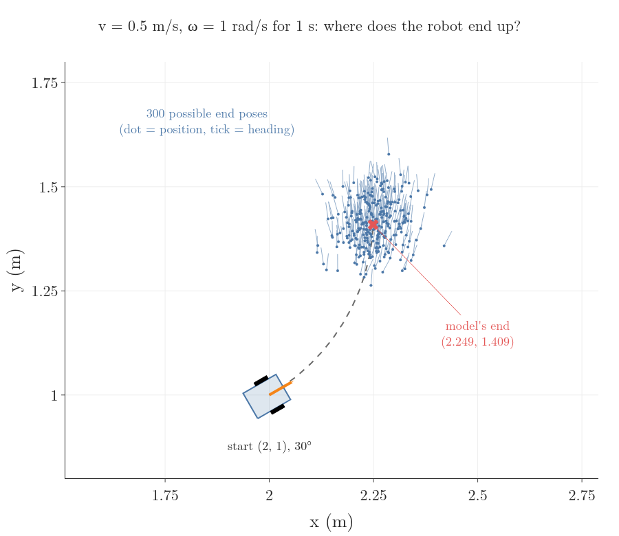
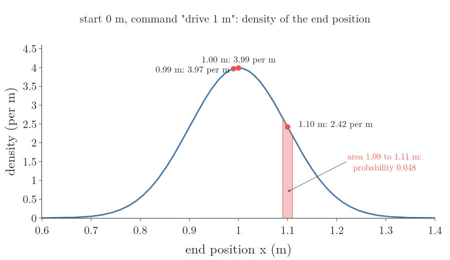
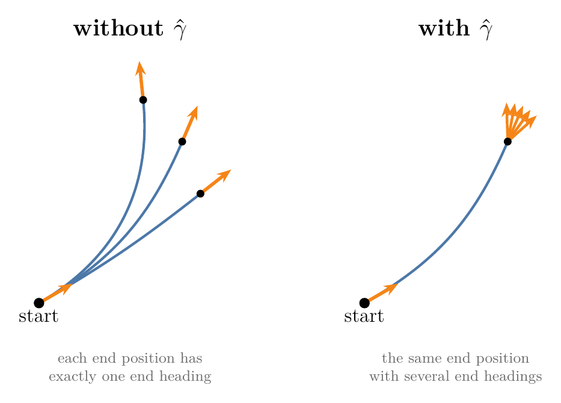

## 1. Overview

> **Key point:** A command or an odometry reading does not fix where the robot ends up; it fixes a probability distribution over likely end poses. A probabilistic **motion model** (G-2319) describes that distribution, so that a filter can both score any end pose and draw likely end poses at random.

So far the robot can predict where a command takes it, with the [kinematic model](../../../control/01-robot-models/RO-001-pose-and-differential-drive/RO-001-pose-and-differential-drive.md#52-the-kinematic-model) (G-2297), and it knows that every move makes it [less sure where it is](../RO-007-why-a-robot-is-never-sure/RO-007-why-a-robot-is-never-sure.md#6-moving-makes-the-robot-less-sure-sensing-makes-it-more-sure). What still breaks: the kinematic model predicts exactly one place. Our robot from that model starts at the [**pose**](../../../control/01-robot-models/RO-001-pose-and-differential-drive/RO-001-pose-and-differential-drive.md#22-why-position-is-not-enough-the-heading) (G-2280) (2 m, 1 m, 30°): its position and the direction it faces. The robot drives forward at 0.5 m/s, its [**linear velocity**](../../../control/01-robot-models/RO-001-pose-and-differential-drive/RO-001-pose-and-differential-drive.md#41-why-we-describe-motion-by-linear-and-angular-velocity) (G-2291) $v$, while its heading turns at 1 rad/s, its [**angular velocity**](../../../control/01-robot-models/RO-001-pose-and-differential-drive/RO-001-pose-and-differential-drive.md#41-why-we-describe-motion-by-linear-and-angular-velocity) (G-2292) $\omega$. After 1 s it should stand at (2.249 m, 1.409 m), facing 87.3°. A real robot on a real floor ends somewhere near there, but a little off, and a different amount off every time (Figure 1). We leave the 10-cell hallway of RO-007 for this robot on a floor, because a real move turns and drives in the plane.

This Note adds the models that say how far off the robot ends, and in which directions:

- motion as a probability distribution over end poses, and why its value is a density ([Section 2](#2-motion-as-a-distribution));
- wheel odometry: how **wheel encoders** (G-2320) measure the motion, and why it drifts ([Section 3](#3-wheel-odometry-measuring-the-motion));
- the **odometry motion model** (G-2323): turn, drive, turn, each with its own noise ([Section 4](#4-the-odometry-motion-model));
- drawing random end poses from a motion model ([Section 5](#5-drawing-sample-poses));
- the **velocity motion model** (G-2324), for when only the commanded speeds are known ([Section 6](#6-the-velocity-motion-model));
- using a map to rule out end poses inside walls ([Section 7](#7-ruling-out-poses-inside-walls)).

## 2. Motion as a distribution

> **Key point:** Wheels slip and motors lag, so the same command ends in different poses, and we describe the result as a distribution over the end pose $\mathbf x_t$, given the control $u_t$ and the start pose $\mathbf x_{t-1}$: $p(\mathbf x_t \mid u_t, \mathbf x_{t-1})$. The distribution's value at a pose is a density, not a probability.

### 2.1 Why one command gives many end poses

Why does the robot of Figure 1 end a little off, and a different amount off every time? Ask a robot to move 1 m forward and it may move 95 cm one time and 1.1 m the next. The reasons are physical:

- the motors do not reach the commanded speed at once, so the robot covers less ground than planned;
- a wheel slips on a smooth floor or a carpet, so it turns without moving the robot as far;
- a bump, such as a cable on the floor, makes a wheel skip part of a turn;
- the two wheels differ slightly in diameter, or a load presses one side harder, so the robot drifts to one side.

The last two are listed for wheeled robots in the Freiburg slides on **motion models** (G-2319). Their effects add up from move to move: a robot that counts only its own moves through a maze slowly drifts away from its true path, the [dead reckoning](../RO-007-why-a-robot-is-never-sure/RO-007-why-a-robot-is-never-sure.md#21-why-counting-moves-is-not-enough-dead-reckoning) (G-2311) drift of the previous Note. So no rule can give the one end pose; what we can give is how likely each end pose is.

### 2.2 The motion model and its density

A pose has three numbers, which makes its distribution hard to draw, so we start with a robot that moves along a straight line. The robot starts at 0 m and is told "drive 1 m". From many trials we find that it ends near 1 m, with a [standard deviation](../../../../MA/02-probability/MA-012-expected-value-and-variance/MA-012-expected-value-and-variance.md#41-variance-term-by-term) (G-1870), the typical miss, of 0.1 m, in a [normal distribution](../../../../MA/03-distributions/MA-024-normal-distribution/MA-024-normal-distribution.md#2-what-the-normal-distribution-is) (G-827), the bell-shaped curve also called a Gaussian. Figure 2 draws the curve. We can ask it questions such as "how likely is the robot to end at 1.1 m?"

The curve's height at a point is a [probability density](../../../../MA/03-distributions/MA-022-pdf-and-continuous-cdf/MA-022-pdf-and-continuous-cdf.md#5-what-the-density-at-a-point-means) (G-1569): probability per metre. The height is not itself a probability, because the chance of ending at exactly 1.1 m, to infinitely many decimals, is zero. A probability is an area under the curve. For the 2 cm band from 1.09 m to 1.11 m:

$$\text{density at 1.10 m} = 2.42 \text{ per m}$$

$$\text{band width} = 0.02 \text{ m}$$

$$\text{probability} \approx 2.42 \times 0.02 = 0.048$$

The exact area is 0.0484. A density can be larger than 1: at 1 m it is 3.99 per m. Some course slides call these density values "probabilities"; they are densities, and only their areas are probabilities.

The same idea in full is the **motion model** (G-2319), also called the state transition probability (Freiburg slides). For the robot of Figure 1:

- $\mathbf{x}$ (bold) is the pose, the three numbers $(x, y, \theta)$; plain $x$ is its first number (position $x$ and $y$ in m, heading $\theta$);
- $\mathbf x_{t-1}$ is the pose before the move, here (2 m, 1 m, 30°);
- $u_t$ is the control, the command or the odometry reading for this move, here 0.5 m/s and 1 rad/s for 1 s;
- $\mathbf x_t$ is a possible pose after the move, the same three numbers, such as the kinematic model's (2.249 m, 1.409 m, 87.3°);
- $p(\mathbf x_t \mid u_t,\ \mathbf x_{t-1})$ is the density of ending at $\mathbf x_t$, given $u_t$ and $\mathbf x_{t-1}$ (the bar reads "given"); in the one-dimensional example it is per m.

$$p(\mathbf x_t \mid u_t,\ \mathbf x_{t-1})$$

In the one-dimensional example:

$$p(1.1 \mid \text{drive 1 m},\ 0) = 2.42 \text{ per m}$$

A filter uses a motion model in two ways, and this Note builds both:

1. **Score a pose:** given a possible end pose, compute its density ([Section 4.4](#44-scoring-a-possible-end-pose)). Filters that keep a probability for every cell of a grid need this.
2. **Draw poses:** produce random end poses that follow the distribution (Sections [5](#5-drawing-sample-poses) and [6](#6-the-velocity-motion-model)). Filters that keep a cloud of sample poses, the particle filters, need this.

## 3. Wheel odometry: measuring the motion

> **Key point:** Encoders count how far each wheel turned; from the two wheel distances we get the robot's forward move and turn, and from those its new pose. Adding up many such steps is accurate over short distances but drifts, from slip and from wrong wheel sizes.

### 3.1 From encoder ticks to a new pose

The **motion model** (G-2319), the distribution of where a move ends, needs a control $u_t$, the command or an odometry reading. To see how far off a move went, the robot can measure what its wheels really did instead of trusting the command. A **wheel encoder** (G-2320) is a sensor that counts how far a wheel turns. A common kind is a disc with evenly spaced slots fixed to the motor shaft. A light shines through the slots onto a light sensor, which gives one pulse, or tick, each time a slot passes (Freiburg slides). Knowing how many slots make a full turn, the robot turns the tick count into the angle the wheel turned. In Figure 3, watch both discs turn for 0.1 s while their counters run up to 191 and 127 ticks; the three boxes then turn those counts into a new pose, and each later 0.1 s starts from the pose before it.

![Animation: the right and the left wheel's encoder discs, each a slotted disc between a light and a sensor (24 slots drawn; the real disc has 1000), turn for one step of 0.1 s while their counters run up to 191 and 127 ticks. The three steps of wheel odometry then fill in: one tick is 0.314 mm, so the wheels rolled 60.0 mm and 39.9 mm; that gives a forward move of 49.95 mm and a turn of 0.1005 rad; the pose (x and y in m, heading in rad) moves from (2, 1, 0.5236) to (2.0433, 1.0250, 0.6241), and the robot below moves there. The step repeats four times with the same counts, each from the last pose; the last frame lists the five poses, up to (2.1851, 1.1639, 1.0263) after 0.5 s](images/encoder_anim.gif)

Working out the robot's pose by adding up the wheel motion the encoders measure is **wheel odometry** (G-2321). Wheel odometry takes three steps. Our encoders give 1000 ticks per wheel turn; our wheels have radius $r = 0.05$ m and are $L = 0.2$ m apart (RO-001). In one step of 0.1 s the right encoder counts 191 ticks and the left 127.

**Step 1: ticks to wheel distances.** A rolling wheel moves one circumference per turn, by [rolling without slipping](../../../control/01-robot-models/RO-001-pose-and-differential-drive/RO-001-pose-and-differential-drive.md#32-why-wheel-spin-gives-ground-speed-rolling-without-slipping) (G-2290). One tick is a thousandth of that, and each wheel's distance is its ticks times one tick. For this step:

- $d_R$ is the distance the right wheel rolls, in mm, from 191 ticks;
- $d_L$ is the distance the left wheel rolls, in mm, from 127 ticks.

$$\text{tick} = \frac{2\pi \times 0.05}{1000}$$

$$= 0.314 \text{ mm}$$

$$d_R = 191 \times 0.314 = 60.0 \text{ mm}$$

$$d_L = 127 \times 0.314 = 39.9 \text{ mm}$$

**Step 2: wheel distances to the robot's move.** These are the [forward kinematics](../../../control/01-robot-models/RO-001-pose-and-differential-drive/RO-001-pose-and-differential-drive.md#43-wheel-speeds-to-linear-and-angular-velocity) (G-2294) of RO-001, the formulas that turn the wheels' motion into the robot's, used with distances instead of speeds. The time step cancels out, so the robot needs only the tick counts, not the wheel speeds. For this step:

- $\Delta s$ is the robot's forward move, the distance its midpoint travels, in mm;
- $\Delta\theta$ is the robot's turn, the change in its heading, in rad;
- $L$ is the wheel separation, 0.2 m.

$$\Delta s = \frac{d_R + d_L}{2}$$

$$= \frac{60.0 + 39.9}{2} = 49.95 \text{ mm}$$

$$\Delta\theta = \frac{d_R - d_L}{L}$$

$$= \frac{0.0600 - 0.0399}{0.2} = 0.1005 \text{ rad}$$

**Step 3: the move in the world frame.** An [Euler step](../../../control/01-robot-models/RO-001-pose-and-differential-drive/RO-001-pose-and-differential-drive.md#53-why-we-predict-the-path-step-by-step) (G-2299) from the pose (2, 1, 0.5236) moves the robot by its forward move $\Delta s$, 0.04995 m, along its heading of 30°, whose cosine is 0.866 and sine 0.5:

- $x'$ is the robot's position along the world x-axis after the step, in m (2 m before it);
- $y'$ is its position along the world y-axis after the step, in m (1 m before it);
- $\theta'$ is its heading after the step, in rad (0.5236 rad, or 30°, before it).

$$x' = 2 + 0.04995 \times 0.866 = 2.0433$$

$$y' = 1 + 0.04995 \times 0.5 = 1.0250$$

$$\theta' = 0.5236 + 0.1005 = 0.6241$$

The step repeats every 0.1 s, each one starting from the last result. The tick counts are the wheel spin rates of RO-001 (12 and 8 rad/s) rounded to whole ticks, so the result matches the first Euler step there, (2.0433, 1.0250, 0.6236), up to that rounding. Each step adds to the last, so an error made in one step stays in every later pose.

### 3.2 Why odometry drifts, and why it needs calibration

**Wheel odometry** (G-2321) adds a small increment to its previous estimate again and again, so every small error stays in the sum and the estimate drifts. The errors are of two kinds:

- **Random errors**, different every time: wheel slip, bumps, the step-by-step approximation. When a wheel slips, the encoder still counts ticks but the robot does not move as far.
- **Systematic errors**, the same every time: the model's wheel radius or wheel separation is slightly wrong. No two real robots are identical, even when built to the same drawing.

Figure 4 shows how much a small systematic error costs. The model assumes both wheels have radius 0.05 m, but the right one is really 0.0505 m, 1 percent larger. Both encoders count the same ticks, so odometry believes the robot drove straight for 10 m. Really, the right wheel covered 10.1 m and the left 10 m, so the robot turned left. Its turn $\Delta\theta$, the change in its heading, is the wheel-distance difference over the wheel separation, 0.2 m:

$$\Delta\theta = \frac{10.1 - 10}{0.2} = 0.5 \text{ rad}$$

In Figure 4, watch the grey robot, where odometry puts the robot, drive straight while the real robot (red) curves left: the gap between them grows with every metre.

The true robot ends at (9.64 m, 2.46 m), 2.49 m from where odometry puts it. Finding the real wheel radii and separation of one particular robot by driving known paths is **odometry calibration** (G-2322); it removes most of the systematic error, while the random error stays and needs a probabilistic model.

## 4. The odometry motion model

> **Key point:** The odometry model takes the motion odometry reports between two poses, splits it into turn, drive, turn, and puts separate noise on each part. The model's density at a possible end pose is the product of three normal densities.

### 4.1 Odometry or commands: which data to use

Now the cloud of Figure 1 itself: which end poses around (2.249, 1.409) are likely, and which are not? There are two common choices for the control $u_t$ of a wheeled robot, and each gives its own **motion model** (G-2319), its own distribution of end poses: the **odometry motion model** (G-2323), built in this section, and the **velocity motion model** (G-2324) of [Section 6](#6-the-velocity-motion-model) (Freiburg slides):

| | Odometry model | Velocity model |
|---|---|---|
| Data | the motion measured by wheel encoders | the commanded speeds $v$ and $\omega$ |
| Needs | encoders | nothing extra |
| Accuracy | usually better | usually worse |
| Available | only after the move | before the move |

Odometry is usually more accurate, because it measures what the wheels did after the command was carried out, while the velocity model only hopes the command was followed. Odometry also leaves out the error of the model that turns speeds into motion.

Strictly, odometry is a measurement. We still treat it as a control, because treating it as a measurement would mean adding the robot's speeds to the state, a bigger state for the same result (Thrun et al. 2005 §5.4.1). Odometry's one drawback: it exists only after the move, so a planner that must predict motion before it happens uses the velocity model instead.

Odometry's pose estimate drifts from the truth over time, as [Section 3.2](#32-why-odometry-drifts-and-why-it-needs-calibration) showed. So the model does not use odometry's poses themselves. The model uses only the change odometry reports over one short step, which stays close to the true change even when odometry's absolute pose has drifted.

### 4.2 Turn, drive, turn

Odometry reports that the robot went from one pose to another. Over our 1 s drive:

- $\bar{\mathbf x_{t-1}}$ is odometry's estimate of the pose before the move (the bar marks odometry's own estimate), three numbers: x and y in m, heading in rad;
- $\bar{\mathbf x_t}$ is odometry's estimate of the pose after the move, the same three numbers.

$$\bar{\mathbf x_{t-1}} = (2,\ 1,\ 0.524)$$

$$\bar{\mathbf x_t} = (2.249,\ 1.409,\ 1.524)$$

Whatever path the robot took, any such change of pose can be done in three simple motions: turn on the spot to face the end point, drive straight to it, turn on the spot to the end heading (Figure 5). Three numbers describe the three motions, matching the three numbers of the pose change (Thrun et al. 2005 §5.4, as in the Freiburg slides):

- $\delta_{\text{rot1}}$ is the first turn, in rad;
- $\delta_{\text{trans}}$ is the straight drive, in m;
- $\delta_{\text{rot2}}$ is the second turn, in rad.

In Figure 5, watch the faint robot drive the arc the robot really drove, then watch the robot redo the move as turn, drive, turn: it lands on the same pose, so the three numbers carry the whole move.

The drive is the straight-line distance between the two positions:

$$\delta_{\text{trans}} = \sqrt{0.249^2 + 0.409^2}$$

$$= 0.479 \text{ m}$$

The first turn is the direction of that line minus the start heading. The direction of a line that rises 0.409 m while running 0.249 m comes from the **atan2** (G-2325) function, which takes the rise and the run separately and returns the angle over the full circle. The plain inverse tangent of the ratio covers only half the circle, so it cannot tell "up and right" from "down and left" (Freiburg slides):

$$\text{atan2}(0.409,\ 0.249) = 1.024$$

$$\delta_{\text{rot1}} = 1.024 - 0.524 = 0.500 \text{ rad}$$

The second turn is whatever turning is left:

$$\delta_{\text{rot2}} = 1.524 - 0.524 - 0.500$$

$$= 0.500 \text{ rad}$$

Odometry's report is now three numbers: 0.500 rad, 0.479 m and 0.500 rad. How far the true move can differ from each is still open.

### 4.3 Noise on each of the three parts

The true motion is odometry's motion plus noise. We could put one Gaussian around the end pose, but in practice a separate noise on each of the three parts matches real robots better (Stachniss channel, Motion models). The robot makes three separate motions, and each goes wrong in its own way: a wrong first turn sends it off at a wrong angle, a wrong drive changes only the distance, a wrong second turn changes only the end heading. [Section 5.2](#52-sampling-the-odometry-model) shows the shapes this gives. Each noise has a **standard deviation** (G-1870), its typical size, that grows with the size of the motion, because a longer drive or a bigger turn gives the wheels more chance to slip (Freiburg slides). The three parts $\delta_{\text{rot1}}$, $\delta_{\text{trans}}$ and $\delta_{\text{rot2}}$ are those of [Section 4.2](#42-turn-drive-turn): 0.500 rad, 0.479 m and 0.500 rad. The bars in $\lvert\delta_{\text{rot1}}\rvert$ take the size of a turn and drop its sign, so a right turn counts like a left one. The four numbers $\alpha_1$ to $\alpha_4$ are set for each robot. For our robot:

- $\sigma_{\text{rot1}}$ is the standard deviation of the first turn's noise, in rad;
- $\sigma_{\text{trans}}$ is the standard deviation of the drive's noise, in m;
- $\sigma_{\text{rot2}}$ is the standard deviation of the second turn's noise, in rad;
- $\alpha_1$ is the turning error per radian turned, 0.1;
- $\alpha_2$ is the turning error per metre driven, 0.1 rad per m;
- $\alpha_3$ is the driving error per metre driven, 0.1;
- $\alpha_4$ is the driving error per radian turned, 0.01 m per rad.

$$\sigma_{\text{rot1}} = \alpha_1 \lvert\delta_{\text{rot1}}\rvert + \alpha_2\thinspace\delta_{\text{trans}}$$

$$\sigma_{\text{trans}} = \alpha_3\thinspace\delta_{\text{trans}} + \alpha_4 (\lvert\delta_{\text{rot1}}\rvert + \lvert\delta_{\text{rot2}}\rvert)$$

$$\sigma_{\text{rot2}} = \alpha_1 \lvert\delta_{\text{rot2}}\rvert + \alpha_2\thinspace\delta_{\text{trans}}$$

For our step:

$$\sigma_{\text{rot1}} = 0.1 \times 0.5 + 0.1 \times 0.479$$

$$= 0.0979 \text{ rad}$$

$$\sigma_{\text{trans}} = 0.1 \times 0.479 + 0.01 \times 1.0$$

$$= 0.0579 \text{ m}$$

$$\sigma_{\text{rot2}} = 0.0979 \text{ rad}$$

So the first turn is 0.500 rad give or take about 0.1 rad (6°), and the drive 0.479 m give or take about 6 cm. With these three standard deviations the model can score any end pose.

### 4.4 Scoring a possible end pose

The question a grid filter asks: how likely is it that the robot, starting at (2, 1, 0.524), really ended at the pose (2.27, 1.38, 1.50)? The odometry model answers in three steps (Freiburg slides, `motion_model_odometry`):

1. Work out the turn, drive and turn that would take the start pose to this pose, with the formulas of [Section 4.2](#42-turn-drive-turn). We mark them with hats.
2. Compare each with what odometry reported, using the normal density with the **standard deviations** (G-1870) of [Section 4.3](#43-noise-on-each-of-the-three-parts).
3. Multiply the three densities, because the three noises are taken as [independent](../../../../MA/02-probability/MA-016-independent-events/MA-016-independent-events.md#2-the-definition) (G-934): one noise tells nothing about another.

For this pose:

- $\hat\delta_{\text{rot1}}$ is the first turn that would take the start pose to this pose, 0.4294 rad (odometry reported 0.500 rad);
- $\hat\delta_{\text{trans}}$ is the drive that would, 0.4662 m (odometry reported 0.479 m);
- $\hat\delta_{\text{rot2}}$ is the second turn that would, 0.5470 rad (odometry reported 0.500 rad);
- $a$ is the gap between odometry's value and the hatted value, in rad or m;
- $\sigma$ is that part's standard deviation from [Section 4.3](#43-noise-on-each-of-the-three-parts), 0.0979 rad for each turn and 0.0579 m for the drive;
- $\mathcal{N}(a;\ \sigma)$ is the normal density at a distance $a$ from the centre, with standard deviation $\sigma$;
- $p_1$ is the density for the first turn, per rad;
- $p_2$ is the density for the drive, per m;
- $p_3$ is the density for the second turn, per rad.

In Figure 6, watch the three steps in order. First the robot drives this pose's turn, drive and turn next to odometry's (grey). Then each gap is marked on its Gaussian and the density read off the curve, and the three densities multiply to 76.7. Last, the far pose (2.10, 1.60, 1.50) does the same: its two turns land far out on their curves, and its product drops close to 0. One part far out on its curve is enough to pull the whole score down.

![Animation of scoring a pose with the odometry model. Odometry reported a first turn of 0.500 rad, a drive of 0.479 m and a second turn of 0.500 rad (grey). Stage 1: the robot drives the turn, drive and turn that take the start (2, 1), facing 30°, to the pose (2.27, 1.38, 1.50): 0.4294 rad, 0.4662 m and 0.5470 rad (blue); the robots are drawn at a fifth of their size. Stage 2: each part gets its Gaussian, centred on odometry's value, with standard deviation σ of 0.0979 rad for each turn and 0.0579 m for the drive; the arrow marks the gap a, odometry's value minus this pose's, and the dot reads the density off the curve: p1 = 3.142 per rad, p2 = 6.724 per m, p3 = 3.631 per rad, whose product is 76.7. Stage 3: the far pose (2.10, 1.60, 1.50) needs 0.8820 rad, 0.6083 m and 0.0944 rad (red). The last frame shows both poses on the three Gaussians: the far pose's turns get only 0.0020 and 0.00076 per rad and its drive 0.57 per m, so its product is 8.7 × 10⁻⁷ against 76.7](images/pose_score_anim.gif)

The normal density:

$$\mathcal{N}(a;\ \sigma) = \frac{1}{\sqrt{2\pi\sigma^2}}\thinspace e^{-a^2 / (2\sigma^2)}$$

The three comparisons:

$$p_1 = \mathcal{N}(0.500 - 0.4294;\ 0.0979)$$

$$= 3.142$$

$$p_2 = \mathcal{N}(0.479 - 0.4662;\ 0.0579)$$

$$= 6.724$$

$$p_3 = \mathcal{N}(0.500 - 0.5470;\ 0.0979)$$

$$= 3.631$$

The density of the pose is the product:

$$p_1\thinspace p_2\thinspace p_3 = 3.142 \times 6.724 \times 3.631$$

$$= 76.7$$

The value 76.7 is a density per radian, per metre and per radian, so it can be far above 1. On its own it means little; it is useful for comparison. The far pose of Figure 6, (2.10, 1.60, 1.50), which needs a first turn of 0.882 rad instead of 0.5, scores $8.7 \times 10^{-7}$: about a hundred million times less likely. The notebook `RO-008-probabilistic-motion-models.ipynb` computes both.

Scoring every pose on a fine grid around the start and shading each by its density draws the shape of the distribution. When the turning noise is large, the shape is curved like a banana, a **banana-shaped distribution** (G-2328). [Section 5.2](#52-sampling-the-odometry-model) shows why.

## 5. Drawing sample poses

> **Key point:** Particle filters need random end poses that follow the **motion model** (G-2319), the distribution of where a move ends. We get them by drawing a random noise for each of the three parts and driving turn, drive, turn.

### 5.1 Why sample instead of scoring

The cloud of Figure 1 is a set of 300 sampled end poses; this section draws such a cloud. Scoring needs a grid over all poses, and a pose has three numbers, so the grid is large: 100 values each of the position $x$, $y$ and the heading $\theta$ make a million cells to score after every move. A cloud of sample poses describes the same distribution where it matters: more samples where the density is high, few where it is low. To build the cloud we need to draw random numbers that follow a chosen distribution. Drawing a random value so that, over many draws, values come up as often as the distribution says is **sampling** (G-2326) from that distribution.

### 5.2 Sampling the odometry model

To draw one end pose (Freiburg slides, `sample_motion_model`), starting from the pose of Figure 1:

- $x$ is the start position along the world x-axis, 2 m;
- $y$ is the start position along the world y-axis, 1 m;
- $\theta$ is the start heading, 0.524 rad;
- $\hat\delta_{\text{rot1}}$ is the noisy first turn, in rad (here the hat marks a drawn, noisy value);
- $\hat\delta_{\text{trans}}$ is the noisy drive, in m;
- $\hat\delta_{\text{rot2}}$ is the noisy second turn, in rad;
- $x'$ is the end position along the x-axis, in m;
- $y'$ is the end position along the y-axis, in m;
- $\theta'$ is the end heading, in rad.

The steps:

1. Draw a noisy first turn, drive and second turn: each odometry value plus a normal sample with the standard deviation, the typical size of that part's noise, of [Section 4.3](#43-noise-on-each-of-the-three-parts).
2. Turn by the noisy first turn and drive the noisy distance:

   $$
   x' = x + \hat\delta_{\text{trans}} \cos(\theta + \hat\delta_{\text{rot1}})
   $$

   $$
   y' = y + \hat\delta_{\text{trans}} \sin(\theta + \hat\delta_{\text{rot1}})
   $$

3. Turn by both noisy turns:

   $$
   \theta' = \theta + \hat\delta_{\text{rot1}} + \hat\delta_{\text{rot2}}
   $$

**Worked sample.** Suppose the three draws come out as +0.05 rad, −0.03 m and −0.02 rad:

$$\hat\delta_{\text{rot1}} = 0.500 + 0.05 = 0.550$$

$$\hat\delta_{\text{trans}} = 0.479 - 0.03 = 0.449$$

$$\hat\delta_{\text{rot2}} = 0.500 - 0.02 = 0.480$$

The robot drives in the direction:

$$0.524 + 0.550 = 1.074 \text{ rad}$$

$$x' = 2 + 0.449 \times 0.477 = 2.214$$

$$y' = 1 + 0.449 \times 0.879 = 1.395$$

$$\theta' = 0.524 + 0.550 + 0.480 = 1.554$$

This sample ends 3.5 cm left of and 1.4 cm below the model's end point, and faces 1.7° further left.

Figure 7 first plays this worked sample one motion at a time, then draws 500 such samples for three noise settings; watch the middle cloud, with mostly turning noise, bend as it fills. With the Note's noise the cloud is round. When turning noise dominates, the samples swing along a circle around the start, because a wrong first turn sends the robot off at a wrong angle but the same distance: that is the banana. When driving noise dominates, they spread along the line of travel. All of this needs odometry; a robot without encoders has only its command.

![Animation of sampling the odometry model. First one draw, zoomed in: with the noise +0.05 rad, −0.03 m and −0.02 rad the robot turns 0.550 rad, drives 0.449 m and turns 0.480 rad, and ends at (2.214, 1.395) facing 1.554 rad, 3.5 cm left of and 1.4 cm below the model's end (red ×); the dashed arc is the noise-free path of Figure 1. Then 500 draws fill in for each of three noise settings. The last frame: the Note's noise gives a round cloud around (2.249, 1.409); mostly turning noise bends it into a banana around the start; mostly driving noise stretches it along the line from the start](images/banana_anim.gif)

## 6. The velocity motion model

> **Key point:** When only the commanded speeds are known, the robot is taken to drive an arc of a circle. Noise on the commanded linear and **angular velocity** (G-2292), plus an extra noise on the final heading, gives the distribution of end poses.

### 6.1 The exact arc from the commanded speeds

A robot without encoders knows only the command of Figure 1. The velocity model takes the control to be the two commanded speeds, held for one time step (Freiburg slides). For our command:

- $v$ is the commanded **linear velocity** (G-2291), how fast the robot drives forward, 0.5 m/s;
- $\omega$ is the commanded **angular velocity** (G-2292), how fast its heading turns, 1 rad/s;
- $\Delta t$ is the time step the command is held, 1 s;
- $u_t$ is the control, the pair of the two speeds.

$$u_t = (v,\ \omega) = (0.5 \text{ m/s},\ 1 \text{ rad/s})$$

RO-001 predicted the path with small [Euler steps](../../../control/01-robot-models/RO-001-pose-and-differential-drive/RO-001-pose-and-differential-drive.md#53-why-we-predict-the-path-step-by-step) (G-2299), short straight moves along the current heading. With speeds held fixed we can do better and compute the end pose exactly, because the robot then drives an arc of a circle about one fixed point.

**The centre of the arc.** A robot driving at $v$ while turning at $\omega$ circles one fixed point, the [**instantaneous centre of curvature**](../../../control/01-robot-models/RO-001-pose-and-differential-drive/RO-001-pose-and-differential-drive.md#42-why-the-robot-turns-about-a-point-on-its-axle-line) (G-2529) (ICC), at the [turning radius](../../../control/01-robot-models/RO-001-pose-and-differential-drive/RO-001-pose-and-differential-drive.md#43-wheel-speeds-to-linear-and-angular-velocity) (G-2293) on its left, square to its heading (RO-001). For our robot:

- $x$ is the start position along the world x-axis, 2 m;
- $y$ is the start position along the world y-axis, 1 m;
- $\theta$ is the start heading, 0.524 rad (30°);
- $R$ is the turning radius, the robot's distance from the ICC, in m;
- $x_c$ is the ICC's position along the world x-axis, in m;
- $y_c$ is the ICC's position along the world y-axis, in m.

$$R = \frac{v}{\omega} = \frac{0.5}{1} = 0.5 \text{ m}$$

Square to the heading, to the left, is the direction $(-\sin\theta,\ \cos\theta)$: the heading direction $(\cos\theta,\ \sin\theta)$ turned a quarter turn to the left. So the ICC is:

$$x_c = x - R\sin\theta$$

$$y_c = y + R\cos\theta$$

A check at $\theta = 0$, a robot facing along x, where the sine is 0 and the cosine 1:

$$x_c = x - R \times 0 = x$$

$$y_c = y + R \times 1 = y + R$$

The ICC lies straight to the robot's left, as it should. For our robot:

$$x_c = 2 - 0.5 \times 0.5 = 1.750$$

$$y_c = 1 + 0.5 \times 0.866 = 1.433$$

**The end pose.** In the time step $\Delta t$ the robot turns about the ICC by the angle $\omega\Delta t$, 1 rad here, and ends on the circle with the ICC still square to its left. The end position $x'$, $y'$ and the end heading $\theta'$ are:

$$x' = x_c + R\sin(\theta + \omega\Delta t)$$

$$y' = y_c - R\cos(\theta + \omega\Delta t)$$

$$\theta' = \theta + \omega\Delta t$$

At $\Delta t = 0$ these give back the start pose, as they should. Our robot turns by 1 rad to the heading 1.524 rad (87.3°):

$$x' = 1.750 + 0.5 \times 0.9989 = 2.249$$

$$y' = 1.433 - 0.5 \times 0.0472 = 1.409$$

Figure 8 plays the construction: watch the green radius swing 1 rad about the ICC and carry the robot along the blue arc, while a faint robot takes one Euler step of 1 s instead. The Euler step ends at (2.433, 1.250), 24 cm away, because it drives straight along the start heading.

A gotcha: the turning radius $R$ divides $v$ by $\omega$, so it has no value when the robot does not turn and $\omega$ is 0. A robot driving straight has no ICC, so code must use the straight-line step when $\omega$ is zero or tiny:

$$x' = x + v\Delta t\cos\theta$$

$$y' = y + v\Delta t\sin\theta$$

The arc gives one exact end pose for the commanded speeds, but a real robot never holds them exactly.

### 6.2 Noise, and why it needs a third number

The noise goes on the two commanded speeds, again growing with their size (Freiburg slides). The commanded $v$, 0.5 m/s, and $\omega$, 1 rad/s, are those of [Section 6.1](#61-the-exact-arc-from-the-commanded-speeds); the four numbers $\alpha_1$ to $\alpha_4$ are this model's own, not those of [Section 4.3](#43-noise-on-each-of-the-three-parts). The bars again take the size and drop the sign. For our command:

- $\hat v$ is the noisy forward speed, in m/s;
- $\hat\omega$ is the noisy turning rate, in rad/s;
- $\text{sample}(b)$ draws normal noise with **standard deviation** (G-1870), or typical size, $b$;
- $\alpha_1$ is the speed error per m/s of commanded speed, 0.1;
- $\alpha_2$ is the speed error per rad/s of commanded turning, 0.02 m per rad;
- $\alpha_3$ is the turning-rate error per m/s of commanded speed, 0.1 rad per m;
- $\alpha_4$ is the turning-rate error per rad/s of commanded turning, 0.1.

$$\hat v = v + \text{sample}(\alpha_1 \lvert v\rvert + \alpha_2 \lvert\omega\rvert)$$

$$\hat\omega = \omega + \text{sample}(\alpha_3 \lvert v\rvert + \alpha_4 \lvert\omega\rvert)$$

For our command, the two standard deviations are:

$$\alpha_1 \lvert v\rvert + \alpha_2 \lvert\omega\rvert = 0.1 \times 0.5 + 0.02 \times 1$$

$$= 0.07 \text{ m/s}$$

$$\alpha_3 \lvert v\rvert + \alpha_4 \lvert\omega\rvert = 0.1 \times 0.5 + 0.1 \times 1$$

$$= 0.15 \text{ rad/s}$$

So the **linear velocity** (G-2291) varies by about 0.07 m/s and the angular velocity by about 0.15 rad/s.

These two noises are not enough. A pose has three numbers, but $\hat v$ and $\hat\omega$ are only two. For every end position, exactly one circular arc leaves the start along the start heading and reaches it, so the end heading is fixed by the end position (Figure 9, left). A real robot can end at the same spot facing a little differently. The model therefore adds a third noise, a small extra turn at the end (Freiburg slides). The start heading $\theta$, the end heading $\theta'$, the noisy turning rate $\hat\omega$ and the time step $\Delta t$, 1 s, are as above; the new symbols:

- $\hat\gamma$ is the extra turning rate, in rad/s, which over $\Delta t$ gives the extra end turn;
- $\alpha_5$ is the extra turning rate per m/s of commanded speed, 0.02 rad per m;
- $\alpha_6$ is the extra turning rate per rad/s of commanded turning, 0.02.

$$\hat\gamma = \text{sample}(\alpha_5 \lvert v\rvert + \alpha_6 \lvert\omega\rvert)$$

$$\theta' = \theta + \hat\omega\Delta t + \hat\gamma\Delta t$$

The notebook checks this with 2 million samples. Among the samples that end within 2 mm of (2.249, 1.409), the end headings have a standard deviation of only 0.24° without $\hat\gamma$, and of 1.71° with it (both $\alpha_5$ and $\alpha_6$ at 0.02).

**Worked sample.** Suppose the draws come out as $\hat v = 0.54$ m/s, $\hat\omega = 0.9$ rad/s and $\hat\gamma = 0.02$ rad/s. The turning radius $R$, the ICC $x_c$, $y_c$ and the end pose follow as in [Section 6.1](#61-the-exact-arc-from-the-commanded-speeds), with the noisy speeds:

$$R = 0.54 / 0.9 = 0.6 \text{ m}$$

$$x_c = 2 - 0.6 \times 0.5 = 1.700$$

$$y_c = 1 + 0.6 \times 0.866 = 1.520$$

The heading after the arc:

$$0.524 + 0.9 \times 1 = 1.424 \text{ rad}$$

$$x' = 1.700 + 0.6 \times 0.9892 = 2.294$$

$$y' = 1.520 - 0.6 \times 0.147 = 1.432$$

$$\theta' = 1.424 + 0.02 \times 1 = 1.444$$

A faster, gentler drive: the sample ends 4.4 cm further right and 2.2 cm higher than the noise-free end, facing 4.6° less far round. Neither model knows the room, so either can still put a sample inside a wall.

## 7. Ruling out poses inside walls

> **Key point:** A map tells the robot where it cannot be. For small steps we multiply the **motion model** (G-2319), the distribution of where a move ends, by "is this pose free?"; when sampling, we throw away and redraw any sample that lands inside an obstacle.

The cloud of Figure 1 can still hold poses where the robot cannot be: the motion models so far know nothing about the surroundings, so they put samples inside walls (Figure 10, left, red). With a map of the free space we want the motion model that also knows the map. The end pose $\mathbf x_t$, the control $u_t$ and the start pose $\mathbf x_{t-1}$ (bold $\mathbf{x}$ for a pose, plain $x$ for its first number) are those of [Section 2.2](#22-the-motion-model-and-its-density); the new symbol:

- $m$ is the map: which places are free and which are inside walls or other obstacles, such as the wall 8 cm thick of Figure 10.

$$p(\mathbf x_t \mid u_t,\ \mathbf x_{t-1},\ m)$$

Computing it exactly is hard, because it asks whether the robot could have reached $\mathbf x_t$ without hitting anything along the way. For small steps there is an easy approximation (Freiburg slides, 2012 edition; Berry, Lecture 3-2b):

- $\pi(\mathbf x_t)$ is 1 if the pose $\mathbf x_t$ is free in the map and 0 if it is inside an obstacle;
- $\eta$ is a number that rescales the result so that it adds up to 1 again.

$$p(\mathbf x_t \mid u_t, \mathbf x_{t-1}, m)$$

$$\approx \eta\thinspace p(\mathbf x_t \mid u_t, \mathbf x_{t-1})\thinspace\pi(\mathbf x_t)$$

A motion model that uses the map in this way is the **map-consistent motion model** (G-2329). When **sampling** (G-2326), it becomes a simple rule: draw a sample with the motion model; if it lies inside an obstacle, throw it away and draw again. Keeping only the draws that pass a test, and drawing again otherwise, is **rejection sampling** (G-2330) (Freiburg slides).

Figure 10 tries both on our step. On the left, watch the cloud jump out in one step: samples that end inside the wall turn red, and samples that end beyond it stay. On the right, watch the cloud creep up in twenty small steps and stop at the wall.

![Animation of sampling with a map; a wall 8 cm thick lies across the cloud of our 0.48 m step. Left: one big step; the 500 samples fly out from the start, and only where they end is checked: 95 end inside the wall and are rejected (red), but 14 end beyond the wall in free space and are kept (purple), though the robot could not have driven through the wall. Right: the same motion in twenty small steps of about 2.4 cm; after each step, draws that land in the wall flash red and are drawn again. The last frame: no sample gets beyond the wall](images/map_reject_anim.gif)

The approximation checks only where a sample ends, not the path to it. So the approximation needs small steps. In Figure 10, left, a wall 8 cm thick lies across the cloud of our 0.48 m step. Of 500 samples, 95 end inside the wall and are rejected, but 14 end beyond it, in free space, and are kept, although the robot could never have driven through the wall. On the right, the same motion is made in twenty small steps of about 2.4 cm, each with the noise raised so that the final cloud has the same **standard deviation** (G-1870), the same spread, and every sample that lands in the wall is redrawn. A small step cannot cross the wall in one jump, so no sample gets beyond it. A common rule of thumb is to keep each step below half the robot's diameter (Thrun et al. 2005 §5.5).

## 8. Summary

| Model | Control $u_t$ | Noise on | Use when |
|---|---|---|---|
| Odometry model | odometry's pose change: turn, drive, turn | each of the three parts | encoders exist; filtering after the move |
| Velocity model | commanded speeds $v$, $\omega$ for a time step $\Delta t$ | the speeds $v$, $\omega$ and an extra end turn $\gamma$ | no encoders, or predicting before the move (planning) |
| Map-consistent model | either of the above, plus a map | as above; poses inside obstacles get 0 | a map is known and steps are small |

- The command of the opening, 0.5 m/s and 1 rad/s for 1 s, does not lead to the one pose (2.249, 1.409) but to a cloud around it, because wheels slip and motors lag; a **motion model** (G-2319) $p(\mathbf x_t \mid u_t, \mathbf x_{t-1})$, the density of the end pose $\mathbf x_t$ given the control $u_t$ and the start pose $\mathbf x_{t-1}$, describes that cloud; its values are densities, so only areas are probabilities (0.048 for the band 1.09 to 1.11 m) and a density can exceed 1.
- **Wheel odometry** (G-2321) turns encoder ticks into wheel distances, the robot's move and a new pose; it drifts because each error stays in the running sum, and a 1 percent wrong wheel radius already puts the robot 2.49 m off after 10 m, so robots need calibration.
- The odometry model splits each reported move into turn, drive, turn and puts noise on each, because that matches real robots better than one Gaussian on the end pose; its **standard deviations** (G-1870), the typical sizes of the noise, grow with the motion, because bigger motions slip more.
- Scoring a pose multiplies three normal densities (76.7 for a close pose, $8.7 \times 10^{-7}$ for a far one), so filters can compare poses on a grid.
- **Sampling** (G-2326) draws noisy turn, drive, turn and moves the robot, so a particle filter gets a cloud of end poses without scoring a grid of a million cells.
- Large rotation noise bends the cloud into a banana, because a wrong turn sends the robot the same distance in a wrong direction; with no readings the cloud keeps growing.
- The velocity model drives an exact arc about the ICC, at the turning radius $R$, the linear velocity divided by the angular velocity, to the robot's left; it needs a third noise $\gamma$, an extra end turn, because two noisy speeds alone tie the end heading to the end position.
- A map rules out poses inside obstacles by rejecting samples there, which is safe only for small steps, because the check looks at where a sample ends, not at the path to it.

The robot can now say how far a move blurs its pose, score any end pose and draw the cloud. Still missing: a reading only means something against a map of where things are, which is [maps and landmarks](../RO-009-maps-and-landmarks/RO-009-maps-and-landmarks.md#1-overview).

## 9. Sources

**Built from**

- Cyrill Stachniss channel (University of Bonn), "Motion Models", YouTube, https://www.youtube.com/watch?v=IVTV7vJgIkU (Stachniss channel, Motion models)
- Carlotta A. Berry, "Advanced Mobile Robotics: Lecture 3-2b Probabilistic Motion Models", YouTube, https://www.youtube.com/watch?v=sTQGT0ar6-g (Berry, Lecture 3-2b)
- Duckietown, "12 - Odometry", YouTube, https://www.youtube.com/watch?v=154DmLoGWic (Duckietown)
- NPTEL IIT Madras, Introduction to Robotics, "#38 Odometry Motion Model", YouTube, https://www.youtube.com/watch?v=PPwih9x12YQ (NPTEL #38)
- Büscher, D. (2023). "Probabilistic Motion Models", *Introduction to Mobile Robotics* slides, University of Freiburg (companion material to Thrun et al. 2005 ch.5): odometry and velocity models, noise, sampling normal and triangular noise, rejection sampling, map-consistent motion. http://ais.informatik.uni-freiburg.de/teaching/ss23/robotics/slides/06-motion-models.pdf (Freiburg slides)
- Burgard, W., Stachniss, C., Bennewitz, M. and Arras, K. (2012). "Probabilistic Motion Models", *Introduction to Mobile Robotics* slides, University of Freiburg, http://ais.informatik.uni-freiburg.de/teaching/ss12/robotics/slides/06-motion-models.pdf (Freiburg slides, 2012 edition): the map-consistent approximation.

**Other references**

- Thrun, S., Burgard, W. and Fox, D. (2005). *Probabilistic Robotics*. MIT Press. §5.3 velocity motion model, §5.4 odometry motion model (§5.4.1: odometry treated as a control), §5.5 motion and maps (steps below half a robot diameter). Cited where the Freiburg slides confirm it, and for §5.4.1 and §5.5 from the book itself.

## 10. Key terms

Terms taught in this Note come first; linked terms are recaps, taught in the Note the link opens.

| Term | Meaning |
|---|---|
| Motion model $p(\mathbf x_t \mid u_t, \mathbf x_{t-1})$ (G-2319) | The probability distribution of a robot's pose after a move, given its pose before and the control (command or odometry); it describes how uncertain motion is, so a filter can score possible end poses or draw them at random. |
| Wheel encoder (G-2320) | A sensor that counts how far a wheel turns, for example a slotted disc on the shaft that gives one tick per slot passing a light sensor; its counts are the raw data of wheel odometry. |
| Odometry motion model (G-2323) | A motion model that splits the pose change reported by odometry into a first turn, a straight drive and a second turn, and adds independent noise to each, with a standard deviation that grows with the motion; used when wheel encoders exist. |
| Velocity motion model (G-2324) | A motion model that takes the commanded linear velocity $v$ and angular velocity $\omega$, moves the robot along the exact arc about the ICC that they give, and adds noise to both speeds plus an extra final turn; used without encoders or to predict before a move. |
| Wheel odometry (G-2321) | Working out a robot's pose by adding up the wheel motion its encoders measure: ticks to wheel distances, to the robot's move and turn, to a new pose; accurate over short distances but it drifts, because every error stays in the sum. |
| Odometry calibration (G-2322) | Measuring one robot's real wheel radii and wheel separation, for example by driving known paths, so that odometry has no systematic error; a 1 percent radius error alone puts a robot 2.49 m off after 10 m. |
| atan2 (G-2325) | A function atan2(rise, run) that returns the direction of a line over the full circle from its rise and run given separately; needed because the plain inverse tangent of the ratio cannot tell opposite directions apart. |
| Banana-shaped distribution (G-2328) | The curved cloud of end positions a motion model gives when turning noise is large: a wrong first turn sends the robot the right distance in a wrong direction, so the positions spread along an arc around the start. |
| Sampling (from a distribution) (G-2326) | Drawing random values so that, over many draws, each value comes up as often as a given distribution says; it turns a motion model into a cloud of possible poses for particle filters. |
| Map-consistent motion model (G-2329) | A motion model that also uses the map, approximated for small steps by multiplying the plain motion model by 1 for free poses and 0 for poses inside obstacles; it stops the robot's estimate from passing through walls. |
| Rejection sampling (G-2330) | Drawing samples and keeping only those that pass a test, drawing again otherwise; used to keep motion samples out of obstacles. |
| [Kinematic model](../../../../RO/control/01-robot-models/RO-001-pose-and-differential-drive/RO-001-pose-and-differential-drive.md#52-the-kinematic-model) (G-2297) | Equations that give how a robot's configuration changes from its speed inputs alone, ignoring masses and forces, such as $\dot{x} = v\cos\theta$, $\dot{y} = v\sin\theta$, $\dot{\theta} = \omega$; used to predict motion at low speed. |
| [Pose](../../../../RO/control/01-robot-models/RO-001-pose-and-differential-drive/RO-001-pose-and-differential-drive.md#22-why-position-is-not-enough-the-heading) (G-2280) | Where a robot is and which way it faces: on a floor, its position $(x, y)$ and heading $\theta$, such as (2 m, 1 m, 30°); needed because a robot at one spot drives off differently depending on its heading. |
| [Linear velocity $v$](../../../../RO/control/01-robot-models/RO-001-pose-and-differential-drive/RO-001-pose-and-differential-drive.md#41-why-we-describe-motion-by-linear-and-angular-velocity) (G-2291) | How fast a robot's reference point (for a differential drive, the middle of the axle) moves along its heading, in m/s; for a differential drive, the average of the two wheel speeds, so it sets how fast the robot advances. |
| [Angular velocity $\omega$](../../../../RO/control/01-robot-models/RO-001-pose-and-differential-drive/RO-001-pose-and-differential-drive.md#41-why-we-describe-motion-by-linear-and-angular-velocity) (G-2292) | How fast a robot's heading changes, in rad/s, positive to the left; for a differential drive, the difference of the wheel speeds divided by the wheel separation. |
| [Dead reckoning](../../../../RO/localization/02-bayes-filters/RO-007-why-a-robot-is-never-sure/RO-007-why-a-robot-is-never-sure.md#21-why-counting-moves-is-not-enough-dead-reckoning) (G-2311) | Working out a robot's position from a known start by adding up its own moves, without looking at its surroundings; simple, but its error grows with every move, so it needs readings to correct it. |
| [Standard deviation of a random variable](../../../../MA/02-probability/MA-012-expected-value-and-variance/MA-012-expected-value-and-variance.md#41-variance-term-by-term) (G-1870) | The square root of a random variable's variance, in the units of $X$; it says how far values typically fall from the expected value. |
| [Gaussian distribution](../../../../MA/03-distributions/MA-024-normal-distribution/MA-024-normal-distribution.md#2-what-the-normal-distribution-is) (G-827) | Another name for the normal distribution: the symmetric, bell-shaped continuous distribution set by its mean and standard deviation, used to model many measurements. |
| [Probability density](../../../../MA/03-distributions/MA-022-pdf-and-continuous-cdf/MA-022-pdf-and-continuous-cdf.md#5-what-the-density-at-a-point-means) (G-1569) | The height of a continuous distribution's curve; compares how likely nearby values are. |
| [Rolling without slipping](../../../../RO/control/01-robot-models/RO-001-pose-and-differential-drive/RO-001-pose-and-differential-drive.md#32-why-wheel-spin-gives-ground-speed-rolling-without-slipping) (G-2290) | A wheel moving so that its contact point does not skid: it moves forward by its radius times the angle it turns and never slides sideways, which is what lets wheel turns predict motion. |
| [Forward kinematics (wheeled robot)](../../../../RO/control/01-robot-models/RO-001-pose-and-differential-drive/RO-001-pose-and-differential-drive.md#43-wheel-speeds-to-linear-and-angular-velocity) (G-2294) | Working out the robot's linear and angular velocity from its wheel speeds, used to predict where the robot goes. |
| [Euler step](../../../../RO/control/01-robot-models/RO-001-pose-and-differential-drive/RO-001-pose-and-differential-drive.md#53-why-we-predict-the-path-step-by-step) (G-2299) | One step of predicting motion: hold the rates fixed for a short time $\Delta t$ and add rate times $\Delta t$ to each quantity; repeated, it traces a path, more accurately the smaller $\Delta t$ is. |
| [Independent events](../../../../MA/02-probability/MA-016-independent-events/MA-016-independent-events.md#2-the-definition) (G-934) | Events where one happening does not change the probability of the other; for them the probability that both happen is the product of their probabilities. |
| [Instantaneous centre of curvature (ICC)](../../../../RO/control/01-robot-models/RO-001-pose-and-differential-drive/RO-001-pose-and-differential-drive.md#42-why-the-robot-turns-about-a-point-on-its-axle-line) (G-2529) | The point a turning robot's whole body circles at a given moment; for a differential drive it lies on the axle line at distance $R = v/\omega$ from the midpoint, so it fixes how fast each wheel must move. |
| [Turning radius $R$](../../../../RO/control/01-robot-models/RO-001-pose-and-differential-drive/RO-001-pose-and-differential-drive.md#42-why-the-robot-turns-about-a-point-on-its-axle-line) (G-2293) | The distance from the point a robot is turning about (the instantaneous centre of curvature, ICC) to the robot's reference point; $R = v / \omega$, so it says how tight a turn is. |
