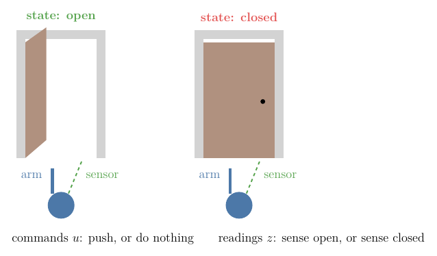
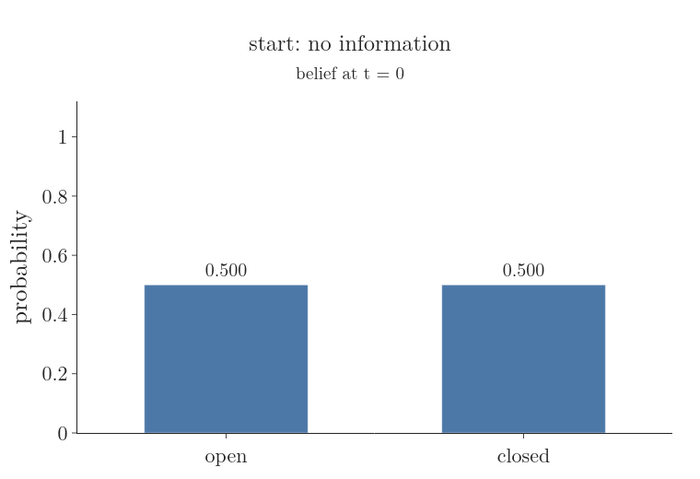
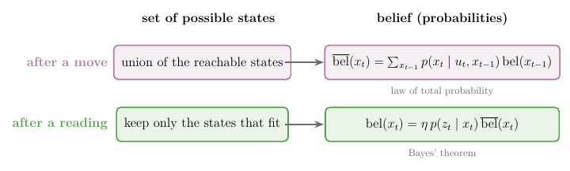

## 1. Overview

> **Key point:** The **Bayes filter** (G-2446) updates a robot's belief one step at a time: a prediction step pushes the belief through the motion model after each command, and a correction step multiplies it by the measurement probability after each reading. The robot never needs to store its history.

So far the robot keeps a [**belief**](../RO-013-belief/RO-013-belief.md#42-the-definition) (G-2433): a probability for every possible state, given every command and every reading since it started. That list is what still breaks. The list grows by one command and one reading at every step: a robot that reads its sensor 10 times a second holds 36,000 readings after an hour, and by its definition the belief must be recomputed from all of them. This Note adds the Bayes filter, which keeps only the last belief, and answers the question: **how can a robot keep its belief up to date at every step, using only the newest command and the newest reading?**



We leave the hallway, where the [**belief**](../RO-013-belief/RO-013-belief.md#1-overview) (G-2433) was a probability for each of 10 cells, for Thrun's door world (Figure 1): 2 states instead of 10 cells, so every sum can be done by hand (PR §2.4.2). The [grid filters](../RO-015-grid-filters/RO-015-grid-filters.md#1-overview) bring the filter back to the hallway. This Note covers:

- one reading at a time, with **Bayes' theorem** (G-269) that remembers earlier readings ([Section 3](#3-one-reading-at-a-time-bayes-theorem-with-past-readings));
- the filter itself, a **prediction step** (G-2447) and a correction step, worked on the door ([Section 4](#4-the-bayes-filter-predict-then-correct));
- why the two steps give the exact belief, and which three assumptions that needs ([Section 5](#5-why-the-two-steps-give-the-exact-belief));
- the same two steps on a continuous position, where sums become **integrals** (G-957) ([Section 6](#6-the-same-two-steps-on-a-continuous-position));
- why the belief is all the robot needs to keep ([Section 7](#7-the-belief-is-the-probabilistic-information-state)), and which later filters are this one in disguise ([Section 8](#8-one-equation-many-filters)).

## 2. The door world

> **Key point:** One state (the door, open or closed), two commands (push, do nothing), one noisy sensor. Its two probability tables are all the filter needs.

The robot does not know whether the door is open. The two tables that drive the [**belief**](../RO-013-belief/RO-013-belief.md#5-the-two-tables-that-drive-the-belief) (G-2433) describe the robot (PR §2.4.2); with them and its last belief, the filter never needs the list of past readings. At step $t$:

- $x_t$ is the [**state**](../RO-007-why-a-robot-is-never-sure/RO-007-why-a-robot-is-never-sure.md#41-state-from-one-number-to-many) (G-2314), the door at time $t$: open or closed;
- $x_{t-1}$ is the door one step earlier;
- $x_0$ is the door at the start, before any command;
- $u_t$ is the command: push or do nothing (do nothing at $t = 1$, push at $t = 2$);
- $z_t$ is the reading: "sense open" or "sense closed" ("sense open" at both steps);
- $\text{bel}(x_t)$ is the robot's belief, its probability for each door state at time $t$, a number from 0 to 1 (0.5 for open at the start).

The [**measurement probability**](../RO-013-belief/RO-013-belief.md#52-what-the-sensor-reads-in-each-place-the-measurement-probability) (G-2435) $p(z_t \mid x_t)$: the sensor reads "open" or "closed", and is sometimes wrong.

| True door | p(sense open) | p(sense closed) |
|---|---|---|
| open | 0.6 | 0.4 |
| closed | 0.2 | 0.8 |

The numbers are the same as for the door sensor of the hallway.

The [**state transition probability**](../RO-013-belief/RO-013-belief.md#51-how-a-command-moves-the-robot-the-state-transition-probability) (G-2434) $p(x_t \mid u_t, x_{t-1})$: the robot can push the door or do nothing.

| Command | Door before | p(open after) | p(closed after) |
|---|---|---|---|
| push | open | 1 | 0 |
| push | closed | 0.8 | 0.2 |
| do nothing | open | 1 | 0 |
| do nothing | closed | 0 | 1 |

A push on a closed door fails one time in five, because the door is heavy. Doing nothing changes nothing.

**The start.** The robot has no idea, so its first belief is:

$$\text{bel}(x_0 = \text{open}) = 0.5$$

$$\text{bel}(x_0 = \text{closed}) = 0.5$$

**The run.** At $t = 1$ the robot does nothing and senses "open". At $t = 2$ it pushes and senses "open" again. We want its belief after each step.

## 3. One reading at a time: Bayes' theorem with past readings

> **Key point:** **Bayes' theorem** (G-269) turns "how likely is this reading in each state" into "how likely is each state given the reading". Applied again with the first answer as the new prior, it adds a second reading, provided the readings are independent once the state is known.

### 3.1 Why the robot needs Bayes' theorem

First the readings alone: can the robot take in a new reading without going back to the old ones? For now, nobody touches the door; the robot only reads. Its table tells it $p(z \mid x)$: how often the sensor reads "open" for each kind of door. The robot needs the other direction, $p(x \mid z)$: given the reading, how likely is each kind of door? For one reading:

- $x$ is the door, open or closed;
- $z$ is the reading, here "sense open";
- $p(x)$ is the [**prior**](../../../../MA/02-probability/MA-018-bayes-theorem/MA-018-bayes-theorem.md#3-the-names-of-the-four-parts) (G-1565), the **belief** (G-2433) in each door before the reading, 0.5 for open and 0.5 for closed;
- $p(z \mid x)$ is the chance of the reading given the door, from the table (0.6 for an open door, 0.2 for a closed one);
- $p(z)$ is the overall chance of the reading, 0.4 for "sense open" (found below);
- $p(x \mid z)$ is the [**posterior**](../../../../MA/02-probability/MA-018-bayes-theorem/MA-018-bayes-theorem.md#3-the-names-of-the-four-parts) (G-1536), the belief in each door after the reading (0.75 for open, found below).

[Bayes' theorem](../../../../MA/02-probability/MA-018-bayes-theorem/MA-018-bayes-theorem.md#4-the-formula-and-its-proof) (G-269) turns one into the other:

$$p(x \mid z) = \frac{p(z \mid x)\ p(x)}{p(z)}$$

**First reading, "sense open".** Multiply each prior by how well that door explains the reading:

$$\text{open: } 0.6 \times 0.5 = 0.3$$

$$\text{closed: } 0.2 \times 0.5 = 0.1$$

The two products are not yet probabilities, because they add to 0.4, not 1. Their sum is the [evidence](../../../../MA/02-probability/MA-018-bayes-theorem/MA-018-bayes-theorem.md#3-the-names-of-the-four-parts) (G-718) $p(z)$, the overall chance of the reading, by the [law of total probability](../../../../MA/02-probability/MA-019-bayes-problem/MA-019-bayes-problem.md#4-the-evidence-total-probability) (G-1053). Divide by it:

$$p(\text{open} \mid z_1) = 0.3 / 0.4 = 0.75$$

$$p(\text{closed} \mid z_1) = 0.1 / 0.4 = 0.25$$

Dividing by the sum is the same as multiplying by its inverse, written $\eta$ (eta):

$$\eta = 1 / 0.4 = 2.5$$

This number is the [**normaliser**](../RO-010-range-sensors-beam-model/RO-010-range-sensors-beam-model.md#41-measurement-noise-a-gaussian-around-the-expected-range) (G-2382): whatever factor makes the products add to 1, the same job it does for the [cut Gaussian of the beam model](../RO-010-range-sensors-beam-model/RO-010-range-sensors-beam-model.md#41-measurement-noise-a-gaussian-around-the-expected-range). We never need $p(z)$ from anywhere else, because it is always the sum of the products (PR §2.2).

### 3.2 A second reading: Bayes' theorem with background knowledge

One reading leaves a 0.25 chance of a closed door. To be surer, the robot reads again and again gets "open". Now the **belief** (G-2433) must depend on both readings. For the second reading:

- $x$ is the door, open or closed;
- $z$ is the new reading, here the second reading $z_2$, "sense open";
- $C$ is the background knowledge, everything known before $z$, here the first reading $z_1$, "sense open".

Bayes' theorem still works if every term also carries the earlier readings $C$ behind the bar:

$$p(x \mid z, C) = \frac{p(z \mid x, C)\ p(x \mid C)}{p(z \mid C)}$$

The formula is **Bayes' rule with background knowledge** (G-2452) (PR §2.2). The rule holds for the same reason as the plain rule: the joint probability of $x$ and $z$ given $C$ can be split two ways by the [multiplication rule](../../../../MA/02-probability/MA-015-conditional-probability/MA-015-conditional-probability.md#5-the-multiplication-rule) (G-2212), and setting the two equal gives the formula.

With $z_2$ in place of $z$ and $z_1$ in place of $C$, two of the terms are known:

- $p(x \mid z_1)$ is the answer of [Section 3.1](#31-why-the-robot-needs-bayes-theorem): the old posterior becomes the new prior;
- $p(z_2 \mid x, z_1)$ asks how likely the second reading is, given the door **and** the first reading.

Here the robot makes an assumption: **once the state of the door is known, the first reading tells nothing more about the second.** Each reading is the door plus its own independent sensor noise. So:

$$p(z_2 \mid x, z_1) = p(z_2 \mid x)$$

The assumption is [conditional independence](../../../../ML/07-classification/ML-082-naive-bayes-maths/ML-082-naive-bayes-maths.md#5-step-3-the-naive-assumption) (G-443): independence that holds **given** the state. The assumption does not say that the two readings are independent on their own. They are not, as the robot's own numbers show:

$$p(z_2 = \text{open}) = 0.6 \times 0.5 + 0.2 \times 0.5$$

$$= 0.4$$

$$p(z_2 = \text{open} \mid z_1 = \text{open})$$

$$= 0.6 \times 0.75 + 0.2 \times 0.25 = 0.5$$

A first "open" makes a second "open" more likely (0.5 instead of 0.4), because it makes an open door more likely. Only when the door is known does that link disappear.

**Second reading, "sense open".** Same recipe, with 0.75 and 0.25 as the prior:

$$\text{open: } 0.6 \times 0.75 = 0.45$$

$$\text{closed: } 0.2 \times 0.25 = 0.05$$

$$\eta = 1 / (0.45 + 0.05) = 2$$

$$p(\text{open} \mid z_1, z_2) = 2 \times 0.45 = 0.9$$

$$p(\text{closed} \mid z_1, z_2) = 2 \times 0.05 = 0.1$$

Figure 2 plays both readings. For each one, watch the two bars shrink when multiplied by 0.6 and 0.2, then grow back when rescaled by $\eta$, one over their sum: the belief in an open door climbs from 0.5 to 0.75, then to 0.9.

![Animation of the two readings. Each panel holds the belief in an open and a closed door (blue bars). For each reading, the bars of the belief before it are multiplied by p(z | x), the chance of "sense open" given the door: 0.6 for open, 0.2 for closed. The products turn grey: they add to 0.4 after the first reading and 0.5 after the second, not 1, so they are not yet probabilities. Then both are multiplied by η (eta), one over their sum (2.5, then 2), and grow back into blue bars that add to 1. The last frame shows the belief before any reading (0.5 for open), after the first sense open (0.75) and after the second (0.9)](images/two_readings_anim.gif)

The robot never went back to the first reading: it kept one number, 0.75, and reused it. That reuse is the whole idea of a filter. So far, though, nothing has changed the door between readings.

## 4. The Bayes filter: predict, then correct

> **Key point:** Each step has two parts. Prediction: after the command, add up every way of reaching each state. Correction: after the reading, multiply by the measurement probability and rescale.

### 4.1 Why a moving world needs a second step

[Section 3](#3-one-reading-at-a-time-bayes-theorem-with-past-readings) kept only the last answer, but it assumed nothing changes the door. Once the robot pushes, the door may change between readings, and a robot that drives changes its own position. The **belief** (G-2433), the robot's probability for each door state, must now follow two kinds of event: commands, which change the state and usually add doubt, and readings, which add knowledge (see the [**predicted belief**](../RO-013-belief/RO-013-belief.md#45-the-predicted-belief-after-the-move-before-the-reading) (G-2436)).

The direct way to know the belief is to recompute it from the whole history at every step (Figure 3, the archive row). Recomputing from the history is an archive, not a filter: after an hour at 10 readings a second, it holds 36,000 readings and keeps growing. The **Bayes filter** (G-2446) keeps only the last belief and updates it with the newest command and reading (Figure 3, the filter row). Updating a belief from the previous belief in this way is **recursive state estimation** (G-2450) (PR §2.4).

Figure 3 runs both ways on the door for two steps (the numbers are worked out in [Section 4.3](#43-the-correction-step)). Watch the archive gain two entries at every step and read them all again, while the filter turns its one stored belief into the next and drops the command and reading it used: both reach the same 0.983, as [Section 5](#5-why-the-two-steps-give-the-exact-belief) proves.

![Animation of the two ways to know the belief, on the door world. Archive row: every command u_t and reading z_t is stored (grey boxes), and the belief bel(x_t), the probability of each door state at time t, is recomputed from all of them. Filter row: only the last belief is stored (blue box); the newest command (purple) and reading (green) turn it into the new belief, and then the old belief, the command and the reading are dropped. Both give a belief in open of 0.5 at the start, 0.75 after step 1 (do nothing, sense open) and 0.983 after step 2 (push, sense open). The last frame shows any step t: the archive keeps growing, 36,000 readings after an hour at 10 a second, while the filter stores one belief](images/recursion_anim.gif)

### 4.2 The prediction step

After the command, before the reading, the robot wants its [**predicted belief**](../RO-013-belief/RO-013-belief.md#45-the-predicted-belief-after-the-move-before-the-reading) (G-2436) $\overline{\text{bel}}(x_t)$. The robot does not know the previous state, so it considers every previous state, asks how likely the command takes it to $x_t$, and weights that by how much it believed in that previous state. At step $t$:

- $x_{t-1}$ is the door before the command, open or closed;
- $x_t$ is the door after the command, open or closed;
- $u_t$ is the command, push at $t = 2$;
- $\text{bel}(x_{t-1})$ is the belief before the command, a number from 0 to 1 (0.75 for open after $t = 1$);
- $p(x_t \mid u_t, x_{t-1})$ is the state transition probability of [Section 2](#2-the-door-world), the chance that the command turns door $x_{t-1}$ into door $x_t$ (0.8 for a push that opens a closed door);
- $\sum_{x_{t-1}}$ adds over every possible previous state, here open and closed;
- $\overline{\text{bel}}(x_t)$ is the predicted belief, after the command and before the reading, a number from 0 to 1 (0.95 for open at $t = 2$).

Adding up every way of reaching $x_t$ is the **law of total probability** (G-1053):

$$\overline{\text{bel}}(x_t) = \sum_{x_{t-1}} p(x_t \mid u_t, x_{t-1})$$

$$\times\ \text{bel}(x_{t-1})$$

The formula is the **prediction step** (G-2447), also called the motion update or time update (PR §2.4.1).

**At $t = 2$, the command is "push"**, and the **belief** (G-2433) after $t = 1$ is 0.75 open ([Section 4.3](#43-the-correction-step) computes it). Figure 4 draws the four paths. Two of them end with the door open:

$$\overline{\text{bel}}(\text{open}) = 1 \times 0.75 + 0.8 \times 0.25$$

$$= 0.75 + 0.2 = 0.95$$

The other two end closed:

$$\overline{\text{bel}}(\text{closed}) = 0 \times 0.75 + 0.2 \times 0.25$$

$$= 0.05$$

In Figure 4, watch the bars as each path is taken: the 0.75 on open stays, and the closed bar's 0.25 splits, 0.2 moving to open and 0.05 staying. The predicted belief is 0.95 for open and 0.05 for closed.

![Animation of the prediction at t = 2, path by path. Left: a probability tree; its first branch is the belief after t = 1 (open 0.75, closed 0.25), its second what a push does (an open door stays open with probability 1; a closed door opens with 0.8 and stays closed with 0.2); each path's product is written at its end. Right: the belief as bars, blue for the belief after t = 1, orange for the predicted belief. Path 1 keeps 0.75 on open; path 2 moves nothing; path 3 lifts 0.2 off the closed bar and stacks it on open; path 4 leaves 0.05 on closed. The last frame shows the whole tree and the predicted belief: the two paths ending open give 0.75 + 0.2 = 0.95, the two ending closed give 0 + 0.05 = 0.05](images/predict_anim.gif)

The push raised the chance of an open door from 0.75 to 0.95 before the robot looked: it knows that pushing tends to open doors. At $t = 1$ the command was "do nothing", which keeps every door as it was, so the prediction changes nothing there:

$$\overline{\text{bel}}(\text{open}) = 1 \times 0.5 + 0 \times 0.5 = 0.5$$

$$\overline{\text{bel}}(\text{closed}) = 0 \times 0.5 + 1 \times 0.5 = 0.5$$

### 4.3 The correction step

After the reading, the robot applies **Bayes' theorem** (G-269) of [Section 3](#3-one-reading-at-a-time-bayes-theorem-with-past-readings) to the **predicted belief** (G-2436). At step $t$:

- $\overline{\text{bel}}(x_t)$ is the predicted belief of [Section 4.2](#42-the-prediction-step), a number from 0 to 1 (0.95 for open at $t = 2$);
- $z_t$ is the reading, "sense open" at $t = 2$;
- $p(z_t \mid x_t)$ is the measurement probability of [Section 2](#2-the-door-world), the chance of the reading given the door (0.6 for "sense open" at an open door);
- $\eta$ is the factor that rescales the products so they add to 1, one over their sum, as in [Section 3.1](#31-why-the-robot-needs-bayes-theorem) (1.724 at $t = 2$);
- $\text{bel}(x_t)$ is the **belief** (G-2433) after the reading, a number from 0 to 1 (0.983 for open at $t = 2$).

Written out:

$$\text{bel}(x_t) = \eta\ p(z_t \mid x_t)\ \overline{\text{bel}}(x_t)$$

The formula is the **correction step** (G-2448), also called the measurement update (PR §2.4.1). The step multiplies each state's predicted belief by how well that state explains the reading, then rescales with $\eta$ so the **beliefs** (G-2433) add to 1.

At $t = 1$ the prediction changed nothing, so the correction repeats [Section 3.1](#31-why-the-robot-needs-bayes-theorem): the belief in open becomes 0.75.

**At $t = 2$, the reading is again "sense open":**

$$\text{open: } 0.6 \times 0.95 = 0.57$$

$$\text{closed: } 0.2 \times 0.05 = 0.01$$

$$\eta = 1 / 0.58 = 1.724$$

$$\text{bel}(x_2 = \text{open}) = 1.724 \times 0.57$$

$$= 0.983$$

$$\text{bel}(x_2 = \text{closed}) = 1.724 \times 0.01$$

$$= 0.017$$

The numbers are Thrun's for the same example (PR §2.4.2). Between the two steps the robot kept only 0.75 and 0.25, never the command and reading before them. Figure 5 plays the whole run: watch the orange predicted belief and the blue belief take turns. The belief in open stays at 0.5 after "do nothing", rises to 0.75 after the first "sense open", to 0.95 after the push, before the robot looks, and to 0.983 after the second "sense open".



### 4.4 The algorithm

Together the two steps are the **Bayes filter** (G-2446) (PR §2.4.1). With the symbols listed in [Section 4.2](#42-the-prediction-step) and [Section 4.3](#43-the-correction-step), for every possible state $x_t$:

1. **Predict:** $\overline{\text{bel}}(x_t) = \sum_{x_{t-1}} p(x_t \mid u_t, x_{t-1})\ \text{bel}(x_{t-1})$.
2. **Correct:** $\text{bel}(x_t) = \eta\ p(z_t \mid x_t)\ \overline{\text{bel}}(x_t)$.

Then return $\text{bel}(x_t)$ and wait for the next command and reading.

> **Python:** one step of the filter for a finite set of states.
> ```python
> import numpy as np
> T_push = np.array([[1.0, 0.0],    # from open: to open, closed
>                    [0.8, 0.2]])   # from closed
> p_z = np.array([0.6, 0.2])        # p(sense open | open, closed)
> bel = np.array([0.75, 0.25])      # belief after t = 1
> bel_bar = bel @ T_push            # predict: [0.95, 0.05]
> bel = p_z * bel_bar
> bel = bel / bel.sum()             # correct: [0.983, 0.017]
> ```

In the code:

- `bel` is a vector of 2 numbers, the **belief** (G-2433) in open and in closed, (0.75, 0.25) after $t = 1$;
- `T_push` is a 2 × 2 matrix of transition probabilities for a push: row $i$ is the door before, column $j$ the door after, so the closed row is (0.8, 0.2);
- `bel @ T_push` is the matrix product, a vector of 2 numbers: entry $j$ adds belief times transition probability over every previous state $i$, which is the sum of the **prediction step** (G-2447).

The notebook `RO-014-bayes-filter.ipynb` runs both steps and checks every number above. The two steps dropped the history; the next section checks that nothing was lost.

## 5. Why the two steps give the exact belief

> **Key point:** Starting from the definition of the belief, five steps lead to the filter: Bayes' rule, a Markov assumption for readings, the **law of total probability** (G-1053), a Markov assumption for motion, and the assumption that the newest command says nothing about the past.

The two steps threw the history away. Here we show that nothing was lost: they give exactly $p(x_t \mid z_{1:t}, u_{1:t})$, the **belief** (G-2433) as defined over the whole history, and we name every assumption on the way (PR §2.4.3). The state $x_t$, the command $u_t$, the reading $z_t$ and the two probability tables are those of [Section 2](#2-the-door-world). The other symbols:

- $z_{1:t}$ is all readings $z_1, \ldots, z_t$, from time 1 to $t$, ("sense open", "sense open") at $t = 2$;
- $z_{1:t-1}$ is all readings before time $t$, only $z_1$ = "sense open" at $t = 2$;
- $u_{1:t}$ is all commands $u_1, \ldots, u_t$, (do nothing, push) at $t = 2$;
- $\text{bel}(x_t)$ is the belief, the probability of each state given all readings and commands, a number from 0 to 1 (0.983 for open at $t = 2$);
- $\overline{\text{bel}}(x_t)$ is the belief before the newest reading $z_t$, as in [Section 4.2](#42-the-prediction-step) (0.95 for open at $t = 2$);
- $\eta$ is the factor that rescales the beliefs so they add to 1 (1.724 at $t = 2$).

**Line 0, the definition.** Nothing is assumed:

$$\text{bel}(x_t) = p(x_t \mid z_{1:t},\ u_{1:t})$$

**Line 1, Bayes' rule with background knowledge.** Split the newest reading $z_t$ off from the rest; everything older is the background $C$ of [Section 3.2](#32-a-second-reading-bayes-theorem-with-background-knowledge). The denominator does not depend on $x_t$, so it becomes the **normaliser** (G-2382) $\eta$:

$$\text{bel}(x_t) = \eta\ p(z_t \mid x_t,\ z_{1:t-1},\ u_{1:t})$$

$$\times\ p(x_t \mid z_{1:t-1},\ u_{1:t})$$

This line is exact; it is a rule of probability.

**Line 2, the Markov assumption for readings.** If the state $x_t$ is known, the past readings and commands tell nothing more about the current reading. The assumption is the same as for the door readings in [Section 3.2](#32-a-second-reading-bayes-theorem-with-background-knowledge), and the arrow structure of the [**dynamic Bayes network**](../RO-013-belief/RO-013-belief.md#62-the-robot-as-a-dynamic-bayes-network) (G-2441):

$$p(z_t \mid x_t,\ z_{1:t-1},\ u_{1:t}) = p(z_t \mid x_t)$$

The second factor of Line 1 is the **predicted belief** (G-2436), by its definition. So:

$$\text{bel}(x_t) = \eta\ p(z_t \mid x_t)\ \overline{\text{bel}}(x_t)$$

The result is the **correction step** (G-2448). One assumption has paid for it: a history that grows forever dropped out of the measurement term.

**Line 3, the law of total probability.** We now unpack the predicted belief. We do not know where the robot was at $t - 1$, so we bring in every possible previous state and weight each by how likely it was. The sum brings in $x_{t-1}$ on purpose, to reach the previous belief:

$$\overline{\text{bel}}(x_t) = \sum_{x_{t-1}} p(x_t \mid x_{t-1},\ z_{1:t-1},\ u_{1:t})$$

$$\times\ p(x_{t-1} \mid z_{1:t-1},\ u_{1:t})$$

This line is exact.

**Line 4, the Markov assumption for motion.** If we know the previous state, the older readings and commands tell nothing more about where the newest command takes the robot; only $u_t$ still matters:

$$p(x_t \mid x_{t-1},\ z_{1:t-1},\ u_{1:t})$$

$$= p(x_t \mid u_t,\ x_{t-1})$$

**Line 5, the newest command does not tell us the past.** The last factor of Line 3 is the belief about $x_{t-1}$, except that it also knows $u_t$, the command given after time $t - 1$. We assume a command chosen now says nothing about where the robot was:

$$p(x_{t-1} \mid z_{1:t-1},\ u_{1:t})$$

$$= p(x_{t-1} \mid z_{1:t-1},\ u_{1:t-1})$$

$$= \text{bel}(x_{t-1})$$

This assumption can fail. A robot with collision avoidance never commands "drive 20 cm forward" while standing in front of a wall, so that command does tell us the robot was not at the wall. In most cases the command carries no such hint, and we drop it (PR §2.4.3).

**The result.** Putting Lines 4 and 5 into Line 3:

$$\overline{\text{bel}}(x_t) = \sum_{x_{t-1}} p(x_t \mid u_t,\ x_{t-1})$$

$$\times\ \text{bel}(x_{t-1})$$

The result is the **prediction step** (G-2447), and its last factor is the belief one step earlier: the formula refers to itself, so the robot only has to keep its last belief. The derivation used three assumptions:

1. readings depend only on the current state (Line 2);
2. the next state depends only on the previous state and the newest command (Line 4);
3. the newest command does not tell us about the previous state (Line 5).

The first two together are the [**Markov property**](../RO-007-why-a-robot-is-never-sure/RO-007-why-a-robot-is-never-sure.md#43-complete-state-and-the-markov-property) (G-2316) (PR §2.4.4): the current state is a complete summary of the past. When all three assumptions hold, the **Bayes filter** (G-2446) is not an approximation; it gives the exact belief. When they fail, for example when people walk around a robot whose map does not include them, the readings are no longer independent given the robot's [**pose**](../../../control/01-robot-models/RO-001-pose-and-differential-drive/RO-001-pose-and-differential-drive.md#22-why-position-is-not-enough-the-heading) (G-2280), its position and heading, and the filter can become overconfident (PR §2.4.4; Fox 1999). Nothing in the derivation needed the door's two states, so the same two steps hold for a position that can take any value.

## 6. The same two steps on a continuous position

> **Key point:** For a position that can take any value, the sum of the **prediction step** (G-2447) becomes an integral; the correction step is unchanged.

Positions in a real hallway are not 2 door states but any number of metres; the filter still needs only the last **belief** (G-2433), the robot's probability for each state, and the newest command and reading. The belief becomes a [probability density](../../../../MA/03-distributions/MA-022-pdf-and-continuous-cdf/MA-022-pdf-and-continuous-cdf.md#5-what-the-density-at-a-point-means) (G-1569), and the sum over previous states becomes an [integral](../../../../MA/03-distributions/MA-022-pdf-and-continuous-cdf/MA-022-pdf-and-continuous-cdf.md#3-area-under-the-curve-is-probability) (G-957), a sum over infinitely many thin slices. For a position:

- $x_t$ is the robot's position at time $t$, any number of metres;
- $x_{t-1}$ is its position one step earlier, in m;
- $\text{bel}(x_{t-1})$ is the belief one step earlier, now a probability density over positions, in probability per metre;
- $p(x_t \mid u_t,\ x_{t-1})$ is the motion model, the density of the new position given the command $u_t$ and the old position, in probability per metre;
- $\int \ldots\ dx_{t-1}$ adds over every previous position $x_{t-1}$, in slices of width $dx_{t-1}$;
- $\overline{\text{bel}}(x_t)$ is the **predicted belief** (G-2436), a density over the new position, in probability per metre.

The **prediction step** (G-2447) becomes:

$$\overline{\text{bel}}(x_t) = \int p(x_t \mid u_t,\ x_{t-1})$$

$$\times\ \text{bel}(x_{t-1})\ dx_{t-1}$$

The **correction step** (G-2448) is unchanged: multiply by $p(z_t \mid x_t)$ and rescale so the area under the curve is 1 (PR §2.4.1).

For a belief shaped like a single bell-shaped curve, a [**Gaussian**](../../../../MA/03-distributions/MA-024-normal-distribution/MA-024-normal-distribution.md#2-what-the-normal-distribution-is) (G-827), the correction step [multiplies two Gaussians into a narrower Gaussian](../RO-017-kalman-filter/RO-017-kalman-filter.md#45-the-same-answer-from-multiplying-gaussians), with the numbers worked out there. Whatever its shape, the belief is still all the robot keeps; the next section shows why that is enough.

## 7. The belief is the probabilistic information state

> **Key point:** The **belief** (G-2433), the robot's probability for each state, can be updated from the previous belief, the newest command and the newest reading alone. So it carries everything the history knew, and the robot can throw the history away.

Why may the robot throw its history away? Because [Section 5](#5-why-the-two-steps-give-the-exact-belief) showed that the new belief needs only the old belief, the newest command $u_t$ and the newest reading $z_t$: whatever the history knew, the belief already holds. The [set of possible states](../RO-013-belief/RO-013-belief.md#3-summary-1-the-set-of-cells-the-robot-could-be-in) also had two update rules, one per event. LaValle puts the two summaries side by side (Figure 6):

- after a move, the **union** of all reachable states becomes the **sum** over all previous states (the **prediction step** (G-2447));
- after a reading, the **intersection** with the states that fit becomes **multiply by the measurement probability $p(z \mid x)$ and rescale** (the **correction step** (G-2448)).

In LaValle's words, marginalisation and Bayes' rule are "the probabilistic equivalents of union and intersection" (LaValle §11.2.3).



The belief, seen as a summary of the history, is the **probabilistic information state** (G-2451) (LaValle §11.2.3), a sufficient summary: any decision the robot could base on the whole history, it can base on the belief instead, without keeping the history (LaValle §11.2.3). The belief is enough to keep; the next section asks how to store it when the pose, the robot's position and heading, is continuous.

## 8. One equation, many filters

> **Key point:** Every filter in the rest of this chapter is the Bayes filter with a particular way of storing the **belief** (G-2433), the robot's probability for each state.

The **Bayes filter** (G-2446) keeps only the last belief, but it says what to compute, not how to store that belief over a continuous pose (position and heading), where the prediction sums over infinitely many previous states. Each practical filter answers that differently (PR §2.5):

- **[grid filters](../RO-015-grid-filters/RO-015-grid-filters.md#2-the-histogram-filter):** chop the space into cells and keep one probability per cell, as in the hallway; the sum stays a sum;
- **[**particle filter**](../RO-016-particle-filter/RO-016-particle-filter.md#3-a-belief-as-a-cloud-of-samples) (G-2492):** keep a cloud of sample states; dense clouds mean high belief;
- **[**Kalman filter**](../RO-017-kalman-filter/RO-017-kalman-filter.md#2-why-two-numbers-are-enough-the-linear-gaussian-system) (G-2506):** assume every belief is a **Gaussian** (G-827), a single bell-shaped curve, and keep only its mean and variance;
- **[**extended Kalman filter**](../RO-018-extended-kalman-filter/RO-018-extended-kalman-filter.md#2-the-kalman-filter-in-brief-and-why-nonlinear-functions-break-it) (G-2520):** the Kalman filter for motion and sensor models whose graphs are curves, not straight lines: [**nonlinear functions**](../RO-018-extended-kalman-filter/RO-018-extended-kalman-filter.md#1-overview) (G-2530).

Each is a different bet about what shape the belief is allowed to have. Knowing the Bayes filter tells us what each of them is trying to compute, and what breaks when its bet is wrong.

## 9. Summary

| Step | When | Formula | Effect on the belief |
|---|---|---|---|
| Prediction | after the command $u_t$ | $\overline{\text{bel}}(x_t) = \sum p(x_t \mid u_t, x_{t-1})\ \text{bel}(x_{t-1})$ | shifts it and usually widens it |
| Correction | after the reading $z_t$ | $\text{bel}(x_t) = \eta\ p(z_t \mid x_t)\ \overline{\text{bel}}(x_t)$ | multiplies up the states that fit, then rescales |

- The robot keeps only its last **belief** (G-2433) and updates it with the newest command and reading, so it never stores the history (36,000 readings after an hour at 10 a second): in the door world two steps took the belief in an open door from 0.5 to 0.983, with only 0.75 and 0.25 kept in between.
- **Bayes' theorem** (G-269) turns the measurement probability $p(z \mid x)$, which we can measure, into $p(x \mid z)$, the chance of each door given the reading, which the robot needs, so one reading moves the door belief from 0.5 to 0.75.
- With background knowledge, the old posterior becomes the new prior, so a second reading moves it to 0.9 without revisiting the first; this needs the readings to be independent given the state, not independent outright.
- The prediction step adds up every way of reaching each state (the **law of total probability** (G-1053)), because the robot does not know its previous state; a push raised the door belief to 0.95 before the robot looked.
- The **correction step** (G-2448) multiplies by the measurement probability $p(z_t \mid x_t)$ and divides by the sum, so the beliefs add to 1; the **normaliser** (G-2382) never has to be known in advance.
- The derivation is exact under three assumptions (readings depend only on the current state, motion only on the previous state and command, the newest command says nothing about the past), so the filter fails in the ways those assumptions fail.
- On a continuous position the sum of the **prediction step** (G-2447) becomes an integral, because there are infinitely many previous positions to add up; the correction step is unchanged.
- The new belief needs only the last belief, the newest command $u_t$ and the newest reading $z_t$, so it carries everything the history knew: it is the **probabilistic information state** (G-2451).

The robot can now keep its belief up to date from the newest command and reading alone. Still missing: the prediction sums over every previous state, and a position has infinitely many, so the sum cannot be done as written; [grid filters](../RO-015-grid-filters/RO-015-grid-filters.md#1-overview) turn it into a sum over 10 cells.

## 10. Sources

**Built from**

- Robo Code Hub, "Bayes Filter Explained | Every Kalman Filter Is This One Equation", YouTube, https://www.youtube.com/watch?v=7GGqhHKz8RA
- Cyrill Stachniss, "Bayes Filter (Cyrill Stachniss)", YouTube, https://www.youtube.com/watch?v=0lKHFJpaZvE
- Carlotta A. Berry, PhD, "Advanced Mobile Robotics Lecture 2-2a: Recursive Bayesian Updating for State Estimation", YouTube, https://www.youtube.com/watch?v=3W6IxGNsKX4
- NPTEL IIT Madras, "Introduction to Robotics: Recursive State Estimation, Bayes Filter Illustration" (#30), YouTube, https://www.youtube.com/watch?v=8PtZx6SeJ2s
- Labbe, R. *Kalman and Bayesian Filters in Python*, ch.2 "Discrete Bayes Filter" (section "Bayes Theorem and the Total Probability Theorem"). https://github.com/rlabbe/Kalman-and-Bayesian-Filters-in-Python (Labbe ch.2)
- LaValle, S. M. (2006). *Planning Algorithms*. Cambridge University Press. §11.2.3 "Probabilistic information spaces". Free online: https://lavalle.pl/planning/node552.html (LaValle)
- DeNero, J., Klein, D. et al. *CS 188: Introduction to Artificial Intelligence*, online textbook, UC Berkeley. §8.2.1 "The forward algorithm" (the two steps derived from marginalisation and Bayes' rule). https://inst.eecs.berkeley.edu/~cs188/textbook/hmms/hmm.html

**Other references**

- Fox, D., Burgard, W. and Thrun, S. (1999). Markov localization for mobile robots in dynamic environments. *Journal of Artificial Intelligence Research* 11, 391–427. §1–2: the Markov assumption and how people near the robot violate it. https://jair.org/index.php/jair/article/view/10246 (Fox 1999)
- Thrun, S., Burgard, W. and Fox, D. (2005). *Probabilistic Robotics*. MIT Press. §2.2 Bayes' rule with background knowledge, §2.4.1 the Bayes filter algorithm, §2.4.2 the door example, §2.4.3 its derivation, §2.4.4 the Markov assumption, §2.5 representation and computation. Cited only where the free sources above say the same (PR)

## 11. Key terms

Terms taught in this Note come first; linked terms are recaps, taught in the Note the link opens.

| Term | Meaning |
|---|---|
| Bayes filter (G-2446) | The algorithm that keeps a robot's belief up to date one step at a time: a prediction step after each command and a correction step after each reading; it gives the exact belief without storing the history, under the Markov assumption. |
| Prediction step (motion update) (G-2447) | The Bayes-filter step after a command: for each state, add up the probability of reaching it from every previous state, weighted by the belief in that state, $\overline{\text{bel}}(x_t) = \sum p(x_t \mid u_t, x_{t-1})\ \text{bel}(x_{t-1})$; it moves the belief with the robot and usually widens it, because the motion is uncertain; a near-certain command, such as a push that opens a door, can make the belief sharper. |
| Bayes' rule with background knowledge (G-2452) | Bayes' theorem with an extra condition $C$ in every term, $p(x \mid z, C) = p(z \mid x, C)\ p(x \mid C) / p(z \mid C)$, such as earlier readings; it lets the posterior after one reading serve as the prior for the next. |
| Recursive state estimation (G-2450) | Estimating the state by updating the previous estimate with only the newest command and reading, instead of recomputing from the whole history; it keeps the work per step fixed however long the robot runs. |
| Correction step (measurement update) (G-2448) | The Bayes-filter step after a reading: multiply each state's predicted belief by the measurement probability $p(z_t \mid x_t)$ and rescale so the beliefs add to 1; it raises the states that explain the reading and sharpens the belief. |
| Probabilistic information state (G-2451) | The belief viewed as a summary of the robot's history: a probability distribution over states that can be updated from itself, the newest command and the newest reading, so it carries everything the history knew and the history can be discarded. |
| [Belief](../../../../RO/localization/02-bayes-filters/RO-013-belief/RO-013-belief.md#42-the-definition) (G-2433) | The robot's probability for each possible state given all its commands and readings, $\text{bel}(x_t) = p(x_t \mid z_{1:t}, u_{1:t})$; a short summary of the history that says how strongly the evidence points to each state. |
| [Bayes' theorem](../../../../MA/02-probability/MA-018-bayes-theorem/MA-018-bayes-theorem.md#4-the-formula-and-its-proof) (G-269) | The rule that reverses a conditional probability: from $P(B \mid A)$ it gives $P(A \mid B)$, so a belief about $A$ can be updated after seeing $B$; $P(A \mid B) = P(B \mid A) P(A) / P(B)$. |
| [Integration](../../../../MA/03-distributions/MA-022-pdf-and-continuous-cdf/MA-022-pdf-and-continuous-cdf.md#3-area-under-the-curve-is-probability) (G-957) | Finding the area under a curve by adding up infinitely many thin strips. |
| [State $x_t$](../../../../RO/localization/02-bayes-filters/RO-007-why-a-robot-is-never-sure/RO-007-why-a-robot-is-never-sure.md#41-state-from-one-number-to-many) (G-2314) | The quantities a robot keeps track of at time $t$ because they decide what happens next, such as its pose, its speeds and moving things around it; it is what localization and filtering estimate. |
| [Measurement probability](../../../../RO/localization/02-bayes-filters/RO-013-belief/RO-013-belief.md#52-what-the-sensor-reads-in-each-place-the-measurement-probability) (G-2435) | The probability of a sensor reading given the true state, $p(z_t \mid x_t)$, such as 0.6 for reading "door" in front of a door; it tells the robot how well each state explains a reading. |
| [State transition probability](../../../../RO/localization/02-bayes-filters/RO-013-belief/RO-013-belief.md#51-how-a-command-moves-the-robot-the-state-transition-probability) (G-2434) | The probability of the next state given the command and the previous state, $p(x_t \mid u_t, x_{t-1})$, such as 0.8 for "move 2" taking the robot from cell 1 to cell 3; it tells the robot how a command changes where it is. |
| [Prior](../../../../MA/02-probability/MA-018-bayes-theorem/MA-018-bayes-theorem.md#3-the-names-of-the-four-parts) (G-1565) | The probability of an event before any evidence is seen. |
| [Posterior](../../../../MA/02-probability/MA-018-bayes-theorem/MA-018-bayes-theorem.md#3-the-names-of-the-four-parts) (G-1536) | The probability of an event after the evidence is taken into account. |
| [Evidence](../../../../MA/02-probability/MA-018-bayes-theorem/MA-018-bayes-theorem.md#3-the-names-of-the-four-parts) (G-718) | The overall chance of seeing what we observed, counted over every possible hypothesis, written $P(E)$. Bayes' theorem divides by it: posterior = likelihood × prior / evidence. |
| [Law of total probability](../../../../MA/02-probability/MA-019-bayes-problem/MA-019-bayes-problem.md#1-overview) (G-1053) | The rule for the overall probability of an event: add its probability under each case, weighted by how likely that case is, $P(B) = \sum_i P(B \mid A_i) P(A_i)$, when the cases $A_i$ are mutually exclusive and cover every possibility. |
| [Normalizer $\eta$](../../../../RO/localization/02-bayes-filters/RO-010-range-sensors-beam-model/RO-010-range-sensors-beam-model.md#41-measurement-noise-a-gaussian-around-the-expected-range) (G-2382) | The factor that rescales a set of numbers, or a density, so that they add up (or integrate) to 1; it is always one over the current total: the sum of the products in the Bayes filter (1/0.4 = 2.5 after a reading in the door world), the area under the cut curve in the beam model (1/0.655 = 1.53). |
| [Multiplication rule](../../../../MA/02-probability/MA-015-conditional-probability/MA-015-conditional-probability.md#5-the-multiplication-rule) (G-2212) | The chance that both A and B happen is the chance of B times the chance of A given B: $P(A \cap B) = P(A \mid B) \times P(B)$. |
| [Conditional independence](../../../../ML/07-classification/ML-082-naive-bayes-maths/ML-082-naive-bayes-maths.md#5-step-3-the-naive-assumption) (G-443) | Independence that holds once a third variable is known: given the class, knowing one feature tells nothing more about another. Naive Bayes assumes it so it can multiply one probability per feature. |
| [Predicted belief](../../../../RO/localization/02-bayes-filters/RO-013-belief/RO-013-belief.md#45-the-predicted-belief-after-the-move-before-the-reading) (G-2436) | The belief after the latest command but before the latest reading, $\overline{\text{bel}}(x_t) = p(x_t \mid z_{1:t-1}, u_{1:t})$; it separates the doubt a move adds from the knowledge a reading brings. |
| [Dynamic Bayes network](../../../../RO/localization/02-bayes-filters/RO-013-belief/RO-013-belief.md#62-the-robot-as-a-dynamic-bayes-network) (G-2441) | A Bayesian network that repeats the same variables at every time step, such as states, commands and readings of a robot; it shows which variable depends on which over time, so a whole run's probability splits into small factors. |
| [Markov property](../../../../RO/localization/02-bayes-filters/RO-007-why-a-robot-is-never-sure/RO-007-why-a-robot-is-never-sure.md#43-complete-state-and-the-markov-property) (G-2316) | The property of a sequence of states that the future depends on the past only through the present state; it lets a filter forget the history and work from the latest state alone. |
| [Pose](../../../../RO/control/01-robot-models/RO-001-pose-and-differential-drive/RO-001-pose-and-differential-drive.md#22-why-position-is-not-enough-the-heading) (G-2280) | Where a robot is and which way it faces: on a floor, its position $(x, y)$ and heading $\theta$, such as (2 m, 1 m, 30°); needed because a robot at one spot drives off differently depending on its heading. |
| [Probability density](../../../../MA/03-distributions/MA-022-pdf-and-continuous-cdf/MA-022-pdf-and-continuous-cdf.md#5-what-the-density-at-a-point-means) (G-1569) | The height of a continuous distribution's curve; compares how likely nearby values are. |
| [Gaussian distribution](../../../../MA/03-distributions/MA-024-normal-distribution/MA-024-normal-distribution.md#2-what-the-normal-distribution-is) (G-827) | Another name for the normal distribution: the symmetric, bell-shaped continuous distribution set by its mean and standard deviation, used to model many measurements. |
| [Particle filter](../../../../RO/localization/02-bayes-filters/RO-016-particle-filter/RO-016-particle-filter.md#4-the-particle-filter-step-by-step) (G-2492) | A Bayes filter that stores the belief as a set of weighted samples (particles) and runs each round as move, weigh, resample; it can hold beliefs of any shape, such as a belief with three modes, one at each of three doors. |
| [Kalman filter](../../../../RO/localization/02-bayes-filters/RO-017-kalman-filter/RO-017-kalman-filter.md#25-the-linear-gaussian-system) (G-2506) | The Bayes filter for a linear Gaussian system: it keeps the belief as a mean and a (co)variance and updates them with a predict step and an update step, blending a model's prediction with a sensor reading so the result is as certain as possible. |
| [Extended Kalman filter (EKF)](../../../../RO/localization/02-bayes-filters/RO-018-extended-kalman-filter/RO-018-extended-kalman-filter.md#41-the-algorithm) (G-2520) | The Kalman filter for nonlinear motion and sensor models: it moves the mean through the nonlinear functions and uses their Jacobians at the latest estimate in place of $F$ and $H$, so it can track unimodal beliefs through nonlinear models. |
| [Nonlinear function](../../../../RO/localization/02-bayes-filters/RO-018-extended-kalman-filter/RO-018-extended-kalman-filter.md#1-overview) (G-2530) | A function whose graph is not a straight line, so it is not a fixed multiple of the input plus a constant, such as the beacon distance $h(x) = \sqrt{(6 - x)^2 + 4}$; it bends a Gaussian into another shape, which is why the Kalman filter cannot use it as it is and the extended Kalman filter linearises it. |
