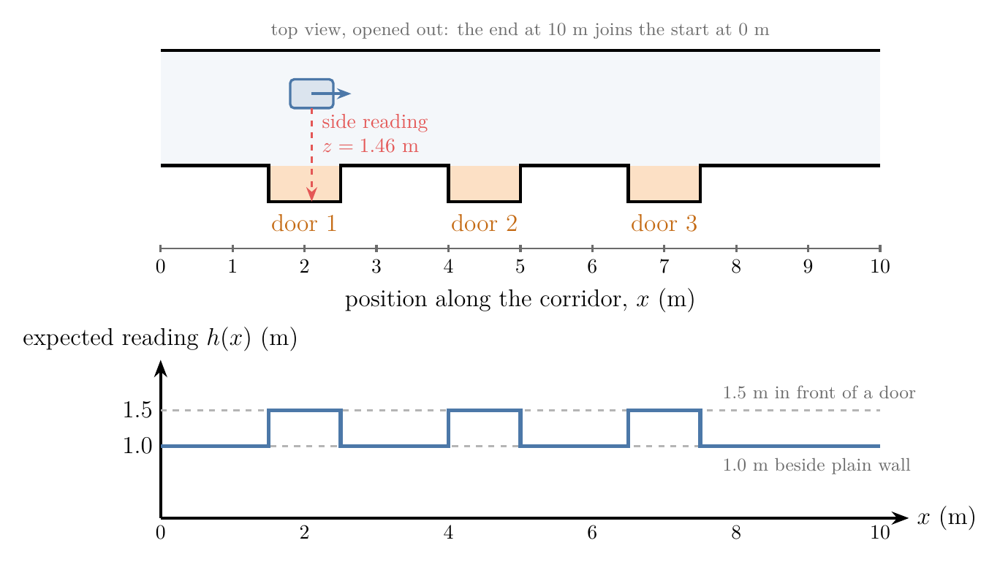
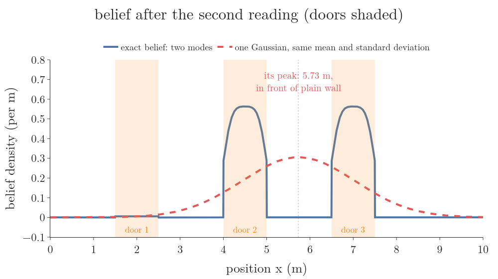
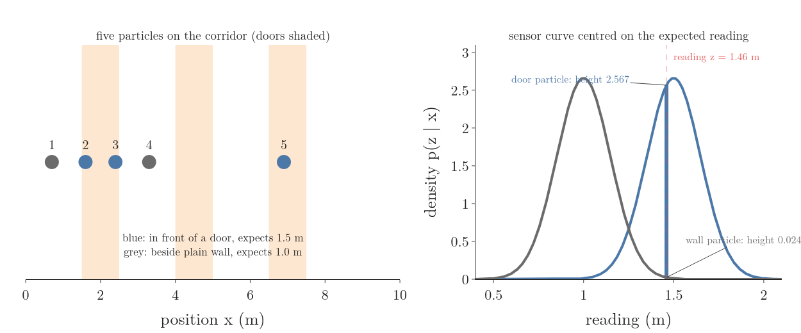

<!-- where-this-fits: generated by course_map/build_map.py; edit concepts.yaml, not this block -->
> **Where this fits:**
>
> - **Builds on:** [Sampling distribution and standard error](../../../../MA/04-inference/MA-033-sampling-distribution-and-clt/MA-033-sampling-distribution-and-clt.md#3-sampling-distributions); [Likelihood](../../../../MA/08-likelihood/MA-069-probability-vs-likelihood/MA-069-probability-vs-likelihood.md#22-likelihood-from-the-event-back-to-the-parameter); [Probabilistic motion models](../../../../RO/localization/02-bayes-filters/RO-008-probabilistic-motion-models/RO-008-probabilistic-motion-models.md#22-the-motion-model-and-its-density); [Bayes filter](../../../../RO/localization/02-bayes-filters/RO-014-bayes-filter/RO-014-bayes-filter.md#44-the-algorithm); [Histogram filter](../../../../RO/localization/02-bayes-filters/RO-015-grid-filters/RO-015-grid-filters.md#2-the-histogram-filter).
> - **Compare with:** [Histogram filter](../../../../RO/localization/02-bayes-filters/RO-015-grid-filters/RO-015-grid-filters.md#2-the-histogram-filter); [Kalman filter](../../../../RO/localization/02-bayes-filters/RO-017-kalman-filter/RO-017-kalman-filter.md#25-the-linear-gaussian-system); [Extended Kalman filter](../../../../RO/localization/02-bayes-filters/RO-018-extended-kalman-filter/RO-018-extended-kalman-filter.md#4-the-extended-kalman-filter).
<!-- /where-this-fits -->

## 1. Overview

> **Key point:** A particle filter keeps the robot's **belief** (G-2433) as a cloud of guesses. Each reading reweighs the guesses, resampling keeps the heavily weighted ones, and each move shifts them all; the cloud can take any shape, including several peaks at once.



So far the robot can run the Bayes filter with a [**histogram filter**](../RO-015-grid-filters/RO-015-grid-filters.md#2-the-histogram-filter) (G-2461): one probability per cell of the 10-cell hallway. The histogram filter becomes impractical when the state grows: a floor robot's pose $(x, y, \theta)$, its position and heading, already needs [7.2 million cells](../RO-015-grid-filters/RO-015-grid-filters.md#31-why-the-number-of-cells-grows-so-fast). This Note keeps the belief as a cloud of samples instead, placed only where the robot may be.

A robot is somewhere in the corridor of Figure 1. It has a map of the corridor, but it does not know where it is. Its side sensor reads 1.46 m, which means "a door is beside me". Three doors fit that reading, so the reading's answer to "where am I?" is "at door 1, door 2 or door 3, about equally likely": a belief with a peak at each door. These peaks are the belief's three [**modes**](../../../../MA/01-descriptive-stats/MA-005-measures-of-central-tendency/MA-005-measures-of-central-tendency.md#5-mode) (G-1251), so the belief is [**multimodal**](../../../../MA/01-descriptive-stats/MA-005-measures-of-central-tendency/MA-005-measures-of-central-tendency.md#5-mode) (G-1275).

The [**Bayes filter**](../RO-014-bayes-filter/RO-014-bayes-filter.md#44-the-algorithm) (G-2446) gives the rule for updating such a belief. Two other ways of running it are poorly suited here:

- the **grid filter**, or [**histogram filter**](../RO-015-grid-filters/RO-015-grid-filters.md#2-the-histogram-filter) (G-2461), stores one number per cell, which is fine on a 10 m line but grows very fast with the number of state variables;
- the [**Kalman filter**](../RO-017-kalman-filter/RO-017-kalman-filter.md#22-a-gaussian-is-two-numbers) (G-2506) stores the belief as a single bell-shaped curve, a [**Gaussian**](../../../../MA/03-distributions/MA-024-normal-distribution/MA-024-normal-distribution.md#2-what-the-normal-distribution-is) (G-827), and one Gaussian has only one mode ([Section 3.1](#31-why-one-gaussian-is-not-enough)).

The **particle filter** (G-2492) stores the belief as a set of sample guesses instead. This Note builds it on the corridor of Figure 1:

- why a cloud of samples can stand for a belief, and how accurate it is ([Section 3](#3-a-belief-as-a-cloud-of-samples));
- the three steps, move, weigh and resample, worked by hand and then run on the corridor ([Section 4](#4-the-particle-filter-step-by-step));
- the **low-variance sampler** (G-2499), the standard way to resample ([Section 4.3](#43-resample-copy-the-heavy-particles-drop-the-light-ones));
- what fails with too few **particles** (G-2491), and the fixes ([Section 5](#5-particle-deprivation)).

## 2. The running example and the Bayes filter in brief

> **Key point:** To tell the three doors apart, the robot has a map, a noisy side sensor and wheels that slip. The Bayes filter turns these into a **belief** (G-2433) with two steps per round: predict with the motion, update with the reading.

### 2.1 The corridor, the sensor and the motion

The corridor loops round a block and is 10 m around, so position 10 m is position 0 m again. The corridor is not the 10-cell [hallway](../RO-015-grid-filters/RO-015-grid-filters.md#21-why-cells) of the grid filter: a **particle** (G-2491) is a position, not a cell, so here the position is a continuous number of metres, and the doors are 1 m stretches of wall. Three doors are set 0.5 m back into the right-hand wall (Figure 1):

| Door | From (m) | To (m) |
|---|---|---|
| 1 | 1.5 | 2.5 |
| 2 | 4.0 | 5.0 |
| 3 | 6.5 | 7.5 |

**The map.** The side sensor measures the distance to the right-hand wall. In symbols:

- $x$ is the robot's position along the corridor, in m, from 0 to 10 m;
- $h(x)$ is the expected reading, what the side sensor should read at position $x$, in m.

The map tells us what it should read at each position:

$$h(x) = 1.5 \text{ m in front of a door}$$

$$h(x) = 1.0 \text{ m beside plain wall}$$

For example, $h(2.0) = 1.5$ m and $h(3.0) = 1.0$ m.

**The sensor model.** The sensor model, the [**measurement model**](../RO-010-range-sensors-beam-model/RO-010-range-sensors-beam-model.md#22-why-we-need-a-measurement-model) (G-2374) of this corridor, gives the density of a reading at each position. The sensor is noisy: its error follows a Gaussian, also called a [normal distribution](../../../../MA/03-distributions/MA-024-normal-distribution/MA-024-normal-distribution.md#2-what-the-normal-distribution-is) (G-827) with mean 0 and standard deviation 0.15 m. In symbols:

- $z$ is the side sensor's reading, in m (1.46 m at the first reading);
- $\sigma_z$ is the standard deviation of the sensor's error, 0.15 m;
- $\mathcal{N}(z;\ h(x),\ \sigma_z^2)$ is the height at $z$ of the Gaussian with mean $h(x)$ and variance $\sigma_z^2$, the square of $\sigma_z$;
- $p(z \mid x)$ is the density of the reading $z$ when the robot is at $x$, in probability per metre (2.567 for the reading 1.46 m at a door, [Section 4.2](#42-weigh-the-update-step)).

So the reading $z$ at position $x$ has the density

$$p(z \mid x) = \mathcal{N}(z;\ h(x),\ \sigma_z^2)$$

a Gaussian centred on the expected reading. The [**beam model**](../RO-010-range-sensors-beam-model/RO-010-range-sensors-beam-model.md#5-the-beam-model-one-mixture-of-four-shapes) (G-2377) explains why real range sensors need a richer curve; one Gaussian is enough for this Note.

**The motion model.** Each move is commanded as $u = 2.5$ m. The wheels slip, so the true move is 2.5 m plus a random slip with standard deviation $\sigma_u = 0.15$ m, a simple probabilistic [**motion model**](../RO-008-probabilistic-motion-models/RO-008-probabilistic-motion-models.md#22-the-motion-model-and-its-density) (G-2319).

**The run.** The robot starts at 2.1 m, takes three readings and makes two moves:

| | Reading 1 | Move 1 | Reading 2 | Move 2 | Reading 3 |
|---|---|---|---|---|---|
| True position (m) | 2.10 | +2.52 | 4.62 | +2.46 | 7.08 |
| Reading $z$ (m) | 1.46 | | 1.58 | | 1.41 |

The filter never sees the true positions; they are there so we can check its answers.

### 2.2 The Bayes filter in brief

The robot's **belief** $\text{bel}(x_t)$ is a probability distribution over where it is at time $t$, given every command and reading so far ([**belief**](../RO-013-belief/RO-013-belief.md#42-the-definition) (G-2433)). The [**Bayes filter**](../RO-014-bayes-filter/RO-014-bayes-filter.md#44-the-algorithm) (G-2446) updates it in two steps per round.

At step $t$:

- $x_t$ is the robot's position at step $t$, in m (2.10 m at the first reading, which the filter never sees);
- $x_{t-1}$ is its position one step earlier, in m;
- $u_t$ is the command, a move of 2.5 m;
- $z_t$ is the side sensor's reading, in m (1.46 m at the first reading);
- $\text{bel}(x_{t-1})$ is the belief one step earlier, a density over positions, in probability per metre;
- $p(x_t \mid u_t, x_{t-1})$ is the motion model, the density of the new position given the command and the old position, in probability per metre;
- $\int \ldots\ dx_{t-1}$ adds over every previous position $x_{t-1}$;
- $\overline{\text{bel}}(x_t)$ (read "bel bar") is the predicted belief, after the move and before the reading;
- $p(z_t \mid x_t)$ is the sensor model of [Section 2.1](#21-the-corridor-the-sensor-and-the-motion), in probability per metre;
- $\eta$ is the number that makes the total 1;
- $\text{bel}(x_t)$ is the belief after the reading.

**Predict** with the command $u_t$: every place $x_{t-1}$ the robot may have been sends probability to the places the move may take it.

$$\overline{\text{bel}}(x_t) = \int p(x_t \mid u_t, x_{t-1})$$

$$\qquad \times\ \text{bel}(x_{t-1})\ dx_{t-1}$$

**Update** with the reading $z_t$: multiply by how well each place explains the reading, then rescale so the total is 1.

$$\text{bel}(x_t) = \eta\ p(z_t \mid x_t)\ \overline{\text{bel}}(x_t)$$

The update is [Bayes' theorem](../../../../MA/02-probability/MA-018-bayes-theorem/MA-018-bayes-theorem.md#3-the-names-of-the-four-parts) (G-269) with the predicted belief as the prior.

The two formulas are exact, but they hold whole curves, and an integral over a curve cannot be computed for most maps and sensors (Labbe ch.12). Every Bayes-filter variant is a way of storing the curve so that the two steps become sums a computer can do. The **particle filter** (G-2492) stores it as samples.

## 3. A belief as a cloud of samples

> **Key point:** The three-door belief of Figure 1 has **modes** (G-1251) that one Gaussian cannot hold, but many samples drawn from it can: the share of samples in a region estimates the probability of that region. Giving each sample a weight lets us change the distribution without moving the samples.

### 3.1 Why one Gaussian is not enough

The simplest way to store the curve would be one Gaussian. After the second reading, the exact belief (computed on a fine grid, [Section 4.5](#45-the-whole-loop-on-the-corridor)) has two **modes** (G-1251), one at door 2 and one at door 3 (Figure 2). The robot has seen "door, then 2.5 m later door again", and two places fit.



Suppose we describe this **belief** (G-2433) by one Gaussian, as a Kalman filter must. The best we can do is a Gaussian with the same mean and standard deviation:

$$\text{mean} = 5.73 \text{ m}$$

$$\text{standard deviation} = 1.31 \text{ m}$$

Figure 2 shows the result: the red curve peaks at 5.73 m, in front of plain wall, the one stretch where the last reading says the robot cannot be. One **Gaussian** (G-827) has one mode, so it cannot hold "here or there" (Labbe ch.12). We need a way of storing a belief that can take any shape.

### 3.2 Samples stand for a distribution: the Monte Carlo idea

Suppose we could draw guesses of the robot's position from its **belief** (G-2433), many of them. Where the belief is high, guesses would fall often; where it is low, rarely. Then the guesses alone would answer every question about the belief: "how likely is door 3?" becomes "what share of the guesses is at door 3?".

Estimating a probability or an average by counting random samples is a **Monte Carlo estimate** (G-2493) (Labbe ch.12). A Monte Carlo estimate needs no formula for the distribution's shape, which is why it can follow two **modes** (G-1251), a step or anything else.

The price of a Monte Carlo estimate is randomness: a different set of samples gives a slightly different answer. More samples give a steadier answer. In our corridor, the share of weight at door 3 after the third reading is exactly 0.956. Estimated by the **particle filter** (G-2492) of [Section 4](#4-the-particle-filter-step-by-step) with $M$ **particles** (G-2491), repeated 1000 times (notebook):

| Samples $M$ | Average estimate | Standard deviation |
|---|---|---|
| 100 | 0.950 | 0.030 |
| 1000 | 0.956 | 0.008 |

Ten times the samples cut the standard deviation by a little under four times, close to the square root of 10:

$$\sqrt{10} = 3.16$$

The standard deviation of an average of independent draws, its [standard error](../../../../MA/04-inference/MA-033-sampling-distribution-and-clt/MA-033-sampling-distribution-and-clt.md#42-mean-and-variance-of-the-sample-means) (G-1872), shrinks at that same rate.

Figure 3 shows the same thing as a picture. The animation draws positions one at a time from the exact belief after the second reading, the two-mode curve of Figure 2, and pauses at 20, 200 and 2000 samples. Watch the grey bars (each 0.25 m bin's share of the samples, divided by 0.25 m to give a value per metre) against the blue curve: at 20 samples they are ragged; at 2000 they follow the two modes.


### 3.3 Weighted samples

In a **particle filter** (G-2492) each sample is a **particle** (G-2491): one guess of the full state, here one position, with a number attached to it, its weight. At step $t$:

- $M$ is the number of particles, such as 100;
- $m$ is a particle's number, from 1 to $M$; the superscript $[m]$ marks particle $m$;
- $x_t^{[m]}$ is particle $m$'s position, in m (1.6 m for particle 2 of [Section 4.2](#42-weigh-the-update-step));
- $w_t^{[m]}$ is particle $m$'s weight, a number from 0 to 1 once the weights add up to 1 (0.3313 for particle 2);
- $\lbrace\langle \ldots \rangle \rbrace$ is the set of all $M$ pairs, each pair a position and its weight.

The **belief** (G-2433) is approximately the whole set:

$$\text{bel}(x_t) \approx \lbrace\langle x_t^{[m]},\ w_t^{[m]} \rangle \rbrace$$

The probability of a region is the sum of the weights of the particles in it (with weights that add up to 1). Equal weights give the plain sample count of [Section 3.2](#32-samples-stand-for-a-distribution-the-monte-carlo-idea). What is left is how to move and reweigh the particles as each command and reading arrives.

## 4. The particle filter, step by step

> **Key point:** Each round moves every **particle** (G-2491) by the command plus its own random slip, weighs it by how well it explains the reading, and resamples the set in proportion to the weights.

The **particle filter** (G-2492) is how the robot of Figure 1 gets from three doors to one: it runs the two Bayes-filter steps on particles, as a loop of three steps, move, weigh and resample. Figure 4 goes once round the loop with 100 particles on the corridor, the first round of the run in [Section 4.5](#45-the-whole-loop-on-the-corridor). Reading 1 comes before any move, so this round starts at weigh. Watch the lit box and the cloud under the loop:

- weigh: the particles at the doors gain weight, the rest lose it;
- resample: the light particles are dropped, and each door particle is copied 3 or 4 times;
- move: every particle shifts by the command, 2.5 m, then its own slip spreads the copies apart.

After one turn the 100 particles hold the three doors of the first reading as three clusters, each carried 2.5 m on.

![One round of the particle filter with 100 particles, frames 1 to 4 of Figure 8. Top: the loop of move, weigh and resample; the lit box is the step being done. Bottom: the particles on the corridor (orange: doors; marker size grows with weight; red triangle: the robot). Start: spread evenly, weight 0.01 each. Weigh by the reading z = 1.46 m: each particle's weight is p(z | x), the density of the reading z for a particle at position x, so the door particles grow. Resample: the 69 light particles are dropped (one survives by chance) and each door particle is copied 3 or 4 times. Move: every particle shifts by the command, 2.5 m, then adds its own slip. The last frame shows three clusters, each 2.5 m past a door, ready for reading 2](images/pf_cycle_anim.gif)

We work each step by hand first, then run all of them on the corridor.

### 4.1 Start: spread the particles evenly

The robot has no information about where it is, so every position is equally likely. We draw $M = 100$ positions at random, evenly between 0 and 10 m, and give each **particle** (G-2491) $m$ the same weight $w^{[m]}$:

$$w^{[m]} = 1 / M$$

$$= 1 / 100 = 0.01$$

Frame 1 of Figure 8 ([Section 4.5](#45-the-whole-loop-on-the-corridor)) shows this cloud.

### 4.2 Weigh: the update step

> **Key point:** A **particle** (G-2491)'s weight is the height of the sensor curve, centred on the reading the particle expects, at the actual reading.

**The idea.** The reading is 1.46 m. A particle in front of a door expects 1.5 m: close, so it explains the reading well. A particle beside plain wall expects 1.0 m: 0.46 m off, more than three sensor standard deviations, so it explains the reading badly. The weight turns "explains well" into a number.

**The weight.** For particle $m$:

- $x^{[m]}$ is its position, in m (1.6 m for particle 2 below);
- $z$ is the reading, 1.46 m;
- $p(z \mid x^{[m]})$ is the sensor model of [Section 2.1](#21-the-corridor-the-sensor-and-the-motion), the density of the reading $z$ at that position, in probability per metre (2.567 for particle 2);
- $w^{[m]}$ is the particle's weight, the same number (2.567 for particle 2) until it is normalised below.

For each particle we evaluate the sensor model at the reading $z$, with the robot at the particle's position:

$$w^{[m]} = p(z \mid x^{[m]})$$

The result is the **importance weight** (G-2494) of the particle: the height of the **Gaussian** (G-827), centred on the particle's expected reading $h(x^{[m]})$, at the reading $z$ (Figure 5). The weight is a height, not an area: the area under a density over a single point is zero, and the height is what a [likelihood](../../../../MA/08-likelihood/MA-069-probability-vs-likelihood/MA-069-probability-vs-likelihood.md#42-likelihood-is-a-height) (G-1086) is. The height is a density, not a probability, so it can be larger than 1.



**Worked example.** Consider five particles, with the reading $z = 1.46$ m and the sensor's standard deviation $\sigma_z = 0.15$ m. For particle 2, at 1.6 m in front of door 1, the gap between the reading $z$ and the expected reading $h(x)$ is:

$$z - h(x) = 1.46 - 1.5 = -0.04$$

In standard deviations:

$$-0.04 / 0.15 = -0.267$$

The height of the normal curve at that point:

$$\frac{1}{0.15\sqrt{2\pi}} = 2.660$$

$$e^{-0.5 \times 0.267^2} = 0.965$$

$$2.660 \times 0.965 = 2.567$$

For particle 1, at 0.7 m beside plain wall:

$$z - h(x) = 1.46 - 1.0 = 0.46$$

$$0.46 / 0.15 = 3.067$$

$$e^{-0.5 \times 3.067^2} = 0.00907$$

$$2.660 \times 0.00907 = 0.024$$

All five:

| Particle | Position (m) | Expected reading $h(x)$ (m) | Density $p(z \mid x)$ |
|---|---|---|---|
| 1 | 0.7 | 1.0 | 0.024 |
| 2 | 1.6 | 1.5 | 2.567 |
| 3 | 2.4 | 1.5 | 2.567 |
| 4 | 3.3 | 1.0 | 0.024 |
| 5 | 6.9 | 1.5 | 2.567 |

**Normalise.** The weights should add up to 1 so that they read as shares of the **belief** (G-2433). Dividing each by their total is [normalisation](../../../../ML/08-trees-and-ensembles/ML-110-adaboost-step-by-step/ML-110-adaboost-step-by-step.md#8-step-6-normalise-the-weights) (G-1347). The total:

$$3 \times 2.567 + 2 \times 0.024 = 7.749$$

A door particle's weight:

$$2.567 / 7.749 = 0.3313$$

A wall particle's weight:

$$0.024 / 7.749 = 0.0031$$

The division by the total is the $\eta$ of the update formula in [Section 2.2](#22-the-bayes-filter-in-brief): we never need to know it in advance.

### 4.2.1 Why weighting gives the right belief

After the move step ([Section 4.4](#44-move-the-predict-step)), the **particles** (G-2491) are samples of the predicted belief $\overline{\text{bel}}(x)$. The update of [Section 2.2](#22-the-bayes-filter-in-brief) multiplies that **belief** (G-2433) by the sensor model $p(z \mid x)$ and rescales. Giving each particle the weight $p(z \mid x)$ and normalising does that same update on the cloud, so the weighted cloud stands for the updated belief $\text{bel}(x)$ (Freiburg PF slides). Weighting is the multiply-then-rescale of the [histogram filter's sense step](../RO-015-grid-filters/RO-015-grid-filters.md#22-sense-multiply-then-rescale), with particles in place of cells.

### 4.3 Resample: copy the heavy particles, drop the light ones

> **Key point:** Resampling draws a fresh set of $M$ particles from the weighted set, each pick in proportion to weight, so the computation goes where the **belief** (G-2433) is. The low-variance sampler does it with one random number and keeps every particle whose weight is at least $1/M$, one over the number of particles $M$.

**Why resample.** After weighing, the two wall **particles** (G-2491) carry a weight of 0.0031 each; after a few more readings, most of 100 particles would carry weights near zero. They still cost a motion step and a sensor check each round but add almost nothing to the belief. In addition, a particle's weight only ever shrinks or grows by multiplication, so a few particles soon carry nearly all the weight and the cloud behaves as if it had two or three particles (Labbe ch.12 calls this degeneracy).

**The idea.** Draw $M$ new particles from the weighted set, [with replacement](../../../../ML/08-trees-and-ensembles/ML-099-bagging-intuition/ML-099-bagging-intuition.md#23-drawing-with-replacement) (G-2125), each draw picking particle $i$ with probability equal to its weight $w^{[i]}$. A heavy particle is picked several times, a light one probably never. The new particles all get the weight $1/M$ again: the copies have taken the place of the weight. This step is **resampling** (G-2498); it is the same "draw rows in proportion to weight" as [upsampling in AdaBoost](../../../../ML/08-trees-and-ensembles/ML-110-adaboost-step-by-step/ML-110-adaboost-step-by-step.md#9-step-7-upsampling-a-new-dataset-drawn-by-weight).

**Plain resampling.** Lay the weights end to end along the line from 0 to 1, so each particle owns a stretch as long as its weight (Figure 6, top). Draw $M$ independent random numbers between 0 and 1; each picks the particle whose stretch it lands in. Drawing with $M$ independent random numbers is **multinomial resampling** (G-2500). With our five weights, one draw of five numbers gave:

$$0.33,\ 0.99,\ 0.32,\ 0.79,\ 0.87$$

| Particle | 1 | 2 | 3 | 4 | 5 |
|---|---|---|---|---|---|
| Weight | 0.0031 | 0.3313 | 0.3313 | 0.0031 | 0.3313 |
| Copies (plain) | 0 | 2 | 0 | 0 | 3 |

Particle 3 carried a third of the belief and got no copy, by chance alone. The chance of that, with five independent draws each missing it with probability 0.6687:

$$0.6687^5 = 0.134$$

A good guess lost by chance is never recovered, because resampling only copies existing particles. [Section 5](#5-particle-deprivation) shows where that leads.

**The low-variance sampler.** Instead of $M$ independent random numbers, draw one random start $r$ between 0 and $1/M$, and place $M$ pointers exactly $1/M$ apart from it (Figure 6, bottom). Each pointer picks the particle it lands on. Resampling with evenly spaced pointers is the **low-variance sampler** (G-2499), also called systematic resampling (Freiburg PF slides; Labbe ch.12).

Figure 6 runs both on our five weights: first the five random numbers of plain resampling land one at a time, then the five evenly spaced pointers. Watch particle 3: plain resampling gives it no copy, the pointers give it one.


**Worked example.** With $M = 5$ the spacing is:

$$1/M = 0.2$$

Let the random start be $r = 0.12$. The pointers are:

$$0.12,\ 0.32,\ 0.52,\ 0.72,\ 0.92$$

The stretches end at the running totals of the weights:

| Particle | 1 | 2 | 3 | 4 | 5 |
|---|---|---|---|---|---|
| Stretch ends at | 0.0031 | 0.3344 | 0.6656 | 0.6687 | 1.0000 |
| Pointers landing | none | 0.12, 0.32 | 0.52 | none | 0.72, 0.92 |
| Copies | 0 | 2 | 1 | 0 | 2 |

**Why it is better.** Two reasons, both visible in Figure 6:

- **No good particle is lost.** A particle whose weight is at least $1/M$ owns a stretch at least as long as the pointer spacing, so at least one pointer must land in it. Particles 2, 3 and 5 (weight 0.3313, above 0.2) are always kept (Freiburg PF slides).
- **Less randomness.** All pointers move together with the one random start, so the number of copies a particle gets can only be the whole number just below or just above $M$ times its weight. For particle 3:

  $$
  5 \times 0.3313 = 1.66
  $$

  so it gets 1 or 2 copies. Over 100,000 repeats (notebook):

| Method | Average copies of particle 3 | Standard deviation of copies | Share of repeats with no copy |
|---|---|---|---|
| Low-variance | 1.655 | 0.475 | 0.000 |
| Plain | 1.654 | 1.052 | 0.135 |

Both give the same average, so neither favours any particle; the low-variance sampler's standard deviation is less than half as large. The low-variance sampler also needs one pass along the list, a running time proportional to $M$, against $M \log M$ for plain resampling with a search per draw (Freiburg PF slides; Labbe ch.12).

> **Python:** the low-variance sampler in four lines.
> ```python
> def low_variance(w, rng):
>     M = len(w)
>     pointers = rng.uniform(0, 1 / M) + np.arange(M) / M
>     return np.searchsorted(np.cumsum(w), pointers, side="right")
> ```
> `np.cumsum(w)` gives the stretch ends; `np.searchsorted(..., side="right")` returns, for each pointer, the index of the first stretch that ends beyond it. `x = x[low_variance(w, rng)]` is the new particle set.

### 4.4 Move: the predict step

> **Key point:** Each **particle** (G-2491) moves by the command plus its own random slip, drawn from the motion model, so copies spread apart again.

**The idea.** The robot is commanded 2.5 m. Each particle is one guess of where the robot was, so each moves 2.5 m too. The wheels slip, so we add to each particle its own random slip, drawn from the **normal distribution** (G-827) with standard deviation $\sigma_u = 0.15$ m. For a particle at 2.0 m whose slip draw is +0.08 m:

$$2.0 + 2.5 + 0.08 = 4.58 \text{ m}$$

Each particle's new position is one sample from the motion model $p(x_t \mid u_t, x_{t-1})$, so the whole set is a sample from the predicted belief $\overline{\text{bel}}(x_t)$: the integral of [Section 2.2](#22-the-bayes-filter-in-brief) is done by sampling, with no integral computed (Freiburg PF slides; [sampling a motion model](../RO-008-probabilistic-motion-models/RO-008-probabilistic-motion-models.md#5-drawing-sample-poses)).

**Why each particle gets its own slip.** After **resampling** (G-2498), particle 2 exists twice at exactly 1.6 m. With the same slip for both, the copies would stay identical forever, and after a few rounds the cloud would be a few points repeated many times. Independent slips spread the copies apart, so the cloud keeps covering the places the robot may be (Labbe ch.12 calls the collapse sample impoverishment).

Figure 7 follows the two copies of particle 2 through three moves of 2.5 m, each move drawn as the command and then the slip. Watch the gap between the copies: with one shared slip it stays 0.00 m; with a slip each it grows to 0.41 m.


### 4.5 The whole loop on the corridor

Figure 8 runs the filter with 100 **particles** (G-2491) through the three readings and two moves. Watch three things:

- after reading 1 (frame 2), the particles at the three doors gain weight and the rest lose it: three **modes** (G-1251);
- after move 1 and reading 2 (frames 4 and 5), only the clusters that saw "door, then door 2.5 m later" stay heavy: two modes, at doors 2 and 3;
- after move 2 and reading 3 (frames 7 and 8), one cluster is left, at door 3, around the robot.

The blue line in the lower panel is the exact **belief** (G-2433) from a fine grid (a [**histogram filter**](../RO-015-grid-filters/RO-015-grid-filters.md#2-the-histogram-filter) (G-2461) with 2000 cells); the grey bars, each 0.25 m bin's share of the weight divided by 0.25 m, follow it.


The share of weight at each door after each reading, from the particles of Figure 8 and from the exact grid (notebook):

| Reading | Door 1: particles, exact | Door 2: particles, exact | Door 3: particles, exact |
|---|---|---|---|
| 1 ($z$ = 1.46) | 0.33, 0.33 | 0.36, 0.33 | 0.29, 0.33 |
| 2 ($z$ = 1.58) | 0.00, 0.01 | 0.49, 0.50 | 0.51, 0.50 |
| 3 ($z$ = 1.41) | 0.00, 0.00 | 0.00, 0.01 | 0.96, 0.96 |

The cloud reflects the history without storing it: after reading 3, the only particles left are those whose whole path, door then door then door, fits every reading. The shares answer the opening's "door 1, door 2 or door 3": they start at about 0.33 each and end at 0.96 for door 3, where the robot is.

**One answer from a cloud, and a pitfall.** A controller usually needs one position. In symbols:

- $M$ is the number of particles, 100 here;
- $x^{[m]}$ is particle $m$'s position, in m;
- $w^{[m]}$ is its weight, a number from 0 to 1, the weights adding up to 1;
- $\sum_{m=1}^{M}$ adds over all particles, from $m = 1$ to $M$;
- $\hat{x}$ is the single position the filter reports, in m (7.05 m after reading 3).

The usual choice is the weighted mean of the particles:

$$\hat{x} = \sum_{m=1}^{M} w^{[m]}\ x^{[m]}$$

After reading 3 it gives 7.05 m; the robot is at 7.08 m. After reading 2, the same formula gives 5.73 m, between the two clusters, in front of plain wall (the black diamond in frame 5 of Figure 8). The weighted mean is a good answer only when the cloud has one cluster; with several, report the heaviest cluster or keep the whole cloud (Labbe ch.12).

### 4.6 The algorithm

Putting the steps together gives the particle filter of Thrun Table 4.3, as also given in the Freiburg PF slides. Inputs: the **particle** (G-2491) set $\mathcal X_{t-1}$ from the last round, the command $u_t$ and the reading $z_t$. The other symbols are listed in [Section 2.2](#22-the-bayes-filter-in-brief) and [Section 3.3](#33-weighted-samples).

1. For each particle $m = 1, \ldots, M$:
   - **move:** sample $x_t^{[m]}$ from $p(x_t \mid u_t, x_{t-1}^{[m]})$;
   - **weigh:** set $w_t^{[m]} = p(z_t \mid x_t^{[m]})$.
2. **Normalise** the weights so they add up to 1.
3. **Resample:** draw $M$ particles from the weighted set in proportion to the weights (**low-variance sampler** (G-2499)); they form $\mathcal X_t$, each with weight $1/M$.

Every line uses the models only to draw a sample or to evaluate a density. No model needs to be linear, smooth or Gaussian: our map is a step, which a **Kalman filter** (G-2506) could not use ([Section 3.1](#31-why-one-gaussian-is-not-enough)). With 100 particles the loop found the right door; with fewer, it can fail.

## 5. Particle deprivation

> **Key point:** If no **particle** (G-2491) is near the true state, no step can create one there, and the filter settles on a wrong answer. More particles and fewer, better-timed resamplings are the fixes.

### 5.1 Too few particles

The cloud can hold the three doors of Figure 1 only if some **particles** (G-2491) sit at each of them. Resampling only copies particles that exist, and the move step only shifts them a little. So once every particle near the true position has been dropped, the filter cannot recover. Losing the particles near the true state is **particle deprivation** (G-2501) (Thrun §4.3).

With few particles it happens often. Figure 9 first runs 5 particles and 100 particles on the same three readings. Watch the 5: none starts at door 1, where the robot starts, so they follow the one particle at door 3 and end clustered at door 1, the wrong door, while the 100 end at door 3. The last frame shows that this is not a rare event: we ran the corridor example 1000 times for each particle count and counted how often the filter ended at the right door.

![Frames 1 to 8: 5 particles (top) and 100 particles (bottom, the run of Figure 8) get the same three readings; marker size grows with weight, the red triangle is the robot. The 5 start with none at door 1; the one at door 3 takes the weight of reading 1, and its copies go round the loop and end tight at door 1, the wrong door (0.99 of the weight); the 100 end at door 3 (0.96). Last frame: share of 1000 runs that end at the right door, 43.9 percent with 5 particles, 63.0 with 10, 87.8 with 20, 99.6 with 50, 100 with 100](images/deprivation_anim.gif)

| Particles $M$ | 5 | 10 | 20 | 50 | 100 |
|---|---|---|---|---|---|
| Runs at the right door (percent) | 43.9 | 63.0 | 87.8 | 99.6 | 100.0 |

With 5 particles, the start often has no particle at door 1, the robot's true door, or resampling drops the few there; the filter then follows the surviving particles, with full confidence. Too few particles make the filter overconfident: it reports one tight cluster at the wrong door. The average share it gives door 3 shows the same bias: 0.432 with 5 particles against the exact 0.956 (notebook); a small particle set gives a biased **belief** (G-2433) (Thrun §4.3).

The problem grows with the number of state variables. A cloud of 100 points covers a 10 m line densely, but spread over a room's $(x, y, \theta)$ the same 100 points leave wide gaps, so the number of particles needed grows very fast with the state's dimension (Labbe ch.12).

### 5.2 Other fixes

- **More particles.** The direct fix, paid for in computation (Labbe ch.12).
- **Resample less often.** Each resampling discards variety. One rule resamples only when the weights have become uneven: when the effective number of **particles** (G-2491) falls below half of $M$, the number of particles (Labbe ch.12). In symbols:

  - $w^{[m]}$ is the weight of particle $m$, a number from 0 to 1, the weights adding up to 1;
  - $\sum_m$ adds over all $M$ particles;
  - $\hat N_{\text{eff}}$ is the effective number of particles, how many particles of equal weight the cloud is worth.

  $$
  \hat N_{\text{eff}} = 1 / \textstyle\sum_m (w^{[m]})^2
  $$

  With equal weights it equals $M$; with all weight on one particle it equals 1.
- **A very accurate sensor is a pitfall.** If the sensor curve is much narrower than the gaps between particles, almost every particle gets a weight near zero and the cloud collapses onto one or two. Modelling the sensor as noisier than it is, or using more particles, keeps enough particles alive (Labbe ch.12).

## 6. Summary

| Step | What it does | Why |
|---|---|---|
| Start | spread $M$ particles (100 here) evenly, weight $1/M$ each | the robot knows nothing yet |
| Move | each particle moves by the command $u$ plus its own slip | samples the predicted belief, no integral needed |
| Weigh | weight $w$ = sensor model $p(z \mid x)$, then normalise | weighting by $p(z \mid x)$ and rescaling turns the predicted cloud into the updated belief |
| Resample | draw $M$ new particles in proportion to weight | puts the computation where the belief is |

- The robot of Figure 1, which saw a door and could be at any of three (about 0.33 each), ends after three readings and two moves with 0.96 of its **belief** (G-2433) at door 3, where it is, because the cloud held all three doors until the readings could tell them apart.
- A cloud of samples can stand for any belief, because the share of samples in a region estimates its probability; the estimate's standard deviation shrinks like one over the square root of the sample count $M$ (0.030 at 100 **particles** (G-2491), 0.008 at 1000).
- One Gaussian cannot hold "door 2 or door 3": its peak lands at 5.73 m, in front of wall, so a **multimodal** (G-1275) belief needs a filter whose belief can take any shape, such as particles.
- A particle's weight is the height of the sensor curve at the reading (2.567 at a door, 0.024 at a wall), because weighting by the sensor model $p(z \mid x)$ and normalising is the multiply-and-rescale of the update step.
- **Resampling** (G-2498) with the low-variance sampler keeps every particle with weight at least $1/M$, one over the number of particles, and halves the randomness of plain resampling, so good guesses are not lost by chance.
- Each particle gets its own slip in the move step, so copies spread out and the cloud keeps covering the possible positions.
- The weighted mean is a safe answer only for one cluster, because with two it averages them and can land between them, in front of a wall (5.73 m after reading 2).
- Too few particles cause deprivation, because resampling only copies particles that exist, so a door left without particles is never recovered (43.9 percent right with 5 particles, 100 percent with 100).

The robot can now keep a belief of any shape, such as three doors at once. Still missing: every particle costs a motion step and a sensor check each round, and when the belief is a single **Gaussian** (G-827), two numbers, a mean and a variance, carry all of it, which is the [**Kalman filter**](../RO-017-kalman-filter/RO-017-kalman-filter.md#1-overview) (G-2506).

## 7. Sources

**Built from**

- MATLAB, "Understanding the Particle Filter | Autonomous Navigation, Part 2", YouTube, https://www.youtube.com/watch?v=NrzmH_yerBU
- James Han, "The Particle Filter: A Full Tutorial", YouTube, https://www.youtube.com/watch?v=BfKEf2s7Y80
- Bot Field, "Particle Filters | Robot Localization", YouTube, https://www.youtube.com/watch?v=ydC0mE0ZYSA
- NPTEL-NOC IITM, "Introduction to Robotics, #35 Particle Filter", YouTube, https://www.youtube.com/watch?v=UOKYhuGOUPI
- Labbe, R. *Kalman and Bayesian Filters in Python*, ch.12 "Particle Filters", https://github.com/rlabbe/Kalman-and-Bayesian-Filters-in-Python/blob/master/12-Particle-Filters.ipynb (Labbe ch.12)
- Burgard, W. et al. (Uni Freiburg), *Introduction to Mobile Robotics*, "Bayes Filter – Particle Filter and Monte Carlo Localization" slides, http://ais.informatik.uni-freiburg.de/teaching/ss23/robotics/slides/09-pf-mcl.pdf (Freiburg PF slides)

**Other references**

- Thrun, S., Burgard, W. and Fox, D. (2005). *Probabilistic Robotics*. MIT Press. §4.3 "The Particle Filter", Table 4.3 (particle filter), Table 4.4 (low-variance sampler); cited for what the Freiburg slides and Labbe confirm (Thrun)

## 8. Key terms

Terms taught in this Note come first; linked terms are recaps, taught in the Note the link opens.

| Term | Meaning |
|---|---|
| Particle filter (G-2492) | A Bayes filter that stores the belief as a set of weighted samples (particles) and runs each round as move, weigh, resample; it can hold beliefs of any shape, such as a belief with three modes, one at each of three doors. |
| Low-variance sampler (systematic resampling) (G-2499) | A way to resample with one random start between 0 and $1/M$ and $M$ pointers $1/M$ apart along the stacked weights; it keeps every particle with weight at least $1/M$, adds little randomness and runs in time proportional to $M$. |
| Particle (G-2491) | One sample guess of the full state, such as a position of 1.6 m, together with a weight; a particle filter keeps $M$ of them so that together they stand for the belief. |
| Monte Carlo estimate (G-2493) | An estimate of a probability or an average made by counting or averaging random samples, such as the share of samples at door 3; it needs no formula for the distribution, and its standard deviation shrinks like one over the square root of the number of samples. |
| Importance weight (G-2494) | The weight a particle gets from a reading: the height of the sensor model $p(z \mid x)$ at that reading, normalised over all particles; it says how well the particle explains what the robot sensed. |
| Resampling (particle filter) (G-2498) | Drawing a fresh set of $M$ particles, with replacement, from the weighted set, each pick in proportion to weight, then giving all weight $1/M$; heavy particles are copied and light ones dropped, so computation goes where the belief is. |
| Multinomial resampling (G-2500) | Plain resampling: $M$ independent random numbers each pick a particle in proportion to weight; simple, but a good particle can get no copy by chance. |
| Particle deprivation (G-2501) | The failure in which no particles are left near the true state, so the filter settles confidently on a wrong answer; caused by too few particles or by resampling that by chance removes the particles near the true state, and reduced with more particles and less frequent resampling. |
| [Belief](../../../../RO/localization/02-bayes-filters/RO-013-belief/RO-013-belief.md#42-the-definition) (G-2433) | The robot's probability for each possible state given all its commands and readings, $\text{bel}(x_t) = p(x_t \mid z_{1:t}, u_{1:t})$; a short summary of the history that says how strongly the evidence points to each state. |
| [Histogram filter (discrete Bayes filter)](../../../../RO/localization/02-bayes-filters/RO-015-grid-filters/RO-015-grid-filters.md#21-why-cells) (G-2461) | The Bayes filter run on a space cut into cells, keeping one probability per cell; sensing multiplies each cell by $p(z \mid x)$ and rescales, moving slides and blurs the list. It makes the Bayes filter computable for a continuous position. |
| [Mode](../../../../MA/01-descriptive-stats/MA-005-measures-of-central-tendency/MA-005-measures-of-central-tendency.md#5-mode) (G-1251) | The value that appears most often in the data, so it sits under the highest peak of a histogram or a distribution curve; it gives a centre for data that are not numbers, and a belief with several peaks has several modes. |
| [Multimodal](../../../../MA/01-descriptive-stats/MA-005-measures-of-central-tendency/MA-005-measures-of-central-tendency.md#5-mode) (G-1275) | Having more than one mode, that is more than one peak (two peaks: bimodal), such as a robot's belief peaking at three doors; it shows the data point to several separate values, so one mean or one best guess would hide them. |
| [Bayes filter](../../../../RO/localization/02-bayes-filters/RO-014-bayes-filter/RO-014-bayes-filter.md#44-the-algorithm) (G-2446) | The algorithm that keeps a robot's belief up to date one step at a time: a prediction step after each command and a correction step after each reading; it gives the exact belief without storing the history, under the Markov assumption. |
| [Kalman filter](../../../../RO/localization/02-bayes-filters/RO-017-kalman-filter/RO-017-kalman-filter.md#25-the-linear-gaussian-system) (G-2506) | The Bayes filter for a linear Gaussian system: it keeps the belief as a mean and a (co)variance and updates them with a predict step and an update step, blending a model's prediction with a sensor reading so the result is as certain as possible. |
| [Gaussian distribution](../../../../MA/03-distributions/MA-024-normal-distribution/MA-024-normal-distribution.md#2-what-the-normal-distribution-is) (G-827) | Another name for the normal distribution: the symmetric, bell-shaped continuous distribution set by its mean and standard deviation, used to model many measurements. |
| [Measurement model $p(z \mid \mathbf{x}, m)$](../../../../RO/localization/02-bayes-filters/RO-010-range-sensors-beam-model/RO-010-range-sensors-beam-model.md#22-why-we-need-a-measurement-model) (G-2374) | The density of getting sensor readings $z$ if the robot were at pose $\mathbf{x}$ in map $m$ (also sensor or observation model); read over poses it is a likelihood that tells a filter which poses fit the readings. |
| [Beam model](../../../../RO/localization/02-bayes-filters/RO-010-range-sensors-beam-model/RO-010-range-sensors-beam-model.md#51-the-mixture) (G-2377) | The measurement model of a range finder that mixes four densities for one reading (measurement noise, unexpected objects, failures, random readings) with weights that add up to 1, so no single odd reading can rule out the true pose. |
| [Motion model $p(\mathbf x_t \mid u_t, \mathbf x_{t-1})$](../../../../RO/localization/02-bayes-filters/RO-008-probabilistic-motion-models/RO-008-probabilistic-motion-models.md#22-the-motion-model-and-its-density) (G-2319) | The probability distribution of a robot's pose after a move, given its pose before and the control (command or odometry); it describes how uncertain motion is, so a filter can score possible end poses or draw them at random. |
| [Bayes' theorem](../../../../MA/02-probability/MA-018-bayes-theorem/MA-018-bayes-theorem.md#4-the-formula-and-its-proof) (G-269) | The rule that reverses a conditional probability: from $P(B \mid A)$ it gives $P(A \mid B)$, so a belief about $A$ can be updated after seeing $B$; $P(A \mid B) = P(B \mid A) P(A) / P(B)$. |
| [Standard error](../../../../MA/04-inference/MA-033-sampling-distribution-and-clt/MA-033-sampling-distribution-and-clt.md#42-mean-and-variance-of-the-sample-means) (G-1872) | How much a statistic, such as the sample mean, changes from one sample to the next, so how precise it is as an estimate. It is the standard deviation of the sampling distribution; for the mean, $\sigma/\sqrt{n}$. |
| [Likelihood](../../../../MA/08-likelihood/MA-069-probability-vs-likelihood/MA-069-probability-vs-likelihood.md#22-likelihood-from-the-event-back-to-the-parameter) (G-1086) | How probable the observed data is under given parameter values; read as a function of the parameters with the data fixed. |
| [Normalisation (of weights)](../../../../ML/08-trees-and-ensembles/ML-111-adaboost-from-scratch/ML-111-adaboost-from-scratch.md#6-normalising-and-drawing-the-next-dataset) (G-1347) | Dividing every weight by their sum so they add up to 1. |
| [With replacement](../../../../ML/08-trees-and-ensembles/ML-099-bagging-intuition/ML-099-bagging-intuition.md#23-drawing-with-replacement) (G-2125) | Sampling in which each drawn item is put back, so it can be drawn again. |
