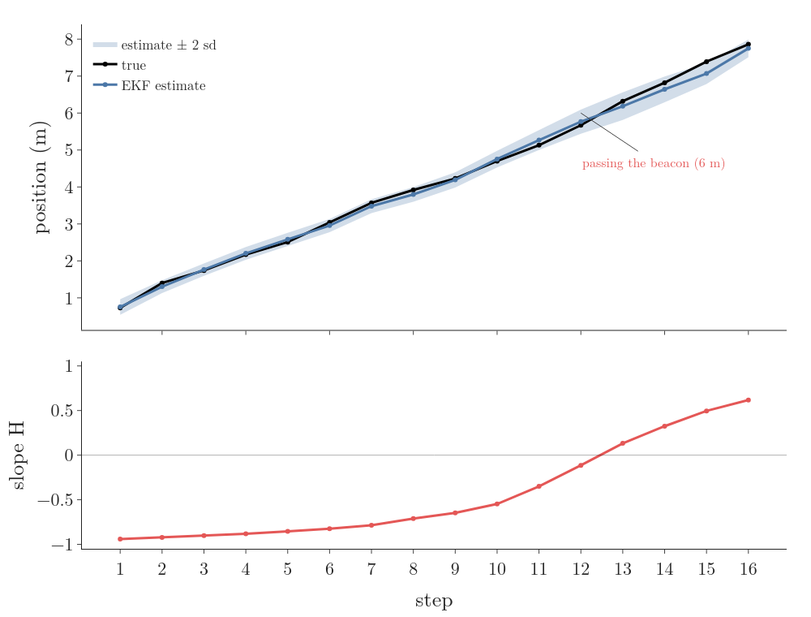
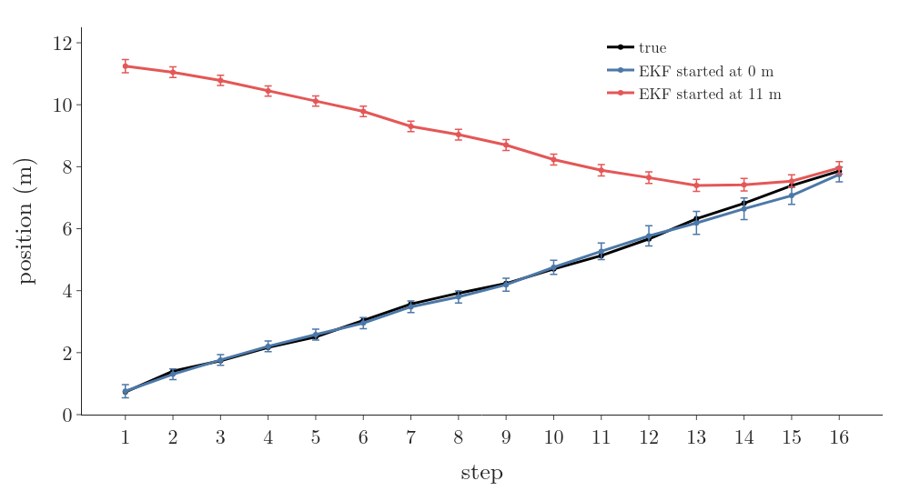
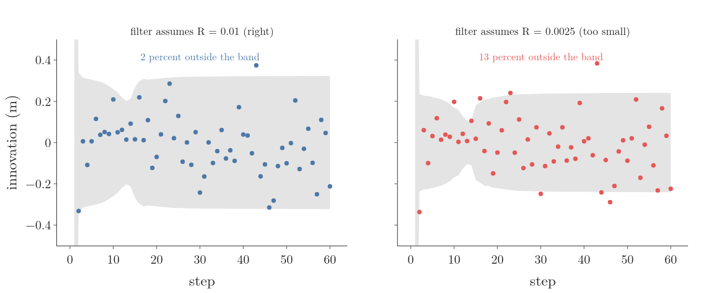
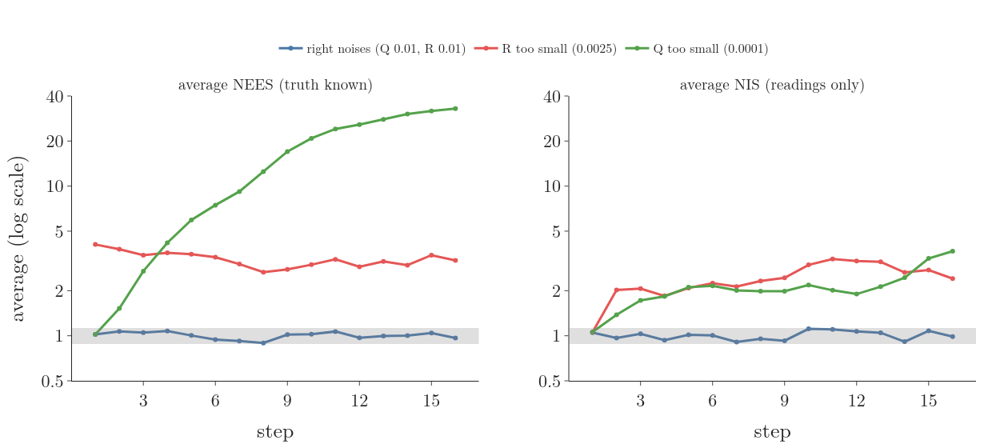

## 1. Overview

> **Key point:** Most robot sensors and motions are nonlinear functions of the state, and a nonlinear function bends a Gaussian out of shape. The extended Kalman filter replaces each nonlinear function by its tangent line at the current estimate and then runs the ordinary Kalman filter; checking its innovations tells us whether its variance can be trusted.

With the [**Kalman filter**](../RO-017-kalman-filter/RO-017-kalman-filter.md#1-overview) (G-2506), the corridor robot blends its drifting commands and its jumping readings, and its estimate misses by 0.17 m, against 0.27 m for the commands alone and 0.51 m for the readings. That works because the belief stays a [**Gaussian**](../../../../MA/03-distributions/MA-024-normal-distribution/MA-024-normal-distribution.md#2-what-the-normal-distribution-is) (G-827), a bell-shaped curve set by a mean and a variance, and because the ceiling system reports the position itself plus noise, a [**linear function**](../RO-017-kalman-filter/RO-017-kalman-filter.md#23-a-linear-function-keeps-a-gaussian-a-gaussian) (G-2527) of the position, whose graph is a straight line. Now the robot has a new sensor in the same corridor: a radio beacon fixed on the wall at 6 m along the corridor, 2 m to the side, and it measures its straight-line distance to the beacon (Figure 1). Such range sensors are common: radio beacons, GPS ranges to satellites, a lidar's range to a landmark.

The reading is no longer the position plus noise. Its graph against the position is a curve (Figure 1), so no fixed multiple of the position plus a constant gives it: the reading is a **nonlinear function** (G-2530) of the position:

- far from the beacon, the distance changes almost one for one with position, nearly a straight line;
- under the beacon, the distance stops changing: it bottoms out at 2 m;
- past the beacon, it grows again, so 4 m and 8 m give the same reading.

The Kalman filter needs linear models (Section 2), so it cannot use this reading as it is. This Note adds the extended Kalman filter, which straightens the curve at the current estimate, and a check that tells when the result has gone wrong:

- pushing a Gaussian through a nonlinear function, and the tangent-line fix (Section 3);
- the extended Kalman filter, step by step on the corridor (Section 4);
- its limits: one Gaussian can hold only one side (Section 4.4);
- consistency, whether the filter's variance matches its real errors: the innovation, its covariance, and the NIS and NEES tests (Section 5).

## 2. The Kalman filter in brief, and why nonlinear functions break it

> **Key point:** The Kalman filter is exact only because linear functions keep a Gaussian a Gaussian. A nonlinear function, such as the beacon distance, does not.

To see why the nonlinear beacon distance of Figure 1 breaks it, recall what the [**Kalman filter**](../RO-017-kalman-filter/RO-017-kalman-filter.md#63-the-five-lines-in-matrix-form) (G-2506) does. It keeps the belief as a mean $\hat{x}$ and a variance $p$ and runs two steps per round:

- **predict:** move the mean with the command and add the process noise $Q$ to the variance;
- **update:** blend in the reading $z$ with the [Kalman gain](../RO-017-kalman-filter/RO-017-kalman-filter.md#43-the-best-weight-the-kalman-gain) (G-2508), which gives the reading the weight that makes the new variance smallest.

Both steps rest on one fact: a [linear function keeps a Gaussian a Gaussian](../RO-017-kalman-filter/RO-017-kalman-filter.md#23-a-linear-function-keeps-a-gaussian-a-gaussian), with the variance multiplied by the slope squared. The update also assumed the reading was a linear function of the position, $z = Hx + v$. Our new reading is

$$h(x) = \sqrt{(6 - x)^2 + 2^2}$$

the distance from position $x$ to the beacon. For example, at 0.5 m:

$$h(0.5) = \sqrt{5.5^2 + 4}$$

$$= \sqrt{34.25} = 5.852 \text{ m}$$

No single number $H$ turns position into this reading everywhere, so the five lines of the Kalman filter cannot be used as they are. The commands and the first guess are those of the Kalman filter: the robot is commanded 0.5 m per step with process noise $Q = 0.01$ m², and starts from the guess 0 m with variance 1 m². The beacon's distance readings have a standard deviation of 0.1 m, so the [**measurement noise**](../RO-017-kalman-filter/RO-017-kalman-filter.md#41-two-estimates-of-one-position) (G-2510) is $R = 0.01$ m². Before the filter can use these readings, we need to know what the beacon distance does to a Gaussian belief.

## 3. Pushing a Gaussian through a nonlinear function

> **Key point:** A nonlinear function bends a Gaussian into a lopsided shape. Near a point, its graph looks like its tangent line, and a line keeps a Gaussian a Gaussian; that approximation is good when the Gaussian is narrow compared with the bend.

### 3.1 What a nonlinear function does to a Gaussian

The worst place is near the beacon, where the distance bottoms out at 2 m (Figure 1). Suppose the robot's position there is a Gaussian with mean 5.5 m and standard deviation 0.5 m. What does the predicted reading look like? We cannot use a formula yet, so we use the [Monte Carlo](../RO-016-particle-filter/RO-016-particle-filter.md#32-samples-stand-for-a-distribution-the-monte-carlo-idea) way: draw 200,000 positions from the Gaussian, push each through $h$, and look at the results (notebook).

Figure 2 shows the result in its middle frame. The readings pile up against 2 m, the smallest possible distance, with a long tail upwards: the Gaussian has become lopsided. Its lopsidedness, the [**skewness**](../../../../ML/02-getting-data/ML-019-univariate-analysis/ML-019-univariate-analysis.md#10-skewness) (G-1817), is 1.89, where a Gaussian has 0. A Kalman filter has no way to store that shape: it keeps only a mean and a variance. To keep the belief Gaussian, the filter needs a straight line in place of the curve.

### 3.2 The tangent line: linearisation

Zoom in on any smooth curve and it looks straight. Near a point $\mu$, the curve is close to its tangent line, the straight line through $(\mu, h(\mu))$ with the curve's slope there. Replacing a function near a point by its tangent line is [linearisation](../../../../MA/06-calculus/MA-061-derivatives-of-one-variable/MA-061-derivatives-of-one-variable.md#63-degree-1-the-tangent-line) (G-1099):

$$h(x) \approx h(\mu) + h'(\mu)\thinspace(x - \mu)$$

Here $h'(\mu)$ is the [**derivative**](../../../../MA/06-calculus/MA-061-derivatives-of-one-variable/MA-061-derivatives-of-one-variable.md#41-from-secant-to-tangent) (G-595), the slope of the curve at $\mu$. For the beacon distance, write $h$ as a square root of an inside part $s$:

$$s(x) = (6 - x)^2 + 4$$

$$h = \sqrt{s}$$

The two slopes:

$$\frac{dh}{ds} = \frac{1}{2\sqrt{s}} = \frac{1}{2h}$$

$$\frac{ds}{dx} = -2\thinspace(6 - x)$$

The [chain rule](../../../../MA/06-calculus/MA-061-derivatives-of-one-variable/MA-061-derivatives-of-one-variable.md#53-the-chain-rule) (G-371) multiplies them:

$$h'(x) = \frac{-2\thinspace(6 - x)}{2h(x)}$$

$$= \frac{-(6 - x)}{h(x)}$$

It is the shrink rate of the distance per metre driven. At $x = 1$:

$$h(1) = \sqrt{25 + 4} = 5.385$$

$$h'(1) = -5 / 5.385 = -0.928$$

Driving 1 m towards the beacon from there cuts the distance by about 0.93 m.

The tangent line is a straight line, and a straight line keeps a Gaussian a Gaussian. So the predicted reading is a Gaussian whose mean is $h(\mu)$ and whose standard deviation is the input's standard deviation times the size of the slope:

$$\text{mean} \approx h(\mu)$$

$$\text{sd} \approx |h'(\mu)| \times \text{sd of } x$$

Carrying a mean and a standard deviation through a function this way, with its value and slope at the mean, is **first-order uncertainty propagation** (G-2519) (Labbe ch.9; Becker ch.13).

### 3.3 When the tangent line fails

The tangent line describes the curve well only near the point where it touches. The wider the Gaussian, and the more the curve bends inside it, the worse the approximation (Labbe ch.9; Freiburg EKF slides). The three frames of Figure 2, from the notebook:

| Input Gaussian | True readings: mean, sd | Tangent line: mean, sd |
|---|---|---|
| mean 1.0, sd 0.5 (curve nearly straight) | 5.39, 0.46 | 5.39, 0.46 |
| mean 5.5, sd 0.5 (near the bend) | 2.12, 0.14 | 2.06, 0.12 |
| mean 5.5, sd 1.5 (near the bend, wide) | 2.48, 0.57 | 2.06, 0.36 |

Near the bend, the tangent-line Gaussian puts its mean too low and is too narrow, so a filter using it would be too sure of itself. It even gives probability to readings below 2 m, which no position can produce. Both failures grow with the width of the input: with standard deviation 1.5 m, the tangent line misses the true standard deviation by more than a third.

### 3.4 Several variables: the Jacobian

The beacon distance has one input, the position, so one slope is enough. A robot's pose has several numbers, $(x, y, \theta)$, and a function of several numbers has a slope for each pair of output and input. The table of all these slopes is the [Jacobian](../../../../MA/06-calculus/MA-063-jacobian-and-matrix-gradients/MA-063-jacobian-and-matrix-gradients.md#42-the-formula-every-partial-derivative-in-one-grid) (G-980), and it plays the part of the slope: near a point, the function behaves like multiplying by that matrix.

For motion the Jacobian is called $G$, the **motion Jacobian** (G-2522), and it carries the covariance as $G P G^{\mathsf T}$. With the tangent line for one number and the Jacobian for several, the Kalman filter can now run on nonlinear models.

## 4. The extended Kalman filter

> **Key point:** The EKF predicts and updates with the nonlinear functions themselves, and uses their slopes at the current estimate wherever the Kalman filter used $F$ and $H$.

### 4.1 The algorithm

The **extended Kalman filter** (EKF) (G-2520) uses that tangent line to run the Kalman filter on a nonlinear model such as the beacon distance: it linearises the nonlinear models at the latest estimate, every step (Freiburg EKF slides; Thrun §3.3; Labbe ch.11):

- the motion model $g$ is linearised at the last estimate $\hat{x}$, with Jacobian $G$;
- the sensor model $h$ is linearised at the prediction $\bar{x}$, with Jacobian $H$, the **measurement Jacobian** (G-2521).

Each is linearised where the filter's best guess is at the moment it is used. The lines:

| Step | Kalman filter | Extended Kalman filter |
|---|---|---|
| predict mean | $\bar{\mathbf{x}} = F\hat{\mathbf{x}}$ | $\bar{\mathbf{x}} = g(u, \hat{\mathbf{x}})$ |
| predict covariance | $\bar{P} = FPF^{\mathsf T} + Q$ | $\bar{P} = GPG^{\mathsf T} + Q$ |
| innovation | $z - H\bar{\mathbf{x}}$ | $z - h(\bar{\mathbf{x}})$ |
| innovation covariance | $S = H\bar{P}H^{\mathsf T} + R$ | same, $H$ = slope of $h$ at $\bar{\mathbf{x}}$ |
| gain | $K = \bar{P}H^{\mathsf T}S^{-1}$ | same |
| update | $\hat{\mathbf{x}} = \bar{\mathbf{x}} + K(z - H\bar{\mathbf{x}})$ | $\hat{\mathbf{x}} = \bar{\mathbf{x}} + K(z - h(\bar{\mathbf{x}}))$ |
| | $P = (I - KH)\bar{P}$ | same |

The means go through the true nonlinear functions; only the covariances and the gain use the slopes. If the models are linear, $G = F$ and $h(\bar{\mathbf{x}}) = H\bar{\mathbf{x}}$, and the EKF is the Kalman filter (Freiburg EKF slides).

In our corridor the motion is still a straight line, so $G = 1$ and the predict step is unchanged. Only the update needs the slope.

### 4.2 Step 1 by hand

**Predict**, as in the Kalman filter:

$$\bar x_1 = 0 + 0.5 = 0.5 \text{ m}$$

$$\bar p_1 = 1 + 0.01 = 1.01 \text{ m}^2$$

**Linearise the sensor at the prediction.** The expected reading and the slope:

$$h(0.5) = 5.852$$

$$H = -5.5 / 5.852 = -0.940$$

**Innovation.** The [**innovation**](../RO-017-kalman-filter/RO-017-kalman-filter.md#44-the-updated-estimate-and-its-variance) (G-2511) is the gap between the reading and the reading the prediction expected. The reading is $z_1 = 5.61$ m:

$$z_1 - h(\bar x_1) = 5.61 - 5.852 = -0.242$$

The robot is 0.24 m closer to the beacon than predicted.

**Gain.** First the innovation variance:

$$S = 0.940^2 \times 1.01 + 0.01$$

$$= 0.892 + 0.01 = 0.902$$

then

$$K = 1.01 \times (-0.940) / 0.902$$

$$= -1.052$$

The gain is negative because the slope is: a shorter distance than expected means the robot is further along, so a negative innovation must move the estimate forward. Its size above 1 is expected too: it converts metres of distance into metres of position, and here the distance changes a little less than one for one.

**Update:**

$$\hat x_1 = 0.5 + (-1.052)(-0.242)$$

$$= 0.5 + 0.255 = 0.755 \text{ m}$$

$$p_1 = (1 - (-1.052)(-0.940)) \times 1.01$$

$$= 0.011 \times 1.01 = 0.0112 \text{ m}^2$$

The true position is 0.73 m. **A check.** After a reading this good, the position should be known about as well as the sensor allows, which is the sensor's standard deviation divided by the slope:

$$0.1 / 0.940 = 0.106 \text{ m}$$

$$0.106^2 = 0.0113 \text{ m}^2$$

matching $p_1$. The slope 0.940 set that precision, and the slope changes as the robot drives towards the beacon.

### 4.3 Sixteen steps, past the beacon

Figure 3 runs 16 steps, as the robot drives from 0.73 m to 7.86 m, past the beacon at 6 m. Watch the slope $H$ in the lower panel:

| Step | Prediction (m) | Slope $H$ | Gain $K$ | Variance after (m²) | Estimate (m) | True (m) |
|---|---|---|---|---|---|---|
| 1 | 0.50 | −0.940 | −1.052 | 0.0112 | 0.755 | 0.73 |
| 6 | 3.08 | −0.825 | −0.662 | 0.0080 | 2.955 | 3.04 |
| 11 | 5.25 | −0.349 | −0.623 | 0.0178 | 5.270 | 5.13 |
| 12 | 5.77 | −0.115 | −0.307 | 0.0268 | 5.767 | 5.67 |
| 13 | 6.27 | 0.133 | 0.459 | 0.0346 | 6.186 | 6.32 |
| 16 | 7.57 | 0.617 | 0.868 | 0.0141 | 7.749 | 7.86 |

- Far from the beacon the slope is near −1: each reading pins the position down, and the variance stays between 0.007 and 0.011 m².
- Near the beacon, where the distance bottoms out at 2 m (Figure 1), the slope goes to 0: the distance hardly changes with position, so a reading says almost nothing about where the robot is. The variance grows to 0.035 m² at step 13, and the band in Figure 3 widens; the filter is coasting on its commands.
- Past the beacon the slope turns positive and the gain changes sign with it; the readings pin the position down again.

The filter needs no special case for any of this: recomputing $H$ at every prediction is all it takes, as long as the filter starts on the right side of the beacon.

### 4.4 The limits of the EKF

**One Gaussian holds one side.** Positions 4 m and 8 m give the same reading, 2.83 m (Figure 1); so do 1 m and 11 m. Figure 4 feeds the same 16 readings to a second EKF that starts at 11 m, on the far side of the beacon. Every reading fits the mirror position as well as the true one, so the filter follows the mirror path, confident and wrong: at step 1 it says 11.24 m when the robot is at 0.73 m, 10.5 m off, with only about 10 cm of uncertainty. Only when the robot passes the beacon, where the mirror and the true path meet, does it come right (7.96 m against 7.86 m at step 16, notebook). A Gaussian is [**unimodal**](../RO-017-kalman-filter/RO-017-kalman-filter.md#1-overview) (G-2528), with a single mode, so it cannot say "here or at the mirror place"; that belief has two modes, it is [**multimodal**](../../../../MA/01-descriptive-stats/MA-005-measures-of-central-tendency/MA-005-measures-of-central-tendency.md#5-mode) (G-1275), and a [**particle filter**](../RO-016-particle-filter/RO-016-particle-filter.md#31-why-one-gaussian-is-not-enough) (G-2492) can keep both until the readings decide (Labbe ch.12).

The other limits (Freiburg EKF slides; Labbe ch.11):

- **Strongly nonlinear models.** Where the Gaussian is wide compared with the bend (Section 3.3), the linearised covariance is wrong, usually too small, and the filter becomes overconfident.
- **Jacobians must exist.** A model with steps, like the door map of the [**particle filter**](../RO-016-particle-filter/RO-016-particle-filter.md#21-the-corridor-the-sensor-and-the-motion) (G-2492) (1.0 m beside wall, 1.5 m at a door), has slope 0 almost everywhere and no slope at the edges, so the EKF cannot use it.
- **Jacobians must be derived.** Deriving them by hand is error-prone for big models; symbolic tools such as SymPy can do it (Labbe ch.11).

The unscented Kalman filter pushes a few chosen sample points through the nonlinear function instead of a tangent line, and the particle filter pushes many; both avoid Jacobians at a higher cost (Labbe ch.9; Freiburg EKF slides). Each of these limits can leave the EKF wrong while its variance says it is sure, so it needs a check.

## 5. Consistency: is the filter telling the truth about itself?

> **Key point:** A filter reports a variance along with its estimate. It is consistent when its real errors are as big as that variance says: on average, error squared divided by variance comes to the number of variables. The innovations allow the check without knowing the truth.

### 5.1 Why we need a check

To tell when the result has gone wrong, the filter's own variance is no help. The EKF's variance comes from tangent lines and from the $Q$ and $R$ we chose, so it can be wrong without any error message: the mirror filter of Figure 4 reported about 10 cm of uncertainty while 10 m off. A controller or a planner that trusts a variance needs to know whether that variance matches the real errors. A filter whose errors match its own variance is **consistent** (G-2524) (Chen et al. 2018; Labbe ch.8). On a real robot the true errors are unknown, but the innovations are not.

### 5.2 The innovation and its covariance

Every step, before it sees the reading, the filter predicts it: $h(\bar{x})$. It also predicts how far off the reading will be. The innovation $z - h(\bar{x})$ has two independent sources of error, the prediction's and the sensor's. The prediction's error reaches the reading through the slope $H$, so its variance is multiplied by $H^2$ ([variance times slope squared](../RO-017-kalman-filter/RO-017-kalman-filter.md#23-a-linear-function-keeps-a-gaussian-a-gaussian)); then the [two independent variances add](../RO-017-kalman-filter/RO-017-kalman-filter.md#24-adding-independent-errors-adds-variances):

$$S = H\bar{P}H^{\mathsf T} + R$$

This $S$ is the **innovation covariance** (G-2523): the variance the filter expects of its innovation (Labbe ch.8; Chen et al. 2018). At step 1, the innovation was −0.242 m with $S = 0.902$, a predicted standard deviation of:

$$\sqrt{0.902} = 0.95 \text{ m}$$

So an innovation of 0.24 m was well within what the filter expected. Unlike the true error, the innovation is known on a real robot at every step, so it is the everyday test.

### 5.3 NIS: the innovation test, no truth needed

To turn each innovation into one test number, divide its square by its predicted variance:

$$\varepsilon_z = y^2 / S$$

For several readings at once, $\varepsilon_z = y^{\mathsf T} S^{-1} y$. This is the **normalised innovation squared** (NIS) (G-2526). For step 1:

$$0.242^2 / 0.902 = 0.065$$

**Why it should average 1.** If the filter is consistent, $y$ is a Gaussian with mean 0 and variance $S$, so $y / \sqrt{S}$ is a standard normal variable and its square averages 1. A squared standard normal variable follows the [chi-square distribution](../../../../MA/04-inference/MA-045-chi-square-tests/MA-045-chi-square-tests.md#31-built-from-squared-normal-draws) (G-378) with 1 degree of freedom; with $m$ readings at once, the NIS follows chi-square with $m$ degrees of freedom and averages $m$ (Chen et al. 2018). For one reading, 95 percent of a consistent filter's NIS values lie below 3.84 (notebook), and an innovation two standard deviations out gives an NIS of 4.

**On one run.** Figure 5 plots 60 innovations with the band $\pm 2\sqrt{S}$ the filter predicts. With the right $R$, 2 percent fall outside. A filter that assumes the sensor is twice as precise ($R = 0.0025$, a standard deviation of 0.05 m) predicts a band half as wide, and 13 percent fall outside: its innovations are bigger than its $S$ allows (Labbe ch.8).

### 5.4 NEES: the error test, when the truth is known

In a simulation, or with a much better reference sensor, the true state is known and we can test the error itself. Divide the squared error by the filter's variance:

$$\varepsilon_x = (x - \hat{x})^2 / p$$

or $\tilde{\mathbf{x}}^{\mathsf T} P^{-1} \tilde{\mathbf{x}}$ for a state of $n$ numbers, where $\tilde{\mathbf{x}}$ is the error. This is the **normalised estimation error squared** (NEES) (G-2525) (Labbe ch.8; Chen et al. 2018). By the same argument it follows chi-square with $n$ degrees of freedom and averages $n$, here 1. For step 1:

$$(0.73 - 0.755)^2 / 0.0112 = 0.056$$

One value says little; the test averages many. We simulated 500 runs of 16 steps, ran three EKFs on each, and averaged NEES and NIS at each step (Figure 6). If the filter is consistent, an average of 500 chi-square values with 1 degree of freedom lies between 0.88 and 1.13 in 95 percent of cases (notebook):

| Filter | Average NEES | Average NIS | Verdict |
|---|---|---|---|
| right noises, $Q = 0.01$, $R = 0.01$ | 1.00 | 1.01 | consistent |
| sensor trusted too much, $R = 0.0025$ | 3.25 | 2.41 | overconfident |
| motion trusted too much, $Q = 0.0001$ | 15.95, rising to 32.9 | 2.12 | overconfident, getting worse |

### 5.5 Reading the results

- **Both near 1:** the filter's variances match its real errors; it can be trusted.
- **Both well above 1:** the filter is overconfident. Increase the noise it assumes; which one is told by tuning experiments such as those of [choosing Q and R](../RO-017-kalman-filter/RO-017-kalman-filter.md#72-q-tune-the-motion-noise).
- **NEES rising over time:** errors pile up faster than the filter allows, the mark of too small a $Q$: the filter trusts its motion model and stops listening to readings.
- **Values well below 1:** the filter is too timid; its noises are too large, and it wastes information.

The innovations should also look like random noise: centred on zero and with no slow trend. A trend means the model misses something, such as a bias or too little process noise (Labbe ch.8). NEES needs the truth, so it is a design-time test in simulation; NIS needs only the readings, so it can also run on the robot.

## 6. Summary

| Idea | What it does | Why |
|---|---|---|
| Linearisation | replace a nonlinear function by its tangent line at the estimate | a linear function keeps a Gaussian a Gaussian |
| First-order propagation | sd out ≈ slope × sd in | the tangent line's slope stretches the Gaussian |
| EKF | Kalman filter with Jacobians $G$, $H$ recomputed every step | nonlinear models with unimodal beliefs |
| Innovation covariance $S$ | the variance the filter expects of its innovation | a yardstick for each reading |
| NIS, NEES | squared innovation or error over its predicted variance, average 1 per variable | tests whether the filter is consistent |

- The beacon's distance is a nonlinear function of the position (2 m at its lowest, 2.83 m at both 4 m and 8 m), yet the EKF still locates the robot from it, ending the 16 steps at 7.749 m against a true 7.86 m, because it straightens the curve at every prediction.
- A nonlinear function bends a Gaussian: near the beacon the readings pile up against 2 m with skewness 1.89, so a mean and variance alone no longer describe them.
- Linearising at the mean is almost exact where the curve is nearly straight across the Gaussian's width (sd 0.46 both ways at 1 m) and too narrow where it bends (0.36 against 0.57 for a wide Gaussian at 5.5 m), so EKF accuracy depends on keeping the uncertainty small compared with the bends.
- The EKF uses the nonlinear functions for the means and their slopes for the covariances, so with linear models it is exactly the Kalman filter.
- The slope sets how much a reading tells: at 0.94 the position is pinned to 0.106 m; under the beacon it is near 0 and the filter coasts on its commands.
- One Gaussian holds one hypothesis, so an EKF started on the wrong side follows the mirror path, 10.5 m off with tiny error bars; multimodal beliefs need a particle filter.
- A consistent filter's NEES and NIS average 1 per variable (1.00 and 1.01 in our runs); values near 3 or a rising NEES flag noises set too small, and NIS works without the truth, so it can run on the robot.

So the robot can now locate itself with a sensor that measures a distance, not a position, and check with NIS whether it is consistent, as long as the belief is unimodal. Still missing is a close look at the sensors that give these readings and their noise, the subject of the next chapter, robot sensors.

## 7. Sources

**Built from**

- MATLAB, "Understanding Kalman Filters, Part 5: Nonlinear State Estimators", YouTube, https://www.youtube.com/watch?v=Vefia3JMeHE
- James Han, "The Extended Kalman Filter (EKF): Why Taylor Expansions are Awesome", YouTube, https://www.youtube.com/watch?v=9X3jGGnbcvU
- Lars Hammarstrand (Chalmers), "4.3.2 Kalman filter tuning and consistency: Innovation", YouTube, https://www.youtube.com/watch?v=QQLO7N3PQkM
- Lars Hammarstrand (Chalmers), "4.3.1 Kalman filter tuning and consistency", YouTube, https://www.youtube.com/watch?v=E5JEWjNITxQ
- Labbe, R. *Kalman and Bayesian Filters in Python*, ch.8 "Designing Kalman Filters" (NEES, likelihood, residuals), ch.9 "Nonlinear Filtering", ch.11 "Extended Kalman Filters", ch.12 "Particle Filters", https://github.com/rlabbe/Kalman-and-Bayesian-Filters-in-Python (Labbe ch.8, ch.9, ch.11, ch.12)
- Becker, A. *Kalman Filter from the Ground Up*, ch.13 "Extended Kalman Filter (EKF)": uncertainty projection, EKF equations, limitations; tutorial page https://www.kalmanfilter.net/ekf.html (Becker ch.13)
- Burgard, W. et al. (Uni Freiburg), *Introduction to Mobile Robotics*, "Bayes Filter – Extended Kalman Filter" slides, http://ais.informatik.uni-freiburg.de/teaching/ss23/robotics/slides/11-ekf.pdf (Freiburg EKF slides)
- Chen, Z., Heckman, C., Julier, S. and Ahmed, N. (2018). "Weak in the NEES?: Auto-tuning Kalman Filters with Bayesian Optimization". arXiv:1807.08855, §II (definitions of NEES and NIS and their chi-square tests), https://arxiv.org/abs/1807.08855 (Chen et al. 2018)

**Other references**

- NPTEL-NOC IITM, "Introduction to Robotics, #34 Extended Kalman Filter", YouTube, https://www.youtube.com/watch?v=c7V5_uQ2ues
- Thrun, S., Burgard, W. and Fox, D. (2005). *Probabilistic Robotics*. MIT Press. §3.3 "The Extended Kalman Filter"; cited for what the Freiburg slides and Labbe confirm (Thrun)
- Bar-Shalom, Y., Li, X. R. and Kirubarajan, T. (2001). *Estimation with Applications to Tracking and Navigation*. Wiley. The origin of the NEES and NIS tests, cited by Chen et al. 2018

## 8. Key terms

Terms taught in this Note come first; linked terms are recaps, taught in the Note the link opens.

| Term | Meaning |
|---|---|
| Nonlinear function (G-2530) | A function whose graph is not a straight line, so it is not a fixed multiple of the input plus a constant, such as the beacon distance $h(x) = \sqrt{(6 - x)^2 + 4}$; it bends a Gaussian into another shape, which is why the Kalman filter cannot use it as it is and the extended Kalman filter linearises it. |
| First-order uncertainty propagation (G-2519) | Carrying a mean and a standard deviation through a function by its value and slope at the mean: mean out ≈ $h(\mu)$, standard deviation out ≈ slope × standard deviation in (with a Jacobian, $J P J^{\mathsf T}$); accurate when the function is nearly straight across the standard deviation. |
| Motion Jacobian $G$ (G-2522) | The table of slopes of the motion model at the last estimate, one row per new state variable and one column per old one; the EKF uses it to carry the covariance forward as $G P G^{\mathsf T} + Q$. |
| Extended Kalman filter (EKF) (G-2520) | The Kalman filter for nonlinear motion and sensor models: it moves the mean through the nonlinear functions and uses their Jacobians at the latest estimate in place of $F$ and $H$, so it can track unimodal beliefs through nonlinear models. |
| Measurement Jacobian $H$ (G-2521) | The slopes of the sensor model at the predicted state, one row per reading and one column per state variable; the EKF uses it to compute the innovation covariance and the gain, and its size says how much a reading tells about the state. |
| Consistent filter (G-2524) | A filter whose real errors are as large as its own reported covariance says, on average; only then can its uncertainty be trusted by a controller or planner. |
| Innovation covariance $S$ (G-2523) | The variance the filter expects of its next innovation, $S = H\bar{P}H^{\mathsf T} + R$: prediction uncertainty seen through the sensor plus sensor noise; it scales the gain and is the yardstick for the NIS test. |
| NIS (normalised innovation squared) (G-2526) | The squared innovation divided by its predicted covariance, $y^{\mathsf T}S^{-1}y$; for a consistent filter it follows chi-square with $m$ degrees of freedom (one per reading) and averages $m$, so it tests consistency from readings alone, even on the robot. |
| NEES (normalised estimation error squared) (G-2525) | The squared estimation error divided by the filter's variance, $\tilde{x}^{\mathsf T}P^{-1}\tilde{x}$; for a consistent filter it follows chi-square with $n$ degrees of freedom and averages $n$, so its average over simulated runs tests consistency when the truth is known. |
| [Kalman filter](../../../../RO/localization/02-bayes-filters/RO-017-kalman-filter/RO-017-kalman-filter.md#25-the-linear-gaussian-system) (G-2506) | The Bayes filter for a linear Gaussian system: it keeps the belief as a mean and a (co)variance and updates them with a predict step and an update step, blending a model's prediction with a sensor reading so the result is as certain as possible. |
| [Gaussian distribution](../../../../MA/03-distributions/MA-024-normal-distribution/MA-024-normal-distribution.md#2-what-the-normal-distribution-is) (G-827) | Another name for the normal distribution: the symmetric, bell-shaped continuous distribution set by its mean and standard deviation, used to model many measurements. |
| [Linear function](../../../../RO/localization/02-bayes-filters/RO-017-kalman-filter/RO-017-kalman-filter.md#23-a-linear-function-keeps-a-gaussian-a-gaussian) (G-2527) | A function $y = ax + b$: a fixed multiple of the input plus a constant, whose graph is a straight line; passing a normal variable through it gives another normal variable, which is why the Kalman filter is exact for linear models. |
| [Kalman gain $K$](../../../../RO/localization/02-bayes-filters/RO-017-kalman-filter/RO-017-kalman-filter.md#43-the-best-weight-the-kalman-gain) (G-2508) | The weight the update gives to the reading, $K = \bar{p}/(\bar{p} + R)$ in one dimension: the weight that makes the updated variance smallest, near 1 when the prediction is vague and near 0 when the reading is. |
| [Measurement noise $R$](../../../../RO/localization/02-bayes-filters/RO-017-kalman-filter/RO-017-kalman-filter.md#41-two-estimates-of-one-position) (G-2510) | The random error of a sensor reading, given as its variance or covariance $R$; it sets how much the filter trusts each reading and is taken from the datasheet or measured in a calibration. |
| [Skewness](../../../../ML/02-getting-data/ML-019-univariate-analysis/ML-019-univariate-analysis.md#10-skewness) (G-1817) | A number for how lopsided a distribution is: 0 symmetric, positive right tail, negative left tail. |
| [Linearisation](../../../../MA/06-calculus/MA-061-derivatives-of-one-variable/MA-061-derivatives-of-one-variable.md#63-degree-1-the-tangent-line) (G-1099) | Replacing a function near a point by its tangent line (its first-order Taylor polynomial). |
| [Derivative](../../../../MA/06-calculus/MA-061-derivatives-of-one-variable/MA-061-derivatives-of-one-variable.md#41-from-secant-to-tangent) (G-595) | The slope of a function at a point: how fast the output changes as the input changes there. It is zero at the lowest point of a smooth curve, which is how training finds a minimum. |
| [Chain rule](../../../../ML/07-classification/ML-073-sigmoid-derivative/ML-073-sigmoid-derivative.md#2-two-rules-we-need) (G-371) | To differentiate a function of a function, multiply the outer derivative by the inner derivative. |
| [Jacobian](../../../../MA/06-calculus/MA-063-jacobian-and-matrix-gradients/MA-063-jacobian-and-matrix-gradients.md#42-the-formula-every-partial-derivative-in-one-grid) (G-980) | The table (matrix) of all first partial derivatives of a function with several inputs and outputs, one row per output and one column per input, $J_{ij} = \partial f_i/\partial x_j$; it shows how every output changes with every input near a point. |
| [Innovation](../../../../RO/localization/02-bayes-filters/RO-017-kalman-filter/RO-017-kalman-filter.md#44-the-updated-estimate-and-its-variance) (G-2511) | The gap between a reading and the reading the prediction expected, $z - H\bar{x}$; the update moves the estimate by the gain times this gap, and its size is used to check the filter. |
| [Unimodal](../../../../RO/localization/02-bayes-filters/RO-017-kalman-filter/RO-017-kalman-filter.md#1-overview) (G-2528) | Having a single mode (one peak); a unimodal belief can be held by one Gaussian, so the Kalman filter needs only its mean and variance. |
| [Multimodal](../../../../MA/01-descriptive-stats/MA-005-measures-of-central-tendency/MA-005-measures-of-central-tendency.md#5-mode) (G-1275) | Having more than one mode (two modes: bimodal). |
| [Particle filter](../../../../RO/localization/02-bayes-filters/RO-016-particle-filter/RO-016-particle-filter.md#4-the-particle-filter-step-by-step) (G-2492) | A Bayes filter that stores the belief as a set of weighted samples (particles) and runs each round as move, weigh, resample; it can hold beliefs of any shape, such as a belief with three modes, one at each of three doors. |
| [Chi-square distribution](../../../../MA/04-inference/MA-045-chi-square-tests/MA-045-chi-square-tests.md#31-built-from-squared-normal-draws) (G-378) | The shape the chi-square statistic $\chi^2$ follows when the null hypothesis $H_0$ is true: never negative, skewed to the right, with one parameter, the degrees of freedom. |
