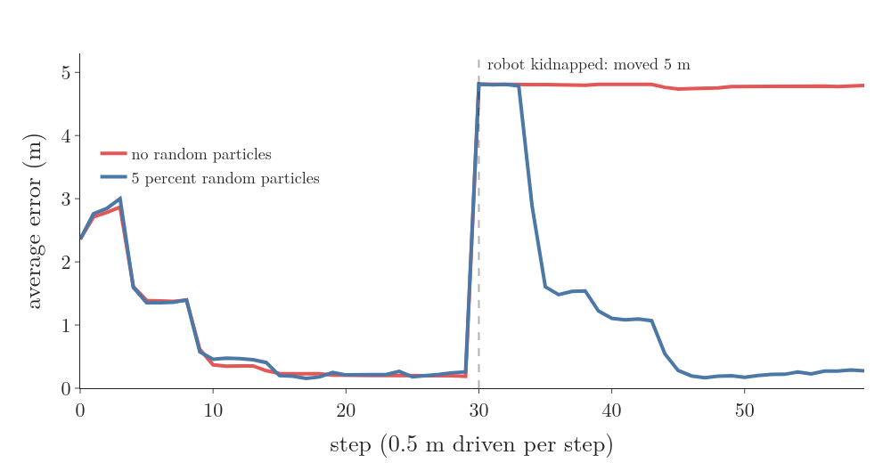

# Moved from RO-016 on 2026-10-10: the kidnapped robot, Monte Carlo localization and AMCL

From RO-016 (Particle Filter) §5.2, whole, with its figure (images/kidnap.png, kidnap.html, kidnap.py; kidnap.py imports pfsim.py and gifkit.py, copied here). The corridor: 10 m loop, doors at 1.5–2.5, 4.0–5.0 and 6.5–7.5 m, side sensor sd 0.15 m, move sd 0.15 m (RO-016 §2.1). Notebook cells: notebook-cells-from-RO-016.json (they call kidnap_run from RO-016's model cell, also in images/pfsim.py). Glossary rows to restore:

| G-2503 | Kidnapped robot problem | The test in which a localized robot is moved elsewhere without being told; a filter passes only if it can notice and relocalize, which a plain particle filter cannot. | [Note RO-016](RO/localization/02-bayes-filters/RO-016-particle-filter/RO-016-particle-filter.md#52-the-kidnapped-robot-and-random-particles) | Particle filter |
| G-2502 | Random particle injection | Replacing a few particles after each resampling with random ones spread over the whole map, so a lost or kidnapped filter can find the robot again, at a small cost in accuracy. | [Note RO-016](RO/localization/02-bayes-filters/RO-016-particle-filter/RO-016-particle-filter.md#52-the-kidnapped-robot-and-random-particles) | Particle filter |
| G-2504 | Monte Carlo localization (MCL) | The particle filter used to find a robot's pose on a known map: particles are poses, moved by the motion model and weighed by the sensor model against the map. | [Note RO-016](RO/localization/02-bayes-filters/RO-016-particle-filter/RO-016-particle-filter.md#46-the-algorithm) | Particle filter |

### 5.2 The kidnapped robot and random particles

A harder test: the robot is localized, then picked up and put down somewhere else without being told. This is the **kidnapped robot problem** (G-2503) (Freiburg PF slides). All particles sit at the old place, every reading fits them badly, but normalising the weights hides that, and the cloud stays where it is.

The fix: after each resampling, replace a few particles with random ones spread over the whole map. Adding random particles in this way is **random particle injection** (G-2502); it amounts to assuming the robot may be teleported at any moment with a small probability (Freiburg PF slides).

We tested it on a longer run: the robot drives 0.5 m per step and reads at every step; at step 30 it is moved 5 m. Over 200 runs with 200 particles each (Figure 9):

| Version | Error before the kidnap (m) | Runs recovered by step 59 (percent) |
|---|---|---|
| no random particles | 0.19 | 1.0 |
| 5 percent random particles | 0.22 | 88.5 |

The random particles cost a little accuracy before the kidnap (0.22 m against 0.19 m), because 5 percent of the cloud is always somewhere useless. In exchange, a lost filter can find the robot again: the random particles that land near the new position explain the readings well, get heavy and are copied.

From RO-016 §4.6 "The algorithm" (end of its last paragraph):

The particle filter applied to robot localization is **Monte Carlo localization** (MCL) (G-2504) (Freiburg PF slides).

From RO-016 §5.3 "Other fixes" (bullet **More particles.**):

Adaptive Monte Carlo localization (AMCL) changes the number each round: many while the belief is spread out, few once it is one tight cluster (Thrun §8.3).
