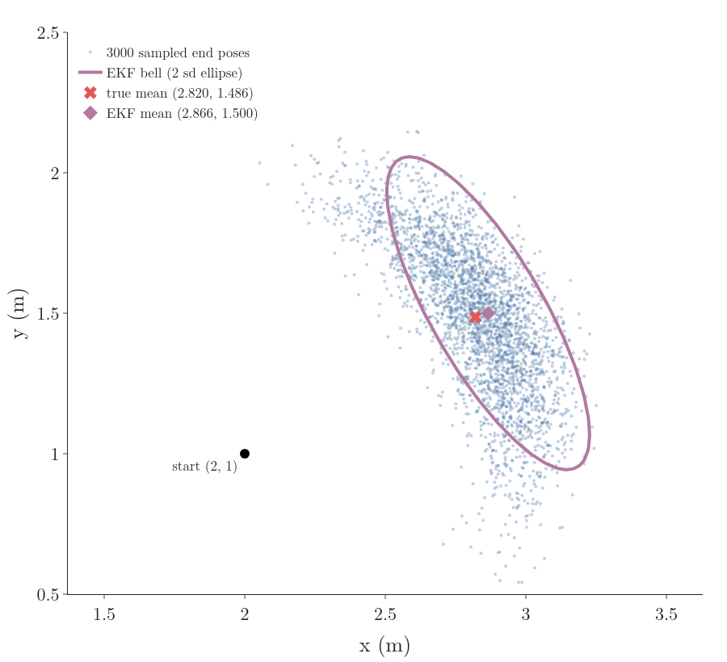

# Moved from RO-018 on 2026-10-10: a pose through the motion model (the banana)

From RO-018 §3.4 (Several variables: the Jacobian), after the Jacobian paragraph. Figure: images/banana (banana.py imports images/gifkit.py, copied from RO-018). Notebook cells: notebook-cells-from-RO-018.json. RO-018 §3.4 keeps the sentence naming G, the motion Jacobian (G-2522). Its Sources also cited Thrun §5.3 (sampled motion and its banana shape) for this block. No glossary rows to restore.

**The motion of a wheeled robot.** The robot of [pose and differential drive](../../../control/01-robot-models/RO-001-pose-and-differential-drive/RO-001-pose-and-differential-drive.md#52-the-kinematic-model), at pose $(2, 1, 30^\circ)$, drives $d = 1$ m straight:

$$x' = x + d\cos\theta$$

$$y' = y + d\sin\theta$$

$$\theta' = \theta$$

These are curved in $\theta$. Their Jacobian with respect to $(x, y, \theta)$ has one row per output and one column per input. Only the $\theta$ column is new: the slope of $x'$ in $\theta$ is $-d\sin\theta$ and of $y'$ is $d\cos\theta$. At 30 degrees:

$$-1 \times \sin 30^\circ = -0.5$$

$$1 \times \cos 30^\circ = 0.866$$

$$G = \begin{bmatrix} 1 & 0 & -0.5 \cr0 & 1 & 0.866 \cr0 & 0 & 1 \end{bmatrix}$$

This $G$ is the **motion Jacobian** (G-2522). Take the start covariance with standard deviations 0.1 m in $x$ and $y$ and 0.3 rad in heading:

$$P = \begin{bmatrix} 0.01 & 0 & 0 \cr0 & 0.01 & 0 \cr0 & 0 & 0.09 \end{bmatrix}$$

The matrix version of "variance times slope squared" is $G P G^{\mathsf T}$ ([the matrix Kalman filter](../../02-bayes-filters/RO-017-kalman-filter/RO-017-kalman-filter.md#63-the-five-lines-in-matrix-form)). Its position part:

$$\text{var } x' = 0.01 + 0.5^2 \times 0.09 = 0.0325$$

$$\text{var } y' = 0.01 + 0.866^2 \times 0.09 = 0.0775$$

$$\text{cov} = -0.5 \times 0.866 \times 0.09 = -0.039$$

Figure 3 compares this ellipse with 3000 sampled end poses. Unsure heading sweeps the end point along an arc, so the true cloud is a curved band, a banana; the ellipse covers it roughly, with its mean 0.04 m ahead of the cloud's. Over 200,000 samples the cloud's mean is (2.828, 1.478); the ellipse's is (2.866, 1.500) (notebook). The 3000 samples drawn in Figure 3 give a mean of (2.820, 1.486). With a heading spread of 0.3 rad (17°) the straight-line picture is still usable; with a much larger one the banana would bend round and the ellipse would not fit it (Labbe ch.9; Thrun §5.3).

