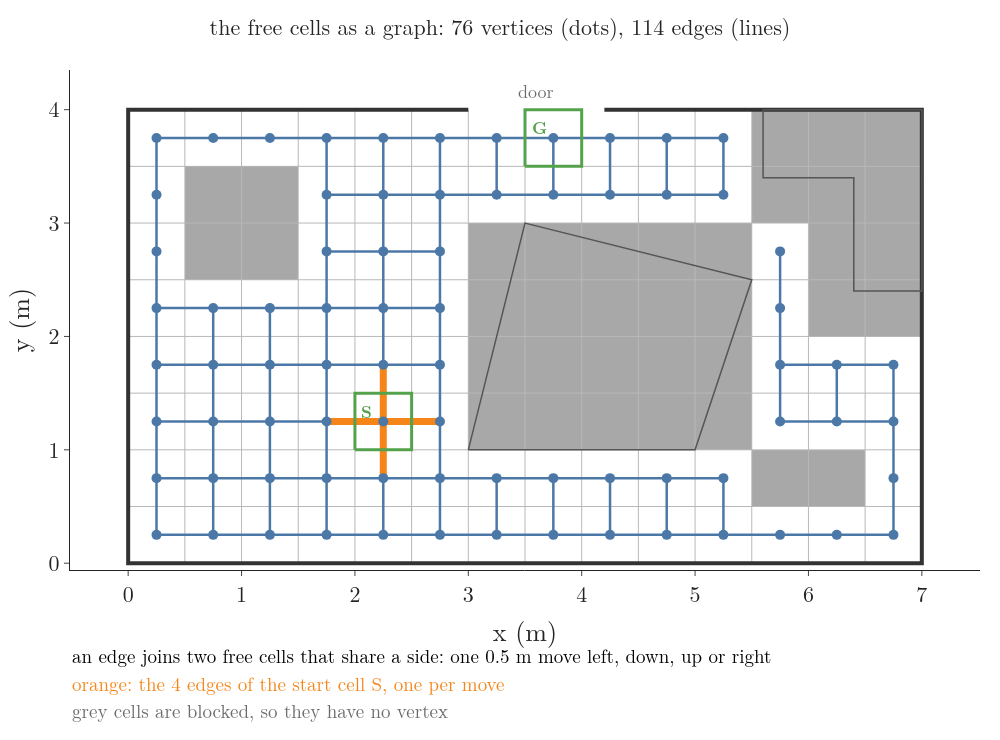

<!-- where-this-fits: generated by course_map/build_map.py; edit concepts.yaml, not this block -->
> **Where this fits:**
>
> - **Builds on:** [State, controls and measurements](../../../../RO/localization/02-bayes-filters/RO-007-why-a-robot-is-never-sure/RO-007-why-a-robot-is-never-sure.md#4-the-state-what-the-robot-keeps-track-of); [Maps and landmarks](../../../../RO/localization/02-bayes-filters/RO-009-maps-and-landmarks/RO-009-maps-and-landmarks.md#21-what-a-map-is-for).
> - **Leads to:** [Dijkstra's algorithm](../../../../RO/navigation/04-graph-search-and-configuration-space/RO-033-dijkstra-and-priority-queues/RO-033-dijkstra-and-priority-queues.md#32-the-algorithm-settle-the-nearest-update-its-neighbours); [Priority queue and binary heap](../../../../RO/navigation/04-graph-search-and-configuration-space/RO-033-dijkstra-and-priority-queues/RO-033-dijkstra-and-priority-queues.md#52-the-binary-heap); [Iterative deepening and IDA*](../../../../RO/navigation/04-graph-search-and-configuration-space/RO-034-a-star-and-heuristics/RO-034-a-star-and-heuristics.md#7-saving-memory-iterative-deepening-and-ida); [Forward state-space search](../../../../RO/navigation/04-graph-search-and-configuration-space/RO-035-strips-and-pddl/RO-035-strips-and-pddl.md#51-the-state-graph-built-while-searching); [Symbolic task planning](../../../../RO/navigation/04-graph-search-and-configuration-space/RO-035-strips-and-pddl/RO-035-strips-and-pddl.md#21-facts-and-states); [Basic motion planning problem](../../../../RO/navigation/04-graph-search-and-configuration-space/RO-036-configuration-space/RO-036-configuration-space.md#6-the-basic-motion-planning-problem); [Wavefront propagation](../../../../RO/navigation/06-grid-sampling-and-car-like-planning/RO-048-grid-planning-wavefronts-and-value-iteration/RO-048-grid-planning-wavefronts-and-value-iteration.md#2-numbering-every-cell-from-the-door-the-wavefront); [Probabilistic roadmap (PRM)](../../../../RO/navigation/06-grid-sampling-and-car-like-planning/RO-052-probabilistic-roadmaps/RO-052-probabilistic-roadmaps.md#22-phase-1-and-phase-2-milestones-and-edges); [Motion primitives and lattice search](../../../../RO/navigation/06-grid-sampling-and-car-like-planning/RO-054-planning-with-motion-limits/RO-054-planning-with-motion-limits.md#5-a-few-motions-to-build-with-motion-primitives-and-a-system-simulator); [Route planning on road graphs](../../../../RO/navigation/06-grid-sampling-and-car-like-planning/RO-057-route-planning-on-road-graphs/RO-057-route-planning-on-road-graphs.md#2-why-route-planning-is-its-own-level).
> - **Compare with:** [Iterative deepening and IDA*](../../../../RO/navigation/04-graph-search-and-configuration-space/RO-034-a-star-and-heuristics/RO-034-a-star-and-heuristics.md#7-saving-memory-iterative-deepening-and-ida); [Connected components of free space](../../../../RO/navigation/04-graph-search-and-configuration-space/RO-037-obstacles-in-c-space/RO-037-obstacles-in-c-space.md#41-one-piece-or-several).
<!-- /where-this-fits -->

## 1. Overview

> **Key point:** A map says where the furniture is, not which way to go. Treating the free cells as places joined by moves turns the map into a graph, and searching the graph finds a route: breadth-first search finds the fewest moves to the door, 8 moves of 0.5 m.

The robot can now hold its room as a [**map**](../../../localization/02-bayes-filters/RO-009-maps-and-landmarks/RO-009-maps-and-landmarks.md#21-what-a-map-is-for) (G-2331), its list of what is where. In particular it has an [**occupancy grid**](../../../localization/02-bayes-filters/RO-009-maps-and-landmarks/RO-009-maps-and-landmarks.md#52-bitmaps-and-occupancy-grids) (G-2340), the room cut into 0.5 m cells with a number in each cell for how much of it furniture covers. What still breaks: the robot at (2 m, 1 m), facing 30°, has to get out of the door, and nothing tells it which way to drive.

Figure 1 plays the first idea: drive straight ahead. Watch the robot leave its spot along its heading: after 1.35 m its centre meets the table's edge.

The last frame shows the map as the robot holds it, 112 cells of which 36 are blocked, because furniture or a pole covers some part of them. The robot stands on the corner of the start cell S, which runs from 2.0 to 2.5 m along x and 1.0 to 1.5 m along y. The goal cell G sits just under the door, from 3.5 to 4.0 m along x and 3.5 to 4.0 m along y.


So the map holds the answer, 76 free cells, but not as a route: which free cells, in which order, take the robot from S to G? We turn the map into something a program can search, and search it; every number below is computed in the notebook `RO-032-graphs-and-uninformed-search.ipynb`:

- the free cells as a graph of vertices and moves ([Section 2](#2-the-map-as-a-graph));
- the tree of every path from the start, and why listing it is wasteful ([Section 3](#3-the-search-tree-every-path-from-the-start));
- one search loop with a frontier and a visited list ([Section 4](#4-searching-with-a-frontier-and-a-visited-list)), run in two orders: breadth-first ([Section 5](#5-breadth-first-search-ring-by-ring)) and depth-first ([Section 6](#6-depth-first-search-dive-then-back-up));
- how the work grows with the size of the problem ([Section 7](#7-how-fast-the-work-grows-big-o-and-exponential-time)), and why exact planning is hard in general ([Section 8](#8-why-exact-planning-is-hard-np-hard-and-pspace-hard));
- building the graph in advance or on demand ([Section 9](#9-explicit-and-implicit-graphs)), and what a search state must hold ([Section 10](#10-choosing-the-search-state-the-markov-rule)).

## 2. The map as a graph

> **Key point:** To choose a route, the robot first needs to know which cell it can step to from which. A graph says exactly that: the free cells are its vertices and the moves between neighbouring cells are its edges.

### 2.1 Cells and moves: vertices and edges

To pick a route to the door, the robot first needs to know which cell it can step to from which. A metro map gives that kind of knowledge: stations are dots, and a line joins two dots when a train runs directly between them. The map leaves out everything else, the streets and the distances, because the question "can I get from here to there?" needs only the dots and the lines.

We do the same with the room. Each free cell becomes a dot, and two dots are joined when the robot can move directly between the cells: when the cells share a side, so one 0.5 m move left, down, up or right takes the robot across.

Figure 2 shows the result for our room. Look at the start cell S: four orange lines leave it, one for each move, because all four cells beside it are free.



Dots joined by lines are a **graph** (G-2540), the standard model of places and the direct steps between them (LaValle §2.1). Its parts have names:

- a **vertex** (G-2541) is one dot, here one free cell, such as the start cell S;
- an **edge** (G-2542) is one line, here one move between two free cells that share a side;
- a **path** (G-2543) is a chain of edges, each starting where the last one ended, such as S, then the cell above S, then the cell above that: a path of 2 edges, 1.0 m.

Joining each cell to the cells that share a side with it, at most four, gives a **4-connected grid** (G-2544) (CMU 16-350, heuristics). Our room's graph has 76 vertices and 114 edges (notebook).

Formally, a graph is written as a pair of sets:

- $G$ is the graph;
- $V$ is its set of vertices, here the 76 free cells;
- $E$ is its set of edges, here the 114 pairs of free cells that share a side;
- a set is a collection with no repeats, and curly brackets list its members: $\lbrace1, 2, 3\rbrace$ is the set of the numbers 1, 2 and 3.

$$G = (V, E)$$

The graph says which moves exist, but not which ones to take; finding those is the search of [Section 3](#3-the-search-tree-every-path-from-the-start) onwards.

### 2.2 Any problem of states and moves is a graph

The graph of Figure 2 came from a map, but the idea does not need a map. Anything that is in one situation at a time, and changes situation by a move, fits the same picture: each situation is a vertex, each move an edge (CS188 §1.2).

- **Our robot:** the situation is its cell; a move is a 0.5 m step. The graph has 76 vertices.
- **A Rubik's cube:** the situation is the arrangement of the coloured squares; a move is one turn of a face. Take one face, say the front. A turn leaves it in one of 3 new positions:
  - turned 90° clockwise;
  - turned 180°;
  - turned 270° clockwise, which is the same as 90° anticlockwise.

  A 360° turn puts the face back where it started, so it is not a move. The 6 faces give 3 moves each, so each arrangement has 18 possible moves, and 18 edges leave every vertex (Korf 1997).

The situation a problem can be in is its [**state**](../../../localization/02-bayes-filters/RO-007-why-a-robot-is-never-sure/RO-007-why-a-robot-is-never-sure.md#41-state-from-one-number-to-many) (G-2314), the quantities that decide what happens next. All the states together, with the moves between them, form the **state space** (G-2545): a graph whose vertices are states and whose edges are the moves (CS188 §1.2.2).

Searching a state space means finding a path from the start state to a goal state, whatever the states stand for. Later Notes search a state space of facts, such as "the cup is on the table" ([symbolic task planning](../RO-035-strips-and-pddl/RO-035-strips-and-pddl.md#1-overview)).

The grid's 76 vertices are too many to follow by hand, so we also use a small graph of the same room (Figure 3). Its vertices are seven waypoints:

- S, the start, at (2, 1);
- A, B, C and D, the four corners of the table;
- P, the pink pole, at (1, 3);
- G, the door, at (3.6, 4).

Two waypoints are joined when the straight line between them misses the table and the cabinet and is at most 2.8 m long; the length limit keeps the graph small enough to trace by hand. In Figure 3, follow the edges out of S: there are three, to A, P and D. The straight line from S to the door is 3.4 m long, too long to be an edge.


The waypoint graph has 7 vertices and 11 edges. In this Note only the edges matter, not their lengths: every edge counts as one move; the lengths come back in [Dijkstra's algorithm](../RO-033-dijkstra-and-priority-queues/RO-033-dijkstra-and-priority-queues.md#31-the-fire-picture).

With either graph in hand, the question is how to search it, and the simplest idea is to list every path.

## 3. The search tree: every path from the start

> **Key point:** Listing every path from the start that never revisits a vertex finds every route to the goal, but the list grows fast and contains the same vertex many times: 40 paths for the 7-waypoint graph.

Which of the routes from S reaches the door G? A program has no eyes to spot a good route on a picture, so the plainest method is to try them all: from S, write down each way to go on; from each of those, each way to go on again; and never let a path visit a waypoint it has already visited (CS188 §1.2.2). A path that reaches G is not extended.

Figure 4 grows that list on the waypoint graph, one new path per frame. The top shows the newest path in the room (orange); the bottom shows where it hangs in the list. Watch the bottom grow like a family tree: every path sits under the path it extends by one edge.


The list of paths is the **search tree** (G-2546): each node is a whole path from the start, the top node, at level 0, is the path that has not moved yet, and the nodes on level 2 are the paths of 2 edges (CS188 §1.2.2). For the waypoint graph:

- levels 0 to 6 hold 1, 3, 8, 11, 10, 5 and 2 paths, 40 in all;
- 14 of the 40 paths reach G; the first ones, on level 2, are S–D–G and S–P–G (notebook).

The tree is wasteful in two ways. First, it repeats work: waypoint D ends 3 nodes on levels 1 and 2 (S–D, S–A–D, S–P–D, the purple nodes in the last frame of Figure 4), and the tree grows everything below D three times. A state space graph holds each state once; a search tree can hold it many times, because each node carries the whole path that led to it (CS188 §1.2.2).

Second, the tree grows fast: on the grid of 76 cells, its level 8 alone holds 1,447 paths ([Section 7](#7-how-fast-the-work-grows-big-o-and-exponential-time)). We need to grow only part of the tree, and never the same vertex twice.

## 4. Searching with a frontier and a visited list

> **Key point:** To reach the door without exploring any place twice, keep two lists: the vertices waiting to be explored (the frontier) and those already explored (the visited list). Taking one vertex off the frontier and adding its new neighbours, over and over, reaches the door in 7 expansions on the waypoint graph, against 40 paths in the tree.

The tree of Section 3 grew the paths below D three times. The fix is the one we use for errands: a to-do list and a done list. The to-do list holds the places reached but not yet explored; the done list holds the places already explored, so they are never explored again.

The to-do list is the **frontier** (G-2547), also called the open list: the vertices the search has reached but not yet expanded. Expanding a vertex means taking it off the frontier and looking at its neighbours. The done list is the **visited list** (G-2548), also called the closed list or extended list: the vertices already expanded (CS188 §1.3, §1.4; LaValle §2.2.1; MIT 6.034).

For each vertex the search also records its **parent** (G-2576), also called its back pointer: the vertex it was reached from, so the route can be read back at the end by following parents from the goal (LaValle §2.2.1). The loop (LaValle §2.2.1; CS188 §1.3):

1. Put the start S on the frontier.
2. Take a vertex off the frontier. If it is the goal G, stop, and read the route back from G along the parents.
3. Mark the vertex visited. Add each of its neighbours that is neither visited nor already on the frontier, and record the vertex as their parent.
4. Go back to step 2. If the frontier is empty, there is no route.

Figure 5 runs this loop on the waypoint graph, taking vertices off the frontier in the order they arrived. In each frame, find the red vertex being expanded, the orange vertices waiting on the frontier (numbered in the order they will come off) and the blue visited ones. In frame "expansion 3: take D off the front", D's neighbours A and S are skipped because they are visited, and P because it is already waiting; only C and G are added.

![Breadth-first search on the waypoint graph, one expansion per frame. Red outline: the vertex taken off the frontier; orange: vertices waiting on the frontier, numbered by their place in line; blue fill: visited vertices; thick blue lines: each vertex's edge to its parent. Each frame lists the frontier, the visited list, the vertices added and the vertices skipped with the reason. Expansion 1 takes S and adds A, D, P; expansion 3 takes D, skips A and S (visited) and P (already waiting), and adds C and G; expansion 7 takes G off the frontier, and the route read back along the parent edges is S–D–G](images/loop_trace.gif)

The run, in order of expansion (notebook):

| Expansion | Taken off | Added | Frontier after |
|---|---|---|---|
| 1 | S | A, D, P | A, D, P |
| 2 | A | B | D, P, B |
| 3 | D | C, G | P, B, C, G |
| 4 | P | none | B, C, G |
| 5 | B | none | C, G |
| 6 | C | none | G |
| 7 | G | stop | (empty) |

The route read back from G along the parents is S–D–G. The loop expanded each of the 7 waypoints once, where the tree of Figure 4 held 40 paths. The parent edges, thick blue in Figure 5, form a tree too, but one that holds each waypoint once.

The loop leaves one choice open: which vertex in step 2 comes off the frontier next. Every search in this Note and the next is this loop with a different answer to that one question (LaValle §2.2.2).

A search that makes this choice only from the order in which vertices arrived, knowing nothing about where the goal lies, is an **uninformed search** (G-2549), also called blind search (CS188 §1.3; NPTEL AI search, lecture 7). Sections 5 and 6 take the two simplest orders.

## 5. Breadth-first search: ring by ring

> **Key point:** Taking the vertex that has waited longest explores the grid in rings of equal moves from the start, so the first time the goal comes off the frontier, it is by the fewest moves: 8 moves, 4.0 m, after 57 expansions.

The loop of Section 4 needs an order in which to take vertices off the frontier, the vertices waiting their turn. The first answer is the one a ticket counter uses: serve whoever has waited longest. A frontier served this way, new arrivals joining the back and the next vertex leaving from the front, is a **queue** (G-2551), "first in, first out".

The loop with a queue is **breadth-first search** (G-2550), BFS: it finishes every vertex one move from the start before any vertex two moves away (LaValle §2.2.2; CS188 §1.3.2). The run of Figure 5 was breadth-first.

Figure 6 runs breadth-first search on the room grid. A blue cell is visited, already expanded, and shows how many moves it is from S; an orange cell waits in the queue and shows its place in the queue.

Each frame is the moment one ring is finished: in frame "ring 1 done", the 4 cells one move from S are blue and the 7 cells two moves away wait in the queue. Watch the blue region spread out from S like a ripple, one move further each frame, round the pink pole's cells and up the left side of the table.


The goal cell G comes off the queue at the 57th expansion. Read back along the parents, the route goes 5 cells up from S and then 3 cells right to G:

$$8 \times 0.5 = 4.0 \text{ m}$$

The rings hold 1, 4, 7, 9, 10, 9, 7, 6 and 5 cells for 0 to 8 moves. Without the stop at G, the search would go on to reach all 76 free cells, the farthest 18 moves from S (notebook).

**Why the first route found has the fewest moves.** Three facts about the queue give it:

1. Cells two moves from S join the queue only while cells one move away are being expanded, so they wait behind every cell one move away. The same holds for every ring: all of ring $k$, the cells $k$ moves from S, leave the queue before any of ring $k + 1$.
2. A cell gets its parent the first time any neighbour reaches it. Rings are expanded in order, so that neighbour is in the lowest ring next to it, and the cell lands in the ring one further out.
3. So each cell's ring is its fewest number of moves from S. G is in ring 8: no route reaches it in 7 moves.

The order in which a cell's neighbours are tried can change which 8-move route is found, but not its length: with each of the 24 possible orders, the route has 8 moves (notebook). Fewest moves means shortest only because every move is 0.5 m long. Breadth-first search finds the cheapest route only when every edge costs the same (CS188 §1.3.2); the next Note lets the robot also move diagonally, and that condition fails.

Breadth-first search pays for its guarantee by finishing each whole ring before going one move further: 57 expansions to reach the door. The opposite order goes straight for depth.

## 6. Depth-first search: dive, then back up

> **Key point:** Taking the vertex that arrived last dives along one path until it is stuck, then backs up to the newest choice not yet tried. Depth-first search finds a route, but which one depends on the order the moves are tried: 22 moves, 11.0 m, on our grid, where breadth-first search found 8.

The second answer to the choice in Section 4 is the opposite of a queue: take the waiting vertex that arrived last. A pile of plates works this way: the plate put on top last is taken first. A frontier served from the end where vertices arrive is a **stack** (G-2553), "last in, first out".

The loop with a stack is **depth-first search** (G-2552), DFS: it always extends the newest path, so it plunges deeper and deeper along one line (LaValle §2.2.2; CS188 §1.3.1).

When the search reaches a cell with no new neighbour, a dead end, the next cell off the stack hangs off an earlier cell. The search has gone back to the most recent choice it has not tried and taken the other branch.

Figure 7 runs depth-first search on the room grid, one expansion per frame, trying the moves in the order left, down, up, right; the first move tried is pushed last, so it sits on top. Orange cells are on the stack, numbered from the top; the purple line is the path from S to the red cell being expanded.

Watch the search dive left along S's row, down the left wall and along the bottom of the room. In frame "expansion 32: dead end, back up", the red cell has no new neighbour, and the purple path jumps back to the next cell on the stack.

![Depth-first search on the room grid, one expansion per frame, moves tried left, down, up, right. Orange cells are on the stack, numbered from the top (1 comes off next); blue cells are visited; the red outline is the cell being expanded; the purple line is the path from S to it. At a dead end (8 times in this run) the next cell off the stack hangs off an earlier cell, so the purple path jumps back. The last frame: the door's cell comes off the stack at the 55th expansion; the green route found winds left of S, up the left wall, across the top, down beside the pink pole and back up: 22 moves, 11.0 m, against 8 moves, 4.0 m, for breadth-first search](images/dfs_dive.gif)

The door's cell comes off the stack at the 55th expansion, after 8 dead ends. The route it returns is 22 moves long:

$$22 \times 0.5 = 11.0 \text{ m}$$

Depth-first search keeps the first route it finds, whatever its length (CS188 §1.3.1). Which route that is depends on the order of the moves. Over all 24 orders (notebook):

| Search | Route found | Expansions until G |
|---|---|---|
| depth-first | 8 to 26 moves | 9 to 65 |
| breadth-first | 8 moves, every time | 54 to 58 |

With a lucky order, depth-first search reaches the door after only 9 expansions, far fewer than breadth-first search ever needs. With an unlucky one it wanders for 65 expansions and returns a route of 26 moves, over three times as long as needed. Breadth-first search never gets lucky, but always returns the fewest moves (LaValle §2.2.2).

> **Python:** one loop gives both searches; only the end of the frontier the next cell comes from differs. A `deque` (double-ended queue) can give its first item, `popleft()`, or its last, `pop()`. The stack takes new cells in reverse so that the first move tried ends on top.
> ```python
> from collections import deque
> def search(start, goal, neighbours, depth_first=False):
>     frontier, parent = deque([start]), {start: None}
>     while frontier:
>         cell = frontier.pop() if depth_first else frontier.popleft()
>         if cell == goal:
>             break
>         new = [n for n in neighbours(cell) if n not in parent]
>         for n in (reversed(new) if depth_first else new):
>             parent[n] = cell
>             frontier.append(n)
>     route = [goal]
>     while parent[route[-1]] is not None:
>         route.append(parent[route[-1]])
>     return route[::-1]
> # with the room's start, goal and neighbours (notebook):
> # breadth-first: 8 moves; depth-first: 22 moves
> ```

Both searches expand each cell at most once, thanks to the visited list (the cells already expanded), so on our grid both stop after at most 76 expansions. The tree of every path had 1,447 paths on level 8 alone. How the work grows as problems get bigger decides which searches are usable at all.

## 7. How fast the work grows: Big-O and exponential time

> **Key point:** Listing every path to the door multiplies the work by the number of choices at every level, 65,536 move sequences of 8 moves, while a search with a visited list touches each vertex and edge a fixed number of times, 304 steps on our grid. Big-O notation names such growth rates, ignoring constant factors.

### 7.1 Counting the work

The tree of every path to the door had 40 paths on the waypoint graph; the loop of Section 4 needed 7 expansions. To see why the gap matters, count how each grows with the depth of the goal.

On the grid, a robot that may make any of the 4 moves at each step has 4 choices for its first move, 4 for its second, and so on. After 8 moves:

$$4^8 = 65{,}536 \text{ move sequences}$$

The number of choices at each step of a search is its **branching factor** (G-2555) (CS188 §1.3). The symbols:

- $b$ is the branching factor, 4 on our grid;
- $d$ is a level of the tree, its number of moves from the start, 8 for the door.

Each level multiplies the sequences by $b$, so level $d$ holds:

$$b^d \text{ sequences}$$

Figure 8 grows those levels one per frame. The grey bars count every sequence of $d$ moves; the orange bars count the paths of $d$ moves in our room that stay in free cells and never revisit a cell, the levels of the room's search tree.

Both are drawn on an ordinary, linear axis, so the early levels look empty. Watch each grey bar dwarf all the bars before it.

![Bar chart with one level d of the tree, its number of moves from the start, per frame, d from 0 to 8, on a linear axis. Grey bars: every sequence of d moves with 4 choices each, 4 to the power d: 1, 4, 16, 64, 256, 1,024, 4,096, 16,384 and 65,536. Orange bars: paths of d moves in the room that stay in free cells and never revisit a cell: 1, 4, 11, 30, 69, 158, 342, 728 and 1,447. The last frame: levels 0 to 8 hold 87,381 move sequences and 2,790 room paths; 16 of the 1,447 room paths on level 8 end at the door, while breadth-first search needed 57 expansions](images/growth.gif)

The room's tree grows more slowly, because walls and the no-revisit rule remove choices, but it still roughly doubles each level: 1,447 paths on level 8, of which 16 end at the door (notebook).

**How big is the whole tree?** Adding up its levels, the last level alone outweighs all the others. The symbols:

- $b$ is the branching factor, 4 on our grid;
- $d$ is the deepest level counted, 2 in the small check below;
- $N$ is the number of nodes on levels 0 to $d$ together.

Our numbers first, with $b$ of 4 and $d$ of 2, then the same steps in symbols:

$$N = 1 + 4 + 16$$

$$N = 1 + b + b^2 + \dots + b^d$$

$$4N = 4 + 16 + 64$$

$$bN = b + b^2 + \dots + b^{d+1}$$

$$4N - N = 64 - 1$$

$$bN - N = b^{d+1} - 1$$

$$N = 63 / 3 = 21$$

$$N = \frac{b^{d+1} - 1}{b - 1}$$

Down to level 8 the tree holds 87,381 move sequences, and level 8 alone holds 65,536 of them, three quarters (notebook). So the work of listing every path is set by the last level, $b^d$.

Work that is multiplied by a constant factor, here $b$, each time the problem grows by one step is [**exponential time**](../../../../DL/01-basics/DL-019-mlp-memoization/DL-019-mlp-memoization.md#32-why-it-is-slow) (G-734), the same blow-up as computing the Fibonacci numbers by plain recursion.

A computer does about $10^8$ simple steps per second (USACO Guide, time complexity). At one step per sequence:

| Depth $d$ | Sequences $4^d$ | Time at $10^8$ per second |
|---|---|---|
| 8 | 65,536 | under a millisecond |
| 20 | $1.1 \times 10^{12}$ | 3 hours |
| 30 | $1.2 \times 10^{18}$ | 365 years |

A Rubik's cube, with $b = 18$, has $3.57 \times 10^{12}$ move sequences of 10 turns, about 10 hours of work, and $1.27 \times 10^{25}$ of 20 turns, about 4 billion years (Korf 1997; notebook).

Breadth-first search with its visited list, the cells already expanded, grows differently. Each of the 76 cells comes off the queue once, and each of the 114 edges is looked at once from each of its two ends:

$$76 + 2 \times 114 = 304 \text{ steps}$$

Double the room and the steps roughly double; they do not multiply by 4 with every extra move.

### 7.2 Big-O notation

To compare searches we do not need the exact step counts, which depend on the computer and the code; we need how the count grows with the problem. So we keep only the fastest-growing part and drop constant factors: breadth-first search's 304 steps grow in step with the number of vertices plus the number of edges, and listing every path grows like $b^d$ (USACO Guide, time complexity).

Writing a growth rate this way is **Big-O notation** (G-2556). With $V$ now standing for the number of vertices, 76 on our grid, and $E$ for the number of edges, 114, "breadth-first search is $O(V + E)$" reads "its work grows at most in proportion to the number of vertices plus the number of edges" (LaValle §2.2.2; USACO Guide, time complexity).

The formal version, with:

- $n$ is the size of the problem, such as the depth $d$;
- $f(n)$ is the exact work for size $n$, such as the tree size $N$;
- $g(n)$ is a simpler function, such as $b^d$;
- $c$ is a constant number, the same for every $n$;
- the sign $\le$ means "is at most".

$f(n)$ is $O(g(n))$ when, for all large enough $n$:

$$f(n) \le c\thinspace g(n)$$

The tree size is $O(b^d)$ with $c$ equal to 2, because the fraction of [Section 7.1](#71-counting-the-work) is at most twice its last level when $b$ is at least 2. With our numbers, $b$ of 4 and $d$ of 8:

$$\frac{4^9 - 1}{4 - 1} = 87{,}381$$

$$2 \times 4^8 = 131{,}072$$

$$87{,}381 \le 131{,}072$$

So, in Big-O terms:

- listing every path takes $O(b^d)$: exponential in the depth $d$;
- breadth-first and depth-first search with a visited list take $O(V + E)$: in proportion to the size of the graph (LaValle §2.2.2).

A search with a visited list is cheap in the size of its graph. The trouble is that for many robots the graph itself is enormous.

## 8. Why exact planning is hard: NP-hard and PSPACE-hard

> **Key point:** Each number a robot's state needs multiplies the number of grid cells, so grids blow up exponentially with the number of numbers. Complexity theory says the general planning problem has no shortcut around this: it is PSPACE-hard, and even shortest paths among obstacles in 3D are NP-hard.

Our grid needs two numbers per state, $x$ and $y$, and has 112 cells. Each further number multiplies the cells by its number of values:

- $x$ and $y$ in 0.5 m cells: 14 times 8 is 112 cells;
- add the heading, in 8 steps of 45°: 112 times 8 is 896 cells;
- a robot arm with 6 joints, each angle in 100 steps: 100 to the power 6 is $10^{12}$ cells.

At $10^8$ cells per second (USACO Guide, time complexity), only touching each of the arm's cells once takes:

$$10^{12} / 10^8 = 10^4 \text{ s}$$

$$10^4 \text{ s} = 2.8 \text{ hours}$$

The search of Sections 4 to 6 is $O(V + E)$, but $V$, the number of vertices, is itself exponential in the number of numbers per state. Is there a cleverer exact method that avoids this blow-up? Complexity theory sorts problems by how fast the best possible method's work must grow, and its answer for planning is: almost certainly not.

**The classes, in plain words.** Two groups of problems matter first, and together they are **P and NP** (G-2557) (MIT 6.006 L23 notes):

- P is the set of problems a computer can solve with work that grows like a power of the input size, $n$, $n^2$ or $n^3$, called polynomial time. Breadth-first search on a grid is in P: its $O(V + E)$ grows like the first power of the grid's size.
- NP is the set of problems whose "yes" answers can be checked in polynomial time, once someone shows the answer. Tetris with every coming piece known is in NP: "can I survive these pieces?" is proved by showing the list of moves, which is quick to check by playing it, however hard it was to find.

Every problem in P is also in NP. Whether every problem in NP is also in P is the famous open question, and most computer scientists believe it is not (MIT 6.006 L23 notes; Wikipedia, P versus NP problem).

A problem is **NP-hard** (G-2558) when it is at least as hard as every problem in NP: a polynomial-time method for it would give one for every NP problem. No such method is known for any NP-hard problem, so we expect NP-hard problems to need exponential time in their worst cases (MIT 6.006 L23 notes; Wikipedia, NP-hardness).

Tetris with known pieces is NP-hard (MIT 6.006 L23 notes). So is finding the shortest path for a point among polyhedral obstacles in 3D (Canny and Reif 1987).

PSPACE is the set of problems that can be solved using memory that grows like a power of the input size, with no limit on time; it contains NP (Wikipedia, PSPACE). A problem is **PSPACE-hard** (G-2559) when it is at least as hard as every problem in PSPACE, so at least as hard as every problem in NP too (Wikipedia, PSPACE). Two planning problems are PSPACE-hard (LaValle §6.5.1):

- moving a body made of several linked parts through a world of obstacles from one placement to another, the general motion planning problem behind the [piano mover's problem](../RO-036-configuration-space/RO-036-configuration-space.md#6-the-basic-motion-planning-problem) (Reif 1979);
- Sokoban, the puzzle of pushing boxes through a grid warehouse to target squares.

Figure 9 places these problems on one line of growing difficulty. Each class is everything to the left of its notch, and "-hard" is everything from the notch rightwards; a problem sitting on a notch is among the hardest of its class.

![A horizontal line of growing difficulty with notches for P, NP, PSPACE and EXP (problems solvable in exponential time). Breadth-first search on our grid and shortest paths in 2D sit left of the P notch; Tetris with known pieces sits on the NP notch; Sokoban and the piano mover's problem on the PSPACE notch; n × n chess on the EXP notch. A red arrow from the NP notch rightwards is labelled NP-hard, with the shortest path among obstacles in 3D as an example; a purple arrow from the PSPACE notch is labelled PSPACE-hard. A note says the picture is a guide, not an exact scale, since no one has proved that P and NP, or NP and PSPACE, really differ](images/hardness.png)

Our floor robot is lucky: shortest paths among polygons in 2D can be found in polynomial time (Wikipedia, Euclidean shortest path). The hard results are about the general problem, with many linked parts or a third dimension.

Because exact planning is hopeless there, practical planners give up some exactness: a grid search is only as fine as its cells, so a gap narrower than a cell can be missed, and later chapters sample the space at random instead (LaValle §6.5.1). Even when the graph is not hopeless, it may be too big to build in full before searching.

## 9. Explicit and implicit graphs

> **Key point:** A graph can be built in full before the search (explicit) or made as the search goes, by a function that returns a vertex's neighbours when asked (implicit). An implicit graph never makes the vertices the search does not reach, which is what makes large state spaces searchable.

Section 8 multiplied the cells by each extra number in the state. A planner for a robot's position and heading shows what that does to the graph (CMU 16-350):

- a 20 m by 20 m area in 0.25 m cells with 8 headings has 80 times 80 times 8, that is 51,200 states;
- a 200 m by 200 m area in 0.25 m cells with 16 headings has 800 times 800 times 16, that is 10,240,000 states.

Building and storing all 51,200 states with their edges before the search is quick. Building 10 million, most of which the search never reaches, wastes time and memory.

So there are two ways to hand a graph to a search (CMU 16-350; CS188 §1.2.2):

- an **explicit graph** (G-2560) is built in full, every vertex and edge, before the search starts; our room's 76 vertices and 114 edges are small enough for that;
- an **implicit graph** (G-2561) is never built in full: the search starts from the start vertex and calls a function that returns a vertex's neighbours when it is expanded, so only the vertices the search reaches are ever made.

Figure 10 contrasts the two on a small grid. On the left every dot and line exists before the search begins; on the right only the cells the search has reached exist, and the function `neighbours(cell)` makes the new ones when the red cell is expanded.


The search loop of [Section 4](#4-searching-with-a-frontier-and-a-visited-list) works unchanged on an implicit graph: it only ever asks for the neighbours of the vertex it is expanding. Our breadth-first search of Figure 6 was written that way: its neighbours function reads the occupancy grid and returns the free cells beside a cell when asked.

A Rubik's cube can only be searched this way, because its state space is never written down; the search applies the 18 turns to the arrangement it is expanding (LaValle §2.2.2). Explicit graphs are typical for 2D problems in robotics and implicit graphs for problems with more dimensions (CMU 16-350).

An implicit graph is defined entirely by what a state holds and by the neighbours function, so choosing the state is the last decision left.

## 10. Choosing the search state: the Markov rule

> **Key point:** The search state must hold everything that decides which moves are allowed and what they cost. Leave out the robot's battery charge, and a depth-first search finds no route to a door 8 moves away; put it in, and it finds one.

The implicit graph of Section 9 is only as good as its states. Suppose the robot's battery holds enough for 12 moves, and each 0.5 m move uses one unit.

Breadth-first search found an 8-move route in [Section 5](#5-breadth-first-search-ring-by-ring), so the battery is enough. Yet depth-first search with the cell as its state, run in the order of Figure 7, reports "no route" after 42 expansions.

Figure 11 shows why. Each visited cell, a cell already expanded, shows the charge left when the search first reached it.

The search dives round the left of the room first and reaches the cell from 2.0 to 2.5 m along x and 2.0 to 2.5 m along y, two moves above S, after a detour, with only 2 units left. From there the door is 6 moves away, so every path through it runs flat. Later the search comes back to the cell below it with 11 units, but the purple cell is already visited, so it is never tried again.

![The battery holds 12 moves. Depth-first search with the cell alone as its state, one expansion per frame; each blue visited cell shows the charge left when the search reached it (12 at S). In frame "expansion 31: reach this cell with 2 units left" the search reaches the cell two moves above S, outlined in purple, after a detour. The frame "stack empty after 42 expansions: no route" shows every cell the search reached; from the purple cell the door was 6 moves away. The last frame: with (cell, charge left) as the state, the same search finds a 12-move route, outlined in green, with the charge left written in each cell, after 182 expansions](images/battery.gif)

The fault is in the state, not in the search. With the cell alone as the state, the moves allowed from a cell depend on the charge left, and the charge depends on the path that led there: on the history.

The search assumes the opposite, that a vertex's neighbours and their costs depend only on the vertex itself (CMU 16-350). The assumption that only the present state matters is the [**Markov property**](../../../localization/02-bayes-filters/RO-007-why-a-robot-is-never-sure/RO-007-why-a-robot-is-never-sure.md#43-complete-state-and-the-markov-property) (G-2316), the future depending on the past only through the present state, applied to search.

What a search keeps per vertex is its **search state** (G-2562): the quantities that decide which moves are allowed and what they cost, and nothing more (CS188 §1.2; CMU 16-350). Here the fix is to add the charge to the state: the same cell with 10 units left and with 2 units left are now different states. The last frame of Figure 11 runs the same depth-first search with (cell, charge left) as the state and finds a 12-move route after 182 expansions. The price is more states, one per cell and charge from 0 to 12:

$$76 \times 13 = 988 \text{ states}$$

Breadth-first search happens to survive the cell-only state in this example, because it reaches every cell first by the fewest moves, with the most charge left: it reaches the door with 4 units to spare (notebook). The rule does not depend on luck: a search state must hold what decides the next moves and costs, and every extra quantity multiplies the states, as in [Section 8](#8-why-exact-planning-is-hard-np-hard-and-pspace-hard).

A Pac-Man that only has to reach a square needs its square as the state; one that must eat every dot needs its square plus a yes or no for each dot (CS188 §1.2). With the state chosen, the graph, the search loop and its cost are all in place for a room whose moves are all the same length.

## 11. Summary

| Search | Frontier | Takes next | Route found | Work |
|---|---|---|---|---|
| every path (search tree) | none | everything | all of them | $O(b^d)$ |
| breadth-first | queue (first in, first out) | the oldest vertex | fewest moves | $O(V + E)$ |
| depth-first | stack (last in, first out) | the newest vertex | the first found | $O(V + E)$ |

- The robot facing 30° drove into the table after 1.35 m; turned into a graph of 76 free cells and 114 moves, the map yields a route by breadth-first search: 8 moves of 0.5 m, 4.0 m, to the door, after 57 expansions, because the queue takes cells ring by ring, so the first time the door comes off is by the fewest moves.
- A **graph** (G-2540) of **vertices** (G-2541) and **edges** (G-2542) keeps only which places connect, so the same search works for any **state space** (G-2545): cells, waypoints or a Rubik's cube.
- The **search tree** (G-2546) of every path finds every route but holds the same vertex many times (40 paths on 7 waypoints), so a search keeps a **frontier** (G-2547) and a **visited list** (G-2548) and expands each vertex once: 7 expansions.
- **Breadth-first search** (G-2550) serves the frontier as a **queue** (G-2551), so it returns the fewest moves, which is the shortest route only because every move here is 0.5 m.
- **Depth-first search** (G-2552) serves it as a **stack** (G-2553) and backs up to its last untried choice at dead ends, so its route depends on the order of the moves: 22 moves here, and anywhere from 8 to 26 over the 24 orders.
- Both are **uninformed** (G-2549): they choose only by arrival order, because they know nothing about where the goal lies.
- With **branching factor** (G-2555) $b$, the tree's level $d$ holds $b^d$ paths, so listing every path takes [exponential time](../../../../DL/01-basics/DL-019-mlp-memoization/DL-019-mlp-memoization.md#32-why-it-is-slow) (G-734), $O(b^d)$ in **Big-O notation** (G-2556), while a search with a visited list takes $O(V + E)$, 304 steps here.
- Grid cells multiply with every number in the state, and no exact method is expected to avoid that in general, because the general motion planning problem is **PSPACE-hard** (G-2559) and shortest paths among obstacles in 3D are **NP-hard** (G-2558), terms built on the classes **P and NP** (G-2557); so practical planners give up some exactness.
- An **implicit graph** (G-2561) makes vertices only when the search reaches them, so a search can run where an **explicit graph** (G-2560) of millions of states would never be built.
- A **search state** (G-2562) must hold everything that decides the next moves and costs, the [Markov property](../../../localization/02-bayes-filters/RO-007-why-a-robot-is-never-sure/RO-007-why-a-robot-is-never-sure.md#43-complete-state-and-the-markov-property) (G-2316), because leaving the battery out made depth-first search miss an 8-move route.

The robot can now turn its map into a graph and find the route with the fewest moves to the door. Still missing: real moves have different lengths, such as a diagonal of 0.707 m beside a straight move of 0.5 m, and then the fewest moves is no longer the shortest route; [Dijkstra's algorithm](../RO-033-dijkstra-and-priority-queues/RO-033-dijkstra-and-priority-queues.md#1-overview) finds the shortest one.

## 12. Sources

**Built from**

- MIT OpenCourseWare, "4. Search: Depth-First, Hill Climbing, Beam" (MIT 6.034 Artificial Intelligence), YouTube, https://www.youtube.com/watch?v=j1H3jAAGlEA (MIT 6.034)
- NPTEL, *Design and Analysis of Algorithms* (Chennai Mathematical Institute), "Introduction and motivation", YouTube, https://www.youtube.com/watch?v=JzjkWMTPkdA (NPTEL DAA)
- MIT OpenCourseWare, "23. Computational Complexity" (MIT 6.006 Introduction to Algorithms), YouTube, https://www.youtube.com/watch?v=moPtwq_cVH8, and its lecture notes, https://ocw.mit.edu/courses/6-006-introduction-to-algorithms-fall-2011/resources/mit6_006f11_lec23/ (MIT 6.006 L23 notes)
- NPTEL, *Artificial Intelligence: Search Methods for Problem Solving* (IIT Madras), "7. Search - DFS and BFS", YouTube, https://www.youtube.com/watch?v=TMLyKcBtHuo, and "8. Search DFID", YouTube, https://www.youtube.com/watch?v=xIEe0yK1VL4 (NPTEL AI search, lectures 7 and 8)
- UC Berkeley CS188, *Introduction to Artificial Intelligence*, online textbook, §1.2 "State Spaces and Search Problems", https://inst.eecs.berkeley.edu/~cs188/textbook/search/state.html, and §1.3 "Uninformed Search", https://inst.eecs.berkeley.edu/~cs188/textbook/search/uninformed.html (CS188 §1.2, §1.3)
- Likhachev, M. (Carnegie Mellon University), *16-350 Planning Techniques for Robotics*, slides "Skeletonization-, Grid- and Lattice-based Graphs; Explicit vs. Implicit Graphs", https://www.cs.cmu.edu/~maxim/classes/robotplanning/lectures/skelgridlatticebasedgraphs_16350_sp26.pdf, and "Search Algorithms: Markov Property, Dependent Variables", https://www.cs.cmu.edu/~maxim/classes/robotplanning/lectures/dependentvars_16350_sp26.pdf (CMU 16-350)
- Likhachev, M., *16-350*, slides "Search Algorithms: Heuristics, Backward A*, Weighted A* Search", https://www.cs.cmu.edu/~maxim/classes/robotplanning/lectures/heuristicsweightedsearch_16350_sp26.pdf: 4-connected and 8-connected grids (CMU 16-350, heuristics)
- LaValle, S. M. (2006). *Planning Algorithms*. Cambridge University Press. §2.1 discrete feasible planning, §2.2.1 "General forward search", §2.2.2 "Particular forward search methods", §6.5.1 "Lower bounds". Free online: https://lavalle.pl/planning/node40.html and https://lavalle.pl/planning/node303.html (LaValle §2.1, §2.2.1, §2.2.2, §6.5.1)

**Other references**

- USACO Guide, "Time Complexity": about $10^8$ simple operations per second, and the formal definition of Big O, https://usaco.guide/bronze/time-comp (USACO Guide, time complexity)
- Wikipedia, "P versus NP problem": most computer scientists believe that P and NP differ, https://en.wikipedia.org/wiki/P_versus_NP_problem (Wikipedia, P versus NP problem)
- Wikipedia, "NP-hardness": a polynomial-time method for one NP-hard problem would give one for every problem in NP, https://en.wikipedia.org/wiki/NP-hardness (Wikipedia, NP-hardness)
- Korf, R. E. (1997). "Finding optimal solutions to Rubik's Cube using pattern databases". *Proceedings of AAAI-97*, 700–705: 18 face turns from every position, https://cdn.aaai.org/AAAI/1997/AAAI97-109.pdf (Korf 1997)
- Wikipedia, "PSPACE": the definition, and that P, NP, PSPACE and EXPTIME each contain the one before, https://en.wikipedia.org/wiki/PSPACE (Wikipedia, PSPACE)
- Wikipedia, "Euclidean shortest path": polynomial time in 2D, NP-hard in 3D, https://en.wikipedia.org/wiki/Euclidean_shortest_path (Wikipedia, Euclidean shortest path)
- Canny, J. and Reif, J. (1987). "New lower bound techniques for robot motion planning problems". *28th Annual Symposium on Foundations of Computer Science*, 49–60 (Canny and Reif 1987)
- Reif, J. H. (1979). "Complexity of the mover's problem and generalizations". *20th Annual Symposium on Foundations of Computer Science*; cited through LaValle §6.5.1 (Reif 1979)

## 13. Key terms

Terms taught in this Note come first; linked terms are recaps, taught in the Note the link opens.

| Term | Meaning |
|---|---|
| Graph (G-2540) | A set of vertices (points) joined by edges (lines), such as the room's 76 free cells joined by 114 moves; it keeps only which places connect directly, so one search method works for maps, puzzles and any problem of states and moves. |
| Vertex (graph) (G-2541) | One point of a graph, such as one free cell of the room or one waypoint; the places a search moves between. |
| Edge (graph) (G-2542) | A link between two vertices of a graph, such as one 0.5 m move between two free cells that share a side; it says the search can go directly from one vertex to the other. |
| Path (graph) (G-2543) | A chain of edges in which each edge starts where the last one ended, such as S, the cell above S and the cell above that; a route the robot can follow, and what a search returns. |
| 4-connected grid (G-2544) | A grid made into a graph by joining each cell to the up to four cells that share a side with it (left, down, up, right); the simplest graph of a grid map, with every move the same length. |
| State space (G-2545) | All the states a problem can be in, joined by the moves between them, such as the robot's 76 cells or the arrangements of a Rubik's cube; it is a graph, so planning becomes finding a path from the start state to a goal state. |
| Search tree (G-2546) | The tree of paths from the start: each node is a whole path, and its children extend it by one edge; listing it finds every route, but it repeats vertices and grows fast (40 paths for 7 waypoints). |
| Frontier (open list) (G-2547) | The vertices a search has reached but not yet expanded, waiting to be taken off one at a time; which one comes off next is what makes one search differ from another. |
| Visited list (closed list) (G-2548) | The vertices a search has already expanded; a search never expands them again, so it explores each vertex once (7 expansions on the waypoint graph instead of 40 paths). |
| Parent (back pointer) (G-2576) | The vertex from which a search reached a vertex, stored with it during the search; following parents back from the goal gives the route. In A*, a cell's parent changes whenever a shorter way in lowers its cost so far. |
| Uninformed search (blind search) (G-2549) | A search that chooses which vertex to expand next only by the order vertices were reached, knowing nothing about where the goal lies, such as breadth-first and depth-first search. |
| Queue (first in, first out) (G-2551) | A list served in arrival order: new items join the back and the next item leaves from the front; as a search's frontier it gives breadth-first search. |
| Breadth-first search (BFS) (G-2550) | A search whose frontier is a queue, so it expands vertices in rings of equal moves from the start; the first route it finds has the fewest moves, which is the shortest only when every move costs the same. |
| Stack (last in, first out) (G-2553) | A list served from the end where items arrive, like a pile of plates: the item put on last comes off first; as a search's frontier it gives depth-first search. |
| Depth-first search (DFS) (G-2552) | A search whose frontier is a stack, so it always extends the newest path and dives deep before backing up; it backs up to its last untried choice at dead ends and finds a route, but which one, and how long, depends on the order the moves are tried (22 moves where breadth-first search found 8). |
| Branching factor $b$ (G-2555) | The number of choices at each step of a search, such as 4 moves on a 4-connected grid or 18 turns of a Rubik's cube; level $d$ of a search tree holds up to $b^d$ nodes, so it sets how fast the tree grows. |
| Big-O notation (G-2556) | A way to write how fast an algorithm's work grows with the problem's size, keeping only the fastest-growing part and dropping constant factors, such as $O(V + E)$ for breadth-first search and $O(b^d)$ for listing every path; it lets us compare methods without timing them. |
| P and NP (G-2557) | Two classes of problems: P, those a computer can solve with work that grows like a power of the input size (polynomial time), such as breadth-first search on a grid; NP, those whose "yes" answers can be checked in polynomial time once shown, such as surviving a known sequence of Tetris pieces. Whether every NP problem is also in P is unproved. |
| NP-hard (G-2558) | Said of a problem at least as hard as every problem in NP: a polynomial-time method for it would give one for all of NP, and none is known, so it is expected to need exponential time in its worst cases; finding the shortest path among obstacles in 3D is NP-hard. |
| PSPACE-hard (G-2559) | Said of a problem at least as hard as every problem solvable with memory growing like a power of the input size (PSPACE, which contains NP); the general motion planning problem and Sokoban are PSPACE-hard, which is why practical planners give up exactness. |
| Explicit graph (G-2560) | A graph built in full, every vertex and edge, before the search starts; simple and fine for small state spaces such as the room's 76 cells. |
| Implicit graph (G-2561) | A graph never built in full: the search starts from the start vertex and calls a function that returns a vertex's neighbours when it is expanded, so only the vertices the search reaches are made; this is what makes state spaces of millions of states searchable. |
| Search state (G-2562) | What a search keeps for each vertex: the quantities that decide which moves are allowed and what they cost, and nothing more, such as (cell, charge left) for a robot with a battery; leaving one out breaks the Markov property and can hide routes. |
| [Map](../../../../RO/localization/02-bayes-filters/RO-009-maps-and-landmarks/RO-009-maps-and-landmarks.md#21-what-a-map-is-for) (G-2331) | A robot's list of the objects in its surroundings that matter, with their positions and properties, such as the pink pole at (1, 3); readings only give positions relative to the robot, and the map turns them into a pose. |
| [Occupancy grid](../../../../RO/localization/02-bayes-filters/RO-009-maps-and-landmarks/RO-009-maps-and-landmarks.md#52-bitmaps-and-occupancy-grids) (G-2340) | A grid map that stores in each cell a number between 0 and 1, such as the probability that the cell is occupied, instead of a hard 0 or 1; the standard grid map of robotics, since sensors are never sure. |
| [State $x_t$](../../../../RO/localization/02-bayes-filters/RO-007-why-a-robot-is-never-sure/RO-007-why-a-robot-is-never-sure.md#41-state-from-one-number-to-many) (G-2314) | The quantities a robot keeps track of at time $t$ because they decide what happens next, such as its pose, its speeds and moving things around it; it is what localization and filtering estimate. |
| [Exponential time](../../../../DL/01-basics/DL-019-mlp-memoization/DL-019-mlp-memoization.md#32-why-it-is-slow) (G-734) | Work that is multiplied by a constant factor with every step of the input size. |
| [Markov property](../../../../RO/localization/02-bayes-filters/RO-007-why-a-robot-is-never-sure/RO-007-why-a-robot-is-never-sure.md#43-complete-state-and-the-markov-property) (G-2316) | The property of a sequence of states that the future depends on the past only through the present state; it lets a filter forget the history and work from the latest state alone. |
