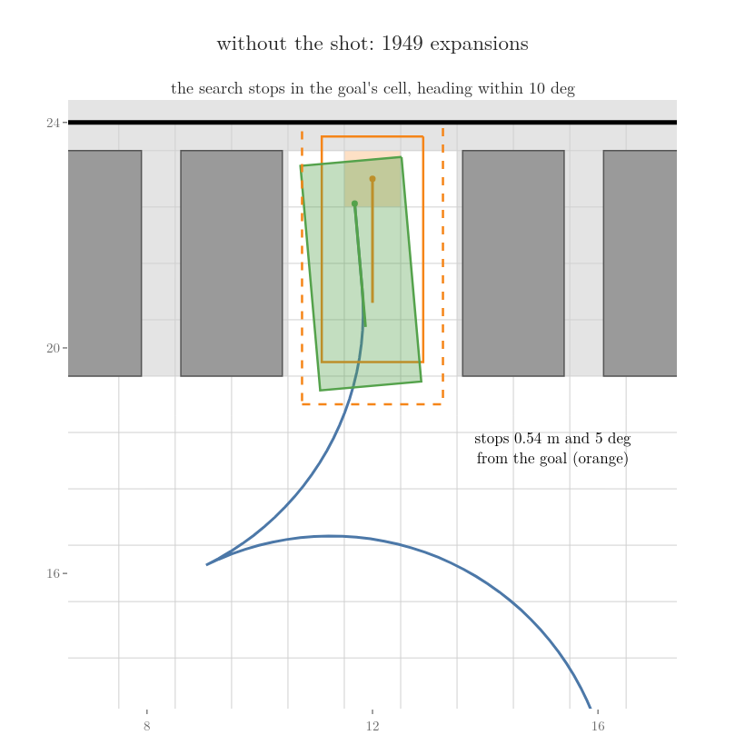

<!-- where-this-fits: generated by course_map/build_map.py; edit concepts.yaml, not this block -->
> **Where this fits:**
>
> - **Builds on:** [Gradient descent](../../../../ML/06-regression/ML-056-gradient-descent/ML-056-gradient-descent.md#2-the-idea); [A* search](../../../../RO/navigation/04-graph-search-and-configuration-space/RO-034-a-star-and-heuristics/RO-034-a-star-and-heuristics.md#45-the-algorithm); [Admissible heuristic](../../../../RO/navigation/04-graph-search-and-configuration-space/RO-034-a-star-and-heuristics/RO-034-a-star-and-heuristics.md#51-a-guess-that-never-overestimates); [Dubins and Reeds-Shepp paths](../../../../RO/navigation/06-grid-sampling-and-car-like-planning/RO-054-planning-with-motion-limits/RO-054-planning-with-motion-limits.md#7-the-shortest-drivable-paths-dubins-and-reeds-shepp-curves); [Motion primitives and lattice search](../../../../RO/navigation/06-grid-sampling-and-car-like-planning/RO-054-planning-with-motion-limits/RO-054-planning-with-motion-limits.md#5-a-few-motions-to-build-with-motion-primitives-and-a-system-simulator).
> - **Compare with:** [State lattice and control set](../../../../RO/navigation/06-grid-sampling-and-car-like-planning/RO-056-state-lattices/RO-056-state-lattices.md#32-the-control-set); [Elastic band](../../../../RO/navigation/06-grid-sampling-and-car-like-planning/RO-058-trajectory-optimisation/RO-058-trajectory-optimisation.md#42-five-points-the-smoothing-matrix).
<!-- /where-this-fits -->

## 1. Overview

> **Key point:** A route found on a grid joins cell centres with sharp corners and ignores which way the car faces, so a car that cannot turn on the spot cannot drive it. Hybrid A\* searches the same grid, but every step is an arc the car can drive and every state keeps its exact pose; a short smoothing pass then removes needless steering.

The robot can already plan on a grid. [A\*](../../04-graph-search-and-configuration-space/RO-034-a-star-and-heuristics/RO-034-a-star-and-heuristics.md#4-a-cost-so-far-plus-the-guess) (G-2577) finds the shortest route through a grid of cells, guided by a guess of the distance left. The robot can also build motions it can drive: short pieces of the turning circle, the [motion primitives](../RO-054-planning-with-motion-limits/RO-054-planning-with-motion-limits.md#5-a-few-motions-to-build-with-motion-primitives-and-a-system-simulator) (G-2826), and the shortest drivable path between two poses when reversing is allowed, the [Reeds-Shepp path](../RO-054-planning-with-motion-limits/RO-054-planning-with-motion-limits.md#72-reeds-shepp-paths-with-reverse) (G-2829).

This Note plans for a car, so the world changes from the room to a parking lot: a car parks, and a car cannot spin on the spot. A car steers its front wheels and turns about a point on the line of its rear axle; how far it can steer sets the radius of its tightest circle (car-like robots, RO-003; MR §13.3.1). Our car:

- is 4.0 m long and 1.8 m wide, with its rear axle 0.75 m from the rear bumper;
- has 2.5 m between its axles;
- cannot drive a circle tighter than 5 m, measured at the middle of the rear axle.

We describe the car by its [**pose**](../../../control/01-robot-models/RO-001-pose-and-differential-drive/RO-001-pose-and-differential-drive.md#22-why-position-is-not-enough-the-heading) (G-2280): the position of the middle of its rear axle and its **heading** (G-2284), the direction it faces.

The lot is 24 m by 24 m (Figure 1). A lower lane runs along the bottom wall; a middle row of six parked cars separates it from an upper lane; the two lanes meet at the right end. Along the top wall, nine bays 2.5 m wide hold parked cars, except one. The car starts in the lower lane at (2, 3), facing along x (0°). The car must back into the empty bay, nose out, ending at (12, 23) facing down (−90°).

The grid route fails. Figure 1 runs A\* on 1 m cells and lets the car follow the result. Watch the green car leave the start and turn as tightly as it can towards the blue route:

The car hits a parked car after 4.05 m. The route fails in three ways:

- it was planned for a point, while the car is 4.0 m long and 1.8 m wide;
- it has 8 corners, where it turns by 45° or 90° within one cell, and the car's tightest turn is a 5 m circle;
- its last move heads up the bay (90°), nose first, while the goal is nose out (−90°).

This Note builds a planner whose every step the car can drive:

- Hybrid A\*: A\* whose states carry a heading and whose moves are arcs the car can drive ([Section 2](#2-hybrid-a-states-with-a-heading-moves-the-car-can-drive));
- the two guesses of the cost left that keep its search small ([Section 3](#3-two-guesses-of-the-cost-left));
- a shot to the goal along a Reeds-Shepp path, which lands exactly on the goal ([Section 4](#4-the-reeds-shepp-shot-to-the-goal));
- smoothing, which takes the corners out of a route, and why it cannot rescue the grid route but does improve Hybrid A\*'s path ([Section 5](#5-smoothing-the-path)).

## 2. Hybrid A\*: states with a heading, moves the car can drive

> **Key point:** Hybrid A\* runs A\* on the cells of the grid, but each state also has a heading, and each move is an arc of 1.5 m that the car can drive. Each cell and heading range keeps the cheapest exact pose that reached it, so the path is drivable from end to end.

### 2.1 Six arcs from every pose

The grid route failed because its moves were jumps between cell centres. The fix is to let the search move only the way the car moves. A\* that searches over the grid's cells, but whose states carry a heading and an exact pose and whose moves are arcs the car can drive, is **Hybrid A\*** (G-2840) (Dolgov et al. 2008).

From any pose the car can drive forward or in reverse, and steer full left, straight, or full right. Each of these six choices, held for 1.5 m, is a short arc of the 5 m circle or a straight piece: six of RO-054's [motion primitives](../RO-054-planning-with-motion-limits/RO-054-planning-with-motion-limits.md#5-a-few-motions-to-build-with-motion-primitives-and-a-system-simulator) (G-2826), short motions the car can drive, each one input held for a fixed length. Junior, the Stanford car that used this planner in the 2007 DARPA Urban Challenge, chose between forward and reverse moves of different steering in the same way (Dolgov et al. 2008). Figure 2 draws them from the start.

Two numbers fix the arcs. A turning arc follows the 5 m circle, so it turns the heading by the arc length divided by the radius (the [arc rule](../../../control/01-robot-models/RO-001-pose-and-differential-drive/RO-001-pose-and-differential-drive.md#23-why-angles-are-measured-in-radians), RO-001):

$$\frac{1.5}{5} = 0.3 \text{ rad}$$

$$= 17.2^\circ$$

The arc is 1.5 m long so that every move leaves its cell: a cell of 1 m is at most 1.414 m across, its diagonal. Modern Robotics asks the same of its grid planner for wheeled robots: the cells as large as possible, but every motion must move the robot out of its cell (MR §10.4.2).

Where an arc ends follows from the pose and the circle, as RO-054's [system simulator](../RO-054-planning-with-motion-limits/RO-054-planning-with-motion-limits.md#5-a-few-motions-to-build-with-motion-primitives-and-a-system-simulator) (G-2825) works it out. For the left arc from the start, with:

- $x$ and $y$ the start position, (2, 3) m;
- $\theta$ the start heading, 0 rad;
- $\rho$ the radius of the circle, 5 m;
- $\Delta\theta$ the turn of the arc, 0.3 rad;
- $x'$ and $y'$ the end position, in m.

Numbers first, then the same in symbols:

$$x' = 2 + 5 \times (\sin 0.3 - \sin 0)$$

$$= 2 + 5 \times 0.29552 = 3.478$$

$$y' = 3 - 5 \times (\cos 0.3 - \cos 0)$$

$$= 3 + 5 \times 0.04466 = 3.223$$

$$x' = x + \rho\thinspace(\sin(\theta + \Delta\theta) - \sin\theta)$$

$$y' = y - \rho\thinspace(\cos(\theta + \Delta\theta) - \cos\theta)$$

The steering for that circle is the car's largest steering angle. With 2.5 m between the axles it is the angle whose tangent is 2.5 divided by 5 (MR §13.3.1, eq. 13.16):

$$\tan^{-1}(2.5 / 5) = 26.6^\circ$$

### 2.2 A state is a cell and a heading range

A\* needs states it can recognise again. Hybrid A\* uses the grid's cells for that: 1 m cells centred on whole metres, and the heading cut into 72 ranges of 5° (Dolgov et al. used 5°; it is also Nav2's default). A state is a cell plus a heading range, but it stores the car's exact pose inside them (Dolgov et al., Fig. 2). Figure 2 shades the cells the forward arcs end in: the left and right arcs both end in the cell centred on (3, 3), in different heading ranges, so they are two states.

Then the search is [A\*](../../04-graph-search-and-configuration-space/RO-034-a-star-and-heuristics/RO-034-a-star-and-heuristics.md#45-the-algorithm), step for step. Each state has three numbers:

- $g$, its **cost so far** (G-2574), the cost of the best way found to it, in m;
- $h$, a guess of the cost left from it to the goal, in m;
- $f$, its **estimated total cost** (G-2575), their sum, in m.

$$f = g + h$$

The state with the smallest $f$ comes off the [open list](../../04-graph-search-and-configuration-space/RO-032-graphs-and-uninformed-search/RO-032-graphs-and-uninformed-search.md#4-searching-with-a-frontier-and-a-visited-list) (G-2547), the states reached but not yet expanded, and is expanded by driving its six arcs. Each arc is checked along its length, every 0.25 m, for the body touching a parked car or a wall (as in [checking a path segment](../../04-graph-search-and-configuration-space/RO-038-collision-checking-and-nearest-neighbours/RO-038-collision-checking-and-nearest-neighbours.md#62-step-size-and-order)), with the body grown by 0.1 m on every side as a safety margin (a grown body makes the check conservative, MR §10.9).

The first expansion, with the guess $h$ of [Section 3](#3-two-guesses-of-the-cost-left), the larger of two guesses of the distance left:

| Arc | End pose | Cell, heading range | $g$ (m) | $h$ (m) | $f$ (m) |
|---|---|---|---|---|---|
| forward, left | (3.478, 3.223), 17.2° | (3, 3), 15° | 1.5 | 32.314 | 33.814 |
| forward, straight | (3.500, 3.000), 0° | (4, 3), 0° | 1.5 | 31.314 | 32.814 |
| forward, right | (3.478, 2.777), −17.2° | (3, 3), 345° | 1.5 | 32.314 | 33.814 |
| reverse (all three) | x about 0.5 | — | — | — | blocked by the wall |

The straight arc has the smallest $f$, so it is expanded next. The search goes on like this until it reaches the goal.

### 2.3 Why one pose per state, and what it costs

Without states the search would be a tree of arcs, and a tree grows exponentially with its depth. Every pose has six children, so after five arcs there are six to the fifth power arc ends:

$$6^5 = 7776$$

Yet those 7,776 ends fall into only 455 different cells and heading ranges (notebook, obstacles ignored). Many ends are nearly the same pose. Figure 3 shows three of them: left then right, right then left, and straight then straight all end facing 0° inside the cell centred on (5, 3).

Hybrid A\* treats poses in one cell and heading range as the same state, as if each pose were rounded to its cell: a new arrival is kept only if its cost so far is lower than the pose already stored there; otherwise it is dropped. The three drives of Figure 3 cost the same, so the first one stored stays.

Merging keeps the search finite, but it has a price. The dropped poses are real, different positions; the best route might have passed through one of them. So Hybrid A\* is not guaranteed to find the least-cost path (Dolgov et al. 2008: "not guaranteed to find the minimal-cost solution, due to its merging of continuous-coordinate states that occupy the same cell"). What it does guarantee is a path made only of arcs the car can drive.

### 2.4 What a path costs

A cost of distance alone puts no penalty on reversing. Dolgov et al. penalise driving in reverse and switching between forward and reverse. We use:

- each metre forward costs 1;
- each metre in reverse costs 2 (Nav2's default reverse penalty);
- each switch between forward and reverse, which means a stop, adds 2 m.

The search stops when a state lands in the goal's cell with a heading within 10° of the goal heading. Run this way, with the guess of Section 3, the search expands 1,949 states and stops 0.54 m and 5° from the goal (Figure 4): it reached the right cell, but not the exact pose.

The arcs turn the heading in steps of 17.2°, and no whole number of such steps from 0° makes exactly −90°, so an arc-only search cannot end exactly on the goal. Section 3 makes the search smaller; Section 4 makes it land exactly.

## 3. Two guesses of the cost left

> **Key point:** Hybrid A\* is guided by the larger of two guesses of the cost left: the length of the shortest Reeds-Shepp path, which accounts for the turning but not for the parked cars, and the grid distance, which accounts for the parked cars but not for the turning. Each accounts for what the other ignores.

The search of Section 2 expands 1,949 states to cross the lot, and how many it expands depends on its guess of the cost left. The guess must never overestimate the cost left, or A\* can stop on a costlier path ([admissible heuristics](../../04-graph-search-and-configuration-space/RO-034-a-star-and-heuristics/RO-034-a-star-and-heuristics.md#5-why-a-returns-the-shortest-route-admissible-heuristics), G-2578). The closer the guess comes to the true cost, the fewer states A\* expands ([a closer guess takes fewer cells](../../04-graph-search-and-configuration-space/RO-034-a-star-and-heuristics/RO-034-a-star-and-heuristics.md#53-a-closer-guess-takes-fewer-cells)). From the start, the path Hybrid A\* finds costs 50.8 (Section 4). Figure 5 draws the three cheap guesses.

**The straight line.** The first guess is the [Euclidean distance](../../../../ML/04-missing-data-and-outliers/ML-038-knn-imputer/ML-038-knn-imputer.md#41-the-euclidean-distance) (G-715) from the start to the goal, which is 10 m along x and 20 m along y away:

$$\sqrt{10^2 + 20^2} = \sqrt{500}$$

$$= 22.36 \text{ m}$$

The straight line ignores both the parked cars and the heading.

**The Reeds-Shepp length.** The shortest path of a car that may reverse, between two poses on an empty floor, is a [Reeds-Shepp path](../RO-054-planning-with-motion-limits/RO-054-planning-with-motion-limits.md#72-reeds-shepp-paths-with-reverse) (G-2829), made of arcs of the tightest circle and straight pieces: 27.31 m from the start. The Reeds-Shepp length accounts for the turn the car needs to arrive nose out. The Reeds-Shepp length ignores the parked cars, so it can never be longer than the real path: it is the shortest of all drivable paths, and the real path is one of them (Dolgov et al. call it the non-holonomic-without-obstacles heuristic).

**The grid distance.** [Dijkstra's algorithm](../../04-graph-search-and-configuration-space/RO-033-dijkstra-and-priority-queues/RO-033-dijkstra-and-priority-queues.md#32-the-algorithm-settle-the-nearest-update-its-neighbours) (G-2565), run once from the goal cell over the free cells, gives every cell its distance to the goal along the grid: 33.31 m from the start cell, the route of Figure 1. The grid distance accounts for the middle row blocking the way, but it ignores the heading (Dolgov et al.'s holonomic-with-obstacles heuristic).

**The larger of the two.** Dolgov et al. show that neither guess overestimates the cost, so their larger value does not either, and at every state it is at least as close to the true cost as each of them. Run without the shot of Section 4, and stopping as in Section 2.4:

| Guess $h$ | At the start (m) | States expanded |
|---|---|---|
| straight line | 22.36 | 2,318 |
| Reeds-Shepp length | 27.31 | 2,006 |
| grid distance | 33.31 | 2,011 |
| larger of Reeds-Shepp and grid | 33.31 | 1,949 |

In this lot the gain is modest, because the long way round the middle row dominates. In open lots, where the heading matters most, Dolgov et al. measured a far larger gain: 21,515 states with the straight line and 1,465 with the Reeds-Shepp length; in a maze with dead ends, the Reeds-Shepp length alone expanded 68,730 states and the larger of the two only 10,588.

The search is now guided, but it still stops in the goal's cell rather than on the goal, 0.54 m away, after 1,949 expansions.

## 4. The Reeds-Shepp shot to the goal

> **Key point:** Every few expansions, Hybrid A\* tries the shortest Reeds-Shepp path from the pose it is expanding to the exact goal. When that path hits nothing, the search is done: it ends exactly on the goal, after 312 expansions instead of 1,949.

The arcs of Section 2 can only approach the goal in steps of 1.5 m and 17.2°. A Reeds-Shepp path lands exactly on any pose, but ignores obstacles. Hybrid A\* combines them: from time to time it takes the pose it is expanding, computes the Reeds-Shepp path from there to the goal, and checks that path for collisions like an arc. If it is free, the path is complete (Dolgov et al. 2008). RO-054 uses Reeds-Shepp paths the same way, as a [drivable steer](../RO-054-planning-with-motion-limits/RO-054-planning-with-motion-limits.md#73-using-them-in-a-planner-a-drivable-steer): the step that joins two poses with a drivable path, or reports that it cannot.

This extra child is the **analytic expansion** (G-2841), here the Reeds-Shepp shot: "analytic" because the path comes from a formula, not from a search. Trying it at every expansion would waste time far from the goal, where it nearly always hits something. So it is tried once every $N$ expansions, more often as the goal comes nearer (Dolgov et al.; Nav2's analytic expansion ratio). We use:

- $d$, the straight-line distance from the pose to the goal, in m;
- $N$, the number of expansions between two shots, at least 1.

$$N = \lfloor d / 3 \rfloor$$

where the brackets keep the whole part. At the start:

$$N = \lfloor 22.36 / 3 \rfloor = 7$$

and within 3 m of the goal, every expansion tries a shot.

Figure 6 runs the whole search. Watch the tree of arcs grow along the lower lane and round the end of the middle row, and the red dashed shots that hit parked cars, until a green shot reaches the goal without a collision.

![Hybrid A\* with the shot, one frame per expansion for the first ten, then several per frame. Each expansion takes the pose with the smallest estimated total cost f, cost so far plus guess (orange arrow) and drives its six arcs: kept arcs blue (forward) or purple (reverse), arcs into a cell and heading range that already holds a cheaper pose grey, arcs that hit something red. Red dashed: a Reeds-Shepp shot that hits a parked car. At expansion 312 the shot is free (green). Last frame: the whole path, 39.42 m, with one switch from forward to reverse](images/hybrid_anim.gif)

Of 64 shots tried, 63 hit something. The free one starts at (9.40, 14.67) in the upper lane, facing 206.3°: the car has driven past the bay. From there the shot backs into the bay in one move: reverse with full right steering, reverse straight, reverse with a little left steering, 9.418 m in all. The path is 20 forward arcs, then the shot. Its cost, with the rules of [Section 2.4](#24-what-a-path-costs):

$$20 \times 1.5 = 30.0$$

$$2 \times 9.4176 = 18.835$$

$$30.0 + 18.835 + 2 = 50.835$$

The 2 at the end is the one switch from forward to reverse. The path is 39.42 m long:

$$30.0 + 9.418 = 39.42 \text{ m}$$

The path ends exactly on the goal, and the car's body never comes closer than 0.16 m to a parked car. The shot cut the search from 1,949 expansions to 312. What is left is the steering: the arcs only steer full left, straight or full right.

## 5. Smoothing the path

> **Key point:** Smoothing moves each point of a path a little towards its found position and a little towards its two neighbours, again and again, which rounds corners. Smoothing cannot turn a grid route into one a car can drive, but it removes needless steering from Hybrid A\*'s path, as long as it keeps the turns within the 5 m circle and the body away from the parked cars.

### 5.1 The smoothing rule

Hybrid A\*'s path steers only full left, straight or full right, and switches between them in jumps: Dolgov et al. found such paths "drivable, but can contain unnatural swerves that require unnecessary steering". The grid route of Figure 1 is worse: it turns 90° at one point. The simplest remedy is to pull the corners in.

Write the found points as $x_i$ and the smoothed points as $y_i$, both positions in the plane, numbered along the path. At the start each $y_i$ equals its $x_i$. Two aims pull against each other (Dolgov et al. 2008, smoothness term; Nav2 smoother):

- each smoothed point should stay near its found point;
- each smoothed point should stay near its neighbours, which straightens the path.

The first aim alone leaves the path as found; the second alone pulls all points together onto the straight line between the two ends, which are held fixed. The effect is that of a rubber band laid along the route and tied at both ends: it pulls every point towards its neighbours, and pins near the found points stop it snapping straight. Weighting the two and stepping downhill is [gradient descent](../../../../ML/06-regression/ML-056-gradient-descent/ML-056-gradient-descent.md#21-which-way-to-move) (G-862). With:

- $x_i$, found point $i$, in m;
- $y_i$, smoothed point $i$, in m, starting at $x_i$;
- $\alpha$, the data weight, how hard a point is pulled back to its found position, 0.5;
- $\beta$, the smoothing weight, how hard it is pulled towards its neighbours, 0.1;
- $E$, the weighted squared errors that involve point $i$, in m²;
- $E'$, the slope of $E$ as $y_i$ changes, in m.

Take the 90° corner of the grid route at (16, 7), between (15, 7) and (16, 8), and look at its x coordinate $y$ alone; the found value is 16 and the neighbours' x values are 15 and 16. The weighted squared errors, their slope at the start, and half a step down the slope, then the same in symbols:

$$E = 0.5\thinspace(16 - y)^2$$

$$+\ 0.1\thinspace\big((y - 15)^2 + (16 - y)^2\big)$$

$$E' = -1.0\thinspace(16 - y)$$

$$+\ 0.2\thinspace\big((y - 15) - (16 - y)\big)$$

$$E'(16) = 0 + 0.2 \times 1 = 0.2$$

$$y \leftarrow 16 - 0.2 / 2 = 15.9$$

$$E = \alpha\thinspace(x_i - y_i)^2$$

$$+\ \beta\thinspace\big((y_i - y_{i-1})^2 + (y_{i+1} - y_i)^2\big)$$

$$E' = -2\alpha\thinspace(x_i - y_i)$$

$$-\ 2\beta\thinspace(y_{i+1} + y_{i-1} - 2y_i)$$

$$y_i \leftarrow y_i - E' / 2$$

$$= y_i + \alpha\thinspace(x_i - y_i)$$

$$+\ \beta\thinspace(y_{i+1} + y_{i-1} - 2y_i)$$

The y coordinate moves the same way, from 7 to 7.1, so the corner point moves to (15.9, 7.1), into the inside of the turn. One pass over all points is a sweep; the sweeps repeat until the points stop moving, and the two end points never move. Rounding corners after planning is a standard step: Modern Robotics recommends smoothing the jerky motions of grid and sampling planners afterwards (MR §10.8). Smoothing a path this way is **path smoothing** (G-2842).

### 5.2 Smoothing the grid route

Can smoothing rescue the grid route of Figure 1? Figure 7 tries, first with data weight 0.5 and smoothing weight 0.1, then with the data weight set to 0.

With the data weight 0.5 the route settles after 20 sweeps. How sharp a turn is can be read from its curvature: the change of direction at a point divided by the length of the step into it (Dolgov et al.). The 90° corner turns 1.571 rad within a 1 m step:

$$\frac{1.571}{1} = 1.571 \text{ per m}$$

After smoothing, the sharpest turn is 1.453 per m, a circle of radius:

$$\frac{1}{1.453} = 0.69 \text{ m}$$

The car needs 5 m. The body still overlaps something at 25 of the 31 points, and the route still ends heading up the bay, nose first. With the data weight 0 nothing pulls the points back, so the route becomes the straight line between its fixed ends, and it runs through the middle row. Smoothing only rounds what the planner found; it ignores the car's size, its turning circle and the goal heading. So the planner itself must model the car, as Hybrid A\* does.

### 5.3 Smoothing Hybrid A\*'s path

Hybrid A\*'s path is drivable, so smoothing only has to improve it while keeping it drivable. We take a point every 0.5 m and smooth the forward drive and the reverse drive separately. Three rules keep the path drivable (Dolgov et al.'s cost has the same three concerns):

- the first two and last two points of each drive stay fixed, so the start, the goal and the switch from forward to reverse keep their position and their heading;
- a third pull moves a point away from an obstacle while its body is closer than 0.3 m (Dolgov et al.'s obstacle term), at a tenth of the distance missing;
- where the smoothed path would turn tighter than the 5 m circle, those points and their neighbours are held where Hybrid A\* put them, and the drive is smoothed again (a simple stand-in for Dolgov et al.'s curvature term).

We use Nav2's weights: data weight 0.2 and smoothing weight 0.3. Figure 8 shows the forward drive, sweep by sweep, with its steering angle along the way.

![Smoothing the forward drive of Hybrid A\*'s path, sweep by sweep. Left: the drive round the end of the middle row, as found (grey) and after the sweep (green); black dots are points held where Hybrid A\* put them. Right: the steering angle along the 30 m drive, as found (grey) and after the sweep (green); the angle of 26.6° is full lock. The jumps from straight to full lock become gradual, and the short straight piece inside the long left turn, at about 21 m, flattens. Last frame: settled after 49 sweeps; total steering movement 100° instead of 133°](images/smooth_anim.gif)

The smoothed forward drive:

- turns its front wheels 100° in total, adding up every change of steering angle along the drive, instead of 133°, so the swerves are smaller;
- still steers at most 26.6°, so it stays within the 5 m circle;
- keeps its body at least 0.19 m from the parked cars instead of 0.16 m.

Two long turns, from 12.0 to 20.5 m and from 23.0 to 30.0 m along the drive, stay as found: both are at full lock already, and smoothing pulls a turn inwards, tighter than the car can drive. The reverse drive into the bay stays as found too: its turns are at full lock and its middle piece is already straight. Dolgov et al. smooth with a curvature penalty and then add finer points between the smoothed ones, which gives steering that changes gradually all along.

## 6. Summary

| Step | What it does | Why |
|---|---|---|
| A\* on a grid | finds a 33.31 m route through cell centres | fast, but corners, no heading, planned for a point |
| six arcs of 1.5 m | every move is drivable | the car cannot turn on the spot |
| one pose per cell and heading range | 455 states instead of 7,776 arc ends after five arcs | the search stays finite; not guaranteed least-cost |
| larger of two guesses | Reeds-Shepp length and grid distance | each accounts for what the other ignores |
| Reeds-Shepp shot | ends exactly on the goal | arcs alone end 0.54 m off |
| smoothing | rounds corners and removes swerves | cannot rescue a grid route; must keep the 5 m circle |

- The car reaches the bay nose out: Hybrid A\* finds a 39.42 m path of 20 forward arcs and one Reeds-Shepp move in reverse, after 312 expansions, because every step is an arc the car can drive, where the 33.31 m grid route made it hit a parked car after 4.05 m.
- **Hybrid A\*** (G-2840) is A\* over cells and heading ranges that keeps each state's exact pose, so its path is drivable; it drops other poses in the same cell and range, so it is not guaranteed to find the least-cost path.
- Each move is an arc of 1.5 m, longer than a 1 m cell's diagonal of 1.414 m, so every move leaves its cell and the search does not stall.
- The guess of the cost left is the larger of the Reeds-Shepp length (27.31 m from the start), which accounts for the turning, and the grid distance (33.31 m), which accounts for the parked cars, because neither overestimates (Dolgov et al.) and each accounts for what the other ignores; it expanded 1,949 states against 2,318 for the straight line.
- The **analytic expansion** (G-2841), a Reeds-Shepp shot tried every few expansions, makes the path end exactly on the goal and cuts the search from 1,949 to 312 expansions, because one formula covers the last metres the arcs could only approach.
- **Path smoothing** (G-2842) pulls each point towards its found place and towards its neighbours, so corners round off; on a grid route it leaves a 0.69 m turn and parked cars in the way, so it is no substitute for a planner that models the car.
- On Hybrid A\*'s path, smoothing cut the steering movement of the forward drive from 133° to 100°, because start, goal and switch stay fixed and no turn is allowed tighter than the 5 m circle.

The car can now plan a drivable path into a tight bay. Still missing: Hybrid A\* computes its arcs while it searches, its states land anywhere inside their cells, and it drops some of them, so it cannot promise the cheapest path; the next step fixes the moves in advance so that every one ends exactly on a point of a [state lattice](../RO-056-state-lattices/RO-056-state-lattices.md#2-why-fixed-moves-never-land-exactly-on-earlier-states).

## 7. Sources

**Built from**

- Jasvir Virdi, "Motion Planning – Finding smooth optimal paths using Hybrid A\*/Astar for autonomous vehicles", YouTube, https://www.youtube.com/watch?v=QAzyG2DB8Io
- Udacity, "Artificial Intelligence for Robotics" (CS373), "Smoothing Algorithm 2" and "Smoothing Algorithm 3", YouTube, https://www.youtube.com/watch?v=9mOt7cnCxzo and https://www.youtube.com/watch?v=YesKg2m9vng
- Udacity, "Artificial Intelligence for Robotics" (CS373), "Path Smoothing", YouTube, https://www.youtube.com/watch?v=v0-OUApP_5Q
- Udacity, "Artificial Intelligence for Robotics" (CS373), "Zero Data Weight", YouTube, https://www.youtube.com/watch?v=XUVbNHSlliA; the transcripts of these clips are at the Georgia Tech course-docs mirror, "PID control" §1–12
- Udacity, "Artificial Intelligence for Robotics" (CS373), "A\* in Action", YouTube, https://www.youtube.com/watch?v=qXZt-B7iUyw
- Northwestern Robotics, "Modern Robotics, Chapter 13.3.3: Motion Planning for Nonholonomic Mobile Robots", YouTube, https://www.youtube.com/watch?v=jOesC0wKpTQ
- Dolgov, D., Thrun, S., Montemerlo, M. and Diebel, J. (2008). "Practical Search Techniques in Path Planning for Autonomous Driving". AAAI Workshop on Search in Artificial Intelligence and Robotics. [ai.stanford.edu/~ddolgov](http://ai.stanford.edu/~ddolgov/papers/dolgov_gpp_stair08.pdf) (Dolgov et al. 2008)
- Lynch, K. M. and Park, F. C. (2017). *Modern Robotics: Mechanics, Planning, and Control*. Cambridge University Press. §10.4.2 "Grid-Based Path Planning for a Wheeled Mobile Robot", §10.8 "Smoothing", §10.9 "Summary", §13.3.1 (car kinematics, eq. 13.16). Free preprint: http://modernrobotics.org (MR)

**Other references**

- Nav2 documentation, "Smac Hybrid-A\* Planner" configuration (Jazzy): angle quantization bins 72, reverse penalty 2.0, analytic expansion ratio, smoother weights w_data 0.2 and w_smooth 0.3, [docs.nav2.org](https://docs.nav2.org/jazzy/configuration_and_development/configuration_guide/planners_plugins/smac/smac_hybrid/configuring_smac_hybrid/) (Nav2)

## 8. Key terms

Terms taught in this Note come first; linked terms are recaps, taught in the Note the link opens.

| Term | Meaning |
|---|---|
| Hybrid A* (G-2840) | A* over grid cells and heading ranges in which each state keeps the exact pose that reached it most cheaply and every move is an arc the car can drive, such as six 1.5 m arcs per pose; its path is drivable, but because it drops other poses in the same cell it is not guaranteed to be the cheapest. |
| Analytic expansion (Reeds-Shepp shot) (G-2841) | An extra child that Hybrid A* tries every few expansions: the shortest Reeds-Shepp path from the pose being expanded to the exact goal, kept if it hits nothing; it lets the search end exactly on the goal and much sooner (312 expansions instead of 1,949 in the parking lot). |
| Path smoothing (G-2842) | Moving the points of a found path, sweep after sweep, a little towards their found places and a little towards their neighbours, $y_i \leftarrow y_i + \alpha(x_i - y_i) + \beta(y_{i+1} + y_{i-1} - 2y_i)$; it rounds corners and removes needless steering, but on its own it ignores obstacles, the turning circle and the goal heading. |
| [A* search](../../../../RO/navigation/04-graph-search-and-configuration-space/RO-034-a-star-and-heuristics/RO-034-a-star-and-heuristics.md#45-the-algorithm) (G-2577) | Dijkstra's algorithm with the open list sorted by $f = g + h$, the cost so far plus a heuristic guess of the cost left; with a consistent heuristic it returns the shortest route while expanding far fewer states (9 cells against 54 on the room grid). |
| [Motion primitive](../../../../RO/navigation/06-grid-sampling-and-car-like-planning/RO-054-planning-with-motion-limits/RO-054-planning-with-motion-limits.md#5-a-few-motions-to-build-with-motion-primitives-and-a-system-simulator) (G-2826) | A short motion the robot can drive, usually one input held for a fixed time, such as full left at 0.5 m/s for 0.75 s; planners chain primitives so that every path they build is drivable. |
| [Reeds-Shepp path (Reeds-Shepp curve)](../../../../RO/navigation/06-grid-sampling-and-car-like-planning/RO-054-planning-with-motion-limits/RO-054-planning-with-motion-limits.md#72-reeds-shepp-paths-with-reverse) (G-2829) | The shortest path between two poses for a vehicle that turns no tighter than a given radius but may also reverse: at most five full-lock arcs and straight pieces with at most two reversals, from 48 words in nine families; planners use it to join two poses exactly with a drivable path. |
| [Pose](../../../../RO/control/01-robot-models/RO-001-pose-and-differential-drive/RO-001-pose-and-differential-drive.md#22-why-position-is-not-enough-the-heading) (G-2280) | Where a robot is and which way it faces: on a floor, its position $(x, y)$ and heading $\theta$, such as (2 m, 1 m, 30°); needed because a robot at one spot drives off differently depending on its heading. |
| [Heading $\theta$](../../../../RO/control/01-robot-models/RO-001-pose-and-differential-drive/RO-001-pose-and-differential-drive.md#22-why-position-is-not-enough-the-heading) (G-2284) | The angle from the world x-axis to the direction a robot faces, measured counter-clockwise; it decides which way the robot moves when it drives forward. |
| [System simulator](../../../../RO/navigation/06-grid-sampling-and-car-like-planning/RO-054-planning-with-motion-limits/RO-054-planning-with-motion-limits.md#5-a-few-motions-to-build-with-motion-primitives-and-a-system-simulator) (G-2825) | The module that works out where an input takes the robot, by stepping its motion equations forward, such as 75 Euler steps of 0.01 s; planners call it to turn inputs into motions they can check for collisions. |
| [Cost so far $g$ (g-value)](../../../../RO/navigation/04-graph-search-and-configuration-space/RO-034-a-star-and-heuristics/RO-034-a-star-and-heuristics.md#41-g-h-and-f-on-the-first-step) (G-2574) | The length of the best route found so far from the start to a state; A* lowers it whenever it finds a shorter way into the state. |
| [Estimated total cost $f$ (f-value)](../../../../RO/navigation/04-graph-search-and-configuration-space/RO-034-a-star-and-heuristics/RO-034-a-star-and-heuristics.md#41-g-h-and-f-on-the-first-step) (G-2575) | The cost so far plus the heuristic, $f = g + h$: the length of the best route through a state if the guess were exact; A* expands the open state with the smallest $f$. |
| [Frontier (open list)](../../../../RO/navigation/04-graph-search-and-configuration-space/RO-032-graphs-and-uninformed-search/RO-032-graphs-and-uninformed-search.md#4-searching-with-a-frontier-and-a-visited-list) (G-2547) | The vertices a search has reached but not yet expanded, waiting to be taken off one at a time; which one comes off next is what makes one search differ from another. |
| [Admissible heuristic](../../../../RO/navigation/04-graph-search-and-configuration-space/RO-034-a-star-and-heuristics/RO-034-a-star-and-heuristics.md#51-a-guess-that-never-overestimates) (G-2578) | A heuristic that is never more than the true cost left from any state, $h \le h^\ast$; it makes $f$ a lower bound on every route through a state, so the first route A* takes off the open list is the shortest. |
| [Euclidean distance](../../../../ML/04-missing-data-and-outliers/ML-038-knn-imputer/ML-038-knn-imputer.md#41-the-euclidean-distance) (G-715) | The straight-line distance between two points. |
| [Dijkstra's algorithm](../../../../RO/navigation/04-graph-search-and-configuration-space/RO-033-dijkstra-and-priority-queues/RO-033-dijkstra-and-priority-queues.md#32-the-algorithm-settle-the-nearest-update-its-neighbours) (G-2565) | A search that always settles the vertex with the smallest distance from the start found so far, which is then final, and offers each of its neighbours the route through it, keeping the shorter; with every edge cost at least 0 it finds the shortest route to every vertex (3.414 m to the door on the room grid with diagonals). |
| [Gradient descent](../../../../ML/06-regression/ML-056-gradient-descent/ML-056-gradient-descent.md#1-overview) (G-862) | Finding the lowest point of a function by repeated small steps downhill. |
