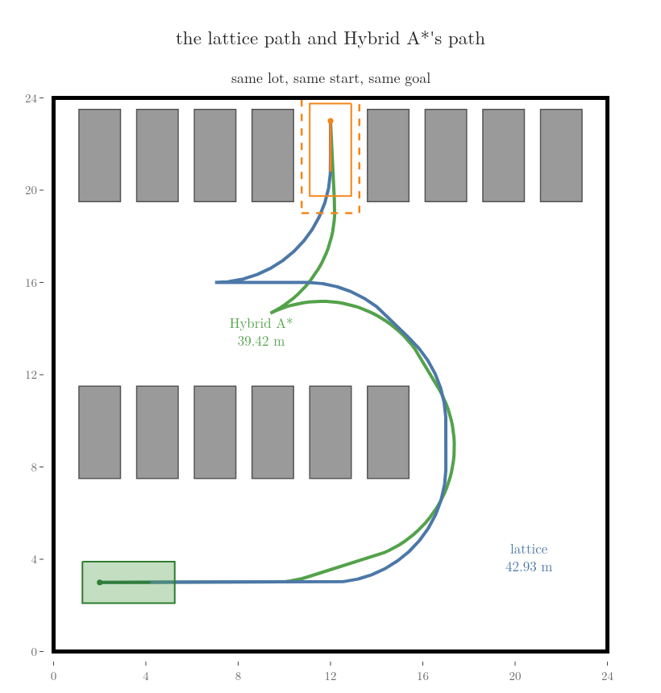

<!-- where-this-fits: generated by course_map/build_map.py; edit concepts.yaml, not this block -->
> **Where this fits:**
>
> - **Builds on:** [Checking a path segment](../../../../RO/navigation/04-graph-search-and-configuration-space/RO-038-collision-checking-and-nearest-neighbours/RO-038-collision-checking-and-nearest-neighbours.md#62-step-size-and-order); [Motion primitives and lattice search](../../../../RO/navigation/06-grid-sampling-and-car-like-planning/RO-054-planning-with-motion-limits/RO-054-planning-with-motion-limits.md#5-a-few-motions-to-build-with-motion-primitives-and-a-system-simulator).
> - **Compare with:** [Hybrid A*](../../../../RO/navigation/06-grid-sampling-and-car-like-planning/RO-055-hybrid-a-star-and-path-smoothing/RO-055-hybrid-a-star-and-path-smoothing.md#2-hybrid-a-states-with-a-heading-moves-the-car-can-drive).
<!-- /where-this-fits -->

## 1. Overview

> **Key point:** A state lattice fixes the car's states to whole-metre points and a few headings, and fixes its moves in advance so that every move ends exactly on another lattice state. Plain A\* then finds the cheapest path the lattice holds, ends exactly on the goal, and checks each move by looking up the map cells it sweeps, listed before planning.

The car of [Hybrid A\* and path smoothing](../RO-055-hybrid-a-star-and-path-smoothing/RO-055-hybrid-a-star-and-path-smoothing.md#1-overview) can already back into its bay. [Hybrid A\*](../RO-055-hybrid-a-star-and-path-smoothing/RO-055-hybrid-a-star-and-path-smoothing.md#2-hybrid-a-states-with-a-heading-moves-the-car-can-drive) (G-2840), A\* over cells and heading ranges whose moves are arcs the car can drive, finds a 39.42 m path after 312 expansions. We keep the same lot and the same car: 4.0 m by 1.8 m, its tightest circle 5 m, starting at (2, 3) facing 0° and backing into the bay at (12, 23) facing −90°.

What still breaks shows in RO-055's search:

- **The arcs never land on the goal.** Each arc turns the heading by 17.2°, and no whole number of 17.2° steps from 0° makes −90°. Without the Reeds-Shepp shot the search expanded 1,949 states and stopped 0.54 m and 5° from the goal.
- **The cheapest path is not promised.** Poses that fall in the same cell and heading range are merged and all but one dropped, so the cheapest path may be among the dropped ones (Dolgov et al. 2008).
- **Every move is worked out during the search.** The search drove 1,866 arcs through the car's motion equations and checked the body at 7 places along each.

This Note fixes all three at once by designing the moves before planning:

- why moves that are not designed never land on the same point twice ([Section 2](#2-why-fixed-moves-never-close-up));
- moves that end exactly on lattice points, the control set ([Section 3](#3-moves-that-end-on-the-lattice-the-control-set));
- the cells each move sweeps, worked out once ([Section 4](#4-checking-a-move-by-look-up-the-swept-cells));
- A\* on the lattice, and how its path compares with Hybrid A\*'s ([Section 5](#5-searching-the-lattice-with-a)).

## 2. Why fixed moves never close up

> **Key point:** If the car repeats Hybrid A\*'s full-left arc of 1.5 m, it never returns to the same point: one lap of the 5 m circle is 20.94 arcs, not a whole number. Moves whose lengths do not fit the geometry make endless different states; moves designed to fit a grid make a finite graph.

RO-055's first problem was that the arcs never land exactly on the goal. The cause is general (LaValle §14.2.2.3), and the simplest case shows it: the car steers full left and keeps driving arcs of 1.5 m round its 5 m circle. One lap is the circumference:

$$2\pi \times 5 = 31.416 \text{ m}$$

$$31.416 / 1.5 = 20.94 \text{ arcs}$$

Figure 1 plays it. Watch the end points of the arcs: after 21 arcs the car is round once more, but not on the start.

Twenty-one arcs turn the car by:

$$21 \times 0.3 = 6.3 \text{ rad}$$

$$6.3 - 2\pi = 0.0168 \text{ rad}$$

so the end of the 21st arc lies 0.0168 rad of the circle past the start, along the 5 m circle:

$$0.0168 \times 5 = 0.084 \text{ m}$$

Every lap shifts by the same amount, so the ends never meet: after 63 arcs there are 64 different points. Because the lap is not a whole number of arcs, the ends keep filling the circle, and the search graph they make has no end of states (LaValle §14.2.2.3). Hybrid A\* copes by merging nearby poses into cells; that is exactly the merging that cost it the promise of the cheapest path.

The last frame of Figure 1 shows the other way out. A quarter turn of the same circle is 7.85 m:

$$\frac{\pi}{2} \times 5 = 7.854 \text{ m}$$

Four such moves bring the car back exactly to the start. A move whose length is chosen to fit the geometry lands on the same few points over and over.

RO-054 met this good case in its straight drive: with speed changes held for a fixed time, positions and speeds fell on a regular grid, and the [lattice search](../RO-054-planning-with-motion-limits/RO-054-planning-with-motion-limits.md#6-searching-the-primitives-systematically-lattice-search) (G-2827) searched it. For the car we can choose the grid first and then design the moves to fit it. The states are:

- positions on whole metres, (x, y) = (2, 3), (2, 4), and so on;
- headings in steps of 45°: 0°, 45°, 90°, up to 315°.

A regular grid of states, joined only by moves the vehicle can drive that end exactly on other states of the grid, is a **state lattice** (G-2855) (Pivtoraiko, Knepper and Kelly 2009). Its states are exactly the lattice points, so nothing needs merging, and a search over it is plain A\*. What remains is to find the moves.

## 3. Moves that end on the lattice: the control set

> **Key point:** A turn on the 5 m circle alone ends between lattice points, but a short straight piece before and after the arc can be sized so that the move ends exactly on one. The moves from each heading, worked out once and copied to every state, are the lattice's control set.

### 3.1 A 45° turn that lands on a lattice point

Section 2 asked for moves that land on lattice points. Start from (0, 0) facing 0° and turn left by 45° on the 5 m circle. The arc alone ends at (3.536, 1.464): between lattice points, as in Figure 2.

Add a straight piece before the arc, along 0°, and one after it, along 45°, and choose their lengths so that the end is a lattice point. With:

- $\rho$, the radius of the circle, 5 m;
- $\phi$, the turn, 45°;
- $a$, the length of the straight piece before the arc, in m;
- $b$, the length of the straight piece after it, in m;
- $X$ and $Y$, the lattice point we aim for, (5, 2) in m.

The arc alone ends at (3.5355, 1.4645), and driving along 45° adds the same amount to x and to y, 0.7071 m for every metre. The y coordinate gives $b$; the x coordinate, which gains the same 0.5355 m from the second straight piece, then gives $a$. Numbers first, then in symbols:

$$1.4645 + 0.7071\thinspace b = 2$$

$$b = 0.5355 / 0.7071 = 0.757 \text{ m}$$

$$a + 3.5355 + 0.5355 = 5$$

$$a = 0.929 \text{ m}$$

$$Y = \rho\thinspace(1 - \cos\phi) + b \sin\phi$$

$$X = a + \rho \sin\phi + b \cos\phi$$

The move is 5.613 m long:

$$0.929 + 3.927 + 0.757 = 5.613 \text{ m}$$

and every part of it is drivable: straight, then the 5 m circle, then straight. Pivtoraiko et al. solve the same problem with smoother curves whose steering changes gradually; straight-arc-straight moves are the simplest that land exactly.

### 3.2 The control set

The other moves are found the same way (notebook). From a state facing 0° (Figure 3, left):

- straight 1 m, ending on (1, 0);
- turn 45° left or right, ending on (5, 2) or (5, −2);
- turn 90° left or right, a quarter of the 5 m circle, ending on (5, 5) or (5, −5) with no straight pieces needed.

From a state facing 45° (Figure 3, right), the straight move is a diagonal of 1.414 m to (1, 1), and the 45° turns end on (2, 5) and (5, 2). Each move also exists in reverse: the same shape mirrored, driven backwards, which also ends on a lattice point.

The moves work like toy bricks made to snap only onto studs: whatever order they are joined in, each ends on a stud, here a lattice point. The moves from one heading, designed once before any planning, are the **lattice control set** (G-2856), the canonical set of repeating moves of Pivtoraiko et al. The lattice control set is not the set of every speed and turn-rate pair a vehicle can produce, such as the [diamond of the room robot](../RO-054-planning-with-motion-limits/RO-054-planning-with-motion-limits.md#5-a-few-motions-to-build-with-motion-primitives-and-a-system-simulator). Each move is a [motion primitive](../RO-054-planning-with-motion-limits/RO-054-planning-with-motion-limits.md#5-a-few-motions-to-build-with-motion-primitives-and-a-system-simulator) (G-2826), a short drivable motion, chosen so that it ends on the lattice. The number of moves from a state is the search's [branching factor](../../04-graph-search-and-configuration-space/RO-032-graphs-and-uninformed-search/RO-032-graphs-and-uninformed-search.md#71-counting-the-work) (G-2555): 10 from the four headings along the axes, 6 from the four diagonal headings.

The diagonal headings get their own moves because a move designed for 0° does not stay on the lattice when turned by 45°: (5, 2) turned by 45° is not a pair of whole numbers. Turning by 90° does keep whole numbers, so the set for 0° serves 90°, 180° and 270°, and the set for 45° serves the other diagonals (Hauser ch. 11 makes the same split into axis-aligned and diagonal moves).

### 3.3 Copying a move to any state

The lattice repeats: a move that joins two lattice states also joins every other pair arranged the same way (Pivtoraiko et al., §2.1). So during the search a move is turned to the state's heading and added to its position (Hauser ch. 11). With:

- $(x, y)$, the state's position, in m;
- $\theta$, its heading;
- $(\Delta x, \Delta y)$, where the move ends when it starts from (0, 0) facing 0°, in m;
- $(x', y')$, where it ends from the state, in m.

The lattice path of Section 5 turns left by 45° from (17, 9) facing 90°; the 0° move ends on (5, 2); the cosine of 90° is 0 and its sine is 1:

$$x' = 17 + 0 \times 5 - 1 \times 2 = 15$$

$$y' = 9 + 1 \times 5 + 0 \times 2 = 14$$

$$x' = x + \Delta x \cos\theta - \Delta y \sin\theta$$

$$y' = y + \Delta x \sin\theta + \Delta y \cos\theta$$

The move ends on (15, 14), facing 135°: a lattice state again. So each move is built once, as an "action template", and replicated at every state the search reaches (CMU 16-350 slides). The moves are in place; each still has to be checked against the parked cars.

## 4. Checking a move by look-up: the swept cells

> **Key point:** Because every move starts on a lattice point, the cells of a fine map that the car's body sweeps during the move are the same at every state, shifted. The cells can be listed once per move, and checking a move during the search is looking up whether any of those cells is occupied.

Hybrid A\* checked its body at 7 places along every arc, during the search. On the lattice that work can move to before the search. Take a fine map of the lot in cells of 0.1 m, each marked occupied if its centre lies inside a parked car or outside the lot. During a move, the car's body (grown by RO-055's safety margin of 0.1 m) passes over a set of these cells, the move's swept cells (Pivtoraiko et al., §3.3; CMU 16-350 case study). Figure 4 drives the 90° left turn from (12, 3), the turn the lattice path takes round the end of the middle row; watch the blue cells pile up behind the body.

Lattice points are whole metres, exactly 10 map cells apart, so a move's swept cells at another state are the same list shifted by whole cells. The 64 lists, one per move and start heading, are worked out once; during the search, checking a move is reading the map at its listed cells. The whole search of Section 5 made 5,192 such look-ups and drove no arc through the motion equations, where Hybrid A\* drove 1,866 arcs and checked each at 7 places. Pivtoraiko et al. write that adding up the cells a move sweeps "is typically much more efficient than simulating the motion of the system". The moves and their checks are ready; what is left is the search itself.

## 5. Searching the lattice with A\*

> **Key point:** A\* over lattice states (with RO-055's costs and guess) finds a 42.93 m path to the exact goal pose after 629 expansions, and no other path in the lattice is cheaper. The path is longer than Hybrid A\*'s 39.42 m because 8 headings and fixed turns are coarse; finer lattices close the gap.

### 5.1 The search

With states, moves and checks in place, the search is [A\*](../../04-graph-search-and-configuration-space/RO-034-a-star-and-heuristics/RO-034-a-star-and-heuristics.md#45-the-algorithm) (G-2577) as in RO-034. Its costs and guess are RO-055's: each metre forward costs 1 and each metre in reverse 2, each switch between them adds 2 m, and the guess $h$ of the cost left is the larger of the [Reeds-Shepp length and the grid distance](../RO-055-hybrid-a-star-and-path-smoothing/RO-055-hybrid-a-star-and-path-smoothing.md#3-two-guesses-of-the-cost-left). A state is a lattice point, a heading and the direction of the last move, so that a switch can be charged. Figure 5 runs it.

![A\* on the state lattice. Grey dots: lattice points. Each expansion takes the state with the smallest estimated total cost f, cost so far plus guess (orange arrow) and copies the control set there: moves whose swept cells touch a parked car or a wall red, moves to a state already reached more cheaply grey dotted, kept moves blue (forward) or purple (reverse). One frame per expansion for the first eight, then several per frame. Expansion 629 takes the goal state off the open list. Last frame: the path, 42.93 m, ending exactly on the goal with one switch to reverse](images/lattice_anim.gif)

The path drives 10 m straight along the lower lane, turns 90° left round the end of the middle row, drives 1 m, makes two 45° left turns into the upper lane, drives 3 m past the bay, then backs in with a reverse 90° turn and 2 m reverse straight. Its forward and reverse lengths:

$$10 + 7.854 + 1 + 2 \times 5.6133 + 3$$

$$= 33.0806 \text{ m forward}$$

$$7.854 + 2 = 9.854 \text{ m in reverse}$$

Its length and its cost:

$$33.0806 + 9.854 = 42.93 \text{ m}$$

$$33.0806 + 2 \times 9.854 + 2 = 54.79$$

The path ends exactly on (12, 23) facing −90°, without any shot, because the goal is a lattice state. Its body stays at least 0.25 m from the parked cars.

Is it the cheapest path the lattice holds? The lattice has no merged states, so A\* with a guess that never overestimates returns the cheapest path in it ([admissible heuristics](../../04-graph-search-and-configuration-space/RO-034-a-star-and-heuristics/RO-034-a-star-and-heuristics.md#5-why-a-returns-the-shortest-route-admissible-heuristics), G-2578). As a check, the same search with no guess at all, [Dijkstra's algorithm](../../04-graph-search-and-configuration-space/RO-033-dijkstra-and-priority-queues/RO-033-dijkstra-and-priority-queues.md#32-the-algorithm-settle-the-nearest-update-its-neighbours) (G-2565), expands 1,620 states and finds the same cost, 54.79. Pivtoraiko et al. state both properties: a search of the lattice finds the best path in the lattice, and as the lattice is made finer its best path can approach the best path of the real car (Pivtoraiko et al., §3.1).

### 5.2 The lattice against Hybrid A\*

Figure 6 puts the two paths side by side.

| | Hybrid A\* (with the shot) | State lattice, 8 headings |
|---|---|---|
| Expansions | 312 | 629 |
| Path length | 39.42 m | 42.93 m |
| Cost | 50.835 | 54.79 |
| Ends on the goal | through the Reeds-Shepp shot | exactly, by design |
| Cheapest possible in its own graph | no (poses merged) | yes |
| Moves checked during the search | 1,866 arcs driven, 7 checks each | 5,192 look-ups of swept cells |

The lattice path is 3.51 m longer:

$$42.93 - 39.42 = 3.51 \text{ m}$$

The lattice is cheapest among its own moves, and its moves are coarse: only 8 headings, and turns of 45° or 90° with straight pieces attached. Hybrid A\*'s arcs can stop turning at any multiple of 17.2°, and its final Reeds-Shepp shot can take any shape. Lattices used in practice are finer: Nav2's lattice planner ships a control set with 16 headings by default, and CMU's car Boss planned its parking manoeuvres in the 2007 DARPA Urban Challenge on a lattice with 32 headings and 36 moves per state (CMU 16-350 case study). Finer lattices find shorter paths but branch more, so their searches need the good guesses of RO-055: for Boss, 2,019 states expanded with the larger of two guesses, against 26,108 and 124,794 with either guess alone (CMU 16-350 case study).

The car can now plan into the bay with every move checked in advance and every state exact.

## 6. Summary

| | Hybrid A\* | State lattice |
|---|---|---|
| States | cells and heading ranges, each holding a pose anywhere inside | lattice points and 8 headings, exactly |
| Moves | 6 arcs of 1.5 m, driven during the search | 10 or 6 moves designed once, ending on lattice points |
| Collision check | body at 7 places per arc, during the search | look-up of the swept cells, listed once |
| Goal | needs the Reeds-Shepp shot | reached exactly |
| Guarantee | none on cost | cheapest path in the lattice |

- The lattice solves RO-055's three problems: its path ends exactly on (12, 23) facing −90° without a shot, Dijkstra confirms its cost of 54.79 is the cheapest the lattice holds, and its search checks moves by 5,192 look-ups instead of driving 1,866 arcs; the price is a path of 42.93 m against 39.42 m, because 8 headings are coarse.
- Moves held for a fixed length do not close up, so a graph built from them has no end of states: one lap of the 5 m circle is 20.94 arcs of 1.5 m, so the arc ends drift by 0.084 m each lap.
- A **state lattice** (G-2855) is a regular grid of states joined only by drivable moves that end exactly on other states, so no states need merging and plain A\* applies.
- A 45° turn lands on (5, 2) when straight pieces of 0.929 m and 0.757 m are added round the arc, because their lengths can be solved for from where the arc alone ends, (3.536, 1.464).
- The **lattice control set** (G-2856), the moves from each heading designed once, is copied to every state by turning and shifting, because a regular lattice looks the same from every state; its size, 10 or 6 here, is the branching factor.
- The map cells a move's body sweeps are the same at every state up to a shift of whole cells, so they are listed once and collision checking becomes a look-up.

The car now has a planner whose path is exact and cheapest within its lattice. Still missing: every planner so far plans in a parking lot or a room; driving between places in a city plans on a road network instead, which [route planning on road graphs](../RO-057-route-planning-on-road-graphs/RO-057-route-planning-on-road-graphs.md#1-overview) covers next.

## 7. Sources

**Built from**

- Likhachev, M. (Carnegie Mellon University), 16-350 Planning Techniques for Robotics, lecture slides "[Skeleton-, Grid- and Lattice-based Graphs](https://www.cs.cmu.edu/~maxim/classes/robotplanning/lectures/skelgridlatticebasedgraphs_16350_sp26.pdf)" (lattice part) and "[Case Study: Planning for Autonomous Driving](https://www.cs.cmu.edu/~maxim/classes/robotplanning/lectures/casestudyautodriving_16350_sp26.pdf)", 2026 (CMU 16-350 slides; CMU 16-350 case study)
- Jasvir Virdi, "Motion Planning – Finding smooth optimal paths using Hybrid A\*/Astar for autonomous vehicles", YouTube, https://www.youtube.com/watch?v=QAzyG2DB8Io
- LaValle, S. M. (2006). *Planning Algorithms*. Cambridge University Press. §14.2.2.3 "Resolution completeness for x-dot = f(x, u)", §14.2.3 "Motion Primitives". Free online: https://lavalle.pl/planning/node737.html, https://lavalle.pl/planning/node738.html (LaValle)
- Pivtoraiko, M., Knepper, R. A. and Kelly, A. (2009). "Differentially constrained mobile robot motion planning in state lattices". *Journal of Field Robotics* 26(3), 308–333. https://doi.org/10.1002/rob.20285 (Pivtoraiko et al.)
- Hauser, K. *Robotic Systems*, ch. 11 "Planning with dynamics and uncertainty", section "Path planning with curvature constraints", [motion.cs.illinois.edu/RoboticSystems](https://motion.cs.illinois.edu/RoboticSystems/PlanningWithDynamicsAndUncertainty.html) (Hauser ch. 11)

**Other references**

- Dolgov, D., Thrun, S., Montemerlo, M. and Diebel, J. (2008). "Practical Search Techniques in Path Planning for Autonomous Driving". [ai.stanford.edu/~ddolgov](http://ai.stanford.edu/~ddolgov/papers/dolgov_gpp_stair08.pdf) (Dolgov et al. 2008)
- Nav2 documentation, "Smac State Lattice Planner" configuration (Jazzy): the default control set has 16 heading bins and a 0.5 m turning radius, [docs.nav2.org](https://docs.nav2.org/jazzy/configuration_and_development/configuration_guide/planners_plugins/smac/smac_lattice/configuring_smac_lattice/) (Nav2)

## 8. Key terms

Terms taught in this Note come first; linked terms are recaps, taught in the Note the link opens.

| Term | Meaning |
|---|---|
| State lattice (G-2855) | A regular grid of states, such as positions on whole metres and headings in steps of 45 deg, joined only by drivable moves that end exactly on other states of the grid; no states need merging, so plain A* finds the cheapest path the lattice holds. |
| Lattice control set (G-2856) | The moves from each heading of a state lattice, designed once before planning so that each ends exactly on a lattice state, such as 10 moves from 0 deg (straight, 45 deg and 90 deg turns, forward and reverse); copied to every state during the search, and its size is the branching factor. Not the same as a vehicle's control set of speed and turn-rate pairs. |
| [Hybrid A*](../../../../RO/navigation/06-grid-sampling-and-car-like-planning/RO-055-hybrid-a-star-and-path-smoothing/RO-055-hybrid-a-star-and-path-smoothing.md#21-six-arcs-from-every-pose) (G-2840) | A* over grid cells and heading ranges in which each state keeps the exact pose that reached it most cheaply and every move is an arc the car can drive, such as six 1.5 m arcs per pose; its path is drivable, but because it drops other poses in the same cell it is not guaranteed to be the cheapest. |
| [Lattice search](../../../../RO/navigation/06-grid-sampling-and-car-like-planning/RO-054-planning-with-motion-limits/RO-054-planning-with-motion-limits.md#6-searching-the-primitives-systematically-lattice-search) (G-2827) | Graph search over states that the primitives keep on a regular grid, such as positions every 0.0625 m and speeds every 0.25 m/s when the robot accelerates, coasts or brakes every 0.5 s; any graph search then finds the best plan on that grid. |
| [Motion primitive](../../../../RO/navigation/06-grid-sampling-and-car-like-planning/RO-054-planning-with-motion-limits/RO-054-planning-with-motion-limits.md#5-a-few-motions-to-build-with-motion-primitives-and-a-system-simulator) (G-2826) | A short motion the robot can drive, usually one input held for a fixed time, such as full left at 0.5 m/s for 0.75 s; planners chain primitives so that every path they build is drivable. |
| [Branching factor $b$](../../../../RO/navigation/04-graph-search-and-configuration-space/RO-032-graphs-and-uninformed-search/RO-032-graphs-and-uninformed-search.md#71-counting-the-work) (G-2555) | The number of choices at each step of a search, such as 4 moves on a 4-connected grid or 18 turns of a Rubik's cube; level $d$ of a search tree holds up to $b^d$ nodes, so it sets how fast the tree grows. |
| [A* search](../../../../RO/navigation/04-graph-search-and-configuration-space/RO-034-a-star-and-heuristics/RO-034-a-star-and-heuristics.md#45-the-algorithm) (G-2577) | Dijkstra's algorithm with the open list sorted by $f = g + h$, the cost so far plus a heuristic guess of the cost left; with a consistent heuristic it returns the shortest route while expanding far fewer states (9 cells against 54 on the room grid). |
| [Admissible heuristic](../../../../RO/navigation/04-graph-search-and-configuration-space/RO-034-a-star-and-heuristics/RO-034-a-star-and-heuristics.md#51-a-guess-that-never-overestimates) (G-2578) | A heuristic that is never more than the true cost left from any state, $h \le h^\ast$; it makes $f$ a lower bound on every route through a state, so the first route A* takes off the open list is the shortest. |
| [Dijkstra's algorithm](../../../../RO/navigation/04-graph-search-and-configuration-space/RO-033-dijkstra-and-priority-queues/RO-033-dijkstra-and-priority-queues.md#32-the-algorithm-settle-the-nearest-update-its-neighbours) (G-2565) | A search that always settles the vertex with the smallest distance from the start found so far, which is then final, and offers each of its neighbours the route through it, keeping the shorter; with every edge cost at least 0 it finds the shortest route to every vertex (3.414 m to the door on the room grid with diagonals). |
