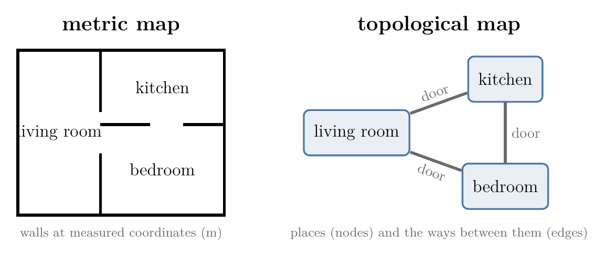

# Draft for the topological maps Note (moved from RO-009, 2026-10-10)

Section 2.2 of RO-009 as written, moved here when RO-009 kept only the maps localization needs. Figure numbers and section links are those of RO-009 and must be renumbered when this Note is built. Figure: images/topological.

## Glossary rows to restore (IDs kept)

| G-2332 | Metric map | A map that gives every object at its coordinates in metres, so distances on the map are real distances; localization needs it because it works out the pose in metres. | [Note RO-009](RO/localization/02-bayes-filters/RO-009-maps-and-landmarks/RO-009-maps-and-landmarks.md#22-metric-and-topological-maps) | Maps and landmarks |
| G-2333 | Topological map | A map that lists places, such as rooms, and which places connect, as a graph of nodes and edges (like a metro map); small and good for routes between rooms, but it fails in open spaces with no recognisable places. | [Note RO-009](RO/localization/02-bayes-filters/RO-009-maps-and-landmarks/RO-009-maps-and-landmarks.md#22-metric-and-topological-maps) | Maps and landmarks |

### 2.2 Metric and topological maps

There are two broad ways to describe a building, shown in Figure 2:

- A **metric map** (G-2332) gives every object at its coordinates in metres, so distances on the map are real distances. A city street map and our room of Figure 1 are metric maps.
- A **topological map** (G-2333) lists places, such as rooms, and which places connect to which: a graph of nodes and edges. A metro map is one: it shows which stations connect, not how far apart they are.

A topological map is small and fits route-finding between rooms. It needs places that the robot can recognise, so it fails in large open spaces such as a desert or a car park, where there are no rooms to split the space into. Localization needs positions in metres, so this chapter uses metric maps.

