# Path-finding on a grid

Twelve search algorithms find a route across a warehouse floor drawn as a grid, all with the same start and goal, so we can watch how each one explores, cell by cell. Further down, the robot numbers every cell with its distance to the goal, keeps those numbers right when the floor turns out different from its map, and learns them while it drives.

## The maps

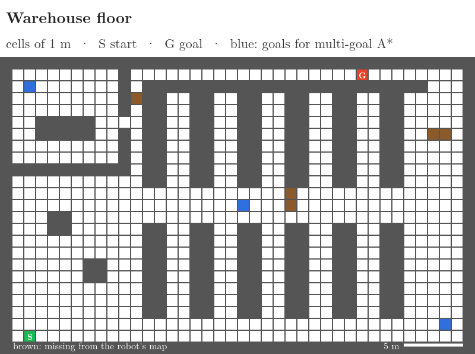

- **The floor:** 40 × 25 cells, each 1 m × 1 m. Dark cells are shelves and walls (blocked); white cells are floor (free).
- **Moves:** the robot moves to any of the 8 cells around it. A straight move costs 1 m, a diagonal move 1.41 m. A diagonal move must not cut the corner of a shelf.
- **The graph:** every free cell is a node (623 of them); every move between two free cells is an edge.
- **The trip:** from S (green, the loading dock, bottom left) to G (red, in the corridor behind the shelves at the top). The shelf rows are closed at the top, so the corridor can be entered only at its two ends.
- **Blue cells:** three charging pads, the goals of the multi-goal search.
- **Brown cells:** five pallets that the robot's map does not show. Every search treats them as floor; only the [replanning robot](#replanning-d-lite) finds them, when it comes within 3 m.

The map is a picture, `maps/warehouse.png`, one pixel per cell. A second map, a maze, runs with the same code:

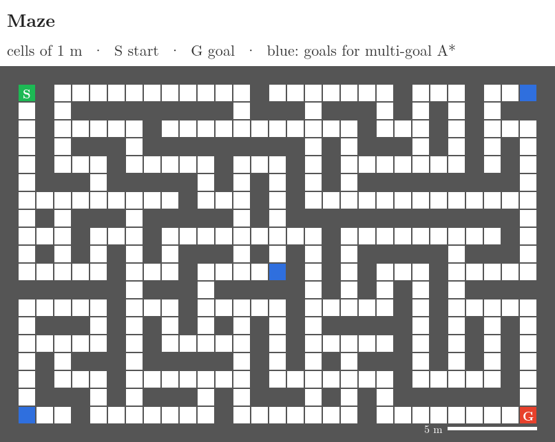

**Reading the animations:** pale green cells are the **frontier** (reached, waiting to be expanded); pale blue cells are **visited** (taken off the frontier and expanded). The yellow line is the route. The counts are above the map.

## Breadth-first search

Breadth-first search (BFS) takes cells from a first-in, first-out queue, so the blue area grows in rings: every cell 1 move away, then 2 moves, and so on. It counts moves and ignores that a diagonal move is longer, so its route has the fewest moves (41), not necessarily the fewest metres. On this floor the fewest-move route is also a shortest one.


- Visited: 597 cells · Route: 44.7 m · 100 % of Dijkstra's

Taught in: [breadth-first search](../../RO/navigation/04-graph-search-and-configuration-space/RO-032-graphs-and-uninformed-search/RO-032-graphs-and-uninformed-search.md#5-breadth-first-search-ring-by-ring)

## Depth-first search

Depth-first search (DFS) takes the newest cell from a stack, so it runs one way until it is stuck, then backs up. The orange line is the branch it is on. It reaches the goal after fewer visits than BFS, but along a 308 m zigzag, 6.9 times the shortest route.


- Visited: 299 cells · Route: 307.9 m · 688 % of Dijkstra's

Taught in: [depth-first search](../../RO/navigation/04-graph-search-and-configuration-space/RO-032-graphs-and-uninformed-search/RO-032-graphs-and-uninformed-search.md#6-depth-first-search-dive-then-back-up)

## Dijkstra

Dijkstra always expands the frontier cell with the smallest distance from the start, g. The blue area grows in bands of equal metres, the same way in every direction, also away from the goal. It stops when the goal is expanded; by then it has visited 596 of the 623 floor cells.

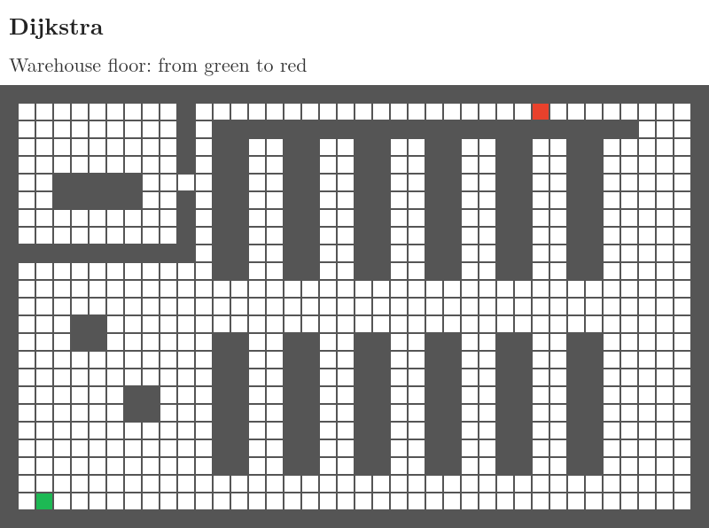

- Visited: 596 cells · Route: 44.7 m (the shortest) · 100 %

Taught in: [Dijkstra's algorithm](../../RO/navigation/04-graph-search-and-configuration-space/RO-033-dijkstra-and-priority-queues/RO-033-dijkstra-and-priority-queues.md#32-the-algorithm-settle-the-nearest-update-its-neighbours)

## A*

A* expands the cell with the smallest f = g + h, where h is the straight-line distance to the goal. A cell that leads away from the goal has a large h and waits. A* visits 376 cells instead of Dijkstra's 596, and its route is still the shortest, because the straight line is never longer than a real route.


- Visited: 376 cells · Route: 44.7 m · 100 % of Dijkstra's

Taught in: [A* search](../../RO/navigation/04-graph-search-and-configuration-space/RO-034-a-star-and-heuristics/RO-034-a-star-and-heuristics.md#45-the-algorithm)

## Choosing the heuristic

The guess h decides how much A* explores. Four guesses race side by side; each tick, every search expands one cell.

- **h = 0:** no guess, so A* is Dijkstra: 596 cells.
- **Straight line:** never too big: 376 cells.
- **Octile:** the length of the best 8-way route if no shelf were in the way. Never too big, and closer to the truth: 350 cells.
- **Manhattan:** metres east-west plus metres north-south. It counts a diagonal move as 2 m where it costs 1.41 m, so it can **overestimate**: at the start it guesses 50.0 m, but the shortest route is 44.7 m. It visits only 42 cells. Here its route is still the shortest, but once h can overestimate, A* no longer promises that.

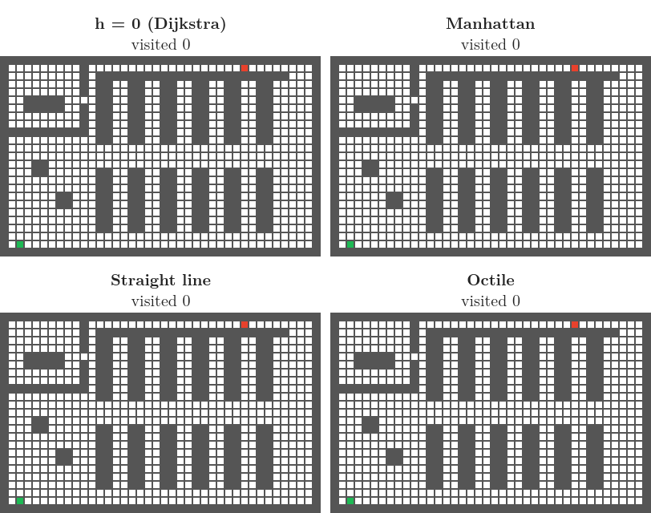

- h = 0: 596 cells · Straight line: 376 · Octile: 350 · Manhattan: 42; all four routes 44.7 m

Taught in: [heuristics](../../RO/navigation/04-graph-search-and-configuration-space/RO-034-a-star-and-heuristics/RO-034-a-star-and-heuristics.md#53-a-closer-guess-takes-fewer-cells)

## Greedy best-first search

Greedy best-first search expands the cell with the smallest h only, and ignores the metres already driven. It heads for the goal, runs up the shelf rows that are closed at the top, one after another, and finally goes round the right end. It visits few cells, but its route is a quarter longer than the shortest.


- Visited: 134 cells · Route: 56.1 m · 126 % of Dijkstra's

Taught in: [best-first search](../../RO/navigation/04-graph-search-and-configuration-space/RO-034-a-star-and-heuristics/RO-034-a-star-and-heuristics.md#3-following-the-guess-alone-greedy-best-first-search)

## Iterative deepening A* (IDA*)

IDA* is depth-first search with a bound on f = g + h: a branch is cut as soon as its f goes over the bound. If the goal is not reached, the bound rises to the smallest f that went over it, and the search starts again. It stores only the branch it is on (orange), but it visits the same cells again in every round.

On the whole trip, IDA* had not finished after 1,000,000 visits (193 rounds), and not on the trip to a point halfway along the route either. So the animation shows a nearer goal, 14.3 m from the start.

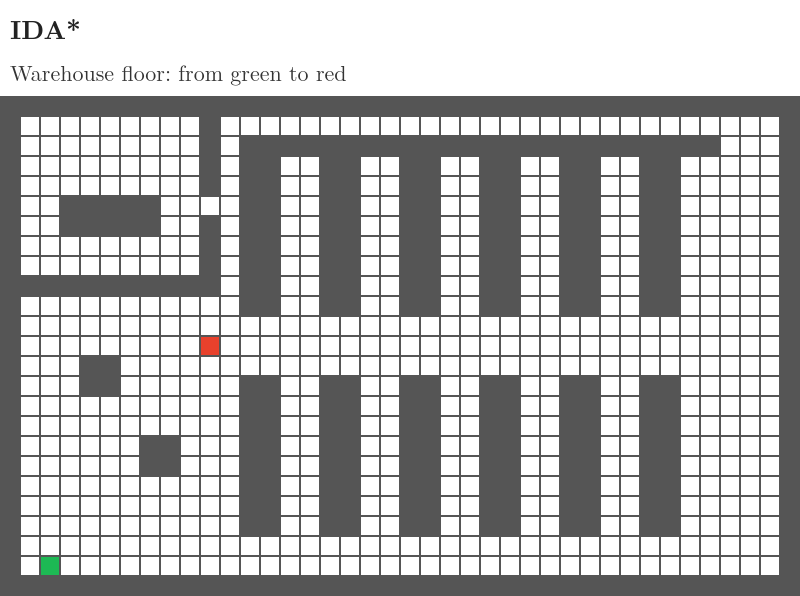

- Visits: 1,560 in 31 rounds (A* to the same goal: 29) · Route: 14.3 m, the shortest to that goal

Taught in: [iterative deepening](../../RO/navigation/04-graph-search-and-configuration-space/RO-034-a-star-and-heuristics/RO-034-a-star-and-heuristics.md#7-saving-memory-iterative-deepening-and-ida)

## Bidirectional search

Two Dijkstra searches run at once, one from the start (blue) and one from the goal (purple); each step expands whichever side's next cell is nearer its own end. The route is complete where they meet. Together they visit 354 cells, against 596 for one Dijkstra.


- Visited: 354 cells · Route: 44.7 m · 100 % of Dijkstra's

Taught in: [bidirectional search](../../RO/navigation/04-graph-search-and-configuration-space/RO-034-a-star-and-heuristics/RO-034-a-star-and-heuristics.md#82-bidirectional-search)

## Weighted A*

Weighted A* uses f = g + ε h with ε = 2: it trusts the guess twice as much. It visits 206 cells, about half of A*'s, and its route is 56.1 m. The promise is a route at most ε times the shortest (89.5 m).


- Visited: 206 cells · Route: 56.1 m · 126 % of Dijkstra's

Taught in: [weighted A*](../../RO/navigation/04-graph-search-and-configuration-space/RO-034-a-star-and-heuristics/RO-034-a-star-and-heuristics.md#101-weighted-a)

## Anytime A*

Weighted A* runs three times, with ε = 2.5, then 1.5, then 1. Each round starts afresh and gives a better route; the dotted lines are the earlier routes. The first route arrives after 169 visits; the shortest after 948 visits in all.


- Rounds: ε = 2.5: 56.1 m after 169 visits · ε = 1.5: 46.5 m after 403 · ε = 1: 44.7 m after 376
- Route: 44.7 m · 100 % of Dijkstra's

Taught in: [anytime A*](../../RO/navigation/04-graph-search-and-configuration-space/RO-034-a-star-and-heuristics/RO-034-a-star-and-heuristics.md#102-anytime-a-and-ara)

## Theta*

Theta* is A* whose route may run at any angle. When it reaches a cell, it checks whether the cell can be seen in a straight line from the parent of the cell it came from; if so, it links to that parent and cuts the corner. The route is 4 straight pieces, shorter than the 8-way route, which can only run along the 8 grid directions.


- Visited: 381 cells · Route: 43.6 m · 98 % of Dijkstra's (Dijkstra may only make 8-way moves)

Taught in: [any-angle search (Theta*)](../../RO/navigation/04-graph-search-and-configuration-space/RO-034-a-star-and-heuristics/RO-034-a-star-and-heuristics.md#12-routes-at-any-angle-theta)

## Multi-goal A*

Which of the three charging pads (blue) is nearest by route? One A* run answers it: we add a virtual goal joined to each pad by a 0 m move, and h is the straight line to the nearest pad.

- **The pad in the office** (top left) is the nearest in a straight line, 21.0 m. The office has one door, in its right wall, so the route to it is 32.0 m.
- **The pad in the middle aisle** is 21.1 m away in a straight line and 24.3 m by route: the nearest by route.
- **The pad in the bottom-right corner** is 35.0 m away in a straight line and 35.4 m by route.

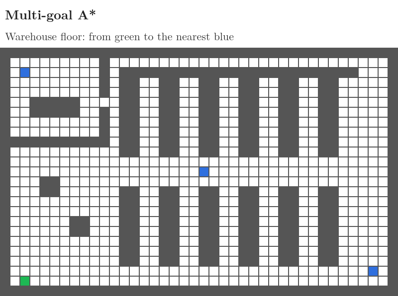

- Visited: 148 cells · Route: 24.3 m to the pad in the middle aisle

**Separate runs or one run:** the plain way is one A* run per pad, keeping the shortest route. The two ways race below; each tick, each expands one cell. One A* per pad visits 169 + 107 + 36 = 312 cells; the one multi-goal run visits 148, less than half, and finds the same 24.3 m route.

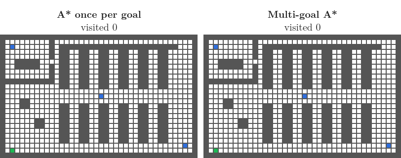

- One A* per pad: 312 cells visited · Multi-goal A*: 148 · Both: 24.3 m to the pad in the middle aisle

Taught in: [multi-goal A*](../../RO/navigation/04-graph-search-and-configuration-space/RO-034-a-star-and-heuristics/RO-034-a-star-and-heuristics.md#91-the-virtual-goal)

## Jump point search

Jump point search (JPS) is A* that skips cells. From a cell it scans straight or diagonally across open floor (pale yellow) and stops only at the goal or beside a shelf corner, where a shortest route might turn. Only these jump points go on the frontier. It visits 67 cells against A*'s 376, with the same route; its scans step over cells 1,696 times.

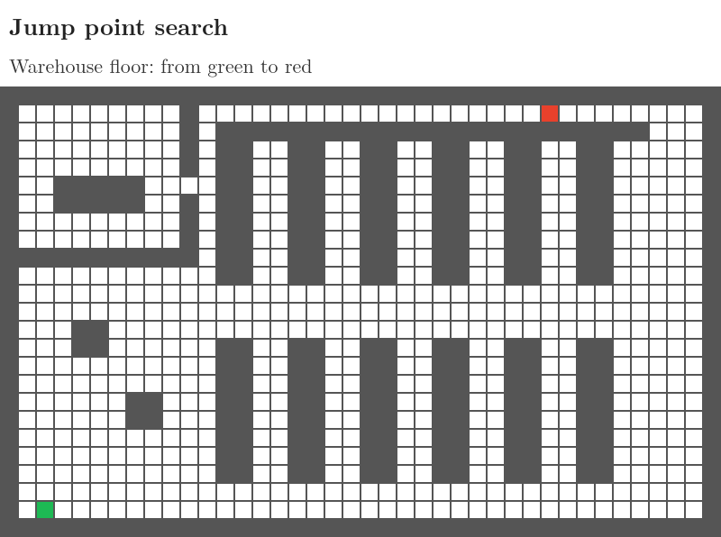

- Visited: 67 jump points · Route: 44.7 m · 100 % of Dijkstra's

Taught in: [jump point search](../../RO/navigation/04-graph-search-and-configuration-space/RO-034-a-star-and-heuristics/RO-034-a-star-and-heuristics.md#11-skipping-equal-routes-jump-point-search)

## The race

Six searches on one clock: each tick, every search expands one cell. Each map shows its cells visited and, once done, its route length.

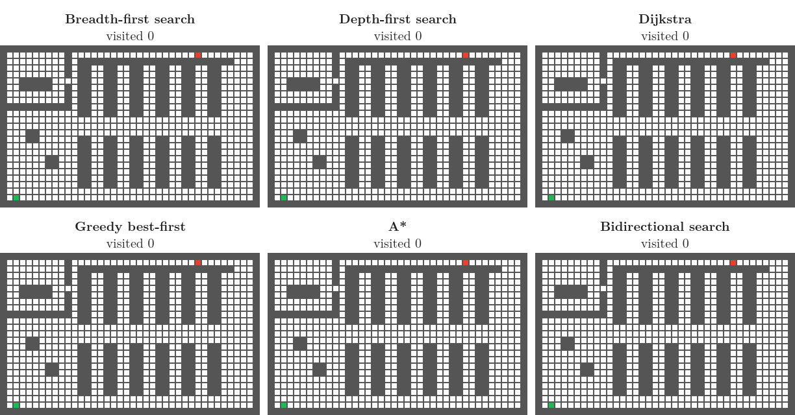

The same race on the maze, run by changing one argument (`--map maze`):

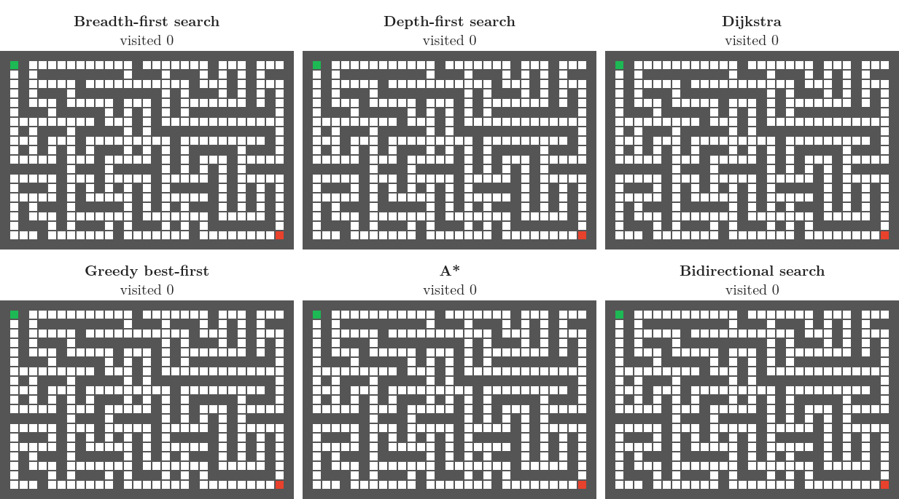

The same functions also run on the streets of Chicago: [Path-finding on real streets](../real-map-pathfinding/real-map-pathfinding.md).

## The wavefront: every cell's distance to the goal

A route from S says nothing once the robot slips into another cell. A search run backwards from G answers for every cell at once: G gets 0, and every other cell gets the length of its shortest route to G, its cost-to-go. The robot moves 8 ways and a diagonal move is longer, so the numbers count metres, and the pass is Dijkstra's algorithm run from G until every cell has a number.

Each frame numbers the cells up to one more metre from G. Watch the numbers run along the top corridor, down the aisles at both of its ends, and into the office through its door.

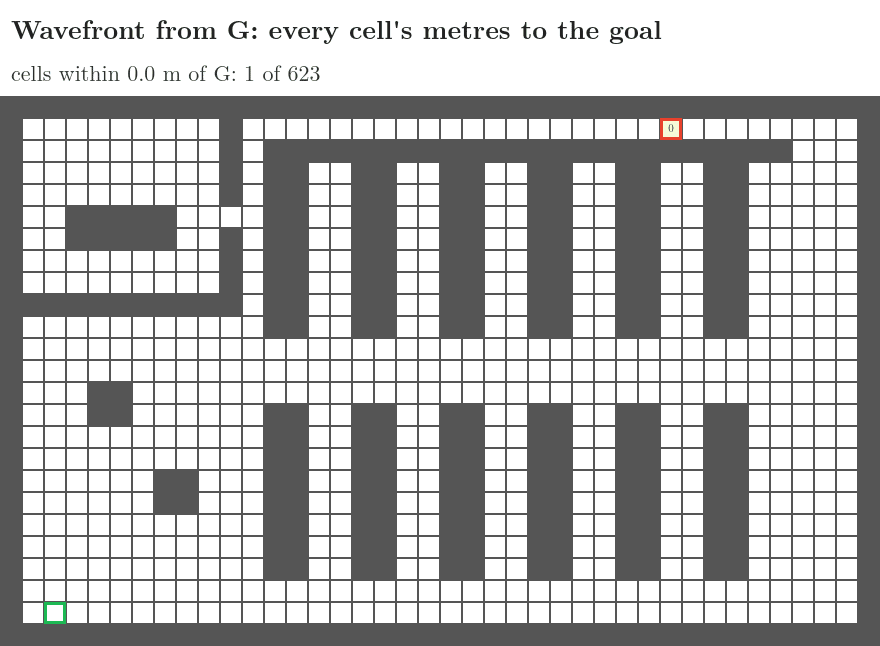

- Cells numbered: 623, the whole floor · S: 44.7 m, the length of A*'s route · Farthest cell: the bottom-left corner, 45.1 m

Taught in: [the wavefront](../../RO/navigation/06-grid-sampling-and-car-like-planning/RO-048-grid-planning-wavefronts-and-value-iteration/RO-048-grid-planning-wavefronts-and-value-iteration.md#2-numbering-every-cell-from-the-door-the-wavefront), [counting metres](../../RO/navigation/06-grid-sampling-and-car-like-planning/RO-048-grid-planning-wavefronts-and-value-iteration/RO-048-grid-planning-wavefronts-and-value-iteration.md#3-which-moves-count-four-or-eight-neighbours-moves-or-metres)

## Walking downhill: the navigation function

From any cell, the robot steps to the neighbour with the smallest move plus number. Each step lowers the number by exactly the length of the move, so the walk is as long as the number in the start cell, and it ends at G. A map of numbers that guides the robot this way is a navigation function. Every cell except G has a neighbour with a smaller number (checked for all 623), so no walk gets stuck.

The arrows show each cell's step. Then four robots follow them, one after another: from S and from each charging pad.

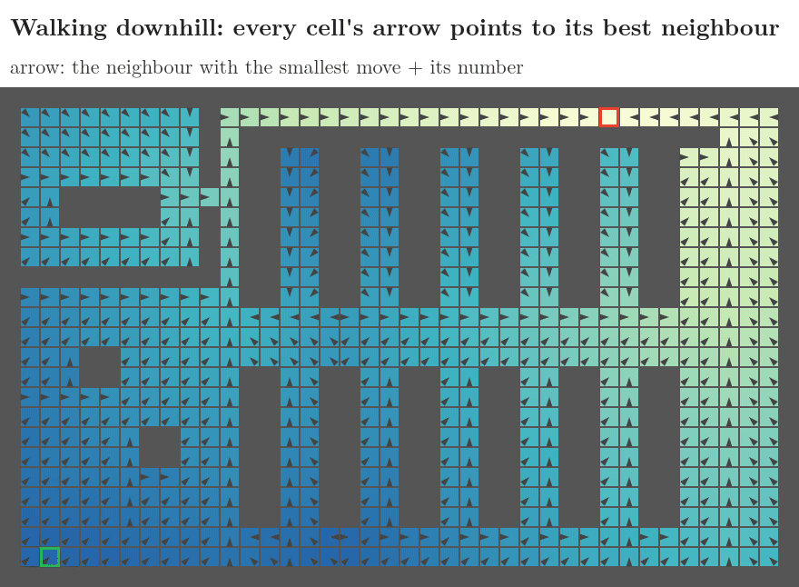

- From S: 44.7 m · from pad 1, in the office: 33.2 m · from pad 2, in the middle aisle: 31.2 m · from pad 3, bottom right: 27.4 m; each walk is as long as its start cell's number

Taught in: [walking downhill](../../RO/navigation/06-grid-sampling-and-car-like-planning/RO-048-grid-planning-wavefronts-and-value-iteration/RO-048-grid-planning-wavefronts-and-value-iteration.md#42-one-step-at-a-time-from-any-cell)

## Value iteration

Value iteration finds the same numbers without Dijkstra's priority queue. G starts at 0 and every other cell has no value yet. A sweep visits the cells row by row from the top, left to right, and gives each the smallest move plus neighbour's value, using values given earlier in the same sweep. Sweeps repeat until one changes nothing.

Watch sweep 1: a value passes right and down within one sweep, so the cells right of G and the whole right-hand aisle get theirs at once (118 cells). Along the top corridor to the left, values move one cell per sweep, because each cell there is visited before its right-hand neighbour has its new value. Orange outlines mark values that fell when a shorter way arrived.

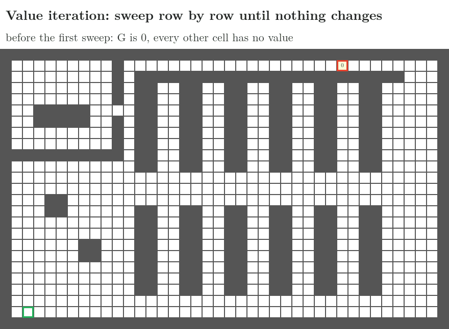

- Sweeps: 30; the 30th changes nothing · Updates: 30 × 622 = 18,660, against 623 cells settled once by Dijkstra · The final values equal Dijkstra's in all 623 cells

Taught in: [value iteration](../../RO/navigation/06-grid-sampling-and-car-like-planning/RO-048-grid-planning-wavefronts-and-value-iteration/RO-048-grid-planning-wavefronts-and-value-iteration.md#5-value-iteration-the-same-numbers-without-a-queue)

## Replanning: D* Lite

The robot's map shows floor where five pallets stand (brown). It treats every cell it has not seen blocked as floor, plans, moves one cell, and looks: it sees every cell within 3 m. When it sees a pallet, the plan must change. Two ways to replan:

- **A\* from scratch:** search again from the robot's cell; nothing is kept from the last search.
- **D\* Lite:** keep the numbers of a search backwards from G, each cell's cost-to-go, and repair only the numbers the pallet made wrong. A cell whose number differs from its best offer, the smallest move plus neighbour's number, waits in a priority queue. Cells on the robot's side come off first, and the repair stops when the robot's own number is right.

The robot drives with D\* Lite. At every replan, A\* from scratch also runs from the robot's cell, for comparison. Light red marks the cells each takes off its queue at that replan.

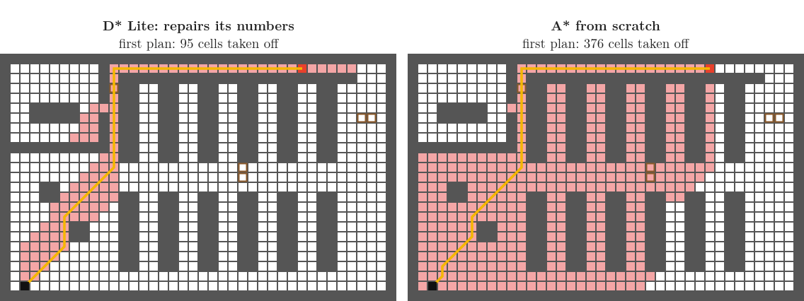

- **First plan:** D\* Lite 95 cells, A\* 376. This gap is not repairing: D\* Lite searches from G, and A\* run from G to S also takes only 85 cells.
- **Move 17, the pallet in the narrow aisle by the office:** this aisle was the route's way into the top corridor. D\* Lite 228 cells, A\* 426; both send the robot back and round the right-hand end.
- **Moves 32 and 33, two pallets in the cross aisle; moves 47 and 48, two in the right-hand aisle:** D\* Lite 7, 4, 6 and 4 cells; A\* 255, 247, 52 and 46. Each pallet changes few numbers, and only D\* Lite keeps the others.
- **All replans:** D\* Lite 249 cells, A\* from scratch 1,026 · Drive: 61 moves, 68.9 m; with the pallets known from the start, the shortest route is 55.6 m

At every replan, D\* Lite's number in the robot's cell equals the length of A\*'s new route (checked).

Taught in: [repairing the numbers](../../RO/navigation/06-grid-sampling-and-car-like-planning/RO-049-replanning-d-star-and-bug-algorithms/RO-049-replanning-d-star-and-bug-algorithms.md#3-repairing-the-numbers-d), [when repairing pays](../../RO/navigation/06-grid-sampling-and-car-like-planning/RO-049-replanning-d-star-and-bug-algorithms/RO-049-replanning-d-star-and-bug-algorithms.md#4-when-repairing-pays)

## Real-time search: LRTA*

D\* Lite and A\* plan all the way to the goal before every move. LRTA\* thinks about one cell per move. The robot's guess of each cell's distance to G starts as the octile distance, the 8-way distance with nothing in the way. At each cell it raises the cell's guess to its best offer, the smallest move plus neighbour's guess, if that is larger, and moves to that neighbour. A raised guess keeps the robot from coming back believing the same thing. In the maze, the octile guess is far too low in every dead end.

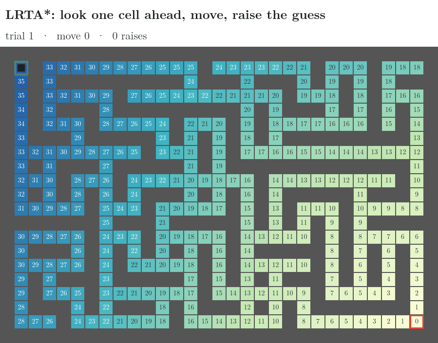

- **Trial 1:** 68 moves, 68 m, against the shortest route's 50 m; 33 raises in 32 cells
- **Trials again from S, keeping the guesses:** from trial 110 on, no guess changes, and the robot drives the shortest route, 50 moves, 50 m. No guess ever rises above the true distance (checked).
- **The same run on the warehouse floor** ([animation](images/warehouse/lrta_star.gif)): trial 1 takes 307 moves, 344.7 m against the shortest 44.7 m, with 252 raises in 104 cells; the guesses settle after 162 trials.

Taught in: [learning the guesses: LRTA\*](../../RO/navigation/06-grid-sampling-and-car-like-planning/RO-049-replanning-d-star-and-bug-algorithms/RO-049-replanning-d-star-and-bug-algorithms.md#51-learning-the-guesses-lrta)

## Fast marching

The grid's numbers count routes made of the 8 grid directions only, so a straight line in another direction comes out too long: 8 percent for a point twice as far across as up, however small the cells. Fast marching lets a front leave G at 1 m/s in every direction. Its loop is Dijkstra's, but a cell's arrival time is worked out from two neighbours at once, one beside it and one above or below, so the front can arrive at a slant. Both run on the warehouse cut into 0.2 m cells (15,575 free); the dark lines are the front every 2 s.

Watch the shape of the lines: straight sides and corners for Dijkstra, round arcs for fast marching.

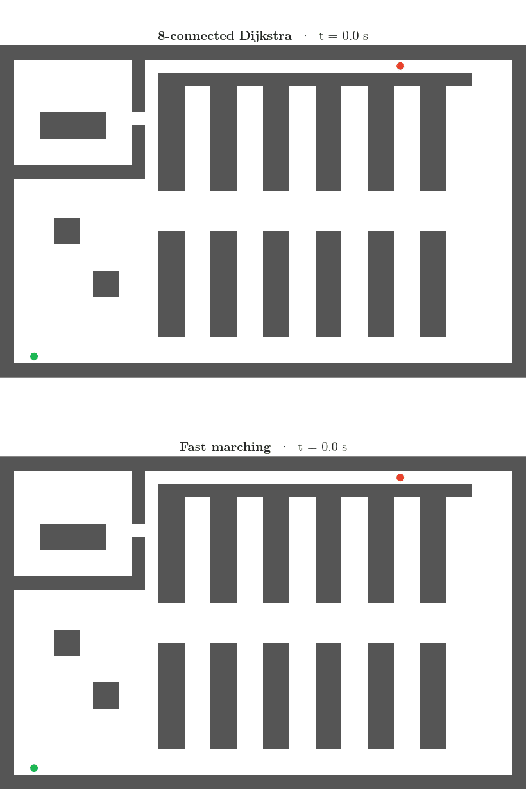

- **Arrival at S:** 8-connected Dijkstra 44.26 s, fast marching 43.09 s. Theta\* on the same 0.2 m cells finds a route of 42.74 m, so the shortest way is at most 42.74 m.
- **On an empty floor, 30 m across and 15 m up from the start of the front:** Dijkstra 8.0 % too long on both 1 m and 0.2 m cells; fast marching 2.5 % on 1 m cells, 0.7 % on 0.2 m cells

Taught in: [fast marching](../../RO/navigation/06-grid-sampling-and-car-like-planning/RO-048-grid-planning-wavefronts-and-value-iteration/RO-048-grid-planning-wavefronts-and-value-iteration.md#72-fast-marching)

## Run it yourself

In the `campusx` environment, from `projects/grid-pathfinding/`:

```bash
python check_algorithms.py                  # every search against networkx, on every map in maps/
python run.py                               # the warehouse: numbers, preview, all animations
python run.py --map maze                    # another map in maps/
python run.py --map path/to/my_floor.png    # a map you drew
python run.py --only a_star race            # only some animations (also: wavefront, downhill, value_iteration,
                                            #   d_star_lite, lrta_star, fast_marching)
python run.py --map maze --only lrta_star   # LRTA* on the maze
jupyter nbconvert --to notebook --execute grid-pathfinding.ipynb
```

**A new map** is a PNG drawn in any paint program with these colours:

- black: blocked (shelf, wall);
- white: free floor;
- pure green (0, 255, 0): the start, one pixel;
- pure red (255, 0, 0): the goal, one pixel;
- pure blue (0, 0, 255), optional: goals for the multi-goal search;
- pure orange (255, 128, 0), optional: blocked on the real floor but missing from the robot's map (the replanning robot finds them).

One pixel is one cell. A JSON file with the same name gives the cell size: `{"label": "My floor", "cell_m": 1.0, "pixels_per_cell": 1}` (set `pixels_per_cell` if each cell is drawn as a block of pixels).

**Files:** `algorithms.py` (every search, and the cost-to-go methods: value iteration, D\* Lite, LRTA\*, fast marching, contraction hierarchies), `map_interface.py` (what a map gives the searches), `grid.py` (PNG maps), `render.py` (the drawings), `run.py`, `check_algorithms.py`, `gifkit.py` (frames to GIF).

## Sources

Built from:

- The video [A* (A-Star) Pathfinding Algorithm Visualization on a Real Map](https://www.youtube.com/watch?v=CgW0HPHqFE8) by ones and zeros, as the inspiration.
- S. M. LaValle, *Planning Algorithms*, Cambridge University Press, 2006, chapter 2 (BFS, DFS, Dijkstra, A*, best-first, iterative deepening, bidirectional search).
- R. E. Korf, "Depth-first iterative-deepening: an optimal admissible tree search", *Artificial Intelligence* 27, 1985 (IDA*).
- I. Pohl, "Heuristic search viewed as path finding in a graph", *Artificial Intelligence* 1, 1970 (weighted A*); M. Likhachev, G. Gordon, S. Thrun, "ARA*: Anytime A* with provable bounds on sub-optimality", NIPS 2003 (anytime A*).
- D. Harabor, A. Grastien, "Online graph pruning for pathfinding on grid maps", AAAI 2011 (jump point search); the no-corner-cutting jump rules follow [PathFinding.js](https://github.com/qiao/PathFinding.js) by Xueqiao Xu, whose look the animations borrow.
- A. Nash, K. Daniel, S. Koenig, A. Felner, "Theta*: any-angle path planning on grids", AAAI 2007.
- S. M. LaValle, *Planning Algorithms*, §2.3 (value iteration) and §8.2 (navigation functions, wavefront propagation).
- S. Koenig, M. Likhachev, "D\* Lite", AAAI 2002.
- R. E. Korf, "Real-time heuristic search", *Artificial Intelligence* 42, 1990 (LRTA\*).
- J. A. Sethian, "A fast marching level set method for monotonically advancing fronts", *Proceedings of the National Academy of Sciences* 93, 1996.
