# Path-finding on real streets

The searches of [Path-finding on a grid](../grid-pathfinding/grid-pathfinding.md), unchanged, run on the streets of central Chicago and are drawn in the look of the video that inspired this project.

## The map

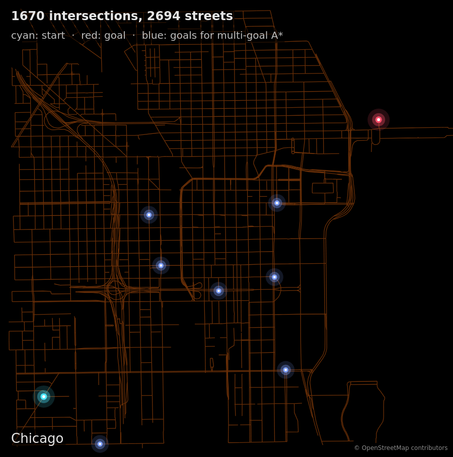

- **The streets:** OpenStreetMap's streets for cars in a 5 km × 5 km square around the Loop, downloaded once with OSMnx.
- **The graph:** a node is an intersection (1,670); an edge is a street between two intersections (2,694). The cost of an edge is the street's length in metres. We treat every street as two-way.
- **The trip:** from the start (cyan) on the Near West Side, in the south-west corner, to the goal (red) in Streeterville, by Navy Pier. They are 4,894 m apart in a straight line; the shortest drive is 6,426 m.
- **Blue:** four train stations, 3–5 km from the start and spread over the map, the goals of the multi-goal search.

**Reading the animations:** a street glows orange when the search looks along it from an intersection it expands; the newest streets glow brightest. At the end the glow fades and the route glows yellow. "Explored" counts the different streets looked at.

## Breadth-first search

BFS counts streets, not metres. Its route uses 34 streets where the shortest uses 40, and it is 921 m longer. It explores almost every street of the map before it reaches the goal.

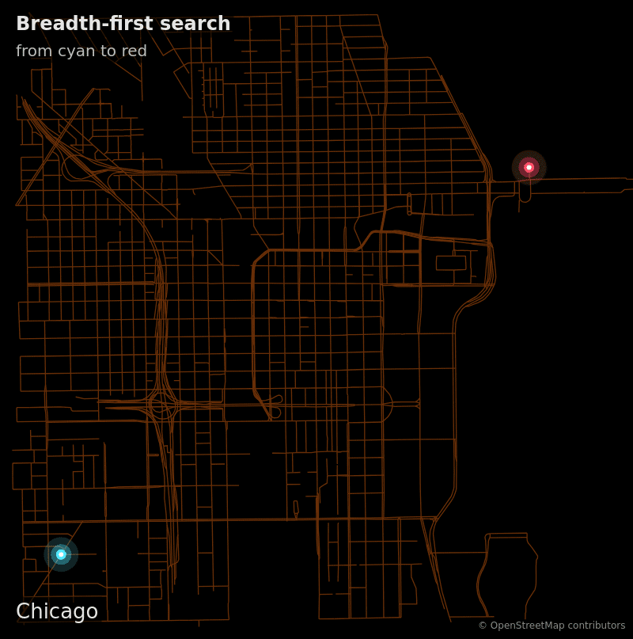

- Explored: 2,597 streets · Route: 7,347 m · 114 % of Dijkstra's

Taught in: [breadth-first search](../../RO/navigation/04-graph-search-and-configuration-space/RO-032-graphs-and-uninformed-search/RO-032-graphs-and-uninformed-search.md#5-breadth-first-search-ring-by-ring)

## Depth-first search

DFS follows one street after another as far as it can, then backs up. It reaches the goal, but its route winds through most of the map: 665 streets and 88.8 km, 14 times the shortest.


- Explored: 2,505 streets · Route: 88,841 m · 1,383 % of Dijkstra's

Taught in: [depth-first search](../../RO/navigation/04-graph-search-and-configuration-space/RO-032-graphs-and-uninformed-search/RO-032-graphs-and-uninformed-search.md#6-depth-first-search-dive-then-back-up)

## Dijkstra

Dijkstra expands intersections in order of their distance from the start, so the glow spreads evenly in every direction. The goal is one of the farthest intersections, so Dijkstra explores 2,682 of the 2,694 streets before it stops.

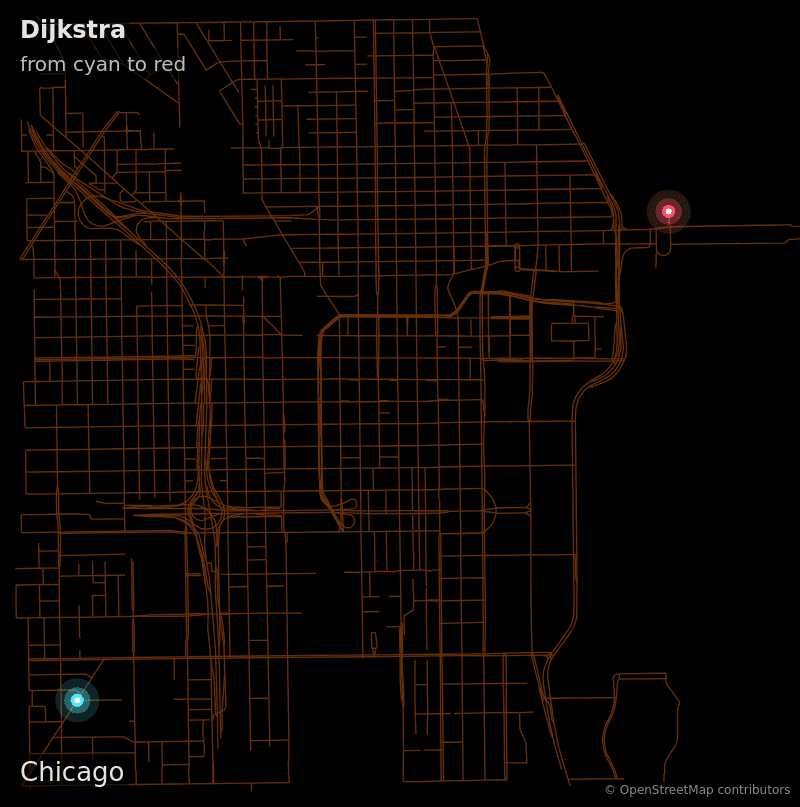

- Explored: 2,682 streets · Route: 6,426 m (the shortest) · 100 %

Taught in: [Dijkstra's algorithm](../../RO/navigation/04-graph-search-and-configuration-space/RO-033-dijkstra-and-priority-queues/RO-033-dijkstra-and-priority-queues.md#32-the-algorithm-settle-the-nearest-update-its-neighbours)

## A*

A* adds the straight-line distance to the goal, so streets that lead away from the goal wait. The streets run north-south and east-west while the goal lies diagonally, so the straight line (4,894 m) is well below the real distance (6,426 m), and A* still explores 64 % of the streets Dijkstra explores. The route is the same shortest one.

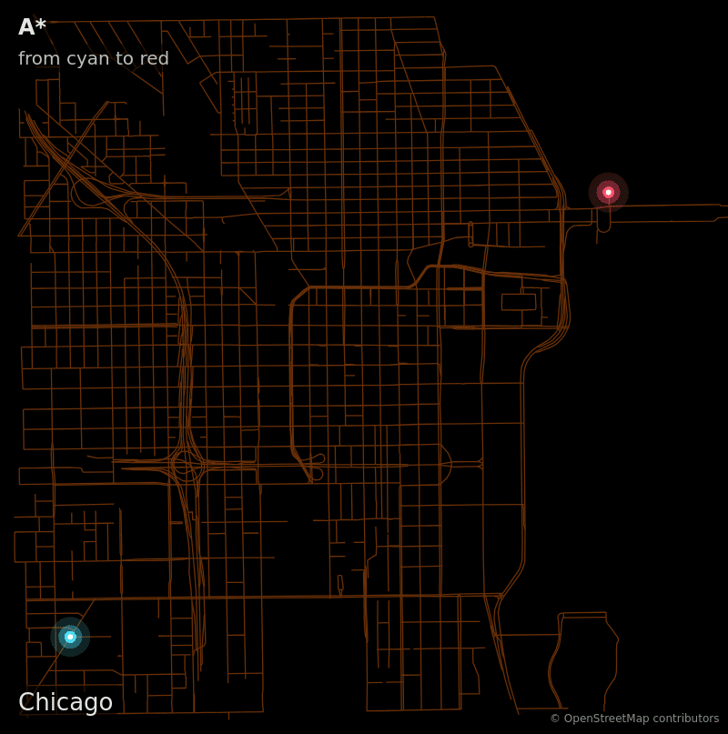

- Explored: 1,709 streets · Route: 6,426 m · 100 % of Dijkstra's

Taught in: [A* search](../../RO/navigation/04-graph-search-and-configuration-space/RO-034-a-star-and-heuristics/RO-034-a-star-and-heuristics.md#45-the-algorithm)

## Greedy best-first search

Greedy best-first search follows only the straight-line distance, so it runs almost directly at the goal. It explores 154 streets, and its route is 412 m longer than the shortest.

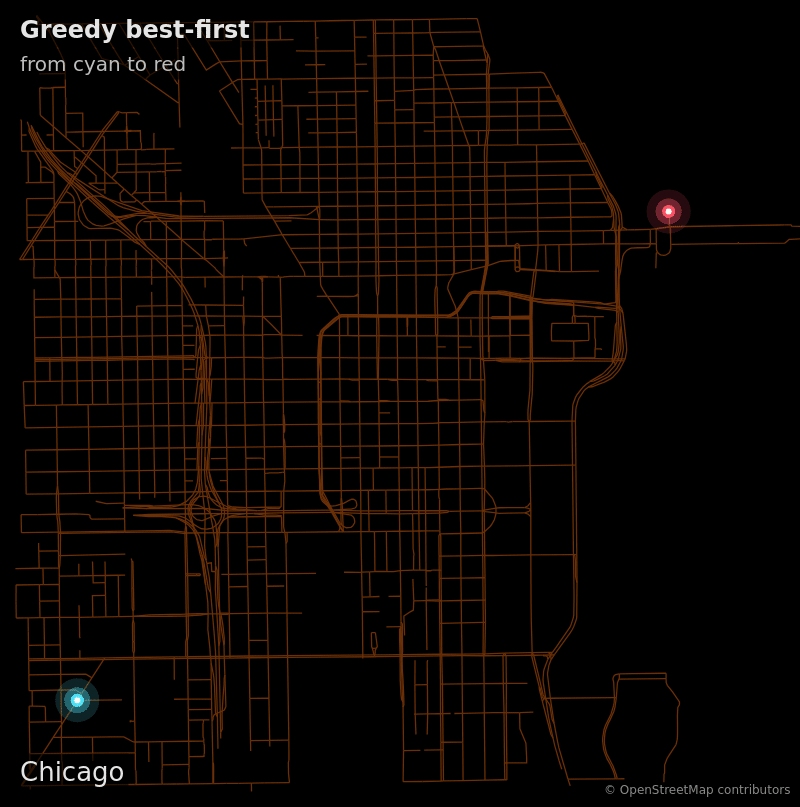

- Explored: 154 streets · Route: 6,838 m · 106 % of Dijkstra's

Taught in: [best-first search](../../RO/navigation/04-graph-search-and-configuration-space/RO-034-a-star-and-heuristics/RO-034-a-star-and-heuristics.md#3-following-the-guess-alone-greedy-best-first-search)

## Iterative deepening A* (IDA*)

IDA* searches depth-first under a bound on f = g + h and raises the bound each round. On the whole trip it had not finished after 1,000,000 visits and 1,415 rounds: street lengths are all different, so each round raises the bound by a few metres only. The animation shows the trip to the point halfway along the shortest route.

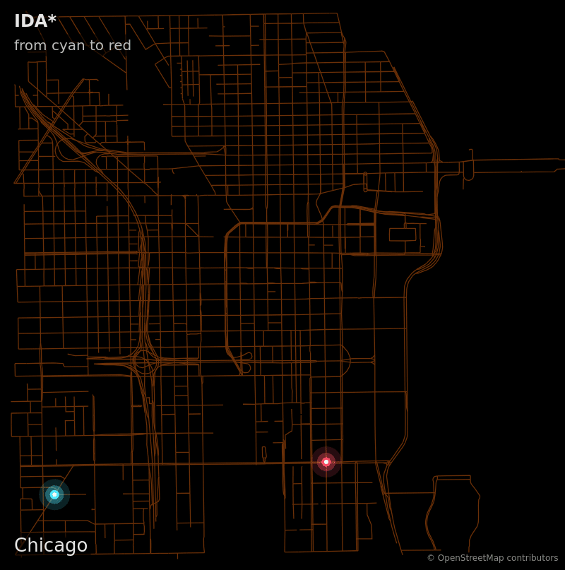

- Visits: 652 in 36 rounds (A* to the same point: 36) · Explored: 82 streets · Route: 2,600 m, the shortest to that point

On the small map below, IDA* finishes the whole trip.

Taught in: [iterative deepening](../../RO/navigation/04-graph-search-and-configuration-space/RO-034-a-star-and-heuristics/RO-034-a-star-and-heuristics.md#7-saving-memory-iterative-deepening-and-ida)

## Bidirectional search

One Dijkstra grows from the start and one from the goal; the route is complete where they meet. Together they explore 2,295 streets, 86 % of one Dijkstra's.

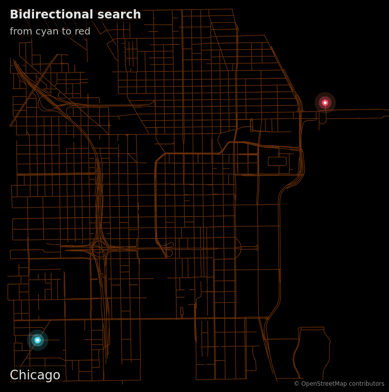

- Explored: 2,295 streets · Route: 6,426 m · 100 % of Dijkstra's

Taught in: [bidirectional search](../../RO/navigation/04-graph-search-and-configuration-space/RO-034-a-star-and-heuristics/RO-034-a-star-and-heuristics.md#82-bidirectional-search)

## Weighted A*

With f = g + 2h the straight line counts twice, and the search runs almost straight at the goal, like greedy search. It explores 155 streets, 9 % of A*'s, for a route 6 % longer.

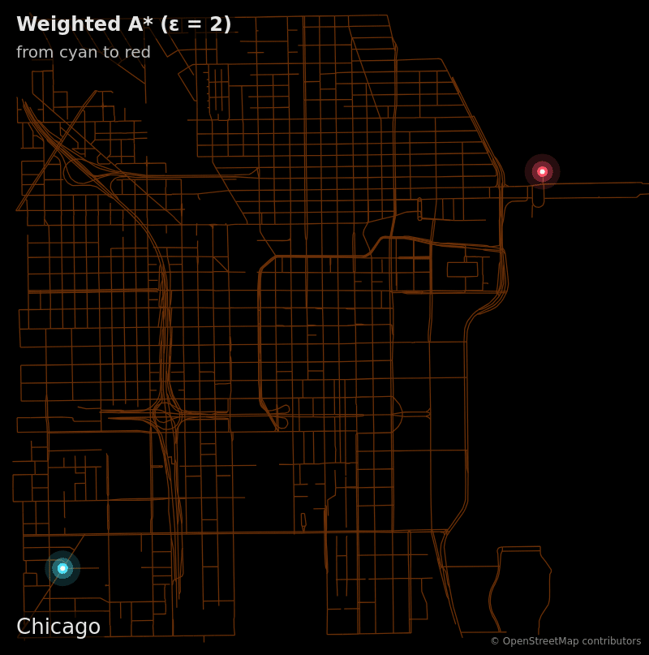

- Explored: 155 streets · Route: 6,809 m · 106 % of Dijkstra's

Taught in: [weighted A*](../../RO/navigation/04-graph-search-and-configuration-space/RO-034-a-star-and-heuristics/RO-034-a-star-and-heuristics.md#101-weighted-a)

## Anytime A*

Weighted A* with ε = 2.5, then 1.5, then 1. The first route comes almost at once; each round improves it, and the last one is the shortest. The earlier routes stay dim yellow.

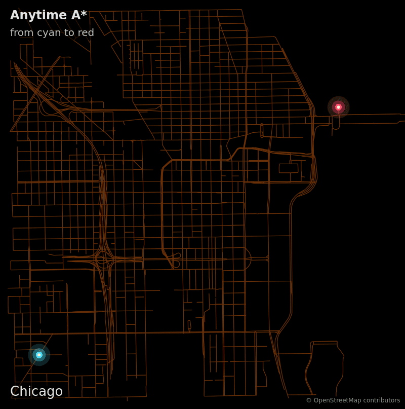

- Rounds: ε = 2.5: 6,860 m after 59 visits · ε = 1.5: 6,790 m after 80 · ε = 1: 6,426 m after 1,009
- Route: 6,426 m · 100 % of Dijkstra's

Taught in: [anytime A*](../../RO/navigation/04-graph-search-and-configuration-space/RO-034-a-star-and-heuristics/RO-034-a-star-and-heuristics.md#102-anytime-a-and-ara)

## Multi-goal A*

Which of four train stations is nearest by road? We took them from OpenStreetMap's stations 3–5 km from the start in a straight line, spread over the map: Clark/Division, Merchandise Mart, Van Buren Street, and the station named Chicago, due north of the start. One A* run to a virtual goal joined to every station by a 0 m street, with h the straight line to the nearest station, finds the answer.

- **Nearest in a straight line:** Van Buren Street, 2,927 m; by road it is 3,767 m.
- **Nearest by road:** Chicago, 3,755 m (3,508 m in a straight line), 12 m nearer than Van Buren Street.
- Merchandise Mart: 3,245 m in a straight line, 4,243 m by road. Clark/Division: 4,739 m and 6,001 m.

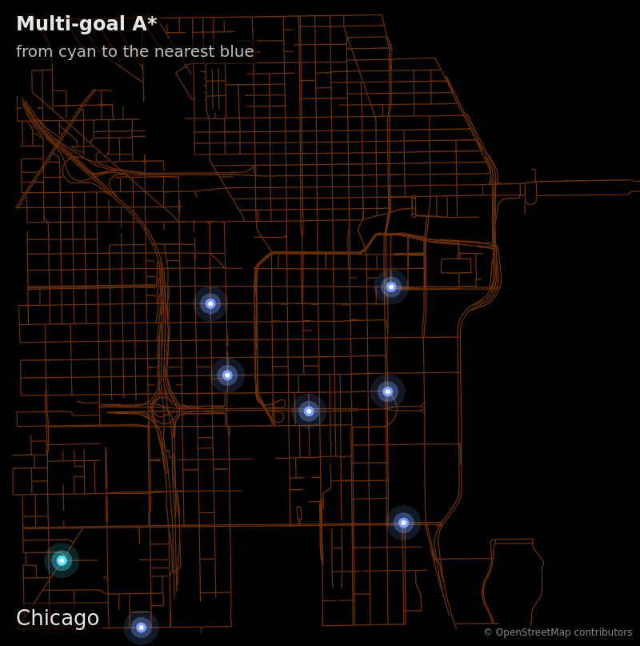

- Explored: 609 streets · Route: 3,755 m to Chicago station

**Separate runs or one run:** the plain way is one A* run per station, keeping the shortest route. The two ways race below; each tick, each explores one more street. The four separate runs explore 1,479 + 484 + 157 + 764 = 2,884 streets (each run counts its own); the one multi-goal run explores 609, about a fifth, and finds the same 3,755 m route.

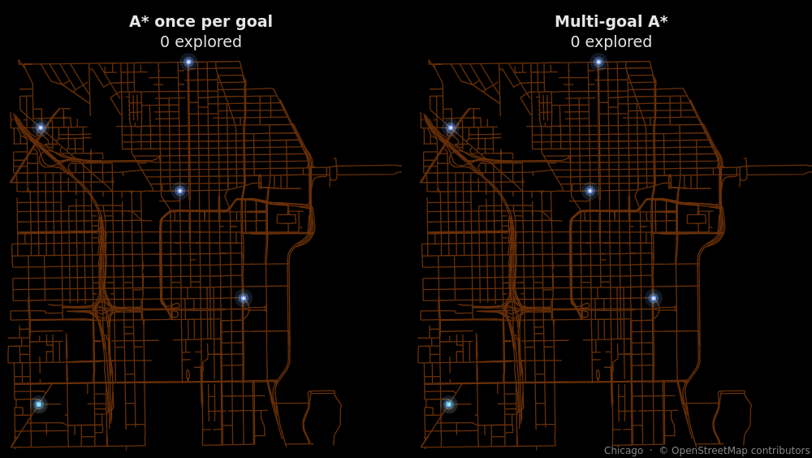

- One A* per station: 2,884 streets explored · Multi-goal A*: 609 · Both: 3,755 m to Chicago station

Taught in: [multi-goal A*](../../RO/navigation/04-graph-search-and-configuration-space/RO-034-a-star-and-heuristics/RO-034-a-star-and-heuristics.md#91-the-virtual-goal)

## On a grid made from the map

Jump point search and Theta* need a grid. We cover the map with cells of 15 m and call a cell free if its centre is within 11 m of a street: 328 × 331 cells, 24,906 of them free. Every street becomes a band of free cells; blocks, the river and the lake are blocked. The glow shows the moves that reached a cell.

### Grid A*

The same A* function, now on the grid. A grid route may cut corners inside the band of free cells, so its length differs a little from the street graph's.


- Visited: 15,090 cells · Route: 6,373 m

Taught in: [A* search](../../RO/navigation/04-graph-search-and-configuration-space/RO-034-a-star-and-heuristics/RO-034-a-star-and-heuristics.md#45-the-algorithm)

### Theta*

Theta* lets the route run straight from a cell to any cell it can see, so it cuts the corners where the route turns from one street into the next. It is 3 % shorter than grid A*'s.

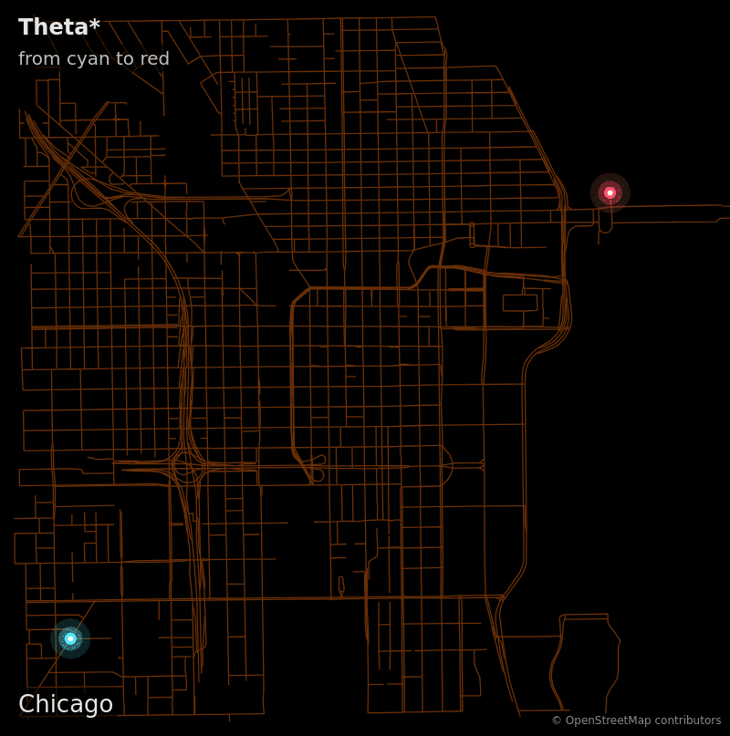

- Visited: 13,870 cells · Route: 6,172 m · 97 % of grid A*'s

Taught in: [any-angle search (Theta*)](../../RO/navigation/04-graph-search-and-configuration-space/RO-034-a-star-and-heuristics/RO-034-a-star-and-heuristics.md#12-routes-at-any-angle-theta)

### Jump point search

JPS scans along the street bands and puts only the cells where a route might turn on the frontier: 3,179 instead of 15,090. The route is the same as grid A*'s. Its scans step over cells 75,951 times, more than the 36,641 moves grid A* looks at: the saving is in the frontier, not in the cells looked at.

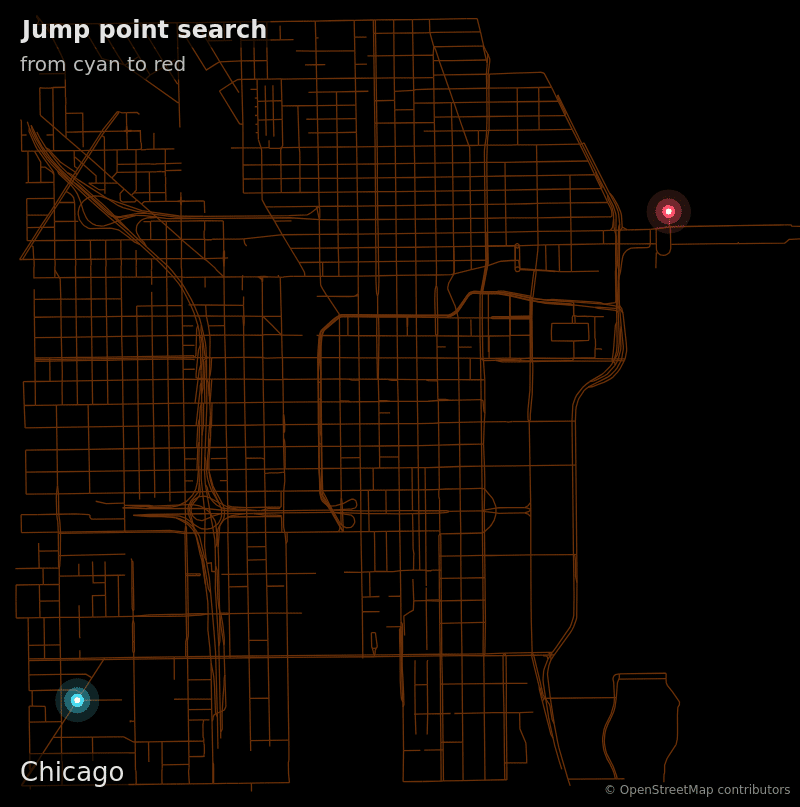

- Visited: 3,179 jump points · Route: 6,373 m · 100 % of grid A*'s

Taught in: [jump point search](../../RO/navigation/04-graph-search-and-configuration-space/RO-034-a-star-and-heuristics/RO-034-a-star-and-heuristics.md#11-skipping-equal-routes-jump-point-search)

## Travel time instead of distance

A driver wants the quickest route, not the shortest. The cost of a street is now the seconds it takes: OSMnx's `add_edge_speeds` takes each street's speed limit from its OpenStreetMap `maxspeed` tag and gives a street without one the average speed of streets of the same road type; `add_edge_travel_times` divides the length by the speed. Speeds on this map run from 24 to 89 km/h. The quickest route takes 478 s (8.0 min) and is 6,486 m long, 60 m longer than the shortest.

A* now needs a guess of the seconds still to go that is never too big. The better the guess, the fewer streets A* explores:

1. **h = 0:** no guess; A* is Dijkstra.
2. **Straight line ÷ top speed:** the straight line driven at the map's top speed (88.5 km/h). No street is faster, so it is never too big, but most streets allow 32–44 km/h, so it is far too small.
3. **Landmarks (ALT):** we pick 8 landmarks spread over the map (each the farthest, by time, from those already chosen) and work out the time from each landmark to every intersection once. For an intersection n, the goal t and a landmark L, the triangle inequality gives time(n → t) ≥ |time(L → t) − time(L → n)|; h is the largest of these over the landmarks.
4. **Exact:** one Dijkstra backwards from the goal gives the true time still to go from every intersection. A* then explores little more than the route itself. No guess can do better, but it costs a full Dijkstra first, and only for this goal.


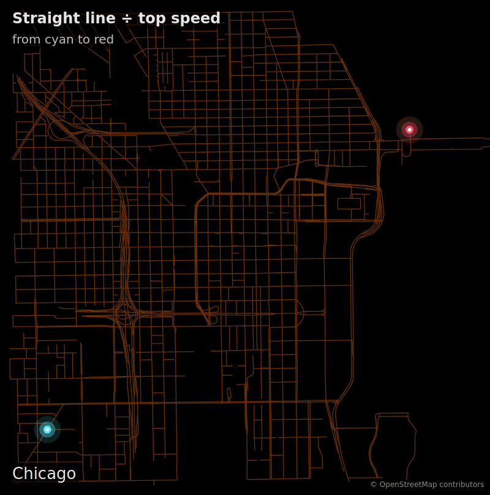

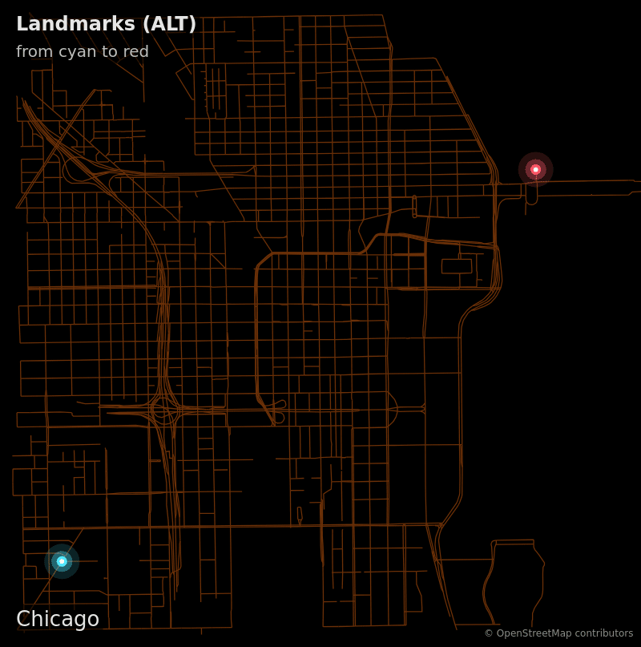


- h = 0: 2,662 streets explored · straight line ÷ top speed: 2,251 · landmarks: 360 · exact: 107; every route 478 s (8.0 min)

Taught in: [heuristics](../../RO/navigation/04-graph-search-and-configuration-space/RO-034-a-star-and-heuristics/RO-034-a-star-and-heuristics.md#53-a-closer-guess-takes-fewer-cells)

## Contraction hierarchy

Landmarks bring the work down to 171 intersections taken off, but the search still creeps along the streets. A contraction hierarchy adds shortcuts, so that a search can skip the small streets.

**Building it, once.** The intersections are removed one at a time, least important first: the one whose removal adds the fewest shortcuts minus the streets it removes, plus the number of its neighbours already removed. Before an intersection goes, every way through it between two of its remaining neighbours is checked. If another way between them that avoids it is no slower (a Dijkstra run that may not use the intersection looks for one), nothing is added. If not, a shortcut joins the two neighbours with the time of the way through it. An intersection's rank is its place in this order.

**A query.** Two searches run in turn, one from the start and one back from the goal. Each follows only streets and shortcuts that lead to a higher rank, so each climbs towards the important roads, and they meet near the top. The route is the best meeting point; its shortcuts are then unpacked into the streets they stand for.

The animation draws each shortcut as a straight green line between its ends, as the intersections are removed. Then the two searches climb, orange from the start and blue from the goal, and the route appears, unpacked into streets.

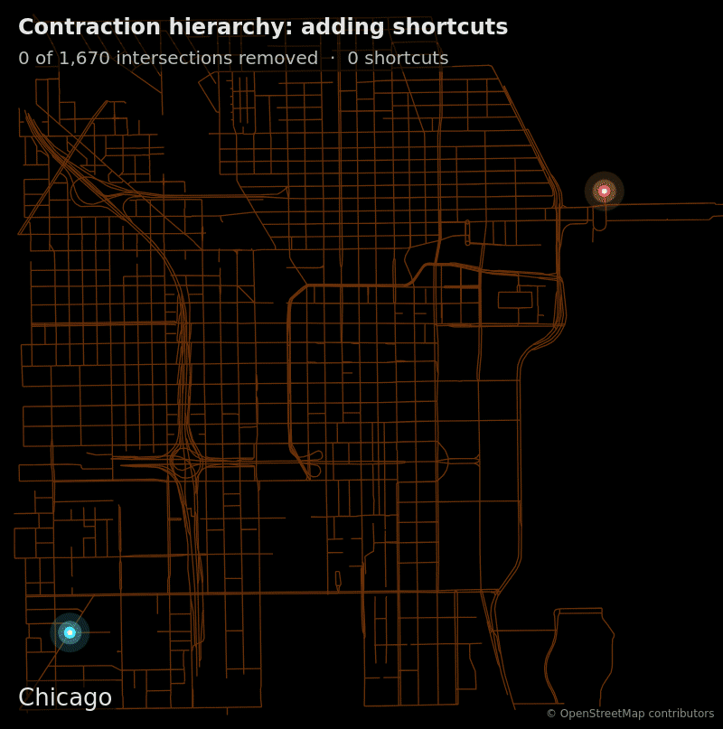

- Shortcuts: 3,602, on top of the 2,694 streets
- The query takes off 52 + 79 = 131 intersections and looks along 658 streets and shortcuts · Route: 478 s (8.0 min), the quickest
- Over 200 random trips: 90.8 intersections taken off on average, against 800.8 for Dijkstra; every trip's time equals networkx's

**The travel-time race.** Four ways to the quickest route, on one clock: each tick, each looks along one more street or shortcut.

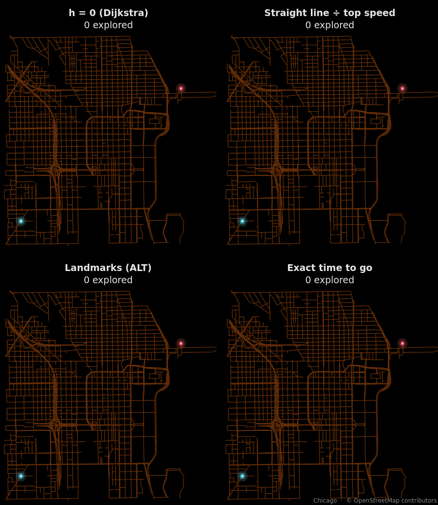

- Intersections taken off: h = 0: 1,638 · straight line ÷ top speed: 1,346 · landmarks: 171 · contraction hierarchy: 131
- Streets (and shortcuts) explored: 2,662 · 2,251 · 360 · 658; every route 478 s (8.0 min)

The hierarchy takes off the fewest intersections, but it looks along 5.0 arcs per intersection taken off (658 ÷ 131), against 2.1 for landmarks (360 ÷ 171): the intersections that rank high carry many shortcuts each.

CH-Potentials (Strasser and Zeitz, 2021) use a contraction hierarchy to give A* a guess close to the exact one, ready quickly for any goal. Live traffic would change the costs as it changes; we have no traffic data, so we do not simulate it.

Taught in: [contraction hierarchies](../../RO/navigation/06-grid-sampling-and-car-like-planning/RO-057-route-planning-on-road-graphs/RO-057-route-planning-on-road-graphs.md#72-contracting-a-vertex-shortcuts), [the query](../../RO/navigation/06-grid-sampling-and-car-like-planning/RO-057-route-planning-on-road-graphs/RO-057-route-planning-on-road-graphs.md#73-the-query-two-searches-that-only-climb)

## The race

Six searches on one clock: each tick, every search explores one more street. Each map shows its explored count and, once done, its route.

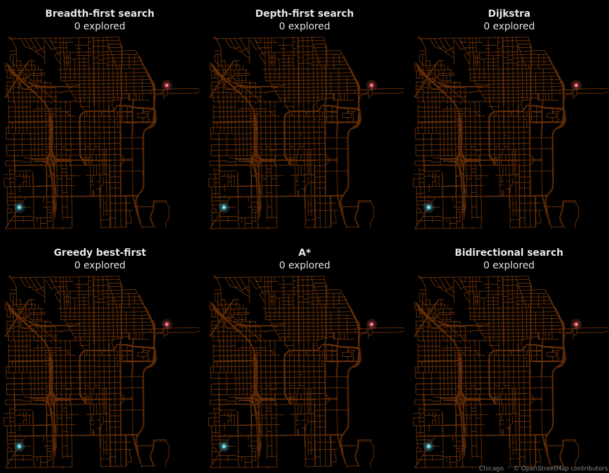

**Explore it yourself:** the interactive map below shows one search at a time (pick it from the menu), with its explored streets coloured by the order it reached them: dark red first, pale yellow last.

<!-- playground: images/chicago/explore.html -->

## A bridge opens: D* Lite

Chicago's river bridges open for boats, and OpenStreetMap tags them movable. The first one on the shortest route is a 554 m stretch of Roosevelt Road over the South Branch of the river. The car drives the shortest route, planning with D\* Lite: it keeps the numbers of a search run backwards from the goal, each intersection's distance to the goal. When the car reaches the bridge, the bridge is open: both its carriageways (red) go off the car's map.

- **D\* Lite** repairs only the numbers that the open bridge made wrong. An intersection whose number differs from its best offer, the smallest street plus neighbour's number, waits in a priority queue, and the repair stops when the car's own number is right.
- **A\* from scratch** searches again from the car's intersection, run at the same moment for comparison.

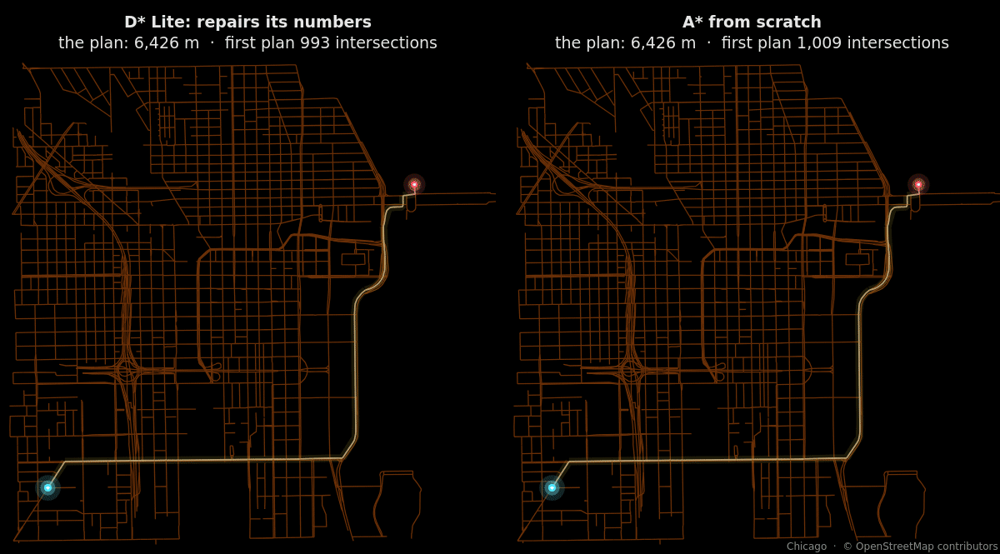

- **First plan:** D\* Lite 993 intersections, A\* 1,009; both plan the 6,426 m route
- **At the bridge, after 14 streets:** D\* Lite repairs with 3 intersections and 5 streets; A\* from scratch takes off 581 intersections and explores 1,046 streets. Both find the same way: north along the river and over the Harrison Street bridge, 4,993 m to go instead of 4,938 m.
- **Drive:** 6,482 m

The open bridge changes few numbers: from the car, the way over the next bridge is only 55 m longer, and D\* Lite has the car's number right after 3 intersections. A\* from scratch cannot know that, and pays for the whole remaining route again. At the bridge, D\* Lite's number equals networkx's distance on the streets without the bridge (checked).

Taught in: [repairing the numbers](../../RO/navigation/06-grid-sampling-and-car-like-planning/RO-049-replanning-d-star-and-bug-algorithms/RO-049-replanning-d-star-and-bug-algorithms.md#3-repairing-the-numbers-d), [when repairing pays](../../RO/navigation/06-grid-sampling-and-car-like-planning/RO-049-replanning-d-star-and-bug-algorithms/RO-049-replanning-d-star-and-bug-algorithms.md#4-when-repairing-pays)

## RRT through the streets

The sampling project's RRT (imported from `../sampling-planning/planners.py`, not copied) grows a tree through the streets as free space. `FreeSpace` in `streets.py` cuts the map into 5 m cells; a cell is free if it lies on a street, and a straight step is free when every cell it crosses is.

What to watch:

- Each tree step is 25 m long, toward a random point anywhere on the map. A step is kept only if it stays on a street, so the tree creeps along the streets and turns only at crossings.
- Then the glow fades and the route glows: 1.96 km, against 1.72 km for the shortest street route.

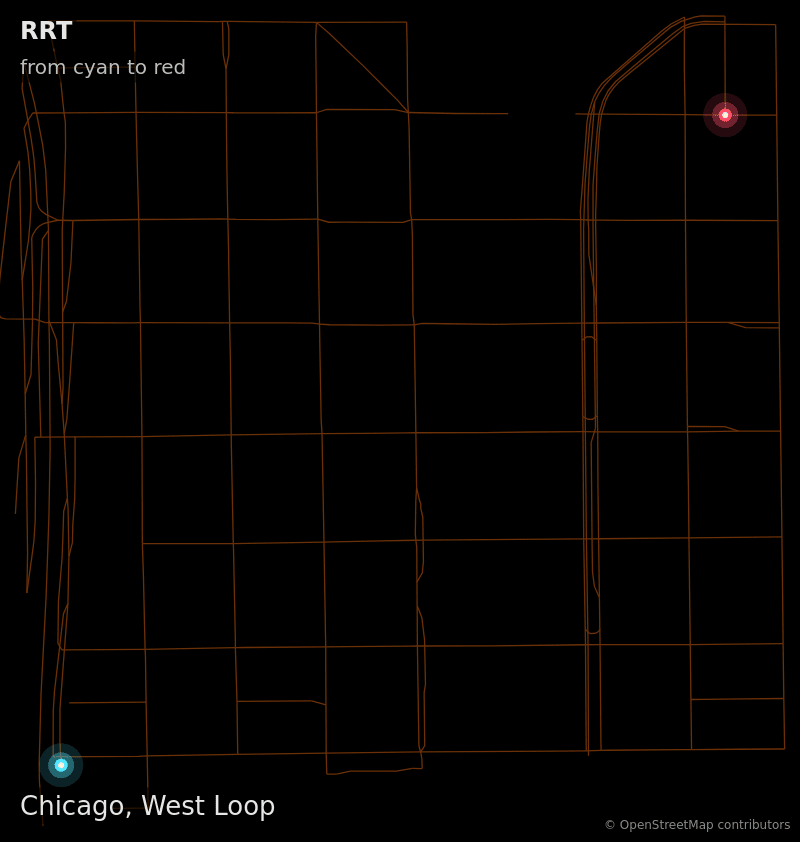

West Loop, seed 2: 30,881 samples, 1,629 nodes, route 1,959 m, 1.14 times the shortest street route (1,723 m). Over seeds 1 to 10, every run reached the goal within 100,000 samples: a median of 28,676 samples, 1,290 nodes and a 1,941 m route.

Why the West Loop and not the whole map: to random points, every street is a narrow passage. Only 9.0 percent of the whole map's 5 m cells are street (14.5 percent in the West Loop), and from the start a 25 m step can point only 23 ways out of 360. On the whole map, start and goal 4.9 km apart, the tree had 17 nodes after 40,000 samples (seed 2).

```bash
python sampling_on_streets.py                 # the West Loop: numbers and images/chicago-west-loop/rrt.gif
python sampling_on_streets.py --map chicago   # the whole map: numbers only
```

Taught in: [one RRT step: sample, nearest node, steer, check](../../RO/navigation/06-grid-sampling-and-car-like-planning/RO-051-rrt/RO-051-rrt.md#21-one-step-sample-nearest-node-steer-check)

## Another map

The same code on a small part of Chicago, the West Loop: 140 intersections and 216 streets, cut from the Chicago file and saved under another name, with the five stations inside it. Only the map argument changes: `python run.py --map chicago-west-loop`.

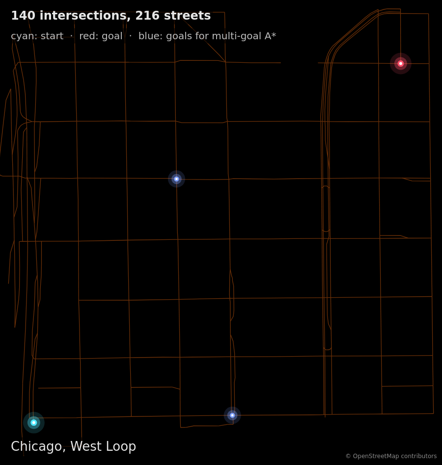

On this small map IDA* finishes the whole trip, but it needs 87,822 visits in 419 rounds where A* needs 56.

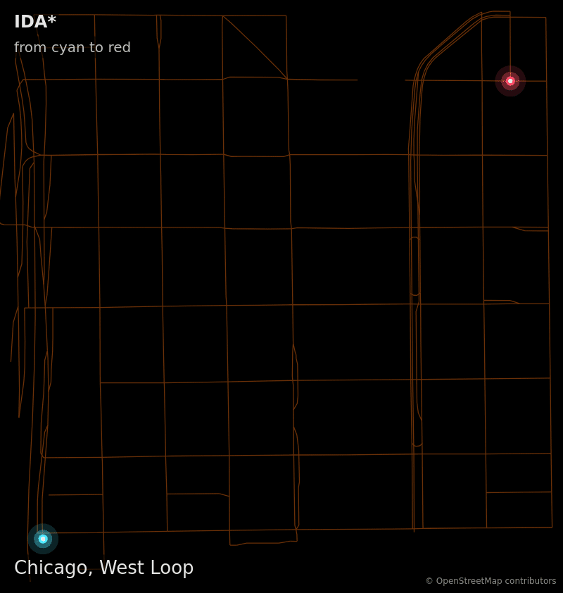

- Visits: 87,822 in 419 rounds · Route: 1,723 m, the shortest

## Run it yourself

In the `campusx` environment, from `projects/real-map-pathfinding/`:

```bash
python check_algorithms.py                      # every search against networkx, on every map in data/
python run.py                                   # Chicago: numbers, preview and all animations
python run.py --map chicago-west-loop           # another map in data/
python run.py --only a_star race                # only some animations (also: time, d_star_lite,
                                                #   contraction_hierarchy)
jupyter nbconvert --to notebook --execute real-map-pathfinding.ipynb
```

The West Loop map was cut from the Chicago file, with no download:

```bash
python get_map.py --cut-from chicago --point 41.8820 -87.6395 --dist 550 --name chicago-west-loop --label "Chicago, West Loop"
```

**A new city** needs the internet once. For example, Rome:

```bash
python get_map.py --place "Rome, Italy" --name rome --label Rome --dist 2500
python run.py --map rome
```

`get_map.py` saves `data/rome.graphml.gz` (the streets), `data/rome-places.json` (the places with the `--goals-tag` tag), `data/rome.json` (label, start, goal and multi-goal goals) and the preview `data/rome.png`. Without `--start` and `--goal` it picks the intersections nearest two opposite corners. `--goals-tag` picks the multi-goal goals from OpenStreetMap tags (hospitals by default), `--goals-dist NEAR FAR` keeps those at that straight-line distance from the start, and `--goals-count N` keeps N of them, spread out. `python get_map.py --keep-streets --keep-places` makes the Chicago choice again from `data/`, with no download. The Chicago map was made with `python get_map.py` and no arguments, which runs the command written at the top of `get_map.py`.

**Files:** `get_map.py` (download), `streets.py` (the street map behind the map interface, with OpenStreetMap's movable bridges marked, the grid made from it, and `FreeSpace`, the streets as free space for sampling planners such as RRT and PRM), `render.py` (the drawings), `run.py`, `check_algorithms.py`. The searches are imported from `../grid-pathfinding/algorithms.py`.

## Sources

Built from:

- The video [A* (A-Star) Pathfinding Algorithm Visualization on a Real Map](https://www.youtube.com/watch?v=CgW0HPHqFE8) by ones and zeros, as the inspiration for the look.
- Map data © [OpenStreetMap](https://www.openstreetmap.org/copyright) contributors, available under the Open Database License (ODbL).
- G. Boeing, [OSMnx](https://github.com/gboeing/osmnx): "Modeling and analyzing urban networks and amenities with OSMnx", *Geographical Analysis*, 2025 (download, speeds and travel times).
- S. M. LaValle, *Planning Algorithms*, Cambridge University Press, 2006, chapter 2.
- A. V. Goldberg, C. Harrelson, "Computing the shortest path: A* search meets graph theory", SODA 2005 (landmarks, ALT).
- B. Strasser, T. Zeitz, ["A fast and tight heuristic for A* in road networks"](https://arxiv.org/abs/1910.12526), SEA 2021 (CH-Potentials).
- R. Geisberger, P. Sanders, D. Schultes, D. Delling, "Contraction hierarchies: faster and simpler hierarchical routing in road networks", WEA 2008.
- S. Koenig, M. Likhachev, "D\* Lite", AAAI 2002.
- The searches and their sources: [Path-finding on a grid](../grid-pathfinding/grid-pathfinding.md#sources).
