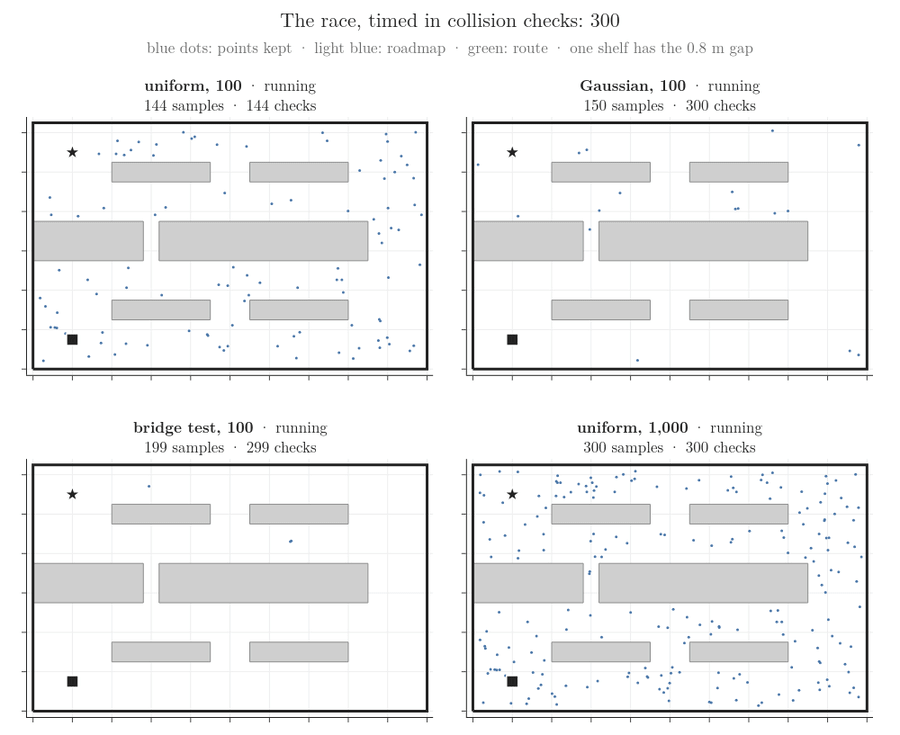
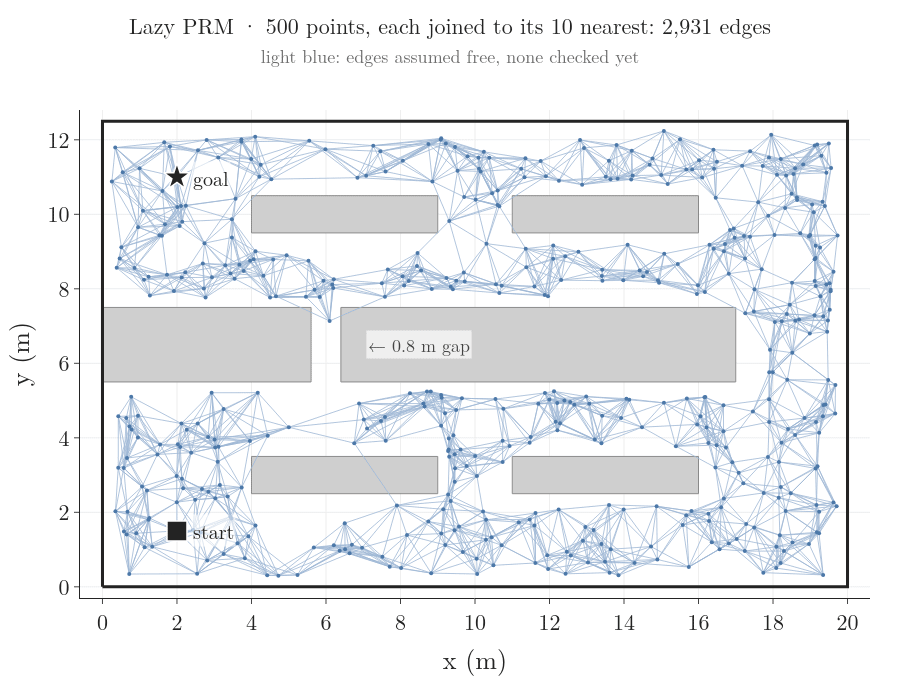
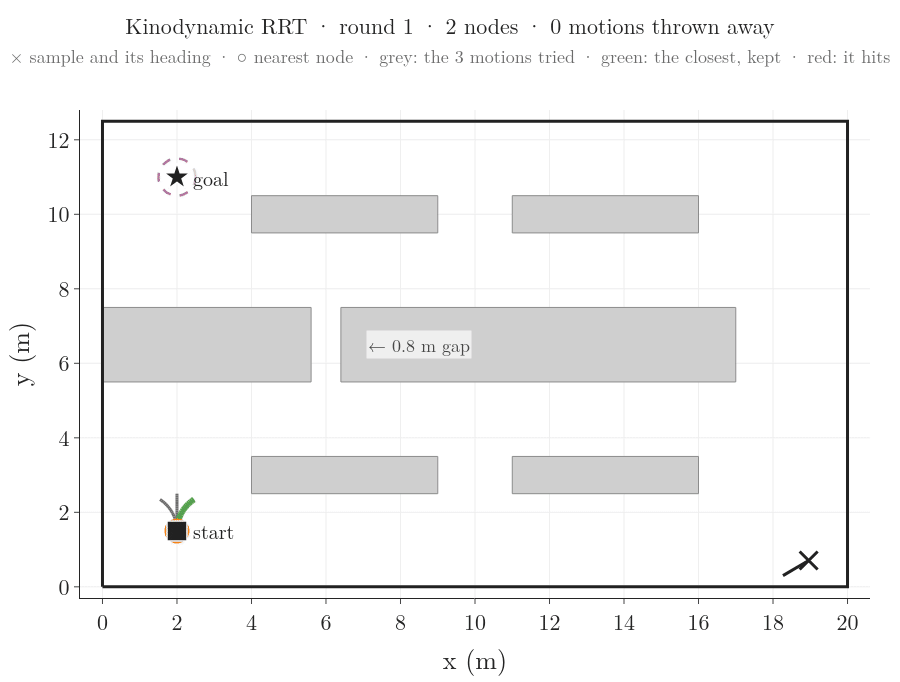
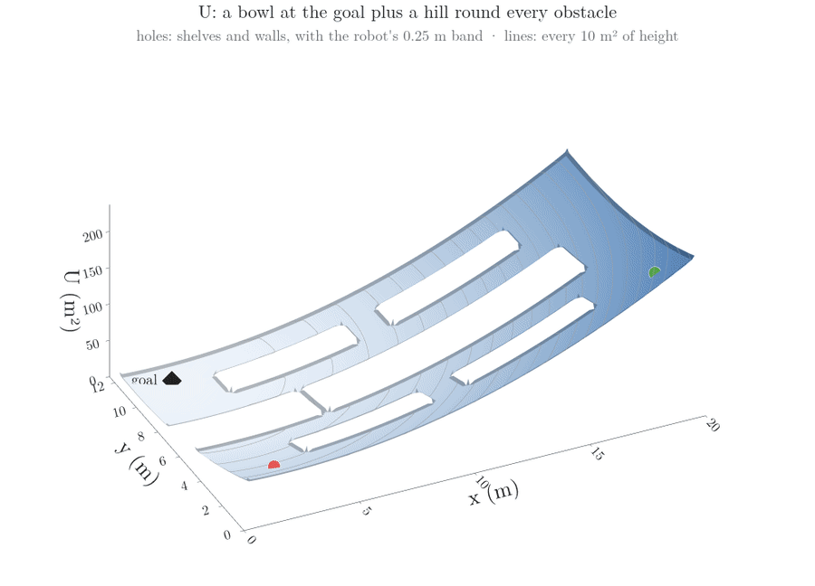
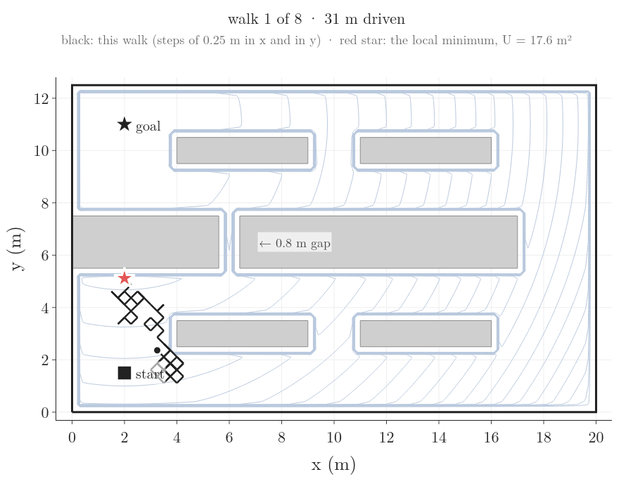
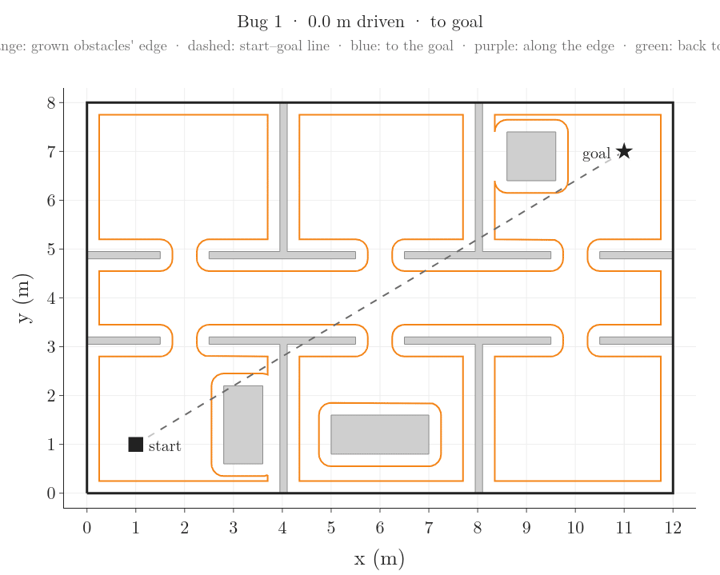
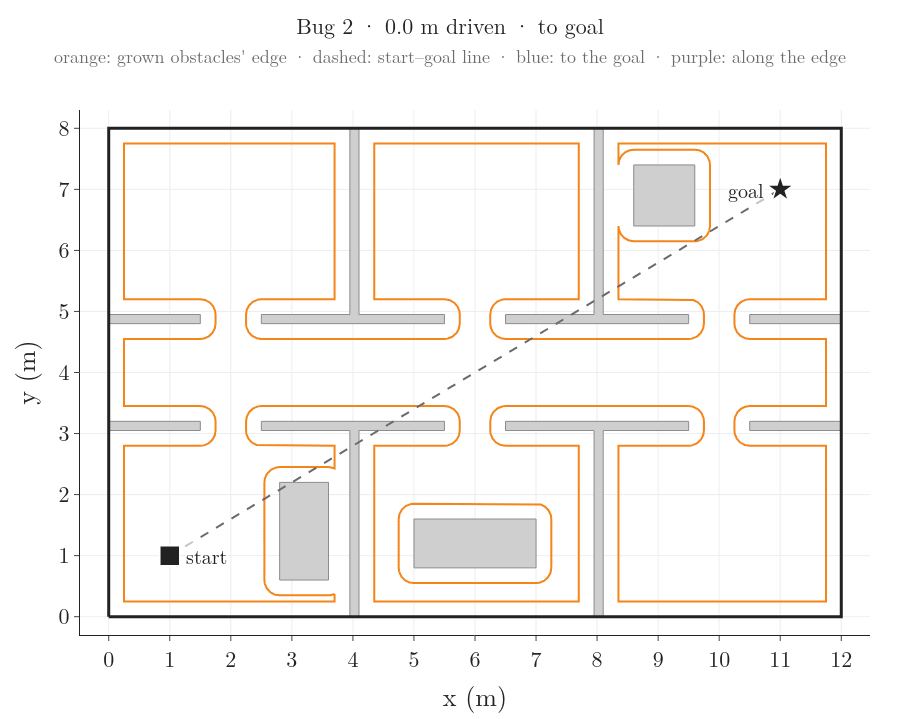

# Sampling-based planning

Planners find a path for a round robot across a floor plan in metres, and every step they take is drawn. Four try random points: RRT, RRT*, RRT-Connect and PRM. Then come smarter ways to place PRM's points, a PRM that checks only the edges it needs, and a tree of arcs that a robot with speed and turn limits can drive. Last come three planners that use no random points: the potential field, the randomized potential field, and the bug algorithms, which need no map.

## The worlds

A world is a floor plan in metres: outer walls, blocked areas (shelves, walls, desks), a start, a goal and the robot's size. Each world is one file in `worlds/`, and its picture is drawn beside it.


- **Small warehouse**, 20 m × 12.5 m, six shelves. The long middle shelf has one 0.8 m gap.
- The robot is a disk of radius 0.25 m, so in the gap it has 0.15 m to spare on each side.
- Start (2, 1.5), goal (2, 11): 9.5 m apart in a straight line.
- Shortest path: 12.8 m, through the gap. With the gap closed it would be 34.2 m, round the right end of the shelf.
- All the animations below run in this world.


- **Warehouse floor**, 40 m × 25 m: the grid project's warehouse, read from its map picture (one pixel per 1 m cell).
- The goal sits in a 1 m wide aisle along the top wall. Shortest path: 43.0 m.


- **Office**, 12 m × 8 m: three rooms below a corridor and three above, with 1.0 m doors. Shortest path: 12.9 m.

How a planner asks "is this free?":

- **A point.** The robot fits at a point when its disk, centred there, touches nothing. Shrinking the free floor by the robot's radius turns this into one question: is the centre inside the shrunk floor?
- **A straight step.** The step is tested at points 5 cm apart (the *edge resolution*): both ends first, then the middle, then the two quarter points, and so on. In the RRT run below, the 169 blocked steps took 1.1 tests each on average; testing point by point from the near end would have taken 8.0.
- **Corners.** Two free test points 5 cm apart can still let the step clip a corner between them, by up to 1.25 mm. So every point is tested with the robot 2.5 mm larger. Without this, one RRT-Connect step in the office (seed 2) passes 0.2 mm too close to a wall corner, and the re-check with points 1 mm apart in `check_planners.py` catches it.
- Each point test is one *collision check*. The check counts below are these tests.

Taught in: [checking a path segment](../../RO/navigation/04-graph-search-and-configuration-space/RO-038-collision-checking-and-nearest-neighbours/RO-038-collision-checking-and-nearest-neighbours.md#6-checking-a-path-segment)

## RRT

What to watch:

- In the first frames: a random point (black ×), the tree node nearest to it (orange ring), and one 1 m step from that node toward the point (orange). A step that would hit a shelf is dropped (red).
- On average one sample in 20 is the goal itself (*goal bias*; 16 of the 331 here). Once a new node is within 1 m of the goal with a free line to it, the goal joins the tree and RRT stops.
- RRT keeps the first path it finds. Here the tree found the gap, but its path zig-zags.


Seed 2: 331 samples, 164 nodes in the tree, 169 steps blocked, 2,828 collision checks, path 24.5 m (shortest possible 12.8 m).

Taught in: [one RRT step: sample, nearest node, steer, check](../../RO/navigation/06-grid-sampling-and-car-like-planning/RO-051-rrt/RO-051-rrt.md#21-one-step-sample-nearest-node-steer-check)

## RRT*

What to watch:

- RRT* draws the same random points as RRT (same seed), so it grows the same nodes and reaches the goal at the same sample, 331. Its first path is shorter, 22.5 m against 24.5 m: each new node joins through the neighbour that gives it the shortest way back to the start, not just the nearest node.
- Then *rewiring*: neighbours within 1 m that are reached more cheaply through the new node switch to it. The close-up shows sample 630, where one new node re-routes 3 neighbours and the path drops from 22.1 m to 14.5 m.
- It keeps sampling after the first path. The lower panel shows the path length never rising.


Seed 2: 1,500 samples, 895 nodes, 819 rewires, 31,625 collision checks (11 times RRT's), path 13.8 m, 1.0 m above the shortest possible. Karaman and Frazzoli (2011) prove that RRT*'s path tends to the shortest as the samples grow, and that RRT's does not.

Taught in: [choose the parent, then rewire](../../RO/navigation/06-grid-sampling-and-car-like-planning/RO-051-rrt/RO-051-rrt.md#31-choose-the-parent-then-rewire)

## RRT-Connect

What to watch:

- Two trees: blue from the start, purple from the goal. Each round one tree takes a step toward a random point; the other then steps straight at that new node, again and again, until it gets there or hits a shelf. Then they swap roles.
- The long orange lines are those straight runs. Kuffner and LaValle (2000) add this greedy step so the two trees meet quickly: here after 210 samples, against RRT's 331.


Seed 2: the trees met after 210 samples (44 nodes from the start, 51 from the goal), 1,950 collision checks, the fewest of the four. The path goes round the right end: 44.2 m, the longest of the four.

Taught in: [two trees that meet](../../RO/navigation/06-grid-sampling-and-car-like-planning/RO-051-rrt/RO-051-rrt.md#4-two-trees-that-meet-rrt-connect)

## PRM

What to watch:

- Step 1: points are scattered over the floor. Points that land on a shelf are thrown away.
- Step 2: each point is joined to its 10 nearest points wherever the straight line between them is free. This network of free lines is the *roadmap*; it serves any start and goal in the same world.
- Step 3: the start and the goal are joined to the roadmap the same way, and A* (the grid project's own) finds the shortest route in it.


Seed 2: 772 points drawn, 500 kept, 272 thrown away; 2,881 roadmap edges; 53,744 collision checks; route 37.2 m, round the right end.

The gap is a *narrow passage*: few random points land in it or line up with it. Here one point landed in the gap, but no roadmap edge passes through it. More points fix this. Over seeds 1 to 10:

| points | through the gap | median route | median checks |
|---:|---:|---:|---:|
| 250 | 4 of 10 | 36.5 m | 38,139 |
| 500 | 4 of 10 | 36.8 m | 53,608 |
| 1,000 | 10 of 10 | 13.9 m | 77,318 |
| 2,000 | 9 of 10 | 13.5 m | 113,010 |

A route under 25.6 m (twice the shortest) must use the gap, since the way round is at least 34.2 m.

Taught in: [phase 1 and phase 2: milestones and edges](../../RO/navigation/06-grid-sampling-and-car-like-planning/RO-052-probabilistic-roadmaps/RO-052-probabilistic-roadmaps.md#22-phase-1-and-phase-2-milestones-and-edges)

## Narrow passages: where the points land

The 0.8 m gap leaves the robot's centre a strip 0.3 m wide (0.8 m minus twice the 0.25 m radius) and 2 m long: 0.6 m² of the 159.5 m² where the centre may go, 0.38 percent. So 100 uniform points put 0.4 points in it on average, and the roadmap rarely crosses it. Such a thin part of free space that a route must cross is a *narrow passage*. Two ways of drawing points aim at them, each drawing a pair:

- **Gaussian sampling.** A uniform point, and a second one near it: its x and its y moved by amounts drawn from a normal distribution with standard deviation 0.25 m. If exactly one of the two is free, keep that one. It lies next to a shelf or a wall.
- **Bridge test.** A uniform point that collides, and a second one near it (standard deviation 1.0 m) that also collides. If the midpoint of the two is free, keep it. The pair is a plank across a thin free strip, such as the gap. Outside the outer walls counts as blocked, so strips along the walls qualify too.

What to watch:

- PRM four times on one clock, the collision checks: 100 points drawn each of the three ways, and 1,000 uniform points.
- Uniform points spread evenly. Gaussian points line up along the shelves and walls. Bridge-test points sit where two blocked areas are close: along the walls, between the rows of shelves, and in the gap.
- Here (seed 4) the bridge test goes through the gap with 100 points, 17.2 m, and so do the 1,000 uniform points, 13.9 m. Uniform and Gaussian with 100 points go round the right end: 39.2 m and 42.4 m.



Seed 4 shows the commonest outcome of seeds 1 to 20: of the three ways with 100 points, only the bridge test goes through the gap (11 of the 20 seeds). Over all 20 seeds (a route under 25.6 m must use the gap):

| sampling | points | through the gap | route found | median draws | median checks |
|---|---:|---:|---:|---:|---:|
| uniform | 100 | 3 of 20 | 19 of 20 | 156 | 21,405 |
| Gaussian, 0.25 m | 100 | 8 of 20 | 19 of 20 | 788 | 22,748 |
| bridge test, 1.0 m | 100 | 20 of 20 | 20 of 20 | 10,124 | 33,516 |
| uniform | 1,000 | 15 of 20 | 20 of 20 | 1,574 | 77,354 |

- The bridge test throws most draws away: 10,124 draws for 100 points. A draw costs one to three point checks, far fewer than an edge, so its checks are only 1.6 times those of 100 uniform points.
- For those checks it went through the gap every time. A thousand uniform points cost 3.6 times as many checks and went through 15 times out of 20.

Taught in: [Gaussian sampling and the bridge test](../../RO/navigation/06-grid-sampling-and-car-like-planning/RO-052-probabilistic-roadmaps/RO-052-probabilistic-roadmaps.md#62-gaussian-sampling-and-the-bridge-test)

## Lazy PRM

Most roadmap edges are never used by any route, yet each costs dozens of checks. Lazy PRM checks an edge only when a route wants it:

1. Place the same 500 points as PRM, and join each to its 10 nearest without checking the edges.
2. A* (the grid project's own) finds the shortest route over the edges left.
3. Check the route's edges in order from the start. If one collides, delete it and go back to step 2.
4. If every edge is free, that is the route.

What to watch:

- Light blue: 2,931 edges, all assumed free.
- Each search: A*'s route (orange), then its edges checked one by one, green if free, red if it cuts a shelf. A red edge is deleted and A* searches again.
- Edges checked once stay checked (thin green), so later searches cost less.



Seed 2: 5 searches, 54 edges checked, 4 of them collided. 1,892 collision checks: 772 to place the points (one per draw) and 1,120 for the 54 edges. PRM checks every edge first: 53,744 checks. Both find the same route, 37.2 m: lazy PRM ends with the shortest route among the free edges, which is PRM's route. Lazy PRM used 3.5 percent of the checks.

Over seeds 1 to 10: the same route as PRM every time; median checks 1,656 against 53,608; median 9.5 searches.

Taught in: [lazy collision checking](../../RO/navigation/06-grid-sampling-and-car-like-planning/RO-052-probabilistic-roadmaps/RO-052-probabilistic-roadmaps.md#8-lazy-collision-checking)

## The race

All four planners side by side. The shared clock is the number of collision checks: each panel shows what that planner had built after that many checks.


Seed 2:

| planner | samples | checks | path | time |
|---|---:|---:|---:|---:|
| RRT | 331 | 2,828 | 24.5 m | 0.018 s |
| RRT* | 1,500 | 31,625 | 13.8 m | 0.322 s |
| RRT-Connect | 210 | 1,950 | 44.2 m | 0.009 s |
| PRM | 772 | 53,744 | 37.2 m | 0.216 s |

One seed can be lucky. Medians over seeds 1 to 10:

| planner | samples | checks | path | through the gap |
|---|---:|---:|---:|---:|
| RRT | 478 | 3,591 | 42.2 m | 3 of 10 |
| RRT* | 1,500 | 30,563 | 36.7 m | 3 of 10 |
| RRT-Connect | 172 | 1,692 | 42.5 m | 4 of 10 |
| PRM | 780 | 53,608 | 36.8 m | 4 of 10 |

- RRT-Connect uses the fewest samples and checks.
- RRT* and PRM pay the most checks. RRT* spends them on shorter paths; PRM spends them on a roadmap that serves every later query.
- Most runs of every planner go round the right end: the 0.8 m gap is hard to find by chance.

## Kinodynamic RRT: a tree of drivable arcs

RRT's path has corners, 23 of them on the run above, the sharpest 97°. A differential-drive robot moving at speed cannot take a corner: it would have to stop and turn on the spot. Here the robot has limits:

- it drives forward at 1 m/s and turns at most 1 rad/s, so its tightest circle has a radius of 1 m;
- it starts at (2, 1.5) facing up the map (+y).

The kinodynamic RRT keeps RRT's loop and changes only how an edge is made:

1. Sample a pose: a point and a heading. One time in ten, take the goal, with a random heading.
2. Find the tree node nearest the sample. The distance counts the metres apart plus 0.25 m for each radian the headings differ.
3. From that node, run three motions through a simulator of the robot: full left (1 rad/s), straight, full right (−1 rad/s), each for 1 s, in Euler steps of 0.01 s. Each is an arc 1 m long that turns by 57°, or a straight metre.
4. Keep the motion that ends closest to the sample. If the robot stays clear along all of it, its end is a new node and the arc is the edge. Otherwise throw it away.
5. Stop when a new node is within 0.5 m of the goal, at any heading. The world's goal has no heading.

What to watch:

- In the first frames, one round each: the sample and its heading (×, black line), the nearest node (orange ring), the three motions tried (grey) and the closest one, green if kept, red if it hits.
- Then the tree of arcs fills the floor. Every path in it can be driven at 1 m/s without stopping.



Seed 2: 2,893 rounds, 1,567 motions thrown away, 448 nodes. The path is 52 arcs, 52.0 m, 40 of them turning; it goes round the right end and drives a full circle near the goal. 39,419 collision checks, 0.63 s.

- The path is drivable but long: RRT's path on the same seed is 24.5 m, with corners the robot cannot drive.
- Over seeds 1 to 20: all 20 reached the goal; median 1,488 rounds, 220 nodes, path 46.0 m. One of the 20 went through the gap.

Taught in: [growing a tree of drivable motions](../../RO/navigation/06-grid-sampling-and-car-like-planning/RO-054-planning-with-motion-limits/RO-054-planning-with-motion-limits.md#8-growing-a-tree-of-drivable-motions-kinodynamic-rrt)

## Potential field

A planner with no random points and no search: the floor is bent into a height *U*, and the robot rolls downhill.

- **The pull of the goal.** A bowl with its bottom at the goal: half the squared distance to the goal, in m². At the start, 9.5 m from the goal, it is 45.1 m².
- **The push of the obstacles.** A hill round every shelf and every outer wall. A hill is zero where the robot's clearance (its distance to the obstacle) is over 0.5 m, and grows without bound as the clearance shrinks to zero, so the robot never rolls into contact.
- **Rolling downhill.** Each step moves the robot 0.01 times minus the gradient of U, the way U falls fastest, and at most 5 cm.
- The settings are those of RO-050's room: bowl steepness 1, push strength 0.02 m⁴, influence distance 0.5 m.

What to watch:

- First the surface, seen from the side: lowest at the goal, highest in the far corner (220 m²). The shelves and walls, with the robot's 0.25 m band, are holes.
- The camera tilts up until the surface is seen from straight above: its contour map, a line every 10 m².
- Then two robots roll. Green, from the far corner (18.5, 1.5), at 181.2 m², slides along the long shelf, through the 0.8 m gap, to the goal: 22.8 m, never closer than 0.092 m to anything.
- Red, from the start (2, 1.5), at 45.1 m², rolls straight up and stops under the long shelf at (2.00, 5.11), at 17.6 m², after 3.6 m.



Why red stops: at (2.00, 5.11) the goal pulls it straight up and the shelf above pushes it straight down, equally hard.

- The bowl's pull equals the distance to the goal: 5.885, straight up.
- The shelf is 0.135 m away. Its push is 0.02 × (1/0.135 − 2) ÷ 0.135² = 5.885, straight down.
- They cancel, so the gradient is zero and every step goes uphill. The robot sits in a *local minimum* of U: lower than everything round it, but not the lowest point, the goal.

Of 500 starts 0.5 m apart, 107 (21 percent) stop in this local minimum; the other 393 reach the goal.

Taught in: [the attractive potential](../../RO/navigation/06-grid-sampling-and-car-like-planning/RO-050-potential-fields/RO-050-potential-fields.md#2-the-pull-of-the-door-the-attractive-potential), [the repulsive potential](../../RO/navigation/06-grid-sampling-and-car-like-planning/RO-050-potential-fields/RO-050-potential-fields.md#3-the-push-of-the-obstacles-the-repulsive-potential), [local minima](../../RO/navigation/06-grid-sampling-and-car-like-planning/RO-050-potential-fields/RO-050-potential-fields.md#4-why-the-robot-stops-local-minima)

## Randomized potential field

The red robot is stuck at (2.00, 5.11). The randomized potential field gets it out by luck:

1. **Random walk.** Each step moves x by 0.25 m one way or the other, and y the same, each by a coin toss. A step onto a shelf is thrown away and tried again. The walk ends after a step limit drawn from 100 to 400, or as soon as U is below the local minimum's 17.6 m².
2. **Roll downhill** again from where the walk ended.
3. **Restart.** After 20 walks that all roll back to the same height, start again from a random point of an earlier walk.

The steps are five times the 0.05 m of RO-050's room, because the way out is far: at the local minimum's height, the nearest start that rolls to the goal is 3.9 m to the right, under the gap. A walk must end beyond it. With steps of 0.1 m, only 13 of 20 runs got out within 200 walks.

What to watch:

- Each walk in black, then the roll back into the dip in orange.
- The last walk ends at (7.00, 4.61), under the right part of the long shelf. From there the robot rolls along the shelf, through the gap, to the goal (green).



Seed 2: 8 walks, 903 m driven. The shortest path from the local minimum to the goal is 11.2 m.

Over seeds 1 to 20: every run reached the goal. A median of 8.5 walks (at most 37), 5 restarts in all, and a median of 910 m driven (one run in ten under 244 m, one in ten over 2,654 m). The walks free the robot, at the price of a long, jittery path.

Taught in: [escaping by chance](../../RO/navigation/06-grid-sampling-and-car-like-planning/RO-050-potential-fields/RO-050-potential-fields.md#5-escaping-by-chance-randomized-potential-fields)

## Bug 1 and Bug 2

A robot with no map at all, in the office: it knows where the goal is and feels what it touches. We follow its centre, so every wall and desk is grown by the robot's 0.25 m radius (orange edge). The centre may slide along that edge but never cross it. Both bugs head straight for the goal; on a hit, they turn left, so the obstacle stays on their right.

- **Bug 1.** Follow the edge all the way round, back to the hit point H, remembering C, the edge point nearest the goal. Return to C the shorter way and leave from there.
- **Bug 2.** Follow the edge until back on the start–goal line (dashed), at a point L nearer the goal than H. Leave there.

All the office's walls join the outer walls, so they form one obstacle with an edge 101.5 m long. Only the desk in the bottom-middle room stands alone, 7.2 m round.

What to watch:

- Both hit the desk in the first room at H, (2.55, 1.93), after 1.8 m.
- Bug 1 goes once round the whole 101.5 m edge, through every room, then 43.1 m back to C, (11.75, 7.00), 0.75 m from the goal: 147.2 m in all.



- Bug 2 leaves the edge three times. Its third hit, H3 (6.92, 4.55), is on the corridor's upper wall, and turning left sends it round most of the office: 94.0 m along the edge, until it crosses the start–goal line in the goal's room at L3 (9.83, 6.30). 105.8 m in all.



The shortest path is 12.9 m. LaValle (2006) bounds how far each can drive, with d the straight-line distance from start to goal (11.7 m) and the edges' lengths (101.5 m and 7.2 m):

- Bug 1 follows each edge at most one and a half times: at most 11.7 + 1.5 × 108.7 = 174.7 m. It drove 147.2 m.
- Bug 2 follows an edge at most half its length for each time the edge crosses the start–goal line. The long edge crosses it 8 times: at most 11.7 + ½ × 8 × 101.5 = 417.8 m. It drove 105.8 m.

Taught in: [no map at all: bug algorithms](../../RO/navigation/06-grid-sampling-and-car-like-planning/RO-049-replanning-d-star-and-bug-algorithms/RO-049-replanning-d-star-and-bug-algorithms.md#6-no-map-at-all-bug-algorithms)

## The same code on other worlds

Nothing in the planners or the drawing code changes; only the world file does.


Office, seed 2:

| planner | samples | checks | path | time |
|---|---:|---:|---:|---:|
| RRT | 175 | 921 | 16.3 m | 0.004 s |
| RRT* | 1,500 | 17,093 | 13.5 m | 0.249 s |
| RRT-Connect | 1,081 | 2,137 | 17.0 m | 0.021 s |
| PRM | 825 | 35,055 | 13.8 m | 0.166 s |


Warehouse floor, seed 2:

| planner | samples | checks | path | time |
|---|---:|---:|---:|---:|
| RRT | 6,018 | 26,927 | 64.3 m | 1.180 s |
| RRT* | 12,036 | 232,382 | 52.6 m | 8.821 s |
| RRT-Connect | 550 | 4,168 | 46.7 m | 0.025 s |
| PRM | 3,013 | 165,324 | 44.9 m | 1.008 s |

The goal's 1 m aisle is a narrow passage for a tree grown from the start: RRT needed 6,018 samples. RRT-Connect also grows a tree from the goal, which starts inside the aisle, and needed 550.

## Run it yourself

From this folder, with the campusx environment:

```bash
python run.py --world small-warehouse        # numbers, checks, animations into images/small-warehouse/
python run.py --world office --no-gifs       # another world, numbers and checks only
python run.py --world ../grid-pathfinding/maps/warehouse.png   # any grid map from the grid project
python run.py --world worlds/my_world.json   # your own world
python run.py --sweep                        # add the 10-seed tables
python run_extra.py                          # the sections after PRM: numbers and animations
python run_extra.py fields bugs --no-gifs     # some of them: fields, walks, bugs, narrow, lazy, kinodynamic
python run_extra.py walks --world office     # one of them on another world
python check_planners.py                     # every check, on every world in worlds/
```

- **Swap the world.** Copy `worlds/office.json`, change its `bounds`, `obstacles` (rectangles `[x0, y0, x1, y1]` or polygons `[[x, y], ...]`), `start`, `goal` and `robot_radius`, and pass it with `--world`. Its picture is drawn on the first run.
- **Grid maps.** A PNG from `../grid-pathfinding/maps/` is read with the grid project's own loader (black blocked, white free, green start, red goal, cell size from the JSON beside it) and saved as a world file.
- **Street maps.** The real-map project runs this project's RRT on Chicago's streets, through its own free-space hook: [RRT through the streets](../real-map-pathfinding/real-map-pathfinding.md#rrt-through-the-streets). `street_world` in `world.py` is the place for a road network as a world here: the free floor is the roads widened to their width.
- **Files.** `world.py` loads worlds, `collision.py` answers "is this free?", `planners.py` holds the sampling planners (the four, the three ways of sampling, lazy PRM, the kinodynamic RRT), `potential.py` the potential fields, `bugs.py` Bug 1 and Bug 2, `render.py` and `render_extra.py` draw, `run.py` and `run_extra.py` run and print, `check_planners.py` checks.
- **The notebook** `sampling-planning.ipynb` runs everything on this page. The numbers above come from its last run (times vary from run to run):

```bash
PYTHONNOUSERSITE=1 /home/anshu/miniforge3/envs/campusx/bin/python -m nbconvert --to notebook --execute sampling-planning.ipynb --output-dir /home/anshu/campusx/.logs
```

## Sources

Built from:

- S. M. LaValle, *Planning Algorithms*, Cambridge University Press, 2006, chapter 5, "Sampling-Based Motion Planning" (collision checking of segments in section 5.3.4, the randomized potential field in section 5.4.3), section 12.3.3 (bug algorithms) and section 14.4.3 (kinodynamic RRT). Free online: <http://lavalle.pl/planning/>
- S. M. LaValle, "Rapidly-exploring random trees: a new tool for path planning", TR 98-11, Iowa State University, 1998 (RRT).
- S. Karaman and E. Frazzoli, "Sampling-based algorithms for optimal motion planning", *International Journal of Robotics Research* 30(7), 846–894, 2011 (RRT*).
- J. J. Kuffner and S. M. LaValle, "RRT-Connect: an efficient approach to single-query path planning", *IEEE International Conference on Robotics and Automation*, 2000 (RRT-Connect).
- L. E. Kavraki, P. Švestka, J.-C. Latombe and M. H. Overmars, "Probabilistic roadmaps for path planning in high-dimensional configuration spaces", *IEEE Transactions on Robotics and Automation* 12(4), 566–580, 1996 (PRM).
- V. Boor, M. H. Overmars and A. F. van der Stappen, "The Gaussian sampling strategy for probabilistic roadmap planners", *IEEE International Conference on Robotics and Automation*, 1999 (Gaussian sampling).
- D. Hsu, T. Jiang, J. Reif and Z. Sun, "The bridge test for sampling narrow passages with probabilistic roadmap planners", *IEEE International Conference on Robotics and Automation*, 2003 (bridge test).
- R. Bohlin and L. E. Kavraki, "Path planning using lazy PRM", *IEEE International Conference on Robotics and Automation*, 2000 (lazy PRM).
- S. M. LaValle and J. J. Kuffner, "Randomized kinodynamic planning", *International Journal of Robotics Research* 20(5), 378–400, 2001 (kinodynamic RRT).
- O. Khatib, "Real-time obstacle avoidance for manipulators and mobile robots", *International Journal of Robotics Research* 5(1), 90–98, 1986 (potential fields).
- J. Barraquand and J.-C. Latombe, "Robot motion planning: a distributed representation approach", *International Journal of Robotics Research* 10(6), 628–649, 1991 (randomized potential field).
- V. J. Lumelsky and A. A. Stepanov, "Path-planning strategies for a point mobile automaton moving amidst unknown obstacles of arbitrary shape", *Algorithmica* 2, 403–430, 1987 (Bug 1 and Bug 2).
