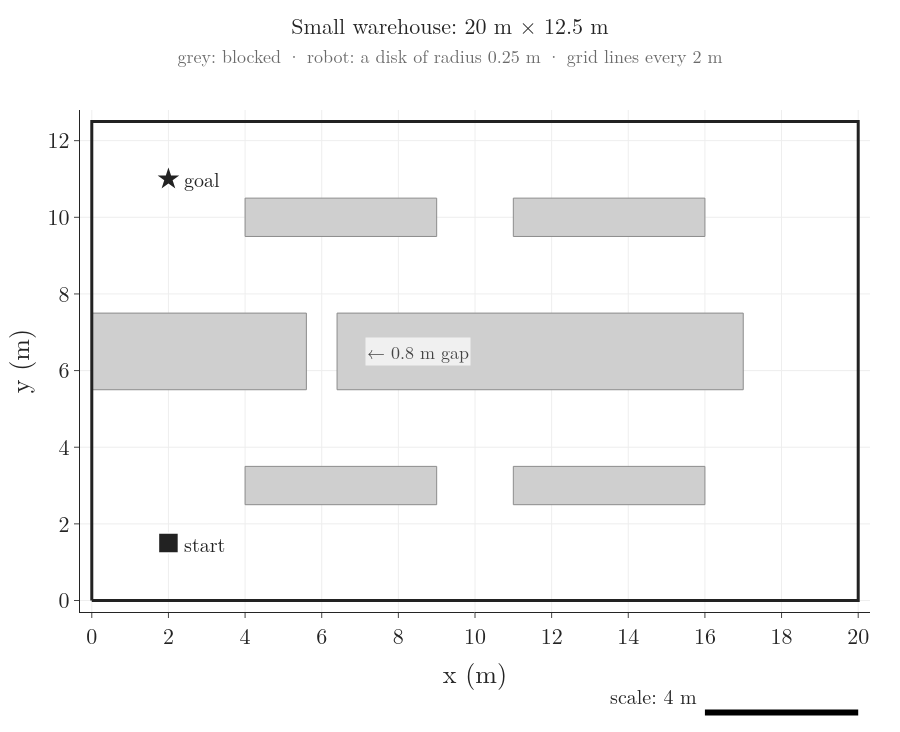
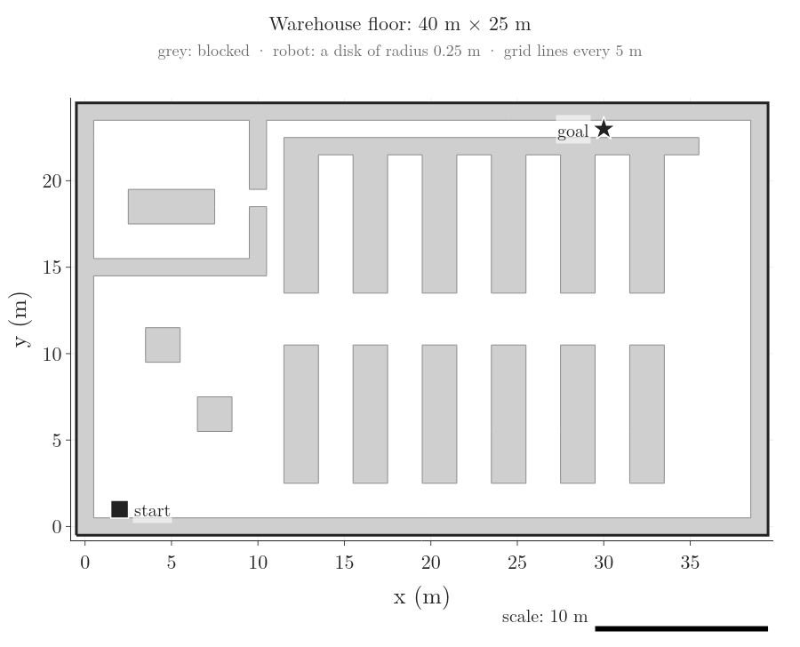
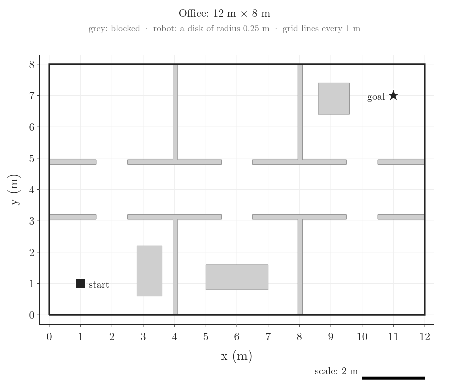
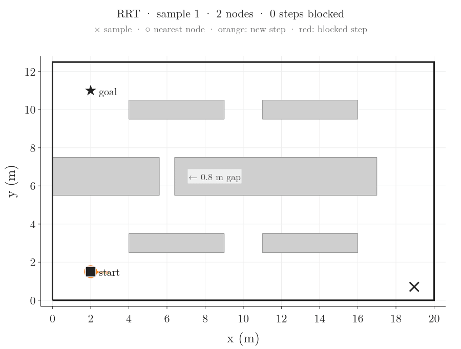
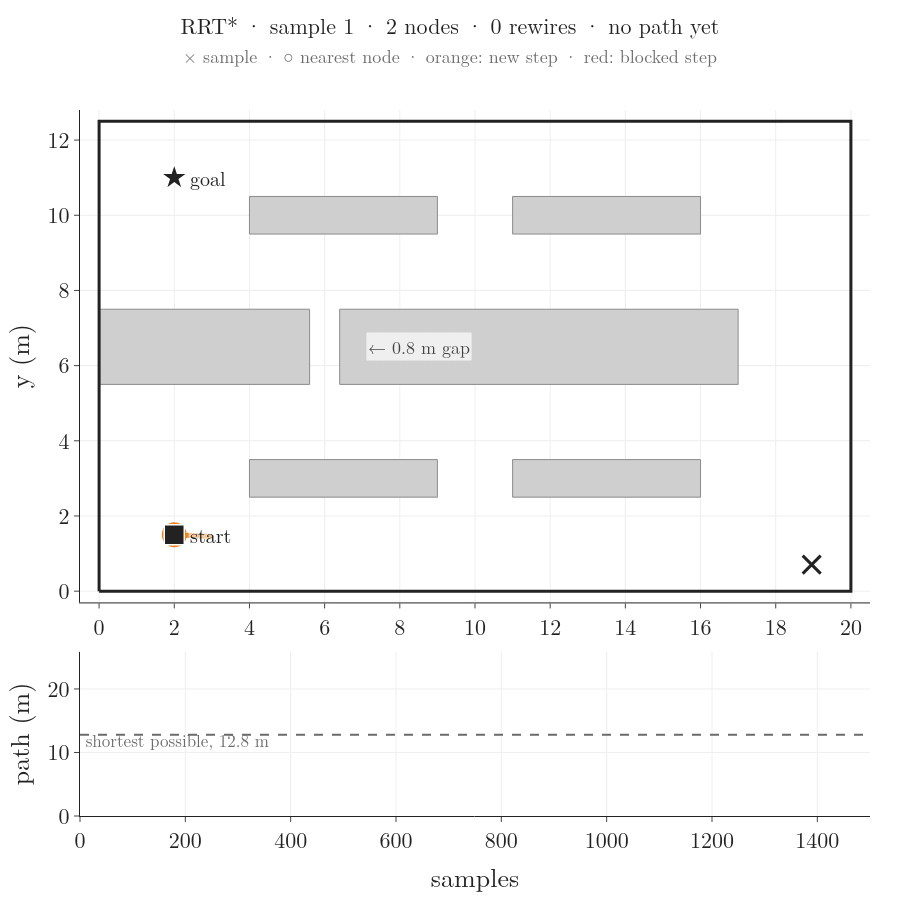
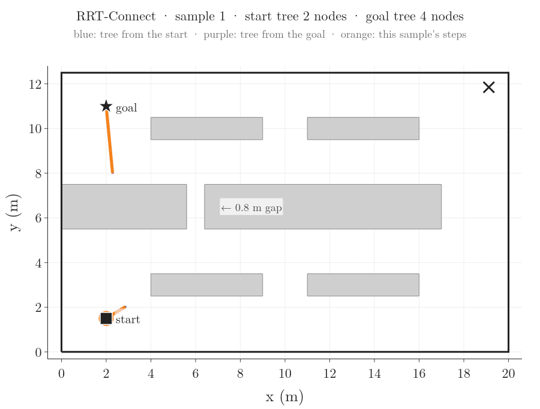
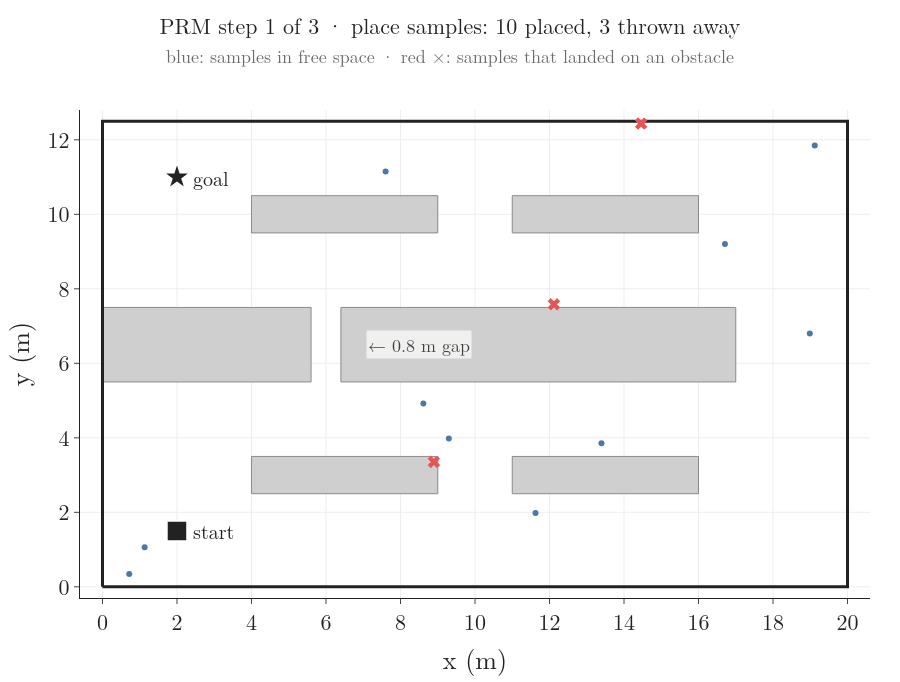
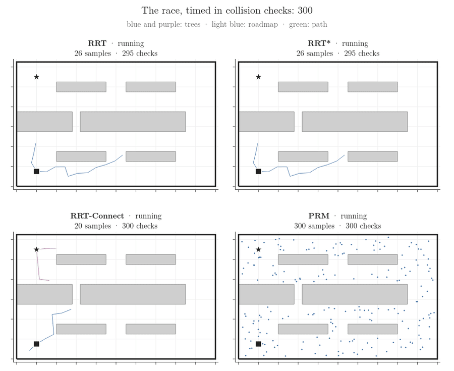
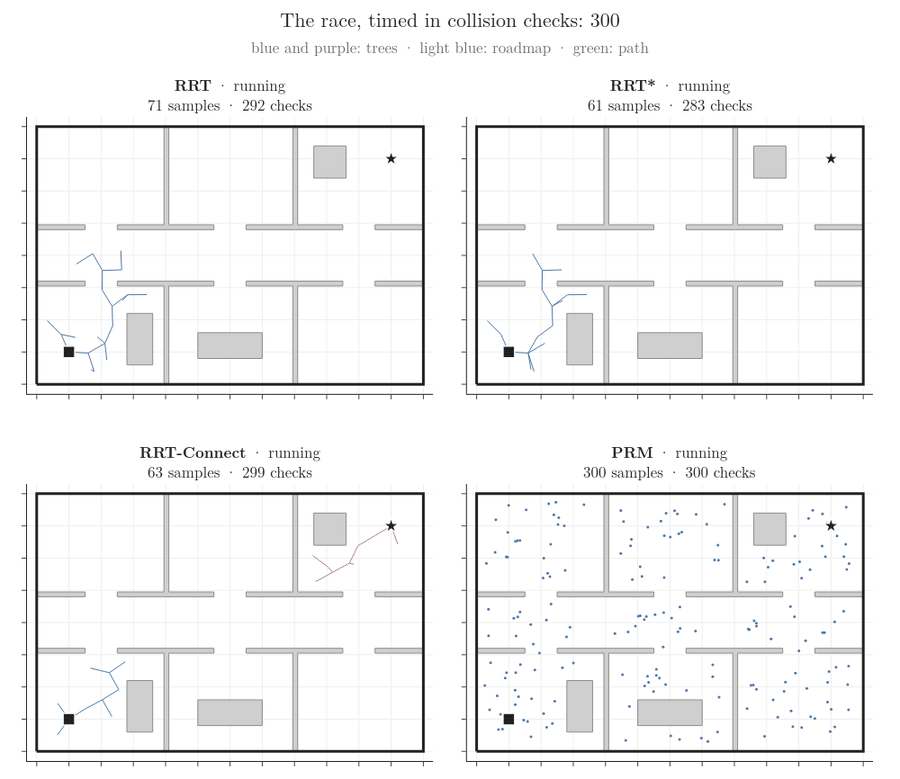
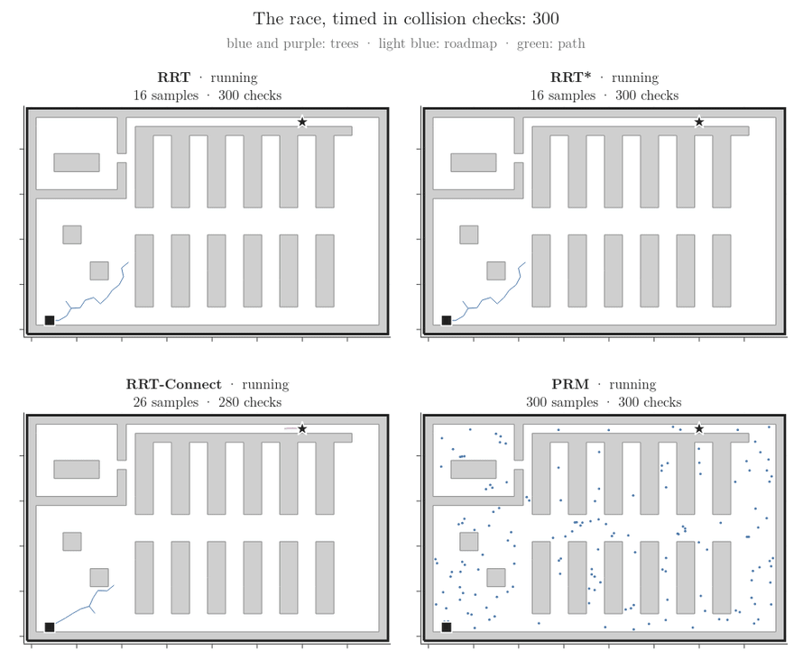

# Sampling-based planning

Four planners (RRT, RRT*, RRT-Connect and PRM) find a path for a round robot across a floor plan by trying random points, and every step they take is drawn.

## The worlds

A world is a floor plan in metres: outer walls, blocked areas (shelves, walls, desks), a start, a goal and the robot's size. Each world is one file in `worlds/`, and its picture is drawn beside it.



- **Small warehouse**, 20 m × 12.5 m, six shelves. The long middle shelf has one 0.8 m gap.
- The robot is a disk of radius 0.25 m, so in the gap it has 0.15 m to spare on each side.
- Start (2, 1.5), goal (2, 11): 9.5 m apart in a straight line.
- Shortest path: 12.8 m, through the gap. With the gap closed it would be 34.2 m, round the right end of the shelf.
- All the animations below run in this world.



- **Warehouse floor**, 40 m × 25 m: the grid project's warehouse, read from its map picture (one pixel per 1 m cell).
- The goal sits in a 1 m wide aisle along the top wall. Shortest path: 43.0 m.



- **Office**, 12 m × 8 m: three rooms below a corridor and three above, with 1.0 m doors. Shortest path: 12.9 m.

How a planner asks "is this free?":

- **A point.** The robot fits at a point when its disk, centred there, touches nothing. Shrinking the free floor by the robot's radius turns this into one question: is the centre inside the shrunk floor?
- **A straight step.** The step is tested at points 5 cm apart (the *edge resolution*): both ends first, then the middle, then the two quarter points, and so on. In the RRT run below, the 169 blocked steps took 1.1 tests each on average; testing point by point from the near end would have taken 8.0.
- **Corners.** Two free test points 5 cm apart can still let the step clip a corner between them, by up to 1.25 mm. So every point is tested with the robot 2.5 mm larger. Without this, one RRT-Connect step in the office (seed 2) passes 0.2 mm too close to a wall corner, and the re-check with points 1 mm apart in `check_planners.py` catches it.
- Each point test is one *collision check*. The check counts below are these tests.

Taught in: [checking a path segment](../../RO/navigation/04-graph-search-and-configuration-space/RO-038-collision-checking-and-nearest-neighbours/RO-038-collision-checking-and-nearest-neighbours.md#6-checking-a-path-segment)

## RRT

What to watch:

- In the first frames: a random point (black ×), the tree node nearest to it (orange ring), and one 1 m step from that node toward the point (orange). A step that would hit a shelf is dropped (red).
- On average one sample in 20 is the goal itself (*goal bias*; 16 of the 331 here). Once a new node is within 1 m of the goal with a free line to it, the goal joins the tree and RRT stops.
- RRT keeps the first path it finds. Here the tree found the gap, but its path zig-zags.



Seed 2: 331 samples, 164 nodes in the tree, 169 steps blocked, 2,828 collision checks, path 24.5 m (shortest possible 12.8 m).

Taught in: RO-051 (being written)

## RRT*

What to watch:

- RRT* draws the same random points as RRT (same seed), so it grows the same nodes and reaches the goal at the same sample, 331. Its first path is shorter, 22.5 m against 24.5 m: each new node joins through the neighbour that gives it the shortest way back to the start, not just the nearest node.
- Then *rewiring*: neighbours within 1 m that are reached more cheaply through the new node switch to it. The close-up shows sample 630, where one new node re-routes 3 neighbours and the path drops from 22.1 m to 14.5 m.
- It keeps sampling after the first path. The lower panel shows the path length never rising.



Seed 2: 1,500 samples, 895 nodes, 819 rewires, 31,625 collision checks (11 times RRT's), path 13.8 m, 1.0 m above the shortest possible. Karaman and Frazzoli (2011) prove that RRT*'s path tends to the shortest as the samples grow, and that RRT's does not.

Taught in: RO-051 (being written)

## RRT-Connect

What to watch:

- Two trees: blue from the start, purple from the goal. Each round one tree takes a step toward a random point; the other then steps straight at that new node, again and again, until it gets there or hits a shelf. Then they swap roles.
- The long orange lines are those straight runs. Kuffner and LaValle (2000) add this greedy step so the two trees meet quickly: here after 210 samples, against RRT's 331.



Seed 2: the trees met after 210 samples (44 nodes from the start, 51 from the goal), 1,950 collision checks, the fewest of the four. The path goes round the right end: 44.2 m, the longest of the four.

Taught in: RO-051 (being written)

## PRM

What to watch:

- Step 1: points are scattered over the floor. Points that land on a shelf are thrown away.
- Step 2: each point is joined to its 10 nearest points wherever the straight line between them is free. This network of free lines is the *roadmap*; it serves any start and goal in the same world.
- Step 3: the start and the goal are joined to the roadmap the same way, and A* (the grid project's own) finds the shortest route in it.



Seed 2: 772 points drawn, 500 kept, 272 thrown away; 2,881 roadmap edges; 53,744 collision checks; route 37.2 m, round the right end.

The gap is a *narrow passage*: few random points land in it or line up with it. Here one point landed in the gap, but no roadmap edge passes through it. More points fix this. Over seeds 1 to 10:

| points | through the gap | median route | median checks |
|---:|---:|---:|---:|
| 250 | 4 of 10 | 36.5 m | 38,139 |
| 500 | 4 of 10 | 36.8 m | 53,608 |
| 1,000 | 10 of 10 | 13.9 m | 77,318 |
| 2,000 | 9 of 10 | 13.5 m | 113,010 |

A route under 25.6 m (twice the shortest) must use the gap, since the way round is at least 34.2 m.

Taught in: RO-052 (being written)

## The race

All four planners side by side. The shared clock is the number of collision checks: each panel shows what that planner had built after that many checks.



Seed 2:

| planner | samples | checks | path | time |
|---|---:|---:|---:|---:|
| RRT | 331 | 2,828 | 24.5 m | 0.026 s |
| RRT* | 1,500 | 31,625 | 13.8 m | 0.584 s |
| RRT-Connect | 210 | 1,950 | 44.2 m | 0.018 s |
| PRM | 772 | 53,744 | 37.2 m | 0.335 s |

One seed can be lucky. Medians over seeds 1 to 10:

| planner | samples | checks | path | through the gap |
|---|---:|---:|---:|---:|
| RRT | 478 | 3,591 | 42.2 m | 3 of 10 |
| RRT* | 1,500 | 30,563 | 36.7 m | 3 of 10 |
| RRT-Connect | 172 | 1,692 | 42.5 m | 4 of 10 |
| PRM | 780 | 53,608 | 36.8 m | 4 of 10 |

- RRT-Connect uses the fewest samples and checks.
- RRT* and PRM pay the most checks. RRT* spends them on shorter paths; PRM spends them on a roadmap that serves every later query.
- Most runs of every planner go round the right end: the 0.8 m gap is hard to find by chance.

## The same code on other worlds

Nothing in the planners or the drawing code changes; only the world file does.



Office, seed 2:

| planner | samples | checks | path | time |
|---|---:|---:|---:|---:|
| RRT | 175 | 921 | 16.3 m | 0.005 s |
| RRT* | 1,500 | 17,093 | 13.5 m | 0.271 s |
| RRT-Connect | 1,081 | 2,137 | 17.0 m | 0.019 s |
| PRM | 825 | 35,055 | 13.8 m | 0.180 s |



Warehouse floor, seed 2:

| planner | samples | checks | path | time |
|---|---:|---:|---:|---:|
| RRT | 6,018 | 26,927 | 64.3 m | 1.398 s |
| RRT* | 12,036 | 232,382 | 52.6 m | 11.041 s |
| RRT-Connect | 550 | 4,168 | 46.7 m | 0.030 s |
| PRM | 3,013 | 165,324 | 44.9 m | 1.128 s |

The goal's 1 m aisle is a narrow passage for a tree grown from the start: RRT needed 6,018 samples. RRT-Connect also grows a tree from the goal, which starts inside the aisle, and needed 550.

## Run it yourself

From this folder, with the campusx environment:

```bash
python run.py --world small-warehouse        # numbers, checks, animations into images/small-warehouse/
python run.py --world office --no-gifs       # another world, numbers and checks only
python run.py --world ../grid-pathfinding/maps/warehouse.png   # any grid map from the grid project
python run.py --world worlds/my_world.json   # your own world
python run.py --sweep                        # add the 10-seed tables
python check_planners.py                     # every check, on every world in worlds/
```

- **Swap the world.** Copy `worlds/office.json`, change its `bounds`, `obstacles` (rectangles `[x0, y0, x1, y1]` or polygons `[[x, y], ...]`), `start`, `goal` and `robot_radius`, and pass it with `--world`. Its picture is drawn on the first run.
- **Grid maps.** A PNG from `../grid-pathfinding/maps/` is read with the grid project's own loader (black blocked, white free, green start, red goal, cell size from the JSON beside it) and saved as a world file.
- **Street maps.** `street_world` in `world.py` is the place for a road network: the free floor is the roads widened to their width.
- **Files.** `world.py` loads worlds, `collision.py` answers "is this free?", `planners.py` holds the four planners, `render.py` draws, `run.py` runs and prints, `check_planners.py` checks.
- **The notebook** `sampling-planning.ipynb` runs everything on this page. The numbers above come from its last run (times vary from run to run):

```bash
PYTHONNOUSERSITE=1 /home/anshu/miniforge3/envs/campusx/bin/python -m nbconvert --to notebook --execute sampling-planning.ipynb --output-dir /home/anshu/campusx/.logs
```

## Sources

Built from:

- S. M. LaValle, *Planning Algorithms*, Cambridge University Press, 2006, chapter 5, "Sampling-Based Motion Planning" (collision checking of segments in section 5.3.4). Free online: <http://lavalle.pl/planning/>
- S. M. LaValle, "Rapidly-exploring random trees: a new tool for path planning", TR 98-11, Iowa State University, 1998 (RRT).
- S. Karaman and E. Frazzoli, "Sampling-based algorithms for optimal motion planning", *International Journal of Robotics Research* 30(7), 846–894, 2011 (RRT*).
- J. J. Kuffner and S. M. LaValle, "RRT-Connect: an efficient approach to single-query path planning", *IEEE International Conference on Robotics and Automation*, 2000 (RRT-Connect).
- L. E. Kavraki, P. Švestka, J.-C. Latombe and M. H. Overmars, "Probabilistic roadmaps for path planning in high-dimensional configuration spaces", *IEEE Transactions on Robotics and Automation* 12(4), 566–580, 1996 (PRM).
